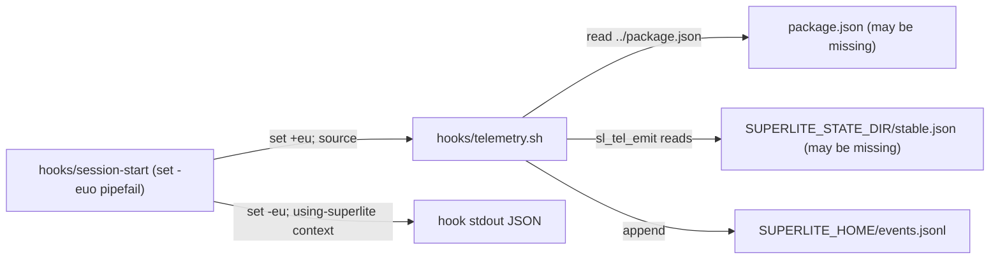
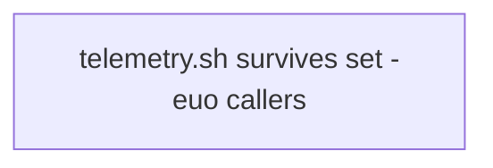

# B289: hooks/telemetry.sh survives a `set -euo pipefail` caller, session-start stays fail-open (#1036)

**Goal:** hooks/session-start (the one `set -euo pipefail` caller of hooks/telemetry.sh) never exits non-zero or loses its using-superlite context because of telemetry: not without package.json at the plugin root (#1036), not with a state dir that holds no stable.json, not under stock macOS bash 3.2.
**Architecture:** telemetry.sh guards every read that can leave a variable unset (`${_sl_tel_pkg-}`, `j=`) and ends every command that may fail outside a condition with `|| :`, so the library itself holds under `set -euo pipefail`; session-start turns `set +eu` on for its telemetry block and `set -eu` back after it (no fork: test_session_start_noforks_941), so a later telemetry regression of the same class cannot kill the hook. One new pytest file pins both.
**Tech stack:** bash 3.2 builtins (hooks), Python 3 stdlib + pytest via `sl run_tests`.
**Spec:** issue #1036 (B286's follow-up).
**Detail:** tests
**Wave0:** none
**Coverage:** off

## Global constraints

- Measured on the unfixed tree (lead, bash 5.3 and /bin/bash 3.2.57): session-start with no package.json at the plugin root exits 1 with no output (bash 5 and 3.2: `_sl_tel_pkg` unbound at telemetry.sh line 18); with SUPERLITE_STATE_DIR set to a folder without stable.json it exits 1 (`j` unbound in sl_tel_emit, line 96); under /bin/bash 3.2 it exits 1 on every startup even with package.json, because bash 3.2 applies errexit inside a sourced file although the caller's `{ ...; } || true` suppresses it in bash 5, and line 17's `read -d ''` returns 1 at EOF.
- telemetry.sh stays bash 3.2 builtins only, spawns no subshell and no process on the normal path, prints nothing, and every public function still returns 0 (sl_tel_session_file still returns 1 for a bad id, as documented).
- Every hooks/session-start line ends with its `# O(...)` complexity comment like its neighbours; session-start spawns no subshell or process for this fix.
- Tests run bash as `shutil.which("bash")`; no test names `/bin/bash` (test_hooks_bash32 lint).
- Files this batch may touch: hooks/telemetry.sh, hooks/session-start, package.json (version bump at ship only), the new tests/scripts/test_telemetry_set_eu_1036.py and this plan. An existing test that breaks: name it in the report, do not edit it without the lead's word.
- Builds: the verdict is `sl run_tests` (the project's test command; a project with `.maxapp` runs `maxapp test`, which a build pool may place on another Mac, and a full run whose tree a green maxapp test stamp covers returns that result without a run); task trees build in <tree>/.build/DerivedData and any build of your own goes under .build/ of the worktree, never -derivedDataPath outside the worktree (your session scratchpad included; backlog cleanup removes scratchpad build folders when the worktree goes); a product, simulator or device build stays on this machine and runs only when an issue's acceptance asks for a running-app check; copy this sentence into every worker brief.
- Simulators: append the UDID of each simulator you or a worker creates (`xcrun simctl create` or `clone`; a checker's `Simulators:` line marks its created ones) as one line to /Users/max/github/superlite/.claude/worktrees/superlite-b289-hooks-telemetry-sh-unguarded-sl-tel/.superlite/simulators.txt; never list one you did not create; ship cleanup shuts down and deletes each listed one; copy this sentence into every worker brief.

Ruling: adjacent fix: besides #1036's `${_sl_tel_pkg-}`, sl_tel_emit's `j` (unset when stable.json is missing), both `read -d ''` lines, the events-folder mkdir and the events.jsonl append get guards, since each one kills session-start the same way and all sit in telemetry.sh (lead's ruling).
Ruling: session-start isolates its telemetry block with `set +eu` ... `set -eu` rather than a `( ... )` subshell: no fork on the session-start path (test_session_start_noforks_941), and the block's own `|| true` keeps catching the rest (lead's ruling).
Ruling: the bash 3.2 errexit case is pinned portably by sourcing telemetry.sh at the top level of `set -euo pipefail` (bash 5 then exits on a failing command exactly as bash 3.2 does inside the hook's sourced file); the worker also checks session-start once by hand under /bin/bash and reports it (lead's ruling).

## Main diagram



## File structure

- hooks/telemetry.sh: guarded reads and appends; header says the library holds under `set -euo pipefail`.
- hooks/session-start: telemetry block runs with errexit and nounset off.
- tests/scripts/test_telemetry_set_eu_1036.py: session-start without package.json and with a stable.json-less state dir; the library under `set -euo pipefail` in five environments.

## Task graph

```mermaid
%% schedule
gantt
  title Predicted schedule (mm:ss)
  dateFormat X
  axisFormat %M:%S
  section lane 1
  T1 telemetry.sh survives set -euo caller :t1, 0, 224s
```





critical path: T1 (3.7 min) · peak width 1 · predicted build 3.7 min · predicted total ≈ 12.2 min

## Telemetry hooks

**Probe entry:** none (bash hooks; the named tests run them as subprocesses)

### T1 telemetry.sh survives set -euo callers · Complexity 3 (O-1) · Est. context 30k
**Owns:** hooks/telemetry.sh, hooks/session-start, tests/scripts/test_telemetry_set_eu_1036.py
**Components:** 2
**LOC owned:** 110
**Tests:** fast
**Model:** sonnet
**Produces:** hooks/telemetry.sh sourced under `set -euo pipefail` exits 0 for every public call · hooks/session-start exits 0 with its context when ../package.json is missing
**Review Focus:** `test_session_start_without_package_json`; `test_session_start_state_dir_without_stable_json`; `test_library_under_set_euo_pipefail[pkg|no-pkg|sd-no-stable|sd-stable|home-not-dir]`; test_telemetry_bash_933.py, test_telemetry_session_933.py, test_session_start*.py and test_hooks_bash32.py stay green.
**Test code (verbatim):**
```python
"""hooks/telemetry.sh under a `set -euo pipefail` caller (#1036): session-start stays fail-open."""
import json
import os
import shutil
import subprocess
from pathlib import Path

import pytest

ROOT = Path(__file__).resolve().parents[2]
HOOKS = ROOT / "hooks"
BASH = shutil.which("bash")
SID = "sess-1036"
DROP = ("GIT_DIR", "GIT_INDEX_FILE", "GIT_WORK_TREE", "SUPERLITE_TELEMETRY", "CLAUDE_ENV_FILE", "CLAUDE_PID",
        "CLAUDE_CODE_SESSION_ID", "SUPERLITE_SESSION_ID", "SUPERLITE_STATE_DIR", "SL_SD", "SL_TEL_SESSION",
        "SL_TEL_CWD", "SUPERLITE_FLEET_WORKER", "SUPERLITE_FLEET_ROLE", "SUPERLITE_FLEET_AGENT",
        "SUPERLITE_FLEET_PARENT_DIR", "CURSOR_PLUGIN_ROOT", "COPILOT_CLI", "MUSE_PLUGIN_ROOT", "PYTEST_CURRENT_TEST")
# Every public call at the top level of a strict shell: bash 3.2 applies errexit inside a sourced file even where
# the caller's `{ ...; } || true` suppresses it in bash 5, so a top-level `set -e` is the portable stand-in.
CALLS = (r'SL_TEL_SESSION=s1; _sl_tel_on; sl_tel_session_file s1 start; sl_tel_json v ""; '
         r'sl_tel_emit mode "\"mode\":\"regular\""; sl_tel_gate h allow r Bash ls; echo ok')


def env(tmp_path, home=None, **extra):
    e = {k: v for k, v in os.environ.items() if k not in DROP}
    e.update(SUPERLITE_HOME=str(home or tmp_path / "home"), CLAUDECODE="1", **extra)
    return e


def events(tmp_path):
    f = tmp_path / "home" / "events.jsonl"
    return [json.loads(x) for x in f.read_text().splitlines()] if f.exists() else []


def plugin_copy(tmp_path) -> Path:
    """hooks/ and the using-superlite skill, without package.json beside them."""
    plugin = tmp_path / "plugin"
    shutil.copytree(HOOKS, plugin / "hooks")
    skill = plugin / "skills" / "using-superlite"
    skill.mkdir(parents=True)
    shutil.copy(ROOT / "skills" / "using-superlite" / "SKILL.md", skill / "SKILL.md")
    assert not (plugin / "package.json").exists()
    return plugin


def start(tmp_path, plugin, **extra):
    proj = tmp_path / "proj"
    proj.mkdir(exist_ok=True)
    payload = {"session_id": SID, "source": "startup", "cwd": str(proj)}
    return subprocess.run([BASH, str(plugin / "hooks" / "session-start")], input=json.dumps(payload),
                          capture_output=True, text=True, cwd=proj,
                          env=env(tmp_path, CLAUDE_PLUGIN_ROOT=str(plugin), CLAUDE_PROJECT_DIR=str(proj), **extra))


def session_line(tmp_path, r):
    assert r.returncode == 0, r.stderr
    ctx = json.loads(r.stdout)["hookSpecificOutput"]["additionalContext"]
    assert "superlite:using-superlite" in ctx
    (line,) = [e for e in events(tmp_path) if e["kind"] == "session_start"]
    assert line["session"] == SID and line["source"] == "startup"
    return line


def test_session_start_without_package_json(tmp_path):
    line = session_line(tmp_path, start(tmp_path, plugin_copy(tmp_path)))
    assert line["version"] is None


def test_session_start_state_dir_without_stable_json(tmp_path):
    sd = tmp_path / "sd"
    sd.mkdir()
    line = session_line(tmp_path, start(tmp_path, ROOT, SUPERLITE_STATE_DIR=str(sd)))
    assert line["run"] is None


@pytest.mark.parametrize("case", ["pkg", "no-pkg", "sd-no-stable", "sd-stable", "home-not-dir"])
def test_library_under_set_euo_pipefail(tmp_path, case):
    lib = (plugin_copy(tmp_path) if case == "no-pkg" else ROOT) / "hooks" / "telemetry.sh"
    extra, home = {}, None
    if case.startswith("sd-"):
        sd = tmp_path / "sd"
        sd.mkdir()
        if case == "sd-stable":
            (sd / "stable.json").write_text('{"run_id": "r-1"}\n')
        extra["SUPERLITE_STATE_DIR"] = str(sd)
    if case == "home-not-dir":
        (tmp_path / "file").write_text("")
        home = tmp_path / "file" / "home"
    r = subprocess.run([BASH, "-c", f"set -euo pipefail; . '{lib}'; {CALLS}"], capture_output=True, text=True,
                       cwd=tmp_path, env=env(tmp_path, home=home, **extra))
    assert (r.returncode, r.stdout, r.stderr) == (0, "ok\n", "")
    got = events(tmp_path)
    if case == "home-not-dir":
        assert got == []
        return
    assert [e["kind"] for e in got] == ["mode", "gate"]
    version = json.loads((ROOT / "package.json").read_text())["version"]
    assert got[0]["version"] == (None if case == "no-pkg" else version)
    assert got[0]["run"] == ("r-1" if case == "sd-stable" else None)
```
**Steps:** 1 write the test file as given; 2 `sl run_tests --fast tests/scripts/test_telemetry_set_eu_1036.py --task T1`: FAIL, 7 failed (both session-start tests exit 1; all five library cases exit 1 at line 17's read); 3 hooks/telemetry.sh: line 17 ends `2>/dev/null || :`; line 18 reads `[[ ${_sl_tel_pkg-} =~ $_sl_tel_re_ver ]]`; in sl_tel_emit declare `j=` (not bare `j`) and end the stable.json read with `|| :`; end the events-folder `mkdir -p ... 2>/dev/null` line and the events.jsonl `{ printf ...; } 2>/dev/null` line with `|| :`; header line 11 becomes `# Fail open: every function returns 0 and prints nothing (errors go to /dev/null), also under a caller's set -euo pipefail.` followed by the unchanged `A line holds no free text.` sentence; 4 hooks/session-start telemetry block: first line inside its `{` is `set +eu  # O(1) telemetry fails open: no unbound variable or failed read ends the hook (#1036)`, and right after the `} >/dev/null 2>&1 || true` line, still inside the `if`, add `set -eu  # O(1)`; 5 rerun the file: PASS (7 passed), then `sl run_tests --fast tests/scripts/test_telemetry_bash_933.py tests/scripts/test_telemetry_session_933.py tests/scripts/test_hooks_bash32.py tests/scripts/test_session_start.py tests/scripts/test_session_start_noforks_941.py --task T1`: PASS; 6 hand check, not a test: in your task tree run `printf '%s' '{"session_id":"hc1","source":"<src>","cwd":"/tmp"}' | env SUPERLITE_HOME=<tree>/.build/hc-home CLAUDE_PLUGIN_ROOT=<tree> /bin/bash <tree>/hooks/session-start` for src startup, clear and compact, and the CALLS line above under `/bin/bash -c 'set -euo pipefail; . <tree>/hooks/telemetry.sh; ...'`; report each exit code and whether stdout parsed as JSON in your DONE reply, then delete <tree>/.build/hc-home.
**Notes:** change nothing else in either hook; no `( ... )` subshell, no `$( )`, no new process. If a step-5 file is red for a reason outside these lines, report it, do not edit that test.

## Review Focus

- Bash hooks (fail-open library): state (which variables can stay unset after a failed read; errexit inside sourced files under bash 3.2 vs bash 5), compatibility (bash 3.2 syntax only, no fork on the session-start path), file (events.jsonl line shape unchanged: test_telemetry_bash_933).
- Risks: `set -eu` restored on a path that skips the block (it must sit inside the same `if`); a `|| :` that hides a function's documented return 1 (sl_tel_session_file keeps it).

## Self-review

Coverage: #1036's guard and session-start test are T1 steps 3 and the first test; the adjacent guards are named in the rulings. No placeholders. One task, no edges.
