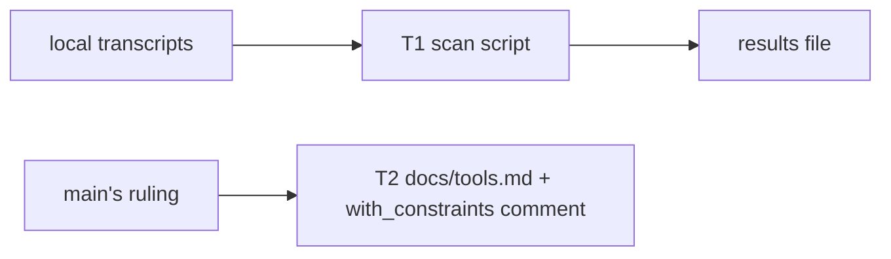
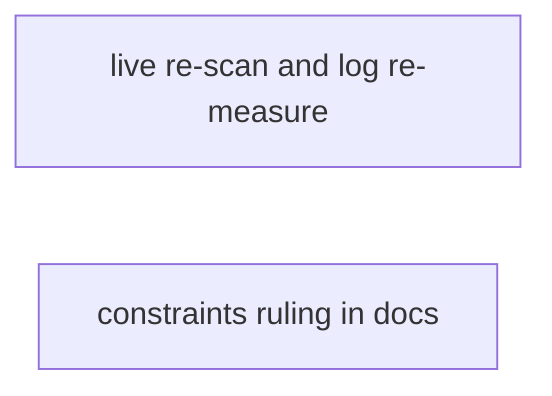

# #914 remainder: live re-scan, constraints ruling, log re-measure (#1059)

**Goal:** finish the three open items of #914 that B298 left: measure the live token figures after #918 (prime chars per worker, task message p50, packet chars per reviewer, `run_tests --wait` median), re-measure how often agents open the log after a red result, and record main's ruling that review and fix briefs keep the plan's Global constraints.
**Architecture:** T1 is a measurement: a throwaway transcript scan, run once, whose aggregate numbers and source text land in one results file. T2 records the constraints ruling in the `fleet` row of docs/tools.md and in the `fleet.with_constraints` comment, with a doc test.
**Tech stack:** Python 3 (standard library only for the scan), pytest.
**Spec:** issue #1059 (and #914's last owner comment).
**Detail:** tests
**Wave0:** none
**Worktree:** none

Global constraints:
- The results file holds aggregate numbers only: no transcript text, prompt text, file path, project name or session id from any transcript.
- The scan reads only this Mac's transcripts and writes nothing outside the task tree; its script lives in `.superlite/measure/` of the task tree (git-excluded) and is copied verbatim into the results file.
- Windows by each line's `timestamp` (UTC): before = 2026-10-05T00:00:00Z to 2026-11-15T19:37:20Z (#918 merged); after = 2026-11-16T00:00:00Z to the scan time.

Ruling: main's ruling (orchestrator, not Max): review and fix briefs keep the plan's Global constraints as `fleet.with_constraints` appends them today; no code path changes; T2 records it (because reviewers and fixers get the constraints only there since #900).
Ruling: the live re-scan reads every local account's transcripts (`~/.claude/projects` and each `~/.claude-account*/projects`, subagent transcripts included), the source B298 used, and compares the same metric before and after #918 with one script, so the two columns share one method; the audit's 26 h trace export is not re-run (lead's ruling).
Ruling: no measurement of the constraints section's size: main ruled the decision, and #914 asked for a decision or a measurement (lead's ruling).
Ruling: the numbers go into the results file, notes.md and the PR body, not an issue comment; the merge closes #1059 with a link to them (lead's ruling).
Ruling: `fleet placement local` for this run, so the measuring worker scans this Mac (lead's ruling).

## Coverage

| Row | State | Basis |
|---|---|---|
| scope and success criteria | settled | #1059's three items; T1 two measurements, T2 the ruling |
| domain and data model | n/a | no data model |
| persistence and migration | n/a | nothing stored |
| interfaces and contracts | settled | T2 changes one doc row and one comment |
| UI states | n/a | no UI |
| concurrency and state ownership | n/a | one-shot scan |
| error handling and recovery | ruled | a transcript line that is not JSON or has no timestamp is skipped and counted |
| security and privacy | ruled | aggregate numbers only (Global constraints) |
| performance and limits | ruled | stream each file line by line; skip files whose mtime is before 2026-10-05 |
| observability | n/a | measurement output is the results file |
| testing strategy | settled | T1 a heading check, T2 a doc test |
| compatibility | n/a | no behaviour change |
| rollout | n/a | docs and a comment |
| research unknowns | ruled | T1 reads the prime, task message, packet and red-result formats from the code it names |



## File structure

- `docs/plans/2026-11-24-1059-token-rescan.results.md`: the measured numbers, the metric definitions and the scan script (T1).
- `docs/tools.md`: `fleet` row names the constraints append and the keep ruling (T2).
- `skills/subagent-driven-development/scripts/fleet.py`: `with_constraints` comment names the ruling (T2).
- `tests/scripts/test_docs_tools_constraints_1059.py`: doc test (T2).

```mermaid
%% schedule
gantt
  title Predicted schedule (mm:ss)
  dateFormat X
  axisFormat %M:%S
  section lane 1
  T1 live re-scan and log re-measure :t1, 0, 670s
  section lane 2
  T2 constraints ruling in docs :t2, 0, 548s
```





critical path: T1 (11.2 min) · peak width 2 · predicted build 11.2 min · predicted total ≈ 27.7 min

## Measurement

### T1 live re-scan and log re-measure · Complexity 4 (O-1) · Est. context 45k
**Owns:** docs/plans/2026-11-24-1059-token-rescan.results.md
**Components:** 1
**LOC owned:** 150
**Tests:** fast cmd=grep -q '^## Live re-scan' docs/plans/2026-11-24-1059-token-rescan.results.md && grep -q '^## Log re-opens after a red result' docs/plans/2026-11-24-1059-token-rescan.results.md && grep -q '^## Scan script' docs/plans/2026-11-24-1059-token-rescan.results.md
**Kind:** design
**Model:** sonnet
**Produces:** none (a results file)
**Review Focus:** `numeric`: each table's n, p50, p90 and mean come from the script's own output, before and after columns from the same run
**Steps:**
1. Read the formats from the code: how a fleet worker gets its prime (`fleet.py` near `prime = "prime-haiku.md" if model == "haiku" else "prime.md"`, and `fleet_io.py`); the first line of `fleet_io.task_message`; the review packet path (`.superlite/review-packet.md`, `plan_tools packet`); how `run_tests.py` prints a red result (its summary and last line) and where its log lives (`test-output.log`, `*.output.log`).
2. Write `.superlite/measure/rescan.py` (standard library only). Walk every `*.jsonl` under `~/.claude/projects` and each existing `~/.claude-account*/projects`, skip files whose mtime is before 2026-10-05, stream line by line, pair each `tool_use` with its `tool_result` by id, and assign each event to a window by its line's `timestamp` (Global constraints). Count skipped lines.
3. Metrics, each per window with n, p50, p90, mean and total chars:
   - M1 prime chars per worker: per transcript, the chars of every tool result that reads `prime.md` or `prime-haiku.md` under a `.superlite` folder (Read, or a Bash `cat`/`sed`/`head`), plus the chars of a user message that carries the prime text itself; one value per transcript that read it; also the count of transcripts that read it twice or more.
   - M2 task message chars: each user message whose text starts with `fleet_io.task_message`'s fixed first line; one value per message.
   - M3 packet chars per reviewer: per transcript, the chars of every tool result that reads `review-packet.md`; one value per transcript that read it.
   - M4 `run_tests --wait` output chars: each Bash call whose command holds `run_tests` and `--wait`; one value per call (the tool result's chars).
   - M5 log re-opens: a red result is the tool result of a Bash call whose command holds `run_tests` and whose text shows a red run (the marker step 1 found); it counts as re-opened when any of the next 5 tool calls of the same transcript reads a test log (Read of a `.log` path, or a Bash `cat`, `tail`, `head`, `less`, `grep`, `sed` or `awk` naming a `.log` path). Report `k of n` per window, beside the audit's baseline `24 of 160` (26 h export).
4. Run the script once and write the results file: `## Live re-scan` (a table per metric M1 to M4, before and after columns, the windows, files and lines scanned, lines skipped), `## Log re-opens after a red result` (M5 and the red marker used), `## Definitions` (each metric in one line), `## Scan script` (the script verbatim in a fenced python block). Numbers only, per the Global constraints.
**Notes:** the scan is read-only; a refused read of a transcript folder is BLOCKED with the refused command, never worked around. If a metric's format cannot be found in the code, name it in the report and measure the rest.

## Docs

### T2 constraints ruling in docs · Complexity 2 (O-1) · Est. context 30k
**Owns:** docs/tools.md, skills/subagent-driven-development/scripts/fleet.py, tests/scripts/test_docs_tools_constraints_1059.py
**Components:** 1
**LOC owned:** 30
**Tests:** fast
**Kind:** mechanical
**Model:** haiku
**Produces:** none (docs and a comment)
**Review Focus:** `test_row_records_the_keep_ruling`: the `fleet` row holds the exact sentence below; `test_with_constraints_comment_names_the_ruling`: the def line holds `#1059` and still ends `| O(L + len)`
**Steps:**
1. Write the test file below; run it: FAIL.
2. docs/tools.md, `fleet` row: right after the text ``appends FILE to the review brief under `## Coordinator notes`;`` insert one space and this sentence: ``review (`spawn --for-review`, `--package`), `spawn --brief` and `send --brief` briefs get the plan's Global constraints once as a `## Global constraints` section (`fleet.with_constraints`, #635; none added when the brief already has the heading); review and fix briefs keep them by ruling (#1059), since reviewers and fixers get the constraints only there (#900);``
3. fleet.py: in the comment of the line `def with_constraints(text, plan):`, replace `none stated (#635) | O(L + len)` with `none stated (#635); review and fix briefs keep it by ruling (#1059) | O(L + len)`. Change no code.
4. Run the test: PASS.
**Test code (verbatim):**
```python
"""docs/tools.md `fleet` row and fleet.with_constraints record that review and fix briefs keep the plan's Global constraints (#1059, #635)."""
from __future__ import annotations

from pathlib import Path

ROOT = Path(__file__).resolve().parents[2]
FLEET = ROOT / "skills" / "subagent-driven-development" / "scripts" / "fleet.py"


def _row() -> str:
    lines = (ROOT / "docs" / "tools.md").read_text(encoding="utf-8").splitlines()
    return [ln for ln in lines if ln.startswith("| `fleet`")][0]


def test_row_names_the_constraints_append():
    assert "(`fleet.with_constraints`, #635; none added when the brief already has the heading)" in _row()


def test_row_records_the_keep_ruling():
    assert "review and fix briefs keep them by ruling (#1059), since reviewers and fixers get the constraints only there (#900);" in _row()


def test_with_constraints_comment_names_the_ruling():
    line = [ln for ln in FLEET.read_text(encoding="utf-8").splitlines() if ln.startswith("def with_constraints(")][0]
    assert "review and fix briefs keep it by ruling (#1059) | O(L + len)" in line
```

## Review Focus

T1 numeric (the table values match the script output; same method both windows; no transcript text). T2 docs (exact sentence placement, no code change in fleet.py). Probe entry: none (a results file and docs; no runnable entry).

## Self-review

Both items of #1059 map to T1 (M1-M4, M5) and the ruling to T2; no placeholders; the two tasks share no file and run at once.
