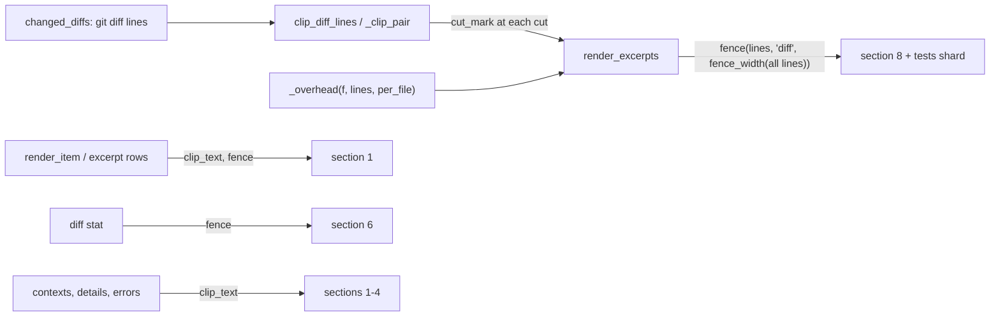
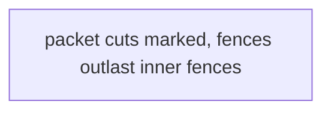

# B321: every review-packet cut carries a marker; every packet fence outlasts the fences inside it (#1118)

**Goal:** the review packet never shows a line whose text was cut without saying so, and no diff (or excerpt, or diff stat) can close the packet's own code fence. A README diff holding its own triple-backtick fences then stays fenced, so `fleet send` no longer refuses the packet under #1015, and a reviewer never reads a garbled sentence the file does not contain.
**Architecture:** three small helpers in pt_review.py: `cut_mark(n)` (the one marker text), `clip_text(s, n)` (a tail cut with the marker) and `fence_width(lines)` / `fence(body, info, width)` (a backtick fence one longer than the longest backtick run in the body, at least 3). `_clip_pair` marks each of its three possible cuts (before the head context, inside an over-long changed span, after the tail context) and only those; every other display cut in the packet (`excerpt` rows, incident and probe contexts, run errors, OUTDATED incidents) goes through `clip_text`; every packet fence (section 8 and the tests shard via `render_excerpts`, section 1 excerpts via `render_item`, section 6 diff stat) goes through `fence`; `_overhead` charges the wider fence so the budget stays exact.
**Tech stack:** Python 3 stdlib (re); pytest via `sl run_tests`.
**Spec:** issue #1118 (feedback 05093c021f7c: docs.md:42 rendered as 'only starts the hub', FR1 and FR2 reported a garbled sentence; feedback 582e2bbfc792: a README diff with ```bash fences closed the packet fence, #1015 refused the packet).
**Detail:** full
**Wave0:** none
**Coverage:** off

## Global constraints

- The cut marker is exactly `[… N chars cut …]` (U+2026 HORIZONTAL ELLIPSIS, a space, the decimal count of chars left out, ` chars cut `, U+2026, `]`), glued to the kept text on both sides with no added spaces, e.g. `abc[… 3 chars cut …]`.
- A marker appears only where chars were left out; a line or text within its cap is returned unchanged (the same object for diff lines, #914).
- The lone long-line cut keeps its existing text `[+N chars; read the file for the rest]`; the pair note keeps its text ` [line of L chars, changed at col C; read the file for the rest]`, with L now the length of that line itself (the old code wrote the `-` line's length on both).
- A packet fence is `"`" * w` with `w = max(3, 1 + longest run of backticks anywhere in the fenced lines)`; section 8 and the tests shard compute `w` from all diff lines of the file (shown or not), so `_overhead` and `render_excerpts` agree.
- Files this batch may touch: skills/subagent-driven-development/scripts/pt_review.py, tests/scripts/test_packet_cuts_fences_1118.py and this plan. An existing test that breaks: name it in the report, do not edit it without the lead's word.
- Builds: the verdict is `sl run_tests` (the project's test command; a project with `.maxapp` runs `maxapp test`, which a build pool may place on another Mac, and a full run whose tree a green maxapp test stamp covers returns that result without a run); task trees build in <tree>/.build/DerivedData and any build of your own goes under .build/ of the worktree, never -derivedDataPath outside the worktree (your session scratchpad included; backlog cleanup removes scratchpad build folders when the worktree goes); a product, simulator or device build stays on this machine and runs only when an issue's acceptance asks for a running-app check; copy this sentence into every worker brief.
- Simulators: append the UDID of each simulator you or a worker creates (`xcrun simctl create` or `clone`; a checker's `Simulators:` line marks its created ones) as one line to /Users/max/github/superlite/.claude/worktrees/superlite-b321-review-packet-cuts-and-fences/.superlite/simulators.txt; never list one you did not create; ship cleanup shuts down and deletes each listed one; copy this sentence into every worker brief.

Ruling: cuts stay (the 400-char cap and its 120-char context exist for #914's token budget); each cut gets the marker instead, and an over-long changed span keeps its first `cap // 2` and last `cap - cap // 2` chars around the marker, so the reader sees where the change starts and ends (lead's ruling).
Ruling: "every cut" covers every display cut in the packet, not only section 8: `excerpt` rows ([:160]), claimed-fix and incident contexts ([:200]), probe details ([:200]), run errors ([:120], [:200]) and OUTDATED incident contexts ([:120]) go through `clip_text`; log-record contexts written by `contract` (`[:200]` stored in the incident log) are data, not display, and stay (lead's ruling).
Ruling: the fence fix lives in the packet (the issue's expected behaviour), not in fleet.py's #1015 scanner (owned by B323); width counts backtick runs anywhere in a line, which also covers fleet.py's scanner, which strips any indentation before it matches a closing fence (lead's ruling).
Ruling: sized bounded (one module, helpers plus call sites, one new test file): one sonnet task with the code given in full (lead's ruling).

## Main diagram



## File structure

- skills/subagent-driven-development/scripts/pt_review.py: `cut_mark`, `clip_text`, `fence_width`, `fence`; `_clip_pair`, `excerpt`, the contexts and errors, `render_item`, `_overhead`, `excerpt_need`, `_allocate`, `render_excerpts` and section 6 use them.
- tests/scripts/test_packet_cuts_fences_1118.py: the regression tests below.

## Task graph

```mermaid
%% schedule
gantt
  title Predicted schedule (mm:ss)
  dateFormat X
  axisFormat %M:%S
  section lane 1
  T1 packet cuts marked fences outlast inn :t1, 0, 320s
```





critical path: T1 (5.3 min) · peak width 1 · predicted build 5.3 min · predicted total ≈ 15.8 min

## Review packet

**Probe entry:** none (the packet is a text builder; the named tests call its functions and the #1015 scanner directly)

### T1 packet cuts marked, fences outlast inner fences · Complexity 2 (O-chars) · Est. context 40k
**Owns:** skills/subagent-driven-development/scripts/pt_review.py, tests/scripts/test_packet_cuts_fences_1118.py
**Components:** 2
**LOC owned:** 150
**Tests:** fast
**Kind:** design
**Model:** sonnet
**Produces:** pt_review.cut_mark(n: int) -> str · pt_review.clip_text(s: str, n: int) -> str · pt_review.fence_width(lines: list[str]) -> int · pt_review.fence(body: str, info: str = "", width: int | None = None) -> str
e.g. cut_mark(812) -> "[… 812 chars cut …]"
e.g. clip_text("abcdef", 3) -> "abc[… 3 chars cut …]"
e.g. fence(" ```bash\n+ls", "diff") -> "````diff\n ```bash\n+ls\n````"
**Review Focus:** `test_long_changed_span_keeps_head_and_tail_with_a_marker`: a 610-char changed span shows its first and last 200 chars around `[… 210 chars cut …]`; `test_markers_only_where_text_was_cut`: no marker on a side with nothing cut, each line's note names its own length; `test_readme_diff_with_fences_stays_fenced`: fleet.outside_paths names nothing inside a README diff with ```bash fences and plan_tools.scan_fences flags every diff line; `test_overhead_charges_the_wider_fence`: a ```` line costs 4 more overhead chars than a backtick-free line of the same length.
**Test code (verbatim):**

```python
"""Review packet: every cut carries a marker, every fence outlasts the fences inside it (#1118)."""
import sys
import types
from pathlib import Path

import pytest

sys.path.insert(0, str(Path(__file__).resolve().parents[2] / "skills" / "subagent-driven-development" / "scripts"))
import fleet  # noqa: E402
import fleet_roles  # noqa: E402
import plan_tools  # noqa: E402
import pt_review as pt  # noqa: E402

M = "…"


def mark(n):
    return f"[{M} {n} chars cut {M}]"


def test_cut_mark_and_clip_text():
    assert pt.cut_mark(812) == mark(812)
    s = "abc"
    assert pt.clip_text(s, 3) is s
    assert pt.clip_text("abcdef", 3) == "abc" + mark(3)
    assert pt.clip_text("", 3) == ""


def test_long_changed_span_keeps_head_and_tail_with_a_marker():
    head, tail = "h" * 50, "t" * 50
    old = "-" + head + "A" * 300 + "MIDDLE-OLD" + "B" * 300 + tail
    new = "+" + head + "C" * 300 + "MIDDLE-NEW" + "D" * 300 + tail
    a, b = pt.clip_diff_lines([old, new])
    note = " [line of 710 chars, changed at col 51; read the file for the rest]"
    assert a == "-" + head + "A" * 200 + mark(210) + "B" * 200 + tail + note
    assert b == "+" + head + "C" * 200 + mark(210) + "D" * 200 + tail + note


def test_markers_only_where_text_was_cut():
    a, b = pt.clip_diff_lines(["-" + "x" * 500, "+" + "x" * 500 + "tail"])
    assert a == "-" + mark(380) + "x" * 120 + " [line of 500 chars, changed at col 501; read the file for the rest]"
    assert b == "+" + mark(380) + "x" * 120 + "tail" + " [line of 504 chars, changed at col 501; read the file for the rest]"


def test_tail_marker_counts_the_chars_after_the_context():
    a, b = pt.clip_diff_lines(["-" + "a" * 10 + "OLD" + "z" * 500, "+" + "a" * 10 + "NEW" + "z" * 500])
    note = " [line of 513 chars, changed at col 11; read the file for the rest]"
    assert a == "-" + "a" * 10 + "OLD" + "z" * 120 + mark(380) + note
    assert b == "+" + "a" * 10 + "NEW" + "z" * 120 + mark(380) + note


def test_excerpt_marks_a_cut_row(tmp_path):
    (tmp_path / "a.py").write_text("x = 1\n" + "y" * 200 + "\n", encoding="utf-8")
    rows = pt.excerpt(tmp_path, "a.py", 2).splitlines()
    assert rows[0] == "    1 | x = 1"
    assert rows[1] == ">   2 | " + "y" * 160 + mark(40)


def test_fence_outlasts_inner_fences():
    assert pt.fence("+a") == "```\n+a\n```"
    assert pt.fence("+a", "diff") == "```diff\n+a\n```"
    body = " ```bash\n+ls x\n ```"
    assert pt.fence(body, "diff") == "````diff\n" + body + "\n````"
    assert pt.fence("+a", "diff", 5) == "`````diff\n+a\n`````"
    assert pt.fence_width(["a", "b``c"]) == 3
    assert pt.fence_width(["+ use ```x``` here", " ````"]) == 5
    assert pt.fence_width([]) == 3


@pytest.fixture
def roots(tmp_path, monkeypatch):
    proj = tmp_path / "proj"; sd = proj / ".superlite"; sd.mkdir(parents=True)
    skills = tmp_path / "plug" / "skills"; skills.mkdir(parents=True)
    other = tmp_path / "other"; other.mkdir(); (other / "spec.md").write_text("spec")
    monkeypatch.setattr(fleet_roles, "SKILLS", skills)
    return types.SimpleNamespace(proj=proj, sd=sd, other=other)


def test_readme_diff_with_fences_stays_fenced(roots):
    o = roots.other
    lines = ["--- a/README.md", "+++ b/README.md", "@@ -1,4 +1,4 @@", " ```bash",
             f"-cat {o}/old.md", f"+cat {o}/spec.md", " ```", f" see {o}/spec.md"]
    text = pt.render_excerpts(["README.md"], [("README.md", lines)])
    assert text == "### README.md\n````diff\n" + "\n".join(lines) + "\n````"
    assert fleet.outside_paths("Packet:\n" + text + "\nEnd of packet\n", roots.proj, roots.sd) == []
    flags, _ = plan_tools.scan_fences(text.splitlines())
    assert flags == [False] + [True] * (len(lines) + 2)


def test_overhead_charges_the_wider_fence():
    plain = pt.excerpt_need([("R.md", [" ...."])])
    wide = pt.excerpt_need([("R.md", [" ````"])])
    assert wide - plain == 4


def test_budgeted_excerpts_with_inner_fences_fit():
    diffs = [(f"d{i}.md", [" ```bash", "+x" * 40, " ```"] * 6) for i in range(4)]
    changed = [f for f, _ in diffs]
    for budget in (300, 700, 2000):
        out = pt.render_excerpts(changed, diffs, budget=budget)
        assert len(out) <= budget, budget


def test_item_excerpt_uses_fence(tmp_path):
    (tmp_path / "R.md").write_text("````\nx\n````\n", encoding="utf-8")
    it = pt.Item("incidents", (0,), "R.md:2 x", "", "R.md", 2, "", False)
    out = pt.render_item(tmp_path, it, set(), "1.1")
    assert "\n`````\n" in out and out.rstrip().endswith("`````")
```

**Steps:**
1. Write the test file above; run `sl run_tests --fast tests/scripts/test_packet_cuts_fences_1118.py --plan .superlite`: FAIL (no `cut_mark`, `clip_text`, `fence_width`, `fence`; old markers; ``` fences).
2. Add the helpers next to `_is_diff_header`:
```python
BACKTICKS_RE = re.compile(r"`+")  # O(1)


def cut_mark(n: int) -> str:  # O(1) total
    """The marker that stands where n chars of a line were left out of the packet (#1118)."""
    return f"[… {n} chars cut …]"  # O(1)


def clip_text(s: str, n: int) -> str:  # O(n) total
    """s cut to its first n chars, with the cut marker when anything was cut; s itself when it fits (#1118)."""
    return s if len(s) <= n else s[:n] + cut_mark(len(s) - n)  # O(n)


def fence_width(lines: list[str]) -> int:  # O(chars) total
    """Backticks a fence needs to hold these lines: one more than their longest backtick run, at least 3 (#1118)."""
    return max(3, 1 + max((len(r) for ln in lines for r in BACKTICKS_RE.findall(ln)), default=0))  # O(chars)


def fence(body: str, info: str = "", width: int | None = None) -> str:  # O(len(body)) total
    """body in a backtick fence that no line of it can close (#1118); `width` overrides the computed width."""
    w = "`" * (width or fence_width(body.splitlines()))  # O(len(body))
    return f"{w}{info}\n{body}\n{w}"  # O(len(body))
```
3. `_clip_pair`: note per line (`len(body)`), and `cut` becomes:
```python
    def cut(body: str, mark: str) -> str:  # O(m)
        end = len(body) - s  # O(1)
        lo, hi = max(0, p - ctx), min(len(body), end + ctx)  # O(1)
        span = body[p:end]  # O(m)
        if len(span) > cap:  # O(1)
            keep = cap // 2  # O(1)
            span = span[:keep] + cut_mark(len(span) - cap) + span[len(span) - (cap - keep):]  # O(cap)
        note = f" [line of {len(body)} chars, changed at col {p + 1}; read the file for the rest]"  # O(1)
        return (mark + (cut_mark(lo) if lo else "") + body[lo:p] + span + body[end:hi]  # O(m)
                + (cut_mark(len(body) - hi) if hi < len(body) else "") + note)  # O(1)
```
4. `clip_text` at the display cuts: `excerpt` row `lines[n - 1][:160]`; the claimed-fix item context and the incident entry context `[:200]`; the probe `detail` `[:200]`; `_run_counts` error `[:120]`; `read_test_summary` `err` `[:200]`; the OUTDATED incident context `[:120]`. Leave the `contract` log-record `[:200]` cuts as they are.
5. Fences: `render_item` uses `fence(excerpt(...))`; section 6 uses `fence(diff)`; `render_excerpts` writes `f"### {f}\n" + fence("\n".join(lines[:n]), "diff", fence_width(lines))`; `_overhead(f, lines, per_file)` takes the file's line list and returns `len(f"### {f}\n") + 2 * fence_width(lines) + len("diff\n") + 1 + len(note) + 2`; update its two callers (`excerpt_need`, `_allocate.grow`) to pass `lines`.
6. Run the new file and tests/scripts/test_packet_long_lines_914.py, test_packet_batch.py, test_packet_tests_shard_381.py, test_packet_inline.py with `sl run_tests --fast ... --plan .superlite`: PASS.
**Notes:** `fence_width` counts runs anywhere in a line on purpose (fleet.py's #1015 scanner strips any indentation). The `-tests.md` shard goes through `render_excerpts` and needs no change of its own.

## Review Focus

- pt_review packet (app type: CLI text builder): categories format, numeric (budget). Probe entry: none. Cases are T1's named tests.

## Self-review

Coverage: both defects of #1118 map to T1. Placeholders: none. Graph: one task. Measurable fields: filled. Limits: under 15k.
