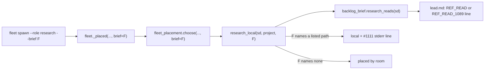
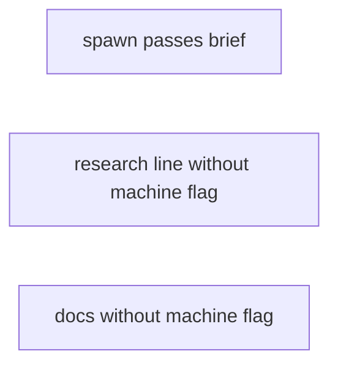

# B329: fleet spawn hands placement the brief (#1132)

**Goal:** a plain `fleet spawn --role research --brief F` passes F to `fleet_placement.choose`, so #1111's keep-local rule judges the brief itself: only a research worker whose brief names a path from the lead brief's research line stays on this Mac; the lead brief line and the docs stop telling a lead to pass `--machine local` for it.
**Architecture:** `fleet._placed` gains `brief=None` and hands it to `fleet_placement.choose(..., brief=brief)`; the plain spawn passes `a.brief`. `backlog_brief.REF_READ` drops its `--machine local` instruction; `research_reads` parses the new line and the pre-#1132 line, so a lead brief written before this ship still lists its reads.
**Tech stack:** Python 3 stdlib, pytest via `sl run_tests`.
**Spec:** issue #1132.
**Detail:** tests
**Wave0:** none
**Coverage:** off

## Global constraints

- `fleet._placed(sd, role, project, tier=None, brief=None)`: unchanged except the last call becomes `return fp.choose(sd, role, project, brief=brief)  # O(w + m)`.
- The plain spawn in `fleet.py` (`if a.brief and not a.machine and not forced:`) calls `a.machine = _placed(sd, a.role, state.project(sd), brief=a.brief)  # O(w + m)`. `_dispatch_placed` and every other `_placed` caller stay unchanged (no brief: they place implementers, and #1111 judges only research).
- `backlog_brief.REF_READ` is exactly: `"Standing note: a research worker may read these outside paths read-only; name them in its brief; fleet spawn keeps a research worker whose brief names one on this machine, since a remote machine lacks them: {items} (#1089, #1132)."`
- `backlog_brief.REF_READ_1089` (new, parsing only) is exactly the old line: `"Standing note: a research worker may read these outside paths read-only; name them in its brief and spawn it with --machine local, since a remote machine lacks them: {items} (#1089)."`
- `backlog_brief.research_reads(sd)` tries `REF_READ` first, then `REF_READ_1089`, on each line of `<sd>/briefs/lead.md` with the existing head/tail split and match rule; the first matching line wins; no match or `OSError`: `[]`.
- Every code line in the scripts ends with its `# O(...)` complexity comment like its neighbours.
- Files this batch may touch: docs/fleet.md, skills/subagent-driven-development/backlog.md, skills/subagent-driven-development/scripts/backlog_brief.py, skills/subagent-driven-development/scripts/fleet.py, tests/scripts/test_docs_b313.py, tests/scripts/test_fleet_placement_spawn.py, tests/scripts/test_research_reads_1089.py and this plan. Never edit docs/tools.md, fleet_placement.py or any other file. An existing test that breaks: name it in the report, do not edit it without the lead's word.
- Builds: the verdict is `sl run_tests` (the project's test command; a project with `.maxapp` runs `maxapp test`, which a build pool may place on another Mac, and a full run whose tree a green maxapp test stamp covers returns that result without a run); task trees build in <tree>/.build/DerivedData and any build of your own goes under .build/ of the worktree, never -derivedDataPath outside the worktree (your session scratchpad included; backlog cleanup removes scratchpad build folders when the worktree goes); a product, simulator or device build stays on this machine and runs only when an issue's acceptance asks for a running-app check; copy this sentence into every worker brief.
- Simulators: append the UDID of each simulator you or a worker creates (`xcrun simctl create` or `clone`; a checker's `Simulators:` line marks its created ones) as one line to /Users/max/github/superlite/.claude/worktrees/superlite-b329-fleet-spawn-passes-brief/.superlite/simulators.txt; never list one you did not create; ship cleanup shuts down and deletes each listed one; copy this sentence into every worker brief.

Ruling: only the plain spawn passes the brief: `--for-dispatch` and `--for-review` place implementers and reviewers, which #1111's rule never keeps local (lead's ruling).
Ruling: `research_reads` also parses the pre-#1132 line (`REF_READ_1089`), so a lead whose brief was written before this ship still gets its research workers kept local by placement (lead's ruling).
Ruling: [scope] docs/tools.md row `fleet` brief checks (B331's file) still says "spawn that researcher with `--machine local`"; it becomes a Follow-up, not an edit (lead's ruling).

## Main diagram



## File structure

- skills/subagent-driven-development/scripts/fleet.py: `_placed` takes and passes `brief`; the plain spawn passes `a.brief`.
- skills/subagent-driven-development/scripts/backlog_brief.py: new `REF_READ` text, `REF_READ_1089`, `research_reads` reads both.
- skills/subagent-driven-development/backlog.md, docs/fleet.md: the research-line rule without `--machine local`.
- tests/scripts/test_fleet_placement_spawn.py, tests/scripts/test_research_reads_1089.py, tests/scripts/test_docs_b313.py: updated and new tests.

## Task graph

```mermaid
%% schedule
gantt
  title Predicted schedule (mm:ss)
  dateFormat X
  axisFormat %M:%S
  section lane 1
  T1 plain spawn hands placement the brief :t1, 0, 187s
  section lane 2
  T2 research line drops the machine flag :t2, 0, 186s
  section lane 3
  T3 docs drop the machine flag for resear :t3, 0, 185s
```





critical path: T1 (3.1 min) · peak width 3 · predicted build 3.1 min · predicted total ≈ 11.6 min

## Placement

### T1 plain spawn hands placement the brief · Complexity 2 (O-1) · Est. context 40k
**Owns:** skills/subagent-driven-development/scripts/fleet.py, tests/scripts/test_fleet_placement_spawn.py
**Components:** 1
**LOC owned:** 30
**Tests:** fast
**Model:** sonnet
**Kind:** design
**Produces:** fleet._placed(sd, role, project, tier=None, brief=None) -> str | None
e.g. _placed(sd, "research", proj, brief="/p/.superlite/briefs/R1.md") with placement on -> fleet_placement.choose(sd, "research", proj, brief="/p/.superlite/briefs/R1.md")'s answer
e.g. _placed(sd, "implementer", proj, "haiku", brief="/x.md") -> None (choose not called)
**Review Focus:** protocol: the plain spawn's brief reaches `choose` unchanged (the string argparse gives); state: `--machine local`, `--machine box` and a forced spawn still skip placement; `--for-dispatch` still calls `_placed` without a brief.
**Test code (tests):** in tests/scripts/test_fleet_placement_spawn.py, fixture `pl`: add `briefs=[]` to the namespace and change the stub to
```python
    def choose(sd, role, project, now=None, brief=None):
        r.asked.append(role); r.briefs.append(brief); return r.pick
```
Add:
```python
def test_plain_spawn_hands_placement_the_brief(pl):
    assert fleet.main(["spawn", "--role", "research", "--brief", str(pl.brief)]) == 0
    assert pl.asked == ["research"] and pl.briefs == [str(pl.brief)]


def test_placed_passes_brief_to_choose(pl, monkeypatch):
    seen = []
    monkeypatch.setattr(fp, "choose", lambda sd, role, project, now=None, brief=None: seen.append((role, brief)) or "box")
    assert fleet._placed(pl.sd, "research", pl.proj, brief="/b/R1.md") == "box"
    assert fleet._placed(pl.sd, "implementer", pl.proj) == "box"
    assert seen == [("research", "/b/R1.md"), ("implementer", None)]


def test_placed_haiku_skips_choose_with_brief(pl, monkeypatch):
    monkeypatch.setattr(fp, "choose", lambda *a, **k: pytest.fail("choose called"))
    assert fleet._placed(pl.sd, "implementer", pl.proj, "haiku", brief="/b/x.md") is None
```
Use the fixture's real attribute names for the state folder and project (read `world` in tests/scripts/test_fleet.py; `pl` copies its fields).
**Steps:** 1 write the tests, 2 run: FAIL (the plain-spawn test sees `[None]`, `_placed` rejects `brief=`), 3 implement per Global constraints, 4 run: PASS (also tests/scripts/test_fleet_placement*.py and tests/scripts/test_fleet_spawn_exclude_1096.py).

## Lead brief

### T2 research line drops the machine flag · Complexity 1 (O-1) · Est. context 30k
**Owns:** skills/subagent-driven-development/scripts/backlog_brief.py, tests/scripts/test_research_reads_1089.py
**Components:** 1
**LOC owned:** 30
**Tests:** fast
**Model:** haiku
**Kind:** mechanical
**Produces:** backlog_brief.research_reads(sd) -> list[str]
e.g. research_reads(sd) with lead.md holding REF_READ.format(items="~/github/other; /opt/x") -> ["<HOME>/github/other", "/opt/x"]
e.g. research_reads(sd) with lead.md holding REF_READ_1089.format(items="/opt/x") -> ["/opt/x"]
**Test code (tests):** in tests/scripts/test_research_reads_1089.py, change the last line of `test_lead_brief_lists_the_note_paths_for_research` to
```python
    assert bb.REF_READ.split("{items}")[0] in t and "--machine local" not in bb.REF_READ and "(#1089, #1132)" in bb.REF_READ
```
and add:
```python
def test_research_reads_parses_the_pre_1132_line(w):
    (w.wt / ".superlite" / "briefs").mkdir(parents=True)
    (w.wt / ".superlite" / "briefs" / "lead.md").write_text("head\n" + bb.REF_READ_1089.format(items="~/github/other; /opt/x") + "\ntail\n")
    assert bb.research_reads(w.wt / ".superlite") == [f"{w.home}/github/other", "/opt/x"]
    assert "--machine local" in bb.REF_READ_1089


def test_research_reads_first_line_wins(w):
    (w.wt / ".superlite" / "briefs").mkdir(parents=True)
    rows = [bb.REF_READ.format(items="/opt/new"), bb.REF_READ_1089.format(items="/opt/old")]
    (w.wt / ".superlite" / "briefs" / "lead.md").write_text("\n".join(rows) + "\n")
    assert bb.research_reads(w.wt / ".superlite") == ["/opt/new"]
```
**Steps:** 1 write the tests, 2 run: FAIL, 3 set `REF_READ`, add `REF_READ_1089` right below it and change `research_reads` per Global constraints, 4 run: PASS (also tests/scripts/test_fleet_placement_research_1111.py and tests/scripts/test_backlog_note_refs_1067.py).

## Docs

### T3 docs drop the machine flag for research · Complexity 1 (O-1) · Est. context 25k
**Owns:** skills/subagent-driven-development/backlog.md, docs/fleet.md, tests/scripts/test_docs_b313.py
**Components:** 1
**LOC owned:** 20
**Tests:** fast
**Model:** haiku
**Kind:** mechanical
**Test code (tests):** in tests/scripts/test_docs_b313.py replace `FLEET` and `BACKLOG` with the new texts below (each exactly as given, split over string literals like now) and add `FLEET_1132` and its test:
- FLEET: `- The #1015 check reads quoted text as text, not as a path a worker must read (#1089): fenced blocks, the standing-note block (its `Standing note from main` line and the four-space lines after it, wherever a brief copies it) and a finding's `quote:` span; a path missing on this machine (a deploy host's `~/app`) is text too. A research worker may name an outside path the lead brief's research line lists (`fleet spawn --brief` keeps that worker on this machine, #1132). `plan_tools lint` prints `WARNING: OUTSIDE:` with the line for each existing outside path a plan names (#1086).`
- BACKLOG: `- A path the standing note names that is missing on this machine is text: neither copied nor named. Each one that is copied or over the copy cap is listed on the brief's `Standing note: a research worker may read` line: a research brief may name it or a path below it; `fleet spawn --brief` keeps a research worker whose brief names one on this machine, since a remote machine lacks it (#1089, #1132).`
- FLEET_1132: `- A research worker whose brief names a path the lead brief's research line lists (`Standing note: a research worker may read ...`) stays here without `--machine local`; stderr says `placement: research worker stays local: ... (#1111)`. `fleet spawn --brief` hands placement the brief, so a research worker whose brief names no such path is placed as usual (#1132).`
```python
def test_fleet_md_names_the_spawn_brief_rule():
    text = (ROOT / "docs" / "fleet.md").read_text(encoding="utf-8")
    assert FLEET_1132 in text and "Until `fleet spawn` hands placement the brief" not in text
```
**Steps:** 1 write the tests, 2 run: FAIL, 3 in docs/fleet.md replace the line starting `- The #1015 check reads quoted text` with FLEET and the line starting `- A research worker whose brief names a path the lead brief's research line lists` with FLEET_1132; in skills/subagent-driven-development/backlog.md replace the line starting `- A path the standing note names that is missing on this machine` with BACKLOG; change nothing else, 4 run: PASS.

## Review Focus

- fleet.py (CLI): protocol and state cases in T1.
- backlog_brief.py (library): encoding: the old and new line both parse, items keep `~` expansion, in T2.
**Probe entry:** none (CLI internals that spawn panes; their tests drive them).

## Self-review

- Coverage: #1132's three asks map to T1 (`_placed` brief, plain spawn, stub `brief=None`), T2 (REF_READ) and T3 (backlog.md rule, plus docs/fleet.md).
- No edges: T1, T2 and T3 own disjoint files and run no other task's code.
