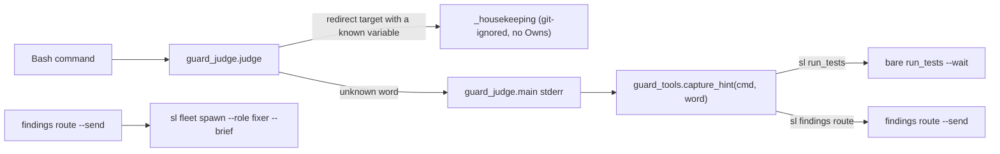
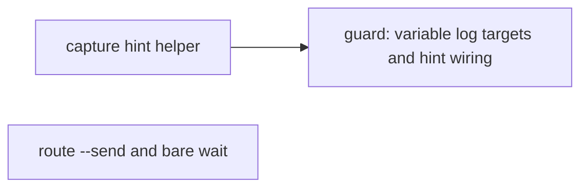

# B306: coordinator guard: captured sl output and logs under an ignored `.build/` (#1069, #1070)

**Goal:** stop two recurring coordinator-guard blocks. #1069: a coordinator captures a line superlite printed (`w=$(sl run_tests ... | sed ...); eval "$w"`, `B=$(sl findings route ... | sed ...)`) and the guard blocks the unknown variable; give each case a form that needs no capture and name it in the block. #1070: a log redirected into a git-ignored `.build/` folder is blocked as project code.
**Architecture:** T2 adds a pure helper to guard_tools.py that reads the whole Bash command and says whether an unresolved word's variable was captured from an `sl` tool's output, returning the hint for that tool. T1 changes guard_judge.py: a redirect target holding a variable whose value is known gets the git-ignored housekeeping check (#1070), the `code` block gains a bullet naming the scratch folder for logs, and the unresolved-word hint line uses T2's helper. T3 adds `findings route --send` (route starts one fixer worker per brief itself) and makes a bare `run_tests --wait` find the tree's pointer from any folder of the checkout.
**Tech stack:** Python 3 standard library, pytest.
**Spec:** issues #1069 and #1070 (this doc's Design section).
**Detail:** tests
**Wave0:** none
**Worktree:** none
**Coverage:** off

Global constraints:
- Every code line keeps the repo's trailing complexity comment (`# O(1)`, `# O(len)` ...), as the surrounding lines do.
- Tests call `guard_judge.judge(...)` or `guard_judge.main([...])` with a patched stdin, as tests/scripts/test_judge_housekeeping.py does; never start the guard hook (hooks/block-coordinator-edits) through `subprocess` from a coordinator shell.
- The last two stderr lines of an unresolved block stay as today (`Unresolved word: W`, then `Blocked command: ...` or the target lines); only the hint line before `Unresolved word:` may change (B51).
- Files other open batches own, never edited here: docs/tools.md, scripts/fleet.py, fleet_io.py, fleet_remote_worker.py, fleet_roles.py, plan_tools.py, backlog*.py, _pyrun.py, commit_task.py, hooks/rewrite-test-runs, hooks/capture-agent-launch.
- Builds: the verdict is `sl run_tests` (the project's test command; a project with `.maxapp` runs `maxapp test`, which a build pool may place on another Mac, and a full run whose tree a green maxapp test stamp covers returns that result without a run); task trees build in <tree>/.build/DerivedData and any build of your own goes under .build/ of the worktree, never -derivedDataPath outside the worktree (your session scratchpad included; backlog cleanup removes scratchpad build folders when the worktree goes); a product, simulator or device build stays on this machine and runs only when an issue's acceptance asks for a running-app check; copy this sentence into every worker brief.
- Simulators: append the UDID of each simulator you or a worker creates (`xcrun simctl create` or `clone`; a checker's `Simulators:` line marks its created ones) as one line to /Users/max/github/superlite/.claude/worktrees/superlite-b306-coordinator-guard-captures-build/.superlite/simulators.txt; never list one you did not create; ship cleanup shuts down and deletes each listed one; copy this sentence into every worker brief.

## Design

Measured before planning (judge called directly on a temp repo with a tracked `.gitignore` holding `.build/` and a run plan, in a linked worktree): literal targets already pass (`> .build/ios-test.log`, `tee .build/logs/x.log`, `mkdir -p .build && ...`, `-derivedDataPath .build/CheckDerivedData`). Blocked: `LOG=.build/ios-test.log; maxapp test > "$LOG"`, `B=b66; ... > .build/smoke-$B.log`, `for n in 1 2; do ... > .build/smoke-$n.log; done` (all `why` empty: guard_judge.py:2138 runs housekeeping only for a target without `$`), and `> .build/run-$(date +%s).log` (a truly unknown name). The feedback's `.build/<name>` rels are expanded values, which fits a variable target.

Ruling: main's ruling for #1069 (orchestrator, not Max): no-capture forms plus block text; the guard does not resolve a captured variable (it would judge text it never saw).
Ruling: bare `sl run_tests --wait` already waits on the tree's newest background run (`.superlite/test-summary.latest`); T3 only makes it work from a subfolder of the checkout too, and the `wait:` line stays as it is (copying it literally needs no capture) (lead's ruling).
Ruling: `findings route --send` runs `<sl> fleet spawn --role fixer --tier T --brief B --label <first finding id> --plan PLAN` per routed line, in order, and prints their output; it refuses with exit 2 before routing when the run's fleet is off. Route's own `fixer tier=...` lines stay byte-identical, so existing parsers keep working (lead's ruling).
Ruling: the capture hint is chosen from the command text alone (an `sl` call inside the `$(...)` or backticks that assign the variable, or inside the substitution that assigned a variable it reads, up to 4 steps); it only changes advice text, never a verdict (lead's ruling).
Ruling: no run plan still means no housekeeping (B159's pinned `test_no_plan_no_housekeeping` stays); a variable target gets housekeeping only when every value the guard judges for it is a known literal path (lead's ruling).
Ruling: docs/tools.md (B303) rows for `findings route --send` and the bare `--wait` subfolder fix are a follow-up; docs/hooks.md (B307's run owns it) gets its guard sentences as a follow-up; fixing.md, which no open batch lists, is edited here (lead's ruling).



## File structure

- `skills/subagent-driven-development/scripts/guard_tools.py`: `capture_hint` and its three hint texts (T2).
- `skills/subagent-driven-development/scripts/guard_judge.py`: variable redirect targets get housekeeping; logs bullet in the `code` block; hint line from `capture_hint` (T1).
- `skills/subagent-driven-development/scripts/findings.py`: `route --send` (T3).
- `skills/subagent-driven-development/scripts/run_tests.py`: bare `--wait` resolves the checkout root (T3).
- `skills/subagent-driven-development/fixing.md`: names `--send` (T3).
- tests: `tests/scripts/test_guard_capture_hint_1069.py` (T2), `tests/scripts/test_guard_build_logs_1070.py` (T1), `tests/scripts/test_findings_route_send_1069.py` and `tests/scripts/test_run_tests_wait_subdir_1069.py` (T3).

```mermaid
%% schedule
gantt
  title Predicted schedule (mm:ss)
  dateFormat X
  axisFormat %M:%S
  section lane 1
  T3 route --send and bare wait :t3, 0, 771s
  section lane 2
  T2 capture hint helper :t2, 0, 739s
  T1 guard variable log targets and hint w :t1, 739, 773s
```





critical path: T2 → T1 (25.2 min) · peak width 2 · predicted build 25.2 min · predicted total ≈ 45.7 min

## Guard

**Probe entry:** none (the judge takes five arguments; its cases are named tests in T1 and T2)

### T2 capture hint helper · Complexity 4 (O-1) · Est. context 40k
**Owns:** skills/subagent-driven-development/scripts/guard_tools.py, tests/scripts/test_guard_capture_hint_1069.py
**Components:** 1
**LOC owned:** 140
**Tests:** fast
**Kind:** design
**Model:** sonnet
**Produces:** guard_tools.capture_hint(cmd: str, word: str) -> str
  e.g. capture_hint('SL=/p/scripts/sl; w=$("$SL" run_tests --full --background 2>&1 | sed -n "s/^wait: //p"); eval "$w"', 'eval $w: text the guard cannot resolve') -> guard_tools.RUN_TESTS_CAPTURE_HINT
  e.g. capture_hint('OUT=$($SL findings route --plan P r.json); B=$(echo "$OUT" | sed -n "s/.*brief=\\([^ ]*\\).*/\\1/p"); echo x >> "$B"', '$B') -> guard_tools.ROUTE_CAPTURE_HINT
  e.g. capture_hint('B=$(awk "{print \\$1}" f); echo x > "$B"', '$B') -> ""
**Review Focus:** `test_backtick_capture`; `test_for_loop_over_route_output`; `test_chain_depth_cap`: a 5-step chain from sl output returns ""; `test_quoted_paren_in_substitution`: `B=$(sl findings route --plan "P (1)" r.json)` still finds route
**Steps:**
1. Write the tests below; run them: FAIL.
2. Add to guard_tools.py, near its other module constants, exactly:
   - `RUN_TESTS_CAPTURE_HINT = "The guard cannot follow a value captured from sl run_tests output: start the run with sl run_tests ... --background, then run sl run_tests --wait with no path as its own command (it waits on this tree's newest background run), or copy the printed wait: line literally into the next command."`
   - `ROUTE_CAPTURE_HINT = "The guard cannot follow a value captured from sl findings route output: add --send and route starts one fixer per brief itself (sl findings route --plan PLAN --send REPORT.json), or copy the literal brief= path it printed into the next command; add a note to a brief with the Edit tool."`
   - `SL_CAPTURE_HINT = "The guard cannot follow a value captured from sl {tool} output: run the tool in one call, then copy the literal text it printed into the next command instead of capturing it in a variable."`
3. `capture_hint(cmd, word)`: for each variable name the word reads (`$NAME`, `${NAME}`), find in `cmd` its sources: `NAME=$(...)`, `NAME="$(...)"`, ``NAME=`...` `` and `for NAME in $(...)` (or backticks); take the substitution's text up to its matching close paren (count nested `$(`/`(` outside single quotes; a backtick source ends at the next unescaped backtick). A text holding an `sl` call gives the tool: a word that is `sl`, ends in `/sl`, or is `$SL`, `${SL}`, `"$SL"`, followed by the tool word (`run_tests`; `findings` plus `route`; any other tool word). A text without one: apply the same to each variable it reads, at most 4 steps deep, each name once. First tool found wins: `run_tests` -> RUN_TESTS_CAPTURE_HINT, `findings route` -> ROUTE_CAPTURE_HINT, other -> `SL_CAPTURE_HINT.format(tool=<tool word>)`; none -> `""`. Never raises: any parse doubt returns `""`.
4. Run the tests: PASS.
**Test code (verbatim):**
```python
"""guard_tools.capture_hint: the no-capture hint for a variable captured from sl output (#1069)."""
import sys
from test_plan_tools import SCRIPTS
sys.path.insert(0, str(SCRIPTS))
import guard_tools as gt  # noqa: E402

SL = "SL=/u/skills/subagent-driven-development/scripts/sl; "


def test_eval_of_captured_wait_line():
    cmd = SL + "w=$(\"$SL\" run_tests --full --background 2>&1 | sed -n 's/^wait: //p'); eval \"$w\""
    assert gt.capture_hint(cmd, "eval $w: text the guard cannot resolve") == gt.RUN_TESTS_CAPTURE_HINT


def test_route_brief_through_a_second_variable():
    cmd = SL + "OUT=$($SL findings route --plan P r.json); B=$(echo \"$OUT\" | sed -n 's/.*brief=\\([^ ]*\\).*/\\1/p'); echo x >> \"$B\""
    assert gt.capture_hint(cmd, "$B") == gt.ROUTE_CAPTURE_HINT


def test_absolute_sl_path_and_braces():
    cmd = "R=$(/u/skills/subagent-driven-development/scripts/sl findings route --plan P r.json | tail -1); cat >> \"${R}\""
    assert gt.capture_hint(cmd, "${R}") == gt.ROUTE_CAPTURE_HINT


def test_backtick_capture():
    cmd = "w=`sl run_tests --full --background | grep wait:`; eval \"$w\""
    assert gt.capture_hint(cmd, "eval $w: text the guard cannot resolve") == gt.RUN_TESTS_CAPTURE_HINT


def test_for_loop_over_route_output():
    cmd = SL + "for id in $($SL findings route --plan P r.json | grep -o 'F-[^ ]*'); do echo x > .superlite/briefs/fix-$id.md; done"
    assert gt.capture_hint(cmd, ".superlite/briefs/fix-$id.md") == gt.ROUTE_CAPTURE_HINT


def test_other_sl_tool():
    cmd = "T=$(sl plan_tools packet --plan P); cat \"$T\" > x"
    assert gt.capture_hint(cmd, "$T") == gt.SL_CAPTURE_HINT.format(tool="plan_tools")


def test_not_from_sl():
    assert gt.capture_hint("B=$(awk '{print $1}' f); echo x > \"$B\"", "$B") == ""
    assert gt.capture_hint("echo x > \"$B\"", "$B") == ""
    assert gt.capture_hint("B=$(slow run_tests); echo > $B", "$B") == ""


def test_chain_depth_cap():
    cmd = "A=$(sl run_tests --full); B=$(echo $A); C=$(echo $B); D=$(echo $C); E=$(echo $D); F=$(echo $E); eval \"$F\""
    assert gt.capture_hint(cmd, "eval $F: text the guard cannot resolve") == ""
    assert gt.capture_hint(cmd, "eval $D: text the guard cannot resolve") == gt.RUN_TESTS_CAPTURE_HINT


def test_quoted_paren_in_substitution():
    cmd = "B=$(sl findings route --plan \"P (1)\" r.json | tail -1); echo x >> \"$B\""
    assert gt.capture_hint(cmd, "$B") == gt.ROUTE_CAPTURE_HINT


def test_garbage_never_raises():
    for cmd, word in (("B=$(", "$B"), ("", ""), ("B=`sl run_tests", "$B"), ("$(((", "$(")):
        assert isinstance(gt.capture_hint(cmd, word), str)
```

### T1 guard: variable log targets and hint wiring · Complexity 6 (O-1) · Est. context 60k
**Owns:** skills/subagent-driven-development/scripts/guard_judge.py, tests/scripts/test_guard_build_logs_1070.py, tests/scripts/test_judge_housekeeping.py, tests/scripts/test_coordinator_doc_images.py, tests/scripts/test_guard_rm_dir_421.py, tests/scripts/test_guard_fix_brief_603.py, tests/scripts/test_block_coordinator_edits.py, tests/scripts/test_guard_inline_owns_599.py, tests/scripts/test_guard_source_hints_781.py, tests/scripts/test_guard_for_loop_289.py
**Components:** 2
**LOC owned:** 170
**Tests:** fast
**Kind:** design
**Model:** sonnet
**Consumes:** guard_tools.capture_hint(cmd: str, word: str) -> str (T2)
**Produces:** none (guard behaviour and block text)
**Review Focus:** `test_two_values_one_not_ignored_blocks`; `test_variable_symlink_target_blocks`; `test_loop_variable_targets_pass`; `test_captured_wait_line_hint_line`: the line before `Unresolved word:` is RUN_TESTS_CAPTURE_HINT and the last two lines are unchanged
**Steps:**
1. Write tests/scripts/test_guard_build_logs_1070.py below; run it: FAIL.
2. guard_judge.py redirect walk (the line `if v is not None and v.kind == "code" and not r.glob and len(c.inn) == 1 ... and "$" not in tgt and "`" not in tgt:`): a target holding `$` or a backtick also gets `_housekeeping` when its expansion (`_expand(tgt, st, ctx)`, as `_check` expands it) holds no `$`, backtick, glob character or `?`; pass that expanded text to `_raw` for the link check. When the guard judges more than one value for the variable, every judged value must pass housekeeping, else the block stays. A literal target behaves exactly as before.
3. MESSAGES["code"]: insert after the bullet that starts `- New code belongs to an implementer task.` this bullet, exactly: `"- Logs and command output: redirect them into {scratch}/ (for example > {scratch}/ios-test.log), or into a git-ignored folder no task Owns such as .build/, named literally or through a variable with one known value; a name built from $(...) stays unknown."`
4. main(): the hint line before `Unresolved word:` is `guard_tools.capture_hint(cmd, v.word)` when that is not empty, else `_hint(v.word)` as today; `{scratch}` is replaced in both.
5. Update every pinned message or line index the new bullet moves, in the tests this task owns; change no assertion's meaning.
6. Run the new test and the owned tests: PASS.
**Test code (verbatim):**
```python
"""#1070: a log redirected into a git-ignored .build/ through a known variable passes; #1069: the hint line names the no-capture form."""
import io, json, subprocess, sys
import pytest
from test_plan_tools import SCRIPTS
sys.path.insert(0, str(SCRIPTS))
import guard_judge as gj  # noqa: E402
import guard_tools as gt  # noqa: E402


def git(P, *a):
    subprocess.run(["git", "-C", str(P), "-c", "user.email=t@t", "-c", "user.name=t", *a], check=True, capture_output=True)


@pytest.fixture
def P(tmp_path):
    p = tmp_path / "proj"
    (p / "src").mkdir(parents=True)
    (p / "docs" / "plans").mkdir(parents=True)
    (p / ".superlite").mkdir()
    (p / ".superlite" / "pool.json").write_text("{}")
    plan = p / "docs" / "plans" / "plan.md"
    plan.write_text("# Plan\n\n### T1 a\n**Owns:** src/a.swift\n\n### T2 b\n**Owns:** src/b.swift\n")
    (p / "src" / "a.swift").write_text("x\n")
    (p / ".gitignore").write_text(".build/\n")
    subprocess.run(["git", "init", "-q", str(p)], check=True)
    git(p, "add", "-A")
    git(p, "commit", "-q", "-m", "init")
    (p / ".superlite" / "stable.json").write_text(json.dumps({"plan": str(plan), "stable": []}))
    return p


def j(P, cmd):
    return gj.judge(cmd, cwd=str(P), project=str(P), mode="active", sds=(str(P / ".superlite"),))


def test_known_variable_log_target_passes(P):
    assert j(P, 'LOG=.build/ios-test.log; maxapp test > "$LOG" 2>&1; tail -5 "$LOG"') is None


def test_variable_in_file_name_passes(P):
    assert j(P, "B=b66; maxapp smoke > .build/smoke-$B.log 2>&1") is None


def test_loop_variable_targets_pass(P):
    assert j(P, "for n in 1 2; do maxapp test > .build/smoke-$n.log 2>&1; done") is None


def test_variable_target_not_ignored_blocks(P):
    v = j(P, 'LOG=src/x.log; maxapp test > "$LOG"')
    assert v is not None and v.kind == "code" and v.why == "not git-ignored"


def test_two_values_one_not_ignored_blocks(P):
    v = j(P, 'L=.build/a.log; true && L=src/a.swift; echo x > "$L"')
    assert v is not None and v.kind == "code"


def test_variable_symlink_target_blocks(P):
    (P / ".build").mkdir()
    (P / ".build" / "lnk").symlink_to(P / "src")
    v = j(P, 'D=.build/lnk; echo x > "$D/a.swift"')
    assert v is not None and v.kind == "code"


def test_literal_target_unchanged(P):
    assert j(P, "maxapp test > .build/ios-test.log 2>&1") is None
    assert j(P, "maxapp test > src/x.log").kind == "code"


def _main(P, cmd, monkeypatch, capsys):
    monkeypatch.setattr(sys, "stdin", io.StringIO(json.dumps({"tool_name": "Bash", "tool_input": {"command": cmd}, "cwd": str(P)})))
    rc = gj.main(["--mode", "active", "--project", str(P), "--sd", str(P / ".superlite")])
    return rc, capsys.readouterr().err.strip().splitlines()


def test_unknown_build_name_blocks_and_names_scratch(P, monkeypatch, capsys):
    rc, err = _main(P, "maxapp test > .build/run-$(date +%s).log", monkeypatch, capsys)
    assert rc == 2
    assert any(x.startswith("- Logs and command output: redirect them into .superlite/scratch/") for x in err)


def test_captured_wait_line_hint_line(P, monkeypatch, capsys):
    cmd = "SL=/u/skills/subagent-driven-development/scripts/sl; w=$(\"$SL\" run_tests --full --background 2>&1 | sed -n 's/^wait: //p'); eval \"$w\""
    rc, err = _main(P, cmd, monkeypatch, capsys)
    assert rc == 2
    assert err[-3] == gt.RUN_TESTS_CAPTURE_HINT
    assert err[-2] == "Unresolved word: eval $w: text the guard cannot resolve"
    assert err[-1].startswith("Blocked command: ")


def test_non_sl_capture_keeps_old_hint(P, monkeypatch, capsys):
    rc, err = _main(P, "B=$(awk '{print $1}' f); echo x >> \"$B\"", monkeypatch, capsys)
    assert rc == 2 and err[-3] == gj.UNRESOLVED_HINT and err[-2] == "Unresolved word: $B"
```
**Notes:** `_main` copies the stdin and argument shape of test_judge_housekeeping.py's main tests.

## No-capture forms

**Probe entry:** none (route --send starts fleet workers)

### T3 route --send and bare wait · Complexity 4 (O-1) · Est. context 45k
**Owns:** skills/subagent-driven-development/scripts/findings.py, skills/subagent-driven-development/scripts/run_tests.py, skills/subagent-driven-development/fixing.md, tests/scripts/test_findings_route_send_1069.py, tests/scripts/test_run_tests_wait_subdir_1069.py
**Components:** 2
**LOC owned:** 150
**Tests:** fast
**Kind:** design
**Model:** sonnet
**Produces:** findings.send_lines(lines: list[str], sl_path: str, plan: str, run=subprocess.run) -> int
  e.g. send_lines(["fixer tier=sonnet brief=/r/.superlite/briefs/fix-F-T1-1.md files=a.py task=T1"], "/s/sl", "/r/.superlite") runs ["/s/sl", "fleet", "spawn", "--role", "fixer", "--tier", "sonnet", "--brief", "/r/.superlite/briefs/fix-F-T1-1.md", "--label", "F-T1-1", "--plan", "/r/.superlite"] and returns 0
  e.g. send_lines([], "/s/sl", "P") -> 0 (nothing runs)
**Review Focus:** `test_send_refuses_when_fleet_off`: exit 2, no brief written, stderr names `sl fleet on`; `test_send_failure_exit_code`: a spawn exiting 3 makes route exit 3 after trying every line; `test_bare_wait_from_subfolder`
**Steps:**
1. Write both test files; run them: FAIL. Tests (pytest, `tmp_path`, a fake `run` recording argv and returning `subprocess.CompletedProcess(args, rc, "W1 F-T1-1 sent\n", "")`):
   - `test_send_lines_argv`: the first e.g. above, exact argv, return 0, the fake's stdout printed.
   - `test_send_lines_empty`: the second e.g.
   - `test_send_failure_exit_code`: two lines, the first spawn returns 3: both run, result 3.
   - `test_send_coordinator_line`: a `task=coordinator` line is sent the same way.
   - `test_route_send_flag_parses`: `findings.main(["route", "--plan", P, "--send", R])` with route patched to return one line and send_lines patched: send_lines gets that line, the plan and the absolute sl path; route's own `fixer tier=` line is still printed first.
   - `test_send_refuses_when_fleet_off`: a run folder whose fleet is off (read the fleet state the way `sl fleet` decides on/off for that run): exit 2 before route runs, stderr `error: --send needs the fleet on (sl fleet on --plan PLAN); without the fleet start each brief with the Agent tool`.
   - `test_bare_wait_from_subfolder` (run_tests): copy the setup of tests/scripts/test_run_tests_wait.py for a finished green run whose pointer sits at `<root>/.superlite/test-summary.latest`; run bare `--wait` with the cwd in `<root>/sub`: exit 0 and the summary line, as from the root.
2. findings.py: `route` gets `--send` (store_true). With it: check the fleet first (refuse as above), then route as today, print the lines, then `return send_lines(lines, sl_path, a.plan)`. `send_lines` parses `tier=`, `brief=` and the brief's first finding id (`fix-<id>.md` stem without `fix-`), runs the argv of the e.g. per line in order with a 600 s timeout, prints each run's stdout and stderr, and returns the first non-zero exit code (0 when all pass; a timeout counts as 3).
3. run_tests.py: a bare `--wait` (no path) resolves the checkout root like a run does (`project_root`, `to_root`) so the shared pointer is found from a subfolder; `--wait PATH` stays as it is.
4. fixing.md, the `**Fleet on:**` paragraph: after the sentence that ends `then "$SL" fleet send Wn --brief P --plan PLAN`.` add: `` `findings route --send` does both for every line itself (fleet on only); never capture route's output to find a brief path: copy the printed `brief=` path. ``
5. Run the tests: PASS; also tests/scripts/test_findings_route.py, test_run_tests_wait.py and any doc test naming fixing.md.
