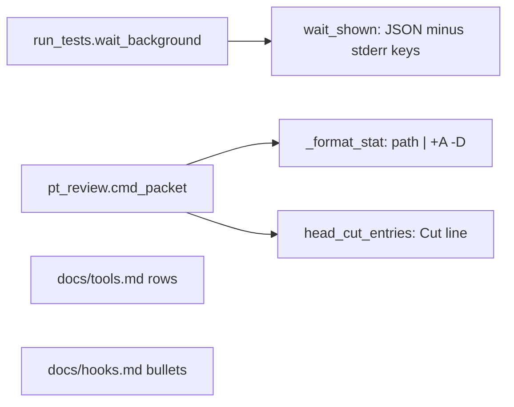
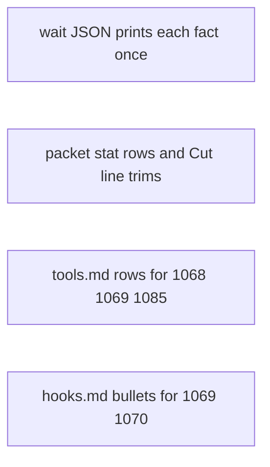

# B317: trim the grown packet and --wait parts (#1085); doc lines for #1068, #1069, #1070 (#1087)

**Goal:** print each fact once in `run_tests --wait` output and in the review packet's diff stat and Cut line, where the token rescan saw them grow (#1085); add the missing doc lines for #1068, #1069 and #1070 to docs/tools.md and docs/hooks.md (#1087).
**Architecture:** T1 filters the `--wait` stdout JSON in run_tests.py; T2 changes two renderers in pt_review.py (diff stat rows, the head's Cut line); T3 and T4 add doc lines with doc tests. The measurement that names the grown parts is docs/plans/2026-11-24-1085-packet-wait-growth.results.md (lead's scan, done).
**Tech stack:** Python 3, pytest.
**Spec:** issues #1085 and #1087; docs/plans/2026-11-24-1085-packet-wait-growth.results.md.
**Detail:** tests
**Wave0:** none
**Worktree:** none

Global constraints:
- Change only the files your task Owns. docs/tools.md and docs/hooks.md are append-only: add the new lines; every existing line stays byte-identical.
- The repository is public: no host names, and no project names or paths other than superlite's own, in any file.
- Builds: the verdict is `sl run_tests` (the project's test command; a project with `.maxapp` runs `maxapp test`, which a build pool may place on another Mac, and a full run whose tree a green maxapp test stamp covers returns that result without a run); task trees build in <tree>/.build/DerivedData and any build of your own goes under .build/ of the worktree, never -derivedDataPath outside the worktree (your session scratchpad included; backlog cleanup removes scratchpad build folders when the worktree goes); a product, simulator or device build stays on this machine and runs only when an issue's acceptance asks for a running-app check.
- Simulators: append the UDID of each simulator you or a worker creates (`xcrun simctl create` or `clone`; a checker's `Simulators:` line marks its created ones) as one line to /Users/max/github/superlite/.claude/worktrees/superlite-b317-docs-and-packet-trim/.superlite/simulators.txt; never list one you did not create; ship cleanup shuts down and deletes each listed one.

Ruling: the grown parts are named from one transcript scan (results file above), not from the code alone: researchers found the packet code added at most about 3k chars, so the scan split real packets by heading and real wait outputs by line kind (lead's ruling).
Ruling: [scope] the batch trims duplicates only: the `--wait` JSON keys its stderr lines print, the diff stat's padding and bars, the Cut line's section-8 names the `Read in full` line repeats. It keeps #912's failure reasons on the last line (they cut log re-opens from 33.7% to 23.1%), #918's `summary` key, the Global constraints (main's ruling in #1059), the standing note and the head's instruction lines - trimming those would undo decided behaviour - cost if wrong: a later batch trims more (lead's ruling).
Ruling: `--wait` keeps the last line's tested tail and the `output:` line and drops their keys from the stdout JSON instead, because workers copy the last line into a report's tests field (#818) and docs/tools.md names the `output:` line (lead's ruling).
Ruling: the Cut line keeps its `section 8 left out:` entry whole: agents/final-reviewer.md lets the reviewer read a file only when that entry or a `read <path> in full` marker names it (lead's ruling).
Ruling: the issue names plan_tools.py, but the packet builder is pt_review.py and the wait output is run_tests.py; no open batch lists either, so this batch edits them and names them in notes.md (lead's ruling).

## Coverage

| Row | State | Basis |
|---|---|---|
| scope and success criteria | settled | #1085: grown parts named (results file) and duplicates trimmed (T1, T2); #1087: the listed doc lines (T3, T4) |
| domain and data model | n/a | no data model |
| persistence and migration | ruled | the summary file on disk is unchanged; only what `--wait` prints changes |
| interfaces and contracts | ruled | `--wait` stdout JSON loses six keys; no caller parses them (grep of scripts and tests) |
| UI states | n/a | no UI |
| concurrency and state ownership | n/a | pure renderers |
| error handling and recovery | n/a | no new failure path |
| security and privacy | ruled | results file holds aggregates only, project file headings grouped |
| performance and limits | settled | fewer chars per packet and per wait call |
| observability | n/a | output trims only |
| testing strategy | settled | unit tests on the renderers, one wait integration test, doc tests |
| compatibility | ruled | the final reviewer's read rule still holds (Cut line keeps `left out`) |
| rollout | n/a | ships with the patch bump |
| research unknowns | n/a | researched (R1 to R4) |



## File structure

- `skills/subagent-driven-development/scripts/run_tests.py`: `WAIT_STDERR_KEYS`, `wait_shown` (T1).
- `tests/scripts/test_run_tests_wait_trim_1085.py`: T1 tests.
- `skills/subagent-driven-development/scripts/pt_review.py`: `_format_stat` rows, `head_cut_entries` (T2).
- `tests/scripts/test_packet_trim_1085.py`: T2 tests; `tests/scripts/test_packet_fast_forward.py`, `tests/scripts/test_packet_cut_code_819.py`: updated assertions (T2).
- `docs/tools.md`, `tests/scripts/test_docs_tools_1087.py`: T3. `docs/hooks.md`, `tests/scripts/test_docs_hooks_1087.py`: T4.

```mermaid
%% schedule
gantt
  title Predicted schedule (mm:ss)
  dateFormat X
  axisFormat %M:%S
  section lane 1
  T2 packet stat rows and Cut line trims :t2, 0, 224s
  section lane 2
  T1 wait JSON prints each fact once :t1, 0, 190s
  section lane 3
  T3 tools.md rows for 1068 1069 1085 :t3, 0, 186s
  section lane 4
  T4 hooks.md bullets for 1069 1070 :t4, 0, 186s
```





critical path: T2 (3.7 min) · peak width 4 · predicted build 3.7 min · predicted total ≈ 12.2 min

## run_tests

### T1 wait JSON prints each fact once · Complexity 2 (O-1) · Est. context 45k
**Owns:** skills/subagent-driven-development/scripts/run_tests.py, tests/scripts/test_run_tests_wait_trim_1085.py
**Components:** 1
**LOC owned:** 60
**Tests:** fast
**Model:** sonnet
**Kind:** design
**Produces:** WAIT_STDERR_KEYS: tuple[str, ...] · wait_shown(data: dict, summary: str) -> dict
**Review Focus:** `test_wait_shown_leaves_out_the_stderr_keys`: the six keys and `files` are gone, every other key stays, `summary` is added, the caller's dict is unchanged; `test_wait_prints_tree_and_output_once`: a real tree run's wait prints the output path once and the last line still ends with the tested tail
**Test code (verbatim):**
```python
"""run_tests --wait prints each fact once: its stdout JSON leaves out what its stderr lines print (#1085)."""
from __future__ import annotations

import json
import sys
from pathlib import Path

from test_plan_tools import SCRIPTS, run
from test_run_tests_tested_818 import RUN_TESTS, TAIL, stack, tree_run

sys.path.insert(0, str(SCRIPTS))
import run_tests  # noqa: E402


def test_wait_shown_leaves_out_the_stderr_keys():
    data = {"passed": 3, "failed": 1, "skipped": 0, "mode": "task", "files": {"t.py": [3, 1]},
            "failures": ["t.py::test_x: boom"], "error": "", "output": "/r/.superlite/s.output.log",
            "warning": "w", "tree": ".superlite/trees/T1", "lacks": ["a.py"], "drift": ["b.py"],
            "result_bundles": ["/r/x.xcresult"], "task": "T1"}
    assert run_tests.wait_shown(data, "/r/.superlite/s.json") == {
        "passed": 3, "failed": 1, "skipped": 0, "mode": "task", "failures": ["t.py::test_x: boom"],
        "error": "", "task": "T1", "summary": "/r/.superlite/s.json"}
    assert run_tests.WAIT_STDERR_KEYS == ("output", "warning", "tree", "lacks", "drift", "result_bundles")
    assert "output" in data and "files" in data


def test_wait_prints_tree_and_output_once(tmp_path):
    plan = stack(tmp_path)
    cp = tree_run(tmp_path, plan, "--background")
    assert cp.returncode == 0, cp.both
    w = run(RUN_TESTS, "--wait", "--timeout", "120", cwd=tmp_path)
    assert w.returncode == 0, w.both
    shown = json.loads(w.out)
    assert [k for k in run_tests.WAIT_STDERR_KEYS if k in shown] == []
    disk = json.loads(Path(shown["summary"]).read_text(encoding="utf-8"))
    assert disk["tree"] == ".superlite/trees/T1" and disk["lacks"] == ["src/b.txt"]
    lines = w.err.strip().splitlines()
    assert lines[-2] == f"output: {disk['output']}"
    assert lines[-1].endswith(TAIL)
    assert w.both.count(disk["output"]) == 1
```
**Steps:** 1 write the test file; 2 run it: FAIL (no `wait_shown`); 3 next to `summary_line` add `WAIT_STDERR_KEYS = ("output", "warning", "tree", "lacks", "drift", "result_bundles")` and `wait_shown(data, summary)`, which returns a new dict of `data` without `files` and those keys, plus `"summary": summary`; in `wait_background` replace the `shown = ...` line and the `json.dumps({**shown, "summary": ...})` call with `json.dumps(wait_shown(data, str(Path(mine).resolve())), ensure_ascii=False, indent=1)`; the stderr `output:`, `warning:` and `summary_line` prints stay as they are; 4 in the module docstring, after the sentence that ends `and `--wait` prints `output: <path>` right before its summary line`, add: `` `--wait`'s stdout JSON leaves out `files` and the keys its stderr lines print (`WAIT_STDERR_KEYS`: output, warning, tree, lacks, drift, result_bundles); the summary file its `summary` key names keeps them (#1085).``; 5 run the new file and `tests/scripts/test_run_tests_*.py`: PASS.

## pt_review

### T2 packet stat rows and Cut line trims · Complexity 3 (O-1) · Est. context 55k
**Owns:** skills/subagent-driven-development/scripts/pt_review.py, tests/scripts/test_packet_trim_1085.py, tests/scripts/test_packet_fast_forward.py, tests/scripts/test_packet_cut_code_819.py
**Components:** 2
**LOC owned:** 90
**Tests:** fast
**Model:** sonnet
**Kind:** design
**Produces:** _format_stat(rows: dict[str, tuple[int, int] | None]) -> str · head_cut_entries(cuts: list[str], must_read: list[str]) -> list[str]
**Review Focus:** `test_stat_rows_carry_counts_without_padding_or_bars`: exact rows below; `test_head_cut_entries_merge_truncated_and_skip_must_read`: exact lists below; `test_packet_head_names_a_cut_code_file_once`: a real packet names `src/big.py` on the head's `Read in full` line and on no Cut line; the stdout `cut:` lines are unchanged
**Test code (verbatim):**
```python
"""Packet trims (#1085): diff stat rows without padding or bars; the Cut line names each section-8 file once."""
from __future__ import annotations

import sys

from test_packet_cut_code_819 import change, packet, proj  # noqa: F401
from test_packet_inline import SCRIPT

sys.path.insert(0, str(SCRIPT.parent))
import pt_review  # noqa: E402


def test_stat_rows_carry_counts_without_padding_or_bars():
    rows = {"a.py": (3, 1), "deep/dir/long_name.py": (120, 0), "img.png": None}
    assert pt_review._format_stat(rows).splitlines() == [
        " a.py | +3 -1",
        " deep/dir/long_name.py | +120 -0",
        " img.png | Bin",
        " 3 files changed, 123 insertions(+), 1 deletion(-)",
    ]
    assert pt_review._format_stat({}) == ""


def test_head_cut_entries_merge_truncated_and_skip_must_read():
    cuts = ["section 0b: earlier rounds cut at 4000 of 9000 characters", "section 8 left out: a.py, b.md",
            "section 8 truncated: src/big.py", "section 8 truncated: docs/x.md", "section 8 truncated: tests/test_big.py"]
    assert pt_review.head_cut_entries(cuts, ["src/big.py", "a.py"]) == [
        "section 0b: earlier rounds cut at 4000 of 9000 characters", "section 8 left out: a.py, b.md",
        "section 8 truncated: docs/x.md, tests/test_big.py"]
    assert pt_review.head_cut_entries(["section 8 truncated: src/big.py"], ["src/big.py"]) == []
    assert pt_review.head_cut_entries(cuts[:2], []) == cuts[:2]


def test_packet_head_names_a_cut_code_file_once(proj):  # noqa: F811
    change(proj, ["src/big.py"], 400)
    r, t = packet(proj, "--max-tokens", "1500")
    lines = t.splitlines()
    assert "Read in full before your verdict (section 8 cut their diff; one Read each): src/big.py" in lines
    assert not [x for x in lines if x.startswith("Cut to fit the size cap:") and "src/big.py" in x]
    assert any(x.startswith("cut: section 8 truncated: ") and "src/big.py" in x for x in r.stdout.splitlines())
```
**Notes:** if `src/big.py` lands in section 8's `Left out:` line instead of a truncated excerpt at `--max-tokens 1500`, raise that number in the new test until it is truncated, and say so in your report.
**Steps:** 1 write the test file; 2 run it: FAIL; 3 `_format_stat`: each row ` {path} | +{added} -{deleted}` (binary ` {path} | Bin`), sorted by path, no padding, no bar; remove `STAT_BAR` if nothing else uses it; the summary line and the empty-input `""` stay; update its docstring; 4 add `head_cut_entries(cuts, must_read)`: entries not starting `section 8 truncated: ` keep their order; the files of all `section 8 truncated: ` entries, minus those in `must_read`, become one `section 8 truncated: f1, f2` entry at the first such entry's place, none when no file is left; in `cmd_packet` build the head's Cut line from `head_cut_entries(cuts, cut_code)` (no line when the list is empty; the `Read in full` line then stands alone in its place) and keep printing every `cut:` stdout line from `cuts` as now; 5 `test_packet_fast_forward.py::test_diff_stat_without_moved_run_file_matches_git`: compare with git's own numbers instead of its `--stat` layout: each `git diff --numstat` row `A\tD\tpath` (same range) must give the stat row `path | +A -D` (rows compared stripped), and the stat's last line stripped must equal `git diff --shortstat` stripped; 6 `test_packet_cut_code_819.py::test_must_read_line_names_cut_code`: both places that look up the Cut line and read the next line instead assert the `Read in full before your verdict` line is in the packet (the first case equal to `Read in full before your verdict (section 8 cut their diff; one Read each): src/big.py`, the second starting with it); keep each test's other assertions; 7 run the new file and `tests/scripts/test_packet_*.py tests/scripts/test_pt_review*.py`: PASS.

## Docs

### T3 tools.md rows for 1068 1069 1085 · Complexity 1 (O-1) · Est. context 30k
**Owns:** docs/tools.md, tests/scripts/test_docs_tools_1087.py
**Components:** 1
**LOC owned:** 40
**Tests:** fast
**Model:** haiku
**Kind:** mechanical
**Review Focus:** `test_new_rows_follow_their_anchor`: each row is present once, after its anchor row; `test_existing_rows_unchanged`: the anchors are still there
**Test code (verbatim):**
```python
"""docs/tools.md names #1068's import check, #1069's route --send, bare --wait and capture hint, and #1085's trims (#1087)."""
from __future__ import annotations

from pathlib import Path

DOC = Path(__file__).resolve().parents[2] / "docs" / "tools.md"
ROWS = [
    ("| `commit_task` |", "| `commit_task` import check (#1068) | The import check runs under the project's Python: the root's `.venv`, then the main checkout's `.venv` (from a worktree or task tree), then `VIRTUAL_ENV`, then `uv run --frozen --project <root> python` when `uv` is on PATH and the root holds `uv.lock` and `pyproject.toml`, then superlite's own interpreter. A declared dependency that is not installed prints `import warning F:L <error> (declared dependency not installed under CMD; environment gap, not blocking)`; a uv check that printed no result prints `import warning F:0 import check not run under CMD: WHY (environment gap, not blocking)`; a script whose module-level code runs the program is compiled, not imported: `import check skipped (script: top-level code runs the program): F`. |"),
    ("| `findings` |", "| `findings route --send` (#1069) | Starts one fixer worker per routed brief after the unchanged route lines; with the fleet off it refuses: `error: --send needs the fleet on (sl fleet on --plan PLAN); without the fleet start each brief with the Agent tool`. |"),
    ("| `run_tests` |", "| `run_tests --wait` (#1069, #1085) | A bare `--wait` (no summary path) waits on this tree's newest background run, also from a subfolder of the checkout. Its stdout JSON leaves out `files` and the keys its stderr lines print (`run_tests.WAIT_STDERR_KEYS`: `output`, `warning`, `tree`, `lacks`, `drift`, `result_bundles`); the summary file its `summary` key names keeps them (#1085). |"),
    ("| `run_tests` |", "| coordinator guard capture hint (#1069) | When the guard cannot resolve a word whose variable was captured from `sl` output, the line before `Unresolved word:` (`guard_tools.capture_hint`) names a form that needs no capture: `sl run_tests --wait` with no path for `run_tests`, `sl findings route --send` for `findings route`, and copying the printed text for any other `sl` tool; verdicts are unchanged (docs/hooks.md). |"),
    ("| `pt_review` |", "| `pt_review packet` trims (#1085) | Diff stat rows read ` path | +A -D` (` path | Bin` for a binary file) with no padding and no `+`/`-` bar, then git's summary line. The head's `Cut to fit the size cap:` line merges its section-8 truncated files into one `section 8 truncated: a, b` entry and leaves out the files the `Read in full before your verdict` line names; with no entry left there is no Cut line; `section 8 left out:` and the stdout `cut:` lines are unchanged. |"),
]


def _lines():
    return DOC.read_text(encoding="utf-8").splitlines()


def test_new_rows_follow_their_anchor():
    lines = _lines()
    for anchor, row in ROWS:
        assert lines.count(row) == 1, row[:60]
        first = next(i for i, ln in enumerate(lines) if ln.startswith(anchor))
        assert lines.index(row) > first, row[:60]


def test_existing_rows_unchanged():
    lines = _lines()
    for anchor, _ in ROWS:
        assert sum(ln.startswith(anchor) for ln in lines) == 1, anchor
```
**Steps:** 1 write the test file; 2 run it: FAIL; 3 in docs/tools.md insert each ROWS row (its second string, verbatim) as a new line directly after the line starting with its anchor; the two `run_tests` rows go in list order (the `--wait` row first, then the capture-hint row); change no other line; 4 run it: PASS.

### T4 hooks.md bullets for 1069 1070 · Complexity 1 (O-1) · Est. context 28k
**Owns:** docs/hooks.md, tests/scripts/test_docs_hooks_1087.py
**Components:** 1
**LOC owned:** 30
**Tests:** fast
**Model:** haiku
**Kind:** mechanical
**Review Focus:** `test_new_bullets_follow_their_anchor`: each bullet is present once, after its anchor bullet
**Test code (verbatim):**
```python
"""docs/hooks.md names #1070's known-variable log targets and the Logs bullet, and #1069's capture hint (#1087)."""
from __future__ import annotations

from pathlib import Path

DOC = Path(__file__).resolve().parents[2] / "docs" / "hooks.md"
BULLETS = [
    ("- `block-coordinator-edits`, session scripts and eval (#693):", "- `block-coordinator-edits`, known-variable log targets (#1070): a redirect target held in a variable with one known value (`LOG=.build/ios-test.log; cmd > \"$LOG\"`) gets the same git-ignored housekeeping check as a literal target; a name built from `$(...)` stays unknown. The code block's \"Logs and command output\" bullet names the scratch folder: redirect logs into `<state folder>/scratch/` or into a git-ignored folder no task Owns such as `.build/`, named literally or through a variable with one known value."),
    ("- `block-coordinator-edits`, unresolved words (#780, #781):", "- `block-coordinator-edits`, captured `sl` output (#1069): when a word the guard cannot resolve comes from a variable captured from `sl` output (followed back up to 4 assignments), the line before `Unresolved word:` (`guard_tools.capture_hint`) names the form that needs no capture: `sl run_tests --wait` with no path for `run_tests`, `sl findings route --send` for `findings route`, and copying the printed text for any other `sl` tool; verdicts and the block's last two lines are unchanged."),
]


def test_new_bullets_follow_their_anchor():
    lines = DOC.read_text(encoding="utf-8").splitlines()
    for anchor, bullet in BULLETS:
        assert lines.count(bullet) == 1, bullet[:60]
        first = next(i for i, ln in enumerate(lines) if ln.startswith(anchor))
        assert lines.index(bullet) > first, bullet[:60]
```
**Steps:** 1 write the test file; 2 run it: FAIL; 3 in docs/hooks.md insert each BULLETS bullet (its second string, verbatim, with the `\"` written as a plain `"`) as a new line directly after the line starting with its anchor; change no other line; 4 run it: PASS.

## Review Focus

run_tests (CLI): protocol - the `--wait` stdout JSON stays valid JSON with every key but the six; state - `wait_shown` never mutates the summary dict. pt_review (file generator): file - stat rows keep every changed file and its exact counts; encoding - a path with spaces keeps them. Docs: exact text, existing lines untouched. Probe entry: none (renderers inside a CLI that needs a run state; covered by the named tests).

## Self-review

#1085 maps to the results file (named parts) and T1, T2 (trims); #1087's bullets map to T3 (four tools.md items) and T4 (two hooks.md items); no placeholders; the four tasks share no file and run at once.
