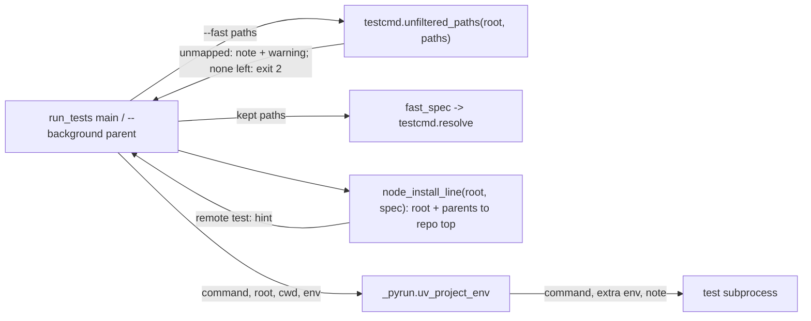
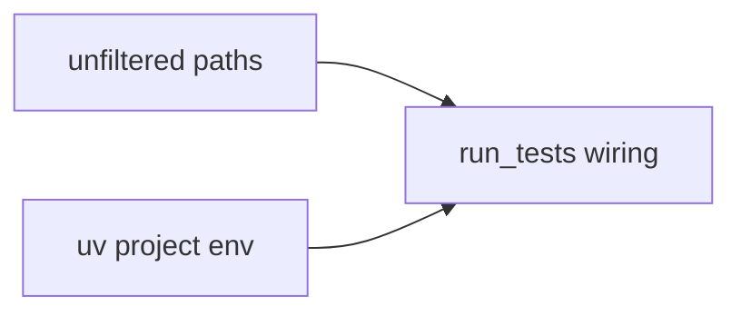

# B320: run_tests --fast never widens an unmapped path; --fast works when the test command runs elsewhere (#1119, #1120)

**Goal:** (#1119) a `run_tests --fast` path that maps to no test filter (a Swift file in no test target under an `{only_testing}` or `{names}` template) is named and skipped, and a run left with no path exits 2; it never runs the unfiltered suite. (#1120) the Node `node_modules` guard finds `node_modules` the way Node does (the run root and its parent folders up to the repository top), so a lead worktree inside a checkout that installed runs; a `uv run --no-project` test command that finds no Python environment (a remote fleet worker's tree) runs in the project's environment.
**Architecture:** new `testcmd.unfiltered_paths(root, paths)` says which paths resolve would widen; new `_pyrun.uv_project_env(command, root, cwd, environ)` rewrites or supplements a `uv run --no-project` command; `run_tests.py` drops the unmapped paths (main path and the `--background` parent), walks parents in `node_install_line`, appends a remote hint to its message, and applies `uv_project_env` to the command it runs.
**Tech stack:** Python 3 stdlib, pytest via `sl run_tests`.
**Spec:** issues #1119, #1120.
**Detail:** contracts
**Wave0:** none
**Coverage:** off

## Global constraints

- Root causes (lead, read on e903fa87): `testcmd.resolve` (testcmd.py:1483-1501) replaces the command with `cfg["test"]` when `only_testing()` or `swift_names()` returns None; `run_tests.node_install_line` (run_tests.py:1245) checks `node_modules` only in the root; `uv run --no-project` uses a venv only when VIRTUAL_ENV is set or a `.venv` sits in the cwd or a parent folder (`uv help run`), which holds for a worktree under the main checkout and not for a remote tree `~/.maxapp/trees/<repo>/<name>/<wid>`.
- Every code line in testcmd.py, _pyrun.py and run_tests.py ends with its `# O(...)` complexity comment like its neighbours; each touched module docstring names the new behaviour in one sentence with the issue number.
- `testcmd.resolve` and `testcmd.only_testing` keep their behaviour and texts (`sl testcmd` and docs tests read them); only run_tests stops reaching the unfiltered branch.
- Existing tests stay green except those a task names as rewritten. Another existing test that breaks: name it in the report, do not edit it without the lead's word.
- Files this batch may touch: skills/subagent-driven-development/scripts/run_tests.py, testcmd.py, _pyrun.py, the test files the tasks own, and this plan. docs/tools.md belongs to batch B326: never edit it.
- Builds: the verdict is `sl run_tests` (the project's test command; a project with `.maxapp` runs `maxapp test`, which a build pool may place on another Mac, and a full run whose tree a green maxapp test stamp covers returns that result without a run); task trees build in <tree>/.build/DerivedData and any build of your own goes under .build/ of the worktree, never -derivedDataPath outside the worktree (your session scratchpad included; backlog cleanup removes scratchpad build folders when the worktree goes); a product, simulator or device build stays on this machine and runs only when an issue's acceptance asks for a running-app check; copy this sentence into every worker brief.
- Simulators: append the UDID of each simulator you or a worker creates (`xcrun simctl create` or `clone`; a checker's `Simulators:` line marks its created ones) as one line to /Users/max/github/superlite/.claude/worktrees/superlite-b320-run-tests-fast-remote-and-filter/.superlite/simulators.txt; never list one you did not create; ship cleanup shuts down and deletes each listed one; copy this sentence into every worker brief.

Ruling: [scope] #1119 names and skips each unmapped path (one stderr note per path, the summary `warning` lists them) and refuses with exit 2 only when no path is left; a mixed run (a test file plus a source file) runs the test file alone. The issue allows "refused (or named and skipped)"; skipping keeps the useful part of a mixed run (lead's ruling).
Ruling: [scope] #1120 asks to skip the Node guard "when the test command is a remote command"; a remote fast command (`maxapp remote ...`) is already exempt (its first word is not a Node runner). The observed refusal was a local `bunx vitest` test_file in a worktree under a checkout that holds node_modules: the guard now walks parents as Node does (bunx found a parent folder's bin, measured). With nothing installed anywhere it still refuses, since a local run without dependencies fails, and the message names the remote route when the project's `test` runs through maxapp remote (lead's ruling).
Ruling: the parent walk stops at the nearest folder (self or ancestor) whose `.git` is a directory, inclusive; with no such folder only the root is checked, so a stray `~/node_modules` never counts (lead's ruling).
Ruling: for `uv run --no-project` with no reachable environment the rewrite to `--frozen --project <root>` (root holds uv.lock and pyproject.toml) comes before exporting the main checkout's venv as VIRTUAL_ENV: the rewrite installs the tree's own source, the main checkout's editable install points at the main checkout's source (lead's ruling).
Ruling: detail `contracts`: small helpers and wiring with exact messages, no algorithmic core (lead's ruling).

## Main diagram

## File structure

- skills/subagent-driven-development/scripts/testcmd.py: `unfiltered_paths`.
- skills/subagent-driven-development/scripts/_pyrun.py: `uv_project_env`.
- skills/subagent-driven-development/scripts/run_tests.py: the drop and refusal, the parent walk and remote hint, the `uv_project_env` call.
- tests/scripts/test_testcmd_unfiltered_paths_1119.py, tests/scripts/test_pyrun_uv_env_1120.py, tests/scripts/test_run_tests_fast_filter_remote_1119_1120.py: new tests; tests/scripts/test_run_tests_swift_only_testing.py and tests/scripts/test_run_tests_tree_node_modules.py: rewritten tests (T3).

## Task graph

```mermaid
%% schedule
gantt
  title Predicted schedule (mm:ss)
  dateFormat X
  axisFormat %M:%S
  section lane 1
  T2 uv project env :t2, 0, 647s
  T3 run_tests wiring :t3, 647, 717s
  section lane 2
  T1 unfiltered paths :t1, 0, 643s
```

critical path: T2 → T3 (22.7 min) · peak width 2 · predicted build 22.7 min · predicted total ≈ 41.2 min

## Helpers

**Probe entry:** none (internal helpers; named tests drive them with fake projects)

### T1 unfiltered paths · Complexity 2 (O-1) · Est. context 35k
**Owns:** skills/subagent-driven-development/scripts/testcmd.py, tests/scripts/test_testcmd_unfiltered_paths_1119.py
**Components:** 1
**LOC owned:** 90
**Tests:** fast
**Model:** sonnet
**Produces:** testcmd.unfiltered_paths(root, paths: list[str]) -> list[str]
e.g. unfiltered_paths(".", ["Tests/AppTests/FooTests.swift", "Tests/Support/Pool.swift"]) -> ["Tests/Support/Pool.swift"] when the config template is `xcodebuild test -scheme App {only_testing}` and only Tests/AppTests is a test target
e.g. unfiltered_paths(".", ["Sources/App/Model.swift"]) -> ["Sources/App/Model.swift"] for a `swift test --filter {names}` template when Model.swift declares no suite and is in no test target
e.g. unfiltered_paths(".", ["tests/test_a.py"]) -> [] for a `pytest {files}` template (no {only_testing}, no {names})
**Review Focus:** state: `test_only_testing_keeps_mapped_drops_unmapped` (first example); `test_names_drops_suite_less_source` (second example); `test_files_template_drops_nothing` (third example); `test_no_config_drops_nothing` (no config resolves: []); `test_order_and_duplicates_kept` (["b.swift","a.swift","b.swift"] all unmapped -> same list, same order); `test_prints_nothing` (capsys err == "" for the first example); `test_resolve_unchanged` (testcmd.resolve on the source path still returns the unfiltered `test` command and its note, as tests/scripts/test_testcmd_swift_targets_431.py::test_resolve_unmapped_runs_unfiltered asserts).
**Steps:** 1 failing tests, 2 run: FAIL, 3 implement, 4 run: PASS
**Notes:** Read the config as `resolve` does (`config_source(Path(root))`, template = `test_file` or `test`). `{only_testing}` in the template: a path is unfiltered when `xcode_only_testing(Path(root), [p], [])` returns ids None. `{names}`: only when `lang == "swift"` or any path ends with `.swift` (the condition at testcmd.py:1484); a path is unfiltered when `swift_names(root, [p])` is None. Both placeholders: `{only_testing}` wins (resolve's `elif`). A python config with no `test` returns []. Prints nothing. Fakes in tests: build a tiny project (Package.swift with a `.testTarget(name: "AppTests")`, or a project.pbxproj) as tests/scripts/test_testcmd_swift_targets_431.py does; copy its fixture helpers.

### T2 uv project env · Complexity 3 (O-1) · Est. context 35k
**Owns:** skills/subagent-driven-development/scripts/_pyrun.py, tests/scripts/test_pyrun_uv_env_1120.py
**Components:** 1
**LOC owned:** 130
**Tests:** fast
**Model:** sonnet
**Produces:** _pyrun.uv_project_env(command: str, root, cwd, environ: dict) -> tuple[str, dict, str]
e.g. uv_project_env("uv run --no-project --with pytest python -m pytest a.py -q", "/t", "/t", {}) -> ("uv run --frozen --project /t --with pytest python -m pytest a.py -q", {}, "uv run --no-project finds no environment from /t; running in the project's environment: uv run --frozen --project /t (#1120)") when /t holds uv.lock and pyproject.toml and no .venv sits in /t or a parent
e.g. uv_project_env(same command, "/w/wt", "/w/wt", {}) -> (same command, {"VIRTUAL_ENV": "/w/main/.venv"}, "uv run --no-project finds no environment from /w/wt; using the project's environment /w/main/.venv (VIRTUAL_ENV) (#1120)") when /w/wt has no uv.lock and found_python("/w/wt") is "/w/main/.venv/bin/python"
e.g. uv_project_env("uv run --group dev python -m pytest a.py", "/t", "/t", {}) -> ("uv run --group dev python -m pytest a.py", {}, "")
**Review Focus:** state, protocol: `test_rewrite_when_no_env` (first example; the rest of the command byte-identical); `test_root_with_space_is_quoted` (root "/t x" -> `--project '/t x'`); `test_virtual_env_set_leaves_command` (environ {"VIRTUAL_ENV": "/v"} -> (command, {}, "")); `test_parent_venv_leaves_command` (cwd /m/wt with /m/.venv/bin/python present -> (command, {}, "")); `test_main_checkout_venv_exported` (second example, a linked worktree laid out as tests/scripts/test_project_python_1068.py does, outside the main checkout); `test_no_lock_no_venv_note_only` (no uv.lock, nothing found -> (command, {}, "uv run --no-project finds no environment from <cwd> and <root> has no uv.lock; the project's own package may not import (#1120)")); `test_not_no_project_untouched` (third example); `test_no_project_after_program_untouched` ("uv run python -m pytest --no-project" -> unchanged, no note); `test_env_prefix_and_path_uv` ("A=1 /opt/bin/uv run --no-project python x.py" is recognised); `test_unparsable_untouched` (unbalanced quote -> (command, {}, "")).
**Steps:** 1 failing tests, 2 run: FAIL, 3 implement, 4 run: PASS
**Notes:** Recognise: shlex words; skip NAME=value words; then a word whose basename is `uv` followed by `run`; `--no-project` must sit before the program word (the first word that is `--` or whose basename is python, python3, python3.N, pytest or py.test). Unchanged when environ has a non-empty VIRTUAL_ENV, or `venv_python(folder / ".venv")` finds an interpreter for cwd or any parent of cwd. Rewrite (root holds uv.lock and pyproject.toml): replace the one `--no-project` token in the text (regex `(?<!\S)--no-project(?!\S)`, first match) with `--frozen --project <shlex.quote(str(root))>`, everything else byte-identical. Else `found_python(root)`: export its venv folder (the interpreter's parent's parent) as VIRTUAL_ENV. Never runs uv or git; paths as given (no resolve) in the command and the note.

## run_tests wiring

**Probe entry:** none (run_tests is driven end to end by the named tests with fake projects and fake runners)

### T3 run_tests wiring · Complexity 4 (O-2) · Est. context 60k
**Owns:** skills/subagent-driven-development/scripts/run_tests.py, tests/scripts/test_run_tests_fast_filter_remote_1119_1120.py, tests/scripts/test_run_tests_swift_only_testing.py, tests/scripts/test_run_tests_tree_node_modules.py
**Components:** 3
**LOC owned:** 220
**Tests:** fast
**Model:** sonnet
**Consumes:** testcmd.unfiltered_paths(root, paths: list[str]) -> list[str] (T1) · _pyrun.uv_project_env(command: str, root, cwd, environ: dict) -> tuple[str, dict, str] (T2)
**Review Focus:** state, protocol, file: see Notes for the exact texts. `test_fast_source_file_refused` (only `App/Views/ContentView.swift`, outside every target: exit 2, stderr and summary error carry the refusal text, no incident, the FULL command never ran); `test_fast_mixed_paths_runs_test_file_only` (test file plus source file: the filtered command for the test file runs, one skip note naming the source file, summary `warning` names it); `test_background_parent_refuses_unmapped` (`--fast <source> --background`: parent exits 2 with the refusal, nothing spawned); `test_background_mixed_runs_child` (mixed paths in the background: the child runs the test file, the note sits in the output log); `test_names_template_source_refused` (`swift test --filter {names}`, a suite-less source file: exit 2); `test_worktree_under_checkout_with_node_modules_runs` (git repo with node_modules and package.json, a linked worktree under it without node_modules: `--fast` passes the guard); `test_parent_without_git_dir_not_searched` (tmp parent holds node_modules, the root has no .git anywhere: refused as today); `test_remote_test_hint` (config `test` = `maxapp remote 'npm test'`, test_file `npx vitest run {files}`, nothing installed: the refusal ends with the hint); `test_uv_no_project_rewritten_in_run` (config test_file `uv run --no-project --with pytest python -m pytest {files} ...` with a fake `uv` on PATH that records argv, root with uv.lock and pyproject.toml, no .venv up the tree: recorded argv holds `--frozen --project <root>`, the note on stderr); `test_uv_virtual_env_exported` (fake uv records VIRTUAL_ENV when the helper returns extra env).
**Steps:** 1 failing tests, 2 run: FAIL, 3 implement, 4 run: PASS
**Notes:**
- #1119 texts: note per dropped path `run_tests: --fast P is in no test target, so it maps to no test filter; skipped, never widened to the whole suite (#1119)`; refusal (through `usage_error(a, label, reason)`, exit 2, no incident) `--fast paths map to no test filter (in no test target): P[, Q]; nothing to run: name a test file in a test target, or use --affected or --full (#1119)`; summary `warning` (joined to an existing one with `; `) `skipped --fast paths in no test target: P[, Q] (#1119)`.
- #1119 placement: on the main path after `skip_non_test` and `expand_fast_paths` and before `fast_spec` (run_tests.py ~2704-2721, also reached by `--affected`), and in the `--background` parent before its `fast_spec` call (~1689; the parent prints only the refusal, never the notes). A `--task` run whose spec comes from `**Tests:** cmd=` is not filtered (no resolve). `run_base_tests` is left as is.
- #1120 guard: `node_install_line(root, spec)` checks node_modules, .pnp.cjs and .pnp.js in root and each parent up to and including the nearest one whose `.git` is a directory; none: root only. Message unchanged, plus, when `testcmd.config_source(Path(root))[0]`'s `test` is a string and `is_remote_command` holds for it: `; the project's "test" runs through maxapp remote: install here, or give "test_file" the same maxapp remote form so --fast runs there (#1120)`.
- #1120 uv: right before the test subprocess starts (string command of a test-cmd.json spec, and the built-in pytest argv via `shlex.join` and `shlex.split`), call `pyrun.uv_project_env(command, run root or tree, the command's cwd, the child env)`; use the returned command, merge the extra env into the child env, print a non-empty note once as `run_tests: <note>`. Every mode (fast, full, task tree).
- Rewrite in tests/scripts/test_run_tests_swift_only_testing.py: `test_fast_source_file_runs_unfiltered` -> `test_fast_source_file_refused`, `test_fast_mixed_paths_run_unfiltered` -> `test_fast_mixed_paths_runs_test_file_only`, `test_background_parent_is_quiet` -> keeps "parent is quiet" for a mixed run and asserts the child ran the filtered command. In tests/scripts/test_run_tests_tree_node_modules.py `test_link_failure_tree_guard_names_tree`: the repo's node_modules is now reached by the walk, so assert the run passes the guard (no `node_modules missing`) and rename it `test_link_failure_tree_reaches_repo_node_modules`.
