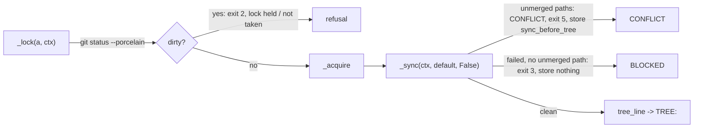
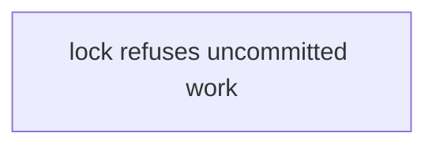

# B327: ship lock refuses uncommitted work up front; a sync that fails without a conflict stores no base tree (#1134)

**Goal:** (#1134) `sl backlog ship B lock` refuses a worktree with uncommitted work before it takes or queues for the ship lock, with a message that says to commit first; `sync_before_tree` is recorded only when the sync left a real conflict, so a rerun after committing never reports the batch's own commits as `changed by the sync`.
**Architecture:** `_lock` in backlog_ship.py runs `git status --porcelain` before `_acquire`; `_sync` (lock path only, `abort=False`) returns a `BLOCKED:` text instead of an empty `CONFLICT: ;` when the failed git command left no unmerged path; `_lock` maps that text to exit 3 and stores no `sync_before_tree`.
**Tech stack:** Python 3 stdlib, pytest via `sl run_tests`.
**Spec:** issue #1134.
**Detail:** contracts
**Wave0:** none
**Coverage:** off

## Global constraints

- Root cause (lead, read on 9565c9bc): `_lock` (backlog_ship.py:229-256) reads `before` and runs `_sync`; with uncommitted work `git rebase origin/<default>` refuses to start ("cannot rebase: You have unstaged changes"), `git diff --diff-filter=U` names nothing, `_sync` returns `CONFLICT: ; lock held: ...` and `_lock` stores `sync_before_tree` = the pre-commit tree; the rerun after the lead's commit compares against it and reports the commit as `changed by the sync`.
- Every code line in backlog_ship.py ends with its `# O(...)` complexity comment like its neighbours; the module docstring names the new behaviour in one sentence with `#1134`.
- `merge --from-main` keeps its behaviour and texts (it already refuses uncommitted work; its `_sync(..., True)` abort branch is unchanged). `bump` is unchanged.
- Existing tests stay green except the one assertion T1 names as rewritten. Another existing test that breaks: name it in the report, do not edit it without the lead's word.
- Files this batch may touch: skills/subagent-driven-development/scripts/backlog_ship.py, tests/scripts/test_backlog_ship_lock_dirty_1134.py, tests/scripts/test_backlog_ship.py (one assertion), and this plan. docs/tools.md (B331) and skills/subagent-driven-development/backlog.md (B329) belong to other batches: never edit them.
- Builds: the verdict is `sl run_tests` (the project's test command; a project with `.maxapp` runs `maxapp test`, which a build pool may place on another Mac, and a full run whose tree a green maxapp test stamp covers returns that result without a run); task trees build in <tree>/.build/DerivedData and any build of your own goes under .build/ of the worktree, never -derivedDataPath outside the worktree (your session scratchpad included; backlog cleanup removes scratchpad build folders when the worktree goes); a product, simulator or device build stays on this machine and runs only when an issue's acceptance asks for a running-app check; copy this sentence into every worker brief.
- Simulators: append the UDID of each simulator you or a worker creates (`xcrun simctl create` or `clone`; a checker's `Simulators:` line marks its created ones) as one line to /Users/max/github/superlite/.claude/worktrees/superlite-b327-ship-lock-refuse-uncommitted/.superlite/simulators.txt; never list one you did not create; ship cleanup shuts down and deletes each listed one; copy this sentence into every worker brief.

Ruling: the dirty check runs before `_acquire`, so a dirty lead neither waits in the ship lock queue nor takes the lock; a lock the batch already holds (after a CONFLICT) stays held and the refusal says so (lead's ruling).
Ruling: the check is the same `git status --porcelain` that `bump` and `merge --from-main` use: untracked files count, ignored ones (.superlite/) do not, so a tree `lock` accepts is one `bump` accepts (lead's ruling).
Ruling: [scope] a lock sync that fails with no unmerged path (git refused to start, nothing synced) prints `BLOCKED: <git command> failed: <tail>; lock held: ...` with exit 3 instead of the empty `CONFLICT: ;` exit 5, and stores no `sync_before_tree`; the issue names the empty CONFLICT as part of the defect and this keeps the base tree a clean committed one in every path (lead's ruling).
Ruling: detail `contracts`: one function's guard and one return-text branch with exact texts, no algorithmic core (lead's ruling).

## Main diagram

## File structure

- skills/subagent-driven-development/scripts/backlog_ship.py: the dirty check in `_lock`, the no-conflict branch in `_sync` (abort=False), the exit mapping in `_lock`, the docstring sentence.
- tests/scripts/test_backlog_ship_lock_dirty_1134.py: new tests.
- tests/scripts/test_backlog_ship.py: `test_lock_waits_for_a_live_holder_and_takes_over_a_dead_one` now expects the one read-only status call before the WAIT.

## Task graph

```mermaid
%% schedule
gantt
  title Predicted schedule (mm:ss)
  dateFormat X
  axisFormat %M:%S
  section lane 1
  T1 lock refuses uncommitted work :t1, 0, 286s
```

critical path: T1 (4.8 min) · peak width 1 · predicted build 4.8 min · predicted total ≈ 15.3 min

## Ship lock

**Probe entry:** none (an internal CLI step; named tests drive `bsh.main([B, "lock"])` with the fake `sh` fixture and the real-git `real` fixture)

### T1 lock refuses uncommitted work · Complexity 2 (O-1) · Est. context 36k
**Owns:** skills/subagent-driven-development/scripts/backlog_ship.py, tests/scripts/test_backlog_ship_lock_dirty_1134.py, tests/scripts/test_backlog_ship.py
**Components:** 1
**LOC owned:** 120
**Tests:** fast
**Model:** sonnet
**Produces:** `sl backlog ship B lock` exit 2 on uncommitted work, exit 3 on a no-conflict sync failure
e.g. worktree with ` M f.txt`, lock free -> exit 2, stdout `refused: uncommitted changes in the worktree (f.txt): commit them first, then run sl backlog ship B1 lock again; lock not taken`
e.g. `git rebase origin/main` exits 1 with `fatal: boom`, `git diff --name-only --diff-filter=U` prints nothing -> exit 3, stdout `BLOCKED: git rebase origin/main failed: fatal: boom; lock held: fix it, then run sl backlog ship B1 lock again`
**Review Focus:** state, protocol: `test_dirty_first_lock_refused_then_clean_rerun_ships_tested_tree` (real fixture: f.txt changed uncommitted; lock -> exactly the first example's text and exit 2, `ship_lock.holder(sh.lock)` is None, `b1(real).get("sync_before_tree")` is None, HEAD unchanged; then `git commit -am`; lock -> exit 0 and the first line is `TREE: unchanged by the sync: the tested tree ships, no full rerun`; this is the #1134 regression and fails before the fix); `test_untracked_file_refused` (sh fixture, reply `git status --porcelain` -> `?? new.txt\n`: exit 2, text names `(new.txt)` and ends `lock not taken`, `sh.calls == [["git", "status", "--porcelain"]]`, lock file absent or holder None); `test_refusal_names_five_paths_and_the_rest` (7 porcelain lines ` M a` .. ` M g`: text holds `(a, b, c, d, e, +2 more)`); `test_dirty_while_holding_after_conflict_keeps_lock_and_tree` (B1 holds the lock via `ship_lock.acquire(sh.lock, owner of B1, ...)` and batch key `sync_before_tree` = `t1`; reply status `UU a.py\n`: exit 2, text ends `; lock held`, holder still B1, `sync_before_tree` still `t1`, no `git fetch` in `sh.calls`); `test_failed_sync_without_conflict_blocks_and_stores_no_tree` (second example: exit 3 and that exact text, `sync_before_tree` absent, holder B1); `test_failed_sync_keeps_a_stored_tree` (same replies with `sync_before_tree` = `t1` stored first: exit 3, still `t1`); `test_conflict_still_stores_the_tree` (reply rebase (1, "CONFLICT"), diff -> `a.py\n`, HEAD^{tree} -> `t1` via the 1074 file's `seq` helper: exit 5, text starts `CONFLICT: a.py`, `sync_before_tree` == `t1`).
**Steps:** 1 failing tests, 2 run: FAIL (record the summary line), 3 implement, 4 run: PASS, 5 rewrite the one old assertion, 6 run the related files: tests/scripts/test_backlog_ship*.py, tests/scripts/test_ship_lock*.py
**Notes:**
- Placement: the check is the first step of `_lock` after `owner` and `lines = ctx["pre"] = []`, before `_acquire`. Command exactly `["git", "status", "--porcelain"]` run in `ctx["wt"]` through `_run` (the `sh` fixture matches replies by prefix). Any non-blank output refuses.
- Paths: one per non-blank porcelain line, `line[3:]` of the unstripped output (`_run` does not strip; a rename shows as `old -> new`, kept as is); the first 5 joined by `, `, then `+N more` when more than 5.
- Lock state word: `lock held` when `ship_lock.holder(ctx["lock"])` is a dict whose `batch` is this batch's id, else `lock not taken`. The refusal never releases or takes the lock and never touches `sync_before_tree`.
- `_sync`: capture each command's output; when it fails and `git diff --name-only --diff-filter=U` names nothing, the `abort=False` branch returns `BLOCKED: {' '.join(cmd)} failed: {_tail(out)}; lock held: fix it, then run sl backlog ship {bid} lock again`; the `abort=True` branch keeps its current text and abort call byte-identical. With unmerged paths both branches keep their current CONFLICT texts.
- `_lock`: a returned text starting `BLOCKED:` -> exit 3, `sync_before_tree` untouched; any other returned text -> exit 5 and the existing first-conflict store.
- tests/scripts/test_backlog_ship.py line 56: change only `sh.calls == []` to `sh.calls == [["git", "status", "--porcelain"]]` in `test_lock_waits_for_a_live_holder_and_takes_over_a_dead_one`.
- Fixtures: import `sh, ship, b1, locked, AG` from test_backlog_ship and `real, g` from test_backlog_ship_tree_639 as test_backlog_ship_conflict_retry_1074_1075.py does; `seq` from that file for the HEAD^{tree} answers.
- Docstring sentence (after the #1074 sentence): `` `lock` refuses uncommitted work before it takes the lock, and a sync that fails without a conflict is BLOCKED and records no base tree (#1134). ``

## Review Focus

- state: the ship lock and `sync_before_tree` after each exit (2, 3, 5, 0); a held lock survives a refusal, a free one is never taken.
- protocol: the exit codes and texts above; `merge --from-main` and `bump` unchanged.

## Running-app checks

None: no UI, widget or browser target.

## Self-review

- Coverage: #1134 Expected (refuse up front, clear message; base tree only from a clean committed tree) -> T1's first four tests and the BLOCKED branch.
- One task, no edges; Owns hold every touched file.
