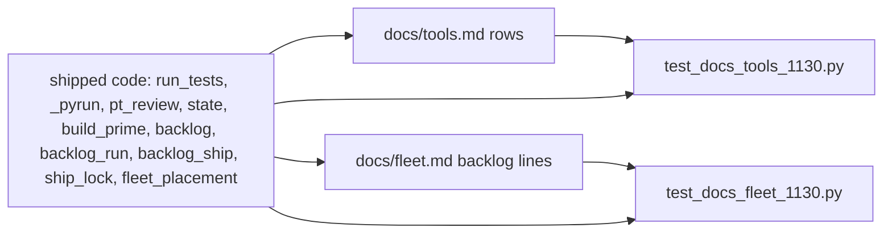
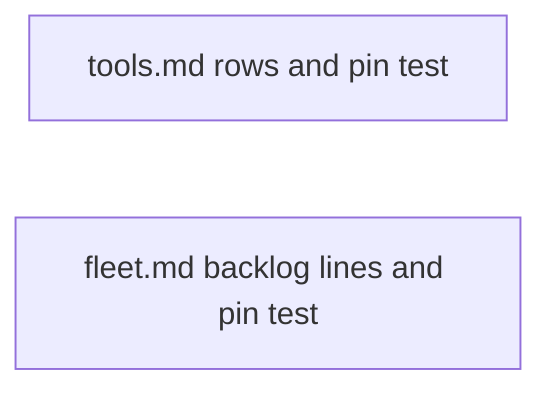

# B331: docs/tools.md and docs/fleet.md name the behaviour shipped in #1113-#1120, #1132-#1134 (#1130)

**Goal:** docs/tools.md and docs/fleet.md state, with each message verbatim from the script printing it, what B320, B321, B322, B324, B327, B328 and B329 shipped and could not write into these docs while other batches held them.
**Architecture:** docs only. New tools.md facts go into sub-rows placed right after their anchor row (B326's ruling: `| \`tool\` topic (#N) |`, so each anchor row stays one); stale facts are fixed in place. fleet.md's backlog-mode paragraph and Ship lock line gain the backlog facts in place. One new pin test per doc pins each fact and checks each quoted message against the script that prints it (B326's test_docs_tools_1106.py pattern).
**Tech stack:** Markdown, Python 3 pytest via `sl run_tests`.
**Spec:** issue #1130; the follow-up lines addressed to these docs in the shipped summaries B320, B321, B322, B324, B327, B328, B329 (their facts are copied into the tasks below).
**Detail:** contracts
**Wave0:** none
**Coverage:** off

## Global constraints

- Never edit a script, a skill or any file outside your task's Owns. An existing test outside your Owns that breaks: name it in the report, do not edit it.
- The code wins: before writing a fact, read the function the task names and quote each message verbatim (an f-string's `{x}` becomes a placeholder such as `<path>`, `B` or `N`); a fact below that the code contradicts is written as the code does it, and the report names the difference.
- Every row of docs/tools.md stays one table line: it ends with ` |`, holds exactly one ` | ` and never a bare `|` in its text (escape one as `\|`). Anchor rows (`| \`run_tests\` |`, `| \`pt_review\` |`, `| \`state\` |`, `| \`build_prime\` |`, `| \`backlog\` |`, `| \`backlog_run\` |`, `| \`backlog_ship\` |`, `| \`ship_lock\` |`, `| \`fleet\` |`) stay exactly one each.
- Read docs/tools.md and docs/fleet.md by line (`grep -n`, then the lines you edit), never whole: tools.md is 124 KB.
- Builds: the verdict is `sl run_tests` (the project's test command; a project with `.maxapp` runs `maxapp test`, which a build pool may place on another Mac, and a full run whose tree a green maxapp test stamp covers returns that result without a run); task trees build in <tree>/.build/DerivedData and any build of your own goes under .build/ of the worktree, never -derivedDataPath outside the worktree (your session scratchpad included; backlog cleanup removes scratchpad build folders when the worktree goes); a product, simulator or device build stays on this machine and runs only when an issue's acceptance asks for a running-app check; copy this sentence into every worker brief.
- Simulators: append the UDID of each simulator you or a worker creates (`xcrun simctl create` or `clone`; a checker's `Simulators:` line marks its created ones) as one line to /Users/max/github/superlite/.claude/worktrees/superlite-b331-docs-tools-md-and-fleet-md-rows-mis/.superlite/simulators.txt; never list one you did not create; ship cleanup shuts down and deletes each listed one; copy this sentence into every worker brief.

Ruling: new tools.md facts go into sub-rows right after their anchor row (after any sub-rows already there), stale clauses are fixed in place; fleet.md gains them in its existing backlog-mode paragraph and Ship lock line (lead's ruling, B326's pattern).
Ruling: [scope] B331 also writes the follow-ups B327 (#1134 ship lock refusal and BLOCKED sync), B328 (#1133 nested-worktree uv env) and B329 (#1132 research placement) addressed to these docs: same files, no decision (lead's ruling).
Ruling: the stale `sl backlog start --note /dev/null clears it` texts become the shipped `sl backlog note /dev/null clears it`; the two pins of the old text (tests/scripts/test_backlog_docs_773_777.py::test_tools_row_names_note_line, tests/scripts/test_docs_b237_fleet.py::test_fleet_names_standing_note_end) move to the new text; no open batch lists them (lead's ruling).
LAYERS: unit

## Main diagram

## File structure

- docs/tools.md: four new sub-rows, five in-place clauses (T1).
- tests/scripts/test_docs_tools_1130.py: pins the tools.md facts and their quoted texts against the scripts (T1).
- tests/scripts/test_backlog_docs_773_777.py: its `backlog_run` row pin moves to `sl backlog note /dev/null` (T1).
- docs/fleet.md: backlog-mode paragraph and Ship lock line (T2).
- tests/scripts/test_docs_fleet_1130.py: pins the fleet.md facts against the scripts (T2).
- tests/scripts/test_docs_b237_fleet.py: its standing-note pin moves to `sl backlog note /dev/null` (T2).

## Task graph

critical path: T1 (4.8 min) · peak width 2 · predicted build 4.8 min · predicted total ≈ 15.3 min

## Docs

### T1 tools.md rows and pin test · Complexity 3 (O-1) · Est. context 60k
**Owns:** docs/tools.md, tests/scripts/test_docs_tools_1130.py, tests/scripts/test_backlog_docs_773_777.py
**Components:** 1
**LOC owned:** 120
**Tests:** fast
**Kind:** design
**Model:** sonnet
**Est. time:** 5 min (1 component, about 120 LOC, fast tests)
**Consumes:** none
**Produces:** docs/tools.md rows `| \`run_tests\` --fast filter and uv env (#1119, #1120, #1133) |`, `| \`pt_review packet\` cuts and fences (#1118) |`, `| \`state\` plugin folder (#1116) |`, `| \`backlog_run\` note and cap 0 (#1113, #1114) |`, `| \`backlog_ship\` lock checks (#1134) |`
**Review Focus:** `test_rows_name_the_shipped_text`: each quoted message is in its row exactly once; `test_quoted_text_is_in_the_scripts`: each literal is in its script; read each new sentence against the function it names and fix one the code contradicts.
**Steps:** 1 write tests/scripts/test_docs_tools_1130.py (shape of tests/scripts/test_docs_tools_1106.py: NEW_ROWS, NAMED, CODE lists and the five tests below); 2 run it: FAIL; 3 make the edits; 4 run it plus test_docs_tools_1106.py, test_docs_tools_1087.py, test_docs_b32_tools.py, test_docs_b268_tools.py, test_docs_607_tools_backlog.py, test_docs_607_tools_tests.py, test_docs_b95_tools_fleet.py, test_backlog_docs_773_777.py: PASS.
**Notes:** Edits, each fact from the named code:

1. `run_tests` anchor row, in place: the Node `node_modules` guard clause now says it checks `node_modules`, `.pnp.cjs` and `.pnp.js` in the run root and its parents up to the nearest folder with a `.git` directory, as Node does; a `maxapp remote` fast command is exempt; with nothing installed it still refuses and, for a project whose `test` runs through `maxapp remote`, names that route (run_tests.py around lines 1240-1260, #1120).
2. New row right after the last existing `run_tests` sub-row (`| \`run_tests\` xcsift log lines and unittest (#1091, #1092) |`): `| \`run_tests\` --fast filter and uv env (#1119, #1120, #1133) |` stating: a `--fast` path that maps to no test filter (a Swift file in no test target under `{only_testing}` or `{names}`) is named on stderr (`run_tests: --fast <path> is in no test target, so it maps to no test filter; skipped, never widened to the whole suite (#1119)`) and in the summary warning, the other paths run filtered, and none left exits 2 with the `--fast paths map to no test filter ...` line (run_tests.py drop_unfiltered, ~1554-1563 and ~2768) and no incident; a `uv run ... --no-project ...` command that finds no environment (no `VIRTUAL_ENV`, no `.venv` in its cwd or a parent, as on a remote worker) runs as `uv run --frozen --project <root>` when root holds `uv.lock` and `pyproject.toml`, else a found venv is exported as `VIRTUAL_ENV`, else it runs unchanged with a note (#1120); one whose first `.venv` from the cwd up lies outside the run root (a worktree nested in the main checkout, a task tree under a worktree) also runs as `uv run --frozen --project <root>` (each tree syncs its own `.venv` once), a root without `uv.lock` keeps the command with the note ending `the tests may import that folder's package, not <root>'s (#1133)`, and an exported `VIRTUAL_ENV` still wins (_pyrun.py uv_project_env, #1133).
3. New row right after `| \`pt_review packet\` trims (#1085) |`: `| \`pt_review packet\` cuts and fences (#1118) |` stating: every display cut in the packet carries `[… N chars cut …]` (`pt_review.cut_mark`, `clip_text`): a long -/+ pair marks the cut before its head context, inside a changed span over 400 chars (first and last 200 kept) and after its tail context, only where text was cut; excerpt rows, incident and probe contexts, run errors and OUTDATED contexts too; every packet fence (section 1 excerpts, section 6 diff stat, section 8 and the tests shard) is one backtick longer than the longest backtick run inside, at least 3 (`pt_review.fence`, `fence_width`), and `_overhead` charges that width so the excerpt budget stays exact (pt_review.py ~2545-2600).
4. New row right after `| \`state\` |`: `| \`state\` plugin folder (#1116) |` stating: state never yields a state folder at or below the plugin's skills folder (`state.PLUGIN_SKILLS`, `in_plugin`): an explicit `--plan`, `SUPERLITE_STATE_DIR` or bind target there exits 2 (`state.Refused`, quote its message); a cwd inside the plugin's skills folder resolves to `<CLAUDE_PROJECT_DIR or SUPERLITE_PROJECT_DIR>/.superlite` (the session's launch folder), not its git toplevel; no launch folder or another live session owns it: the session's private folder; no session id either: exit 2; `bound()` ignores an older binding there and the next bind moves its gate and fleet out; hooks/session-start exports the launch folder (`CLAUDE_PROJECT_DIR`, else the input cwd) as `SUPERLITE_PROJECT_DIR` (state.py top docstring, launch_dir ~117, Refused ~65).
5. `build_prime` anchor row, in place: its default `--out` is `state.plan_dir(<--plan>)`, the folder `fleet spawn --plan` reads; an explicit `--out` keeps its meaning (#1116); also fix the typo `when when` to `when` (adjacent fix).
6. `backlog_run` anchor row, in place: `a \`run end: standing note ...\` line naming \`sl backlog start --note /dev/null\`` becomes `naming \`sl backlog note /dev/null\``; in tests/scripts/test_backlog_docs_773_777.py::test_tools_row_names_note_line change `assert "--note /dev/null" in row` to `assert "sl backlog note /dev/null" in row`.
7. New row right after `| \`backlog_run\` |`: `| \`backlog_run\` note and cap 0 (#1113, #1114) |` stating: `sl backlog note FILE` stores or clears (an empty file, `/dev/null`) the standing note and starts no batch; a fleet worker is refused, exit 2, `BLOCKED: sl backlog note runs only in the main session`; `start --note FILE` still stores and then starts; the run-end line, the status `note:` line and the lead brief's note head name `sl backlog note` (backlog.py ~920-935, backlog_brief.NOTE_HEAD, #1113); `sl backlog run` at lead cap 0 with a planned batch and no running or needs_decision batch prints `BLOCKED: no free slot for B (cap 0); rerun once the cap: line shows room` and `waiting for room: cap 0; start retried every 300 s until --timeout` once, retries start every `--retry` s and ends on a start, a batch needing main or TIMEOUT; `start` at cap 0 exits 2 (backlog_run.py ~335 and ~1234, #1114).
8. New row right after `| \`backlog_ship\` |`: `| \`backlog_ship\` lock checks (#1134) |` stating: `lock` runs `git status --porcelain` before it takes or queues for the lock (untracked files count, the ignored `.superlite/` does not); dirty work exits 2 with `refused: uncommitted changes in the worktree (<up to 5 paths, +N more>): commit them first, then run sl backlog ship B lock again; lock held` (or `lock not taken`), and a lock held after a CONFLICT stays held; a sync that fails with no unmerged path (git refused to start, nothing synced) prints `BLOCKED: <git command> failed: <tail>; lock held: fix it, then run sl backlog ship B lock again` (exit 3) instead of an empty CONFLICT and records no base tree (`sync_before_tree`) (backlog_ship.py ~185-245).
9. `ship_lock` anchor row, in place, append: the queue is first come first served; each poll refreshes a queued waiter's `seen`, and a waiter missing from the Herdr agent list leaves the queue only once unseen for 2 minutes (`LIVE_GRACE_MS`, #1115) (ship_lock.py ~24 and ~95-105).
10. `fleet` brief checks row (`| \`fleet\` brief checks (#1089, #1094, #1107) |`), in place: replace `(#1089: spawn that researcher with \`--machine local\`, since a remote machine lacks the path; spawn does not check it)` with `(#1089); the plain \`fleet spawn --role research --brief F\` hands placement the brief, so a researcher whose brief names such a path stays on this machine by itself (stderr \`placement: research worker stays local: ... (#1111)\`); \`--for-dispatch\` and \`--for-review\` pass no brief (#1132)` (fleet.py plain spawn, fleet_placement.py ~270-280).

Tests (test_docs_tools_1130.py), each over `LINES = docs/tools.md lines`:
- `test_new_rows_follow_their_anchor`: each of the five Produces rows occurs once and after its anchor (`| \`run_tests\` |`, `| \`pt_review\` |`, `| \`state\` |`, `| \`backlog_run\` |`, `| \`backlog_ship\` |`).
- `test_anchor_rows_stay_one_each`: the nine anchors of Global constraints occur once each.
- `test_new_rows_stay_one_table_line`: each new row ends ` |` and holds exactly one ` | `.
- `test_rows_name_the_shipped_text`: NAMED pairs (row prefix, text once in that row), at least: `is in no test target, so it maps to no test filter; skipped, never widened to the whole suite (#1119)`, `uv run --frozen --project <root>`, `(#1133)` in the uv row; `.pnp.cjs` in `run_tests`; `[… N chars cut …]` and `at least 3` in the cuts row; `SUPERLITE_PROJECT_DIR` and `state.Refused` in the state row; `state.plan_dir` in `build_prime` and `when when` absent there; `sl backlog note /dev/null` in `backlog_run`; `BLOCKED: sl backlog note runs only in the main session`, `no free slot for B (cap 0); rerun once the cap: line shows room`, `waiting for room: cap 0; start retried every 300 s until --timeout` in the note row; `refused: uncommitted changes in the worktree (`, `lock held: fix it, then run sl backlog ship B lock again` in the lock checks row; `LIVE_GRACE_MS` in `ship_lock`; `placement: research worker stays local: ... (#1111)` and `(#1132)` in the brief checks row, whose text no longer holds `spawn does not check it`.
- `test_quoted_text_is_in_the_scripts`: CODE pairs (script under skills/subagent-driven-development/scripts, literal its source holds), one per quoted message, at least: run_tests.py `is in no test target, so it maps to no test filter; skipped, never widened to the whole suite (#1119)`; _pyrun.py `the tests may import that folder's package, not {root}'s (#1133)`; pt_review.py `chars cut …]`; state.py `SUPERLITE_PROJECT_DIR`; backlog.py `BLOCKED: sl backlog note runs only in the main session`; backlog_run.py `start retried every {a.retry} s until --timeout` and `); rerun once the cap: line shows room`; backlog_ship.py `refused: uncommitted changes in the worktree (` and `lock held: fix it, then run sl backlog ship {bid} lock again`; ship_lock.py `LIVE_GRACE_MS = 120000`; fleet_placement.py `placement: research worker stays local: `.

### T2 fleet.md backlog lines and pin test · Complexity 2 (O-1) · Est. context 40k
**Owns:** docs/fleet.md, tests/scripts/test_docs_fleet_1130.py, tests/scripts/test_docs_b237_fleet.py
**Components:** 1
**LOC owned:** 60
**Tests:** fast
**Kind:** design
**Model:** sonnet
**Est. time:** 3 min (1 component, about 60 LOC, fast tests)
**Consumes:** none
**Produces:** docs/fleet.md backlog-mode paragraph (the line starting `` `/superlite:backlog` works a whole issue backlog``) and Ship lock line (the line starting `Ship lock: leads ship one at a time.`) naming #1113, #1114, #1115 and #1134
**Review Focus:** `test_backlog_paragraph_names_note_and_room`, `test_ship_lock_line_names_checks_and_grace`: each text once in its line; `test_quoted_text_is_in_the_scripts`.
**Steps:** 1 write tests/scripts/test_docs_fleet_1130.py; 2 run it: FAIL; 3 make the edits; 4 run it plus test_docs_b237_fleet.py, test_docs_607_fleet.py, test_docs_b268_fleet.py, test_docs_b313.py, test_fleet_docs_669.py: PASS.
**Notes:** Edits, each fact from the named code (quote messages verbatim):

1. Backlog-mode paragraph, in place: after the `start --note FILE` clause add that `sl backlog note FILE` stores or clears the standing note and starts no batch (main session only: a fleet worker gets `BLOCKED: sl backlog note runs only in the main session`, exit 2) (backlog.py ~920-935, #1113); replace the closing sentence's `` `run end: standing note from <file> still goes into every later lead brief; sl backlog start --note /dev/null clears it` `` with the current message `` `run end: standing note from <file> (<time>, <n> lines) still goes into every later lead brief; sl backlog note /dev/null clears it` `` (backlog_run.py ~1078); add that `sl backlog run` at lead cap 0, with a planned batch and none running or needing a decision, prints `BLOCKED: no free slot for B (cap 0); rerun once the cap: line shows room` and `waiting for room: cap 0; start retried every 300 s until --timeout` once and retries `start` every `--retry` s until a start, a batch needing main or TIMEOUT (backlog_run.py ~335 and ~1234, #1114).
2. Ship lock line, in place, append: `lock` first refuses uncommitted work (`git status --porcelain`; untracked files count, the ignored `.superlite/` does not), exit 2 `refused: uncommitted changes in the worktree (<paths>): commit them first, then run sl backlog ship B lock again; lock held` or `lock not taken`; a sync that fails with no unmerged path is `BLOCKED: <git command> failed: <tail>; lock held: fix it, then run sl backlog ship B lock again` (exit 3) and records no base tree (backlog_ship.py ~185-245, #1134); waiters queue first come first served, each poll refreshes a waiter's `seen`, and a waiter Herdr does not list leaves the queue only once unseen for 2 minutes (`LIVE_GRACE_MS`, ship_lock.py, #1115).
3. tests/scripts/test_docs_b237_fleet.py::test_fleet_names_standing_note_end: change `"--note /dev/null" in FLEET` to `"sl backlog note /dev/null" in FLEET`.

Tests (test_docs_fleet_1130.py), over the two fleet.md lines found by their start text:
- `test_backlog_paragraph_names_note_and_room`: the paragraph holds once each `sl backlog note FILE`, `BLOCKED: sl backlog note runs only in the main session`, `run end: standing note from <file> (<time>, <n> lines) still goes into every later lead brief; sl backlog note /dev/null clears it`, `waiting for room: cap 0; start retried every 300 s until --timeout`, `no free slot for B (cap 0); rerun once the cap: line shows room`; and no longer `sl backlog start --note /dev/null clears it`.
- `test_ship_lock_line_names_checks_and_grace`: the Ship lock line holds `refused: uncommitted changes in the worktree (`, `lock held: fix it, then run sl backlog ship B lock again`, `LIVE_GRACE_MS`, `2 minutes`.
- `test_quoted_text_is_in_the_scripts`: backlog.py `BLOCKED: sl backlog note runs only in the main session`; backlog_run.py `still goes into every later lead brief; sl backlog note /dev/null clears it`, `start retried every {a.retry} s until --timeout`; backlog_ship.py `refused: uncommitted changes in the worktree (`, `lock held: fix it, then run sl backlog ship {bid} lock again`; ship_lock.py `LIVE_GRACE_MS = 120000`.

## Review Focus

Docs package, no runnable entry: each new sentence is checked against the function it names; the pin tests turn a later rewording red. **Probe entry:** none (docs only).

## Self-review

Every #1130 bullet and the B327, B328, B329 follow-ups map to T1 or T2; T1 and T2 share no file; no placeholders.
