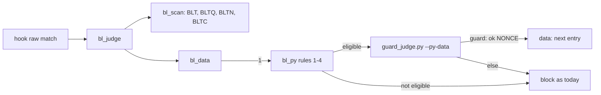
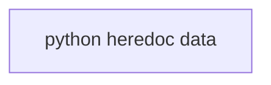

# B332: the fleet backlog guard reads a Python heredoc body as Python (#1142)

**Goal:** in a fleet session, `sl backlog decide|answer|start|plan` inside the string literals or comments of a quoted heredoc that a lone Python runs as its program (`python3 - <<'EOF'`) is data, not a command; real runs stay blocked.
**Architecture:** `hooks/block-coordinator-edits` `bl_judge` (#276/#706 fleet backlog guard, bash) gains `bl_py J`: for a quoted-heredoc match it asks `guard_judge.py --py-data` (new mode) whether the words are data. The judge reuses `guard_tools._mask` (strings, f-string text and comments blanked) and `guard_tools._RUNS_TEXT` (code that can run text, B99).
**Tech stack:** bash 3.2-compatible hook, Python 3.10+ stdlib, pytest.
**Spec path:** issue #1142 (this plan restates it under Design).
**Detail:** tests
**Wave0:** none
**Coverage:** off
**Target-min:** 11

Global constraints:
- Builds: the verdict is `sl run_tests` (the project's test command; a project with `.maxapp` runs `maxapp test`, which a build pool may place on another Mac, and a full run whose tree a green maxapp test stamp covers returns that result without a run); task trees build in <tree>/.build/DerivedData and any build of your own goes under .build/ of the worktree, never -derivedDataPath outside the worktree (your session scratchpad included; backlog cleanup removes scratchpad build folders when the worktree goes); a product, simulator or device build stays on this machine and runs only when an issue's acceptance asks for a running-app check.
- Simulators: append the UDID of each simulator you or a worker creates (`xcrun simctl create` or `clone`; a checker's `Simulators:` line marks its created ones) as one line to /Users/max/github/superlite/.claude/worktrees/superlite-b332-guard-heredoc-body-is-data/.superlite/simulators.txt; never list one you did not create; ship cleanup shuts down and deletes each listed one.
- The hook stays bash 3.2 compatible (no `declare -A`, no `${x,,}`, no `mapfile`); every new check only relaxes the block: any doubt, error, missing Python, missing judge or missing `guard: ok NONCE` line keeps the block.
- Block message text, `Matched:` sentences and every existing ALLOW/BLOCK case of tests/scripts/test_lead_guard_heredoc_276.py stay unchanged.

## Design

Sighting (B331 T2, 1.5.350): `cd W; python3 - <<'EOF'` with a Python docs edit whose string literals hold `sl backlog start --note /dev/null`, then `sl run_tests ...`, was blocked: "Matched: the heredoc <<EOF, which python3 in the same command runs." The guard lives in the hook's `bl_judge`, not in guard_judge/guard_lex.

Rules (all must hold, else today's verdict stands):
1. The BLT entry is a heredoc with a quoted delimiter (`<<'D'`, `<<"D"`, `<<\D`, also `<<-`); quoted text entries and unquoted heredocs are unchanged.
2. It is not inside `$( )` or backticks (`BLTN[j]=0`).
3. Its command word `CW[c]` (c = `BLTC[j]`) matches `^(python|pypy)[0-9.]*$`, and every word of `CA[c]` is `-`, matches `^-[BEIOSbdqsuv]+$`, or is one of that command's stdout targets (`BLF[c]` lines): the body is the program, not stdin data of a script, `-c` or `-m`.
4. No other command of the call is a runner: `CR[c2]` is not 1 for every `c2 != c` (0..`BLNC`), `hasmake` is 0, and not both `envw` and `envs` are 1.
5. `guard_judge.py --py-data` gets the raw body on stdin and prints `guard: ok NONCE` (exit 0) only when `guard_tools._mask(body)` is readable, no `guard_tools._RUNS_TEXT` pattern matches the masked code, and the masked code (with `\`, `"`, `'` removed) holds no backlog words (`backlog(\.py)?\s+(decide|answer|start|plan)` not followed by `[A-Za-z0-9_-]`, case-insensitive).

Ruling: [scope] #1142 says a quoted heredoc body is data; it is only where the shell does not run it: a body a shell, eval or a non-Python interpreter runs (`bash <<'EOF'`, `node - <<'EOF'`) still counts as a command, and a Python body counts when its code can run text (because those are real runs the guard exists for).
Ruling: the fix lives in hooks/block-coordinator-edits (where the block is) plus a guard_judge.py mode; guard_lex.py needs no change (because the fleet backlog guard has its own bash lexer, bl_scan).
Ruling: `python3 -c '...'` quoted text keeps today's verdict (because #1142's sighting is a heredoc; YAGNI).
Ruling: the judge call is one Python spawn, only when the raw backlog match fired and rules 1-4 hold (because the idle path must stay spawn-free, #276).



## File structure

- hooks/block-coordinator-edits: `bl_scan` records `BLTQ[j]` (1 for a quoted-delimiter heredoc, 0 otherwise); new `bl_py J`; `bl_judge` calls it when `bl_data` returned 1; `find_py` moves above the fleet backlog block (pure move) so `bl_py` can call it.
- skills/subagent-driven-development/scripts/guard_judge.py: `py_data(code: str) -> bool` and the `--py-data` mode in `main`.
- tests/scripts/test_guard_heredoc_body_1142.py: hook and judge tests.
- docs/hooks.md: one #1142 sentence in the fleet backlog guard (#706) bullet.

## Task graph




critical path: T1 (3.9 min) · peak width 1 · predicted build 3.9 min · predicted total ≈ 10.4 min (target ✓)

## Guard

### T1 Python heredoc body judged as Python · Complexity 4 · Est. context 45k
**Owns:** hooks/block-coordinator-edits, skills/subagent-driven-development/scripts/guard_judge.py, tests/scripts/test_guard_heredoc_body_1142.py, docs/hooks.md
**Components:** 2
**LOC owned:** 170
**Tests:** fast
**Kind:** design
**Model:** sonnet
**Est. time:** 4 min (2 components, about 170 LOC, fast tests)
**Produces:** guard_judge.py_data(code: str) -> bool · guard_judge.py --py-data (stdin: Python program; stdout `guard: ok NONCE`, exit 0 when data; exit 1 otherwise)
e.g. py_data("t = 'sl backlog start'\n") -> True
e.g. py_data("import os\nos.system('sl backlog start')\n") -> False
e.g. py_data("sl backlog start\n") -> False
**Review Focus:** state: the new arrays are reset per `bl_scan` and `BLTQ` lines up with `BLT` for quoted-text entries too; protocol: a judge exit 0 without the nonce line keeps the block (`test_judge_without_ack_keeps_block`); encoding: an unreadable body (`x = '''...` unterminated) keeps the block.
**Steps:** 1 write the test file below, 2 run it: the ALLOW hook cases and the judge cases FAIL, 3 implement guard_judge `py_data` and `--py-data` (handled in `main` before `_args`; any exception: exit 1, no ack), 4 implement the hook per the Design rules 1-5 (`bl_py` runs the judge like the `--owns` call: `SUPERLITE_GUARD_NONCE`, `"${PY[@]}" -I -X utf8 -W ignore`, body via `printf '%s'` on stdin, ok only on exit 0 with `guard: ok $nonce` in the output), 5 add the docs/hooks.md sentence and a #1142 line to the hook's comment above the fleet block, 6 run the test file plus tests/scripts/test_lead_guard_heredoc_276.py and tests/scripts/test_block_coordinator_edits.py: PASS.
**Notes:** `bl_judge` runs with `nocasematch` on; keep `bl_py`'s regex tests inside it. The body passed to the judge is the raw `BLT[j]` (not the quote-stripped `t`).
**Test code (verbatim):**
```python
"""#1142: in a fleet session the backlog guard reads a quoted heredoc that a lone Python runs as its program as Python:
`sl backlog decide|answer|start|plan` in its string literals or comments is data, unless the code can run text or
another command of the call is a runner."""
import json, os, subprocess, sys
from pathlib import Path
import pytest
from test_block_coordinator_edits import BASH, HOOK

JUDGE = Path(__file__).resolve().parents[2] / "skills" / "subagent-driven-development" / "scripts" / "guard_judge.py"

SIGHTING = ("cd /tmp/w; python3 - <<'EOF'\np='docs/fleet.md'\nt=open(p).read()\n"
            "b=\"`run end: still goes into every later lead brief; sl backlog start --note /dev/null clears it`.\"\n"
            "assert t.count(b)==1\nt=t.replace(b,\"`sl backlog note /dev/null clears it`.\")\nopen(p,'w').write(t)\nEOF\n"
            "/abs/sl run_tests --fast tests/scripts/test_docs_fleet_1130.py --task T2 --background")

ALLOW = [
    SIGHTING,
    "python3 - <<'EOF'\nopen('docs/x.md', 'w').write('Run sl backlog start B1 from main.')\nEOF",
    "python3 <<'EOF'\nprint('sl backlog plan --reset')\nEOF",
    'python3 -u - <<"EOF"\nt = """sl backlog decide --file f"""\nEOF',
    "python3 - <<\\EOF\n# sl backlog answer B1\nx = 1\nEOF",
    "python - <<'EOF'\nopen('a.md','w').write(f'sl backlog start {1}')\nEOF\ngit add a.md && git commit -m x",
    "python3.12 - <<'PY'\ns = 'sl backlog start'\nPY",
    "python3 - <<'EOF' > out.md\nprint('sl backlog start')\nEOF",
]
BLOCK = [
    "python3 - <<'EOF'\nimport os\nos.system('sl backlog start')\nEOF",
    "python3 - <<'EOF'\nimport subprocess\nsubprocess.run('sl backlog start', shell=True)\nEOF",
    "python3 - <<'EOF'\nexec('import os; os.system(\"sl backlog plan\")')\nEOF",
    "python3 - <<'EOF'\nfrom os import system\nsystem('sl backlog decide')\nEOF",
    "python3 - <<EOF\nprint('sl backlog start')\nEOF",
    "python3 - <<'EOF'\nopen('f.sh','w').write('sl backlog start')\nEOF\nbash f.sh",
    "python3 - <<'EOF' | sh\nprint('sl backlog start')\nEOF",
    "python3 - <<'EOF'\nprint('sl backlog start')\nEOF\nmake test",
    "python3 x.py <<'EOF'\nsl backlog start\nEOF",
    "python3 -c 'import sys; print(sys.stdin.read())' <<'EOF'\nsl backlog start\nEOF",
    "python3 -m code <<'EOF'\nsl backlog start\nEOF",
    "$(python3 - <<'EOF'\nprint('sl backlog start')\nEOF\n)",
    "python3 - <<'EOF'\nx = '''sl backlog start\nEOF",
    "python3 - <<'EOF'\nsl backlog start\nEOF",
    "node - <<'EOF'\nconsole.log('sl backlog start')\nEOF",
    "bash <<'EOF'\necho 'sl backlog start' > d.md\nEOF",
]


@pytest.fixture
def sd(tmp_path):
    d = tmp_path / "proj" / ".superlite"; d.mkdir(parents=True); return d


def call(sd, cmd, role="lead", **env):
    e = {k: v for k, v in os.environ.items() if not k.startswith("SUPERLITE_")}
    e.update({"CLAUDE_PROJECT_DIR": str(sd.parent), "SUPERLITE_FLEET_WORKER": "W2", "SUPERLITE_FLEET_ROLE": role,
              "SUPERLITE_STATE_DIR": str(sd)}, **env)
    raw = json.dumps({"session_id": "s1142", "tool_name": "Bash", "tool_input": {"command": cmd}, "cwd": str(sd.parent)})
    return subprocess.run([BASH, str(HOOK)], input=raw, capture_output=True, text=True, env=e, cwd=sd.parent)


@pytest.mark.parametrize("cmd", ALLOW)
def test_python_heredoc_strings_pass(sd, cmd):
    for role in ("lead", "implementer"):
        r = call(sd, cmd, role=role)
        assert r.returncode == 0, (role, cmd, r.stderr)


@pytest.mark.parametrize("cmd", BLOCK)
def test_runs_stay_blocked(sd, cmd):
    for role in ("lead", "implementer"):
        r = call(sd, cmd, role=role)
        assert r.returncode == 2 and "runs only in the main session" in r.stderr, (role, cmd, r.stderr)


def test_block_line_unchanged(sd):
    r = call(sd, "python3 - <<'EOF'\nimport os\nos.system('sl backlog start')\nEOF")
    assert "Matched: the heredoc <<EOF, which python3 in the same command runs." in r.stderr, r.stderr


def test_judge_without_ack_keeps_block(sd, tmp_path):
    fake = tmp_path / "fakepy"
    fake.write_text("#!/bin/sh\ncat >/dev/null\nexit 0\n"); fake.chmod(0o755)
    r = call(sd, SIGHTING, SUPERLITE_PYTHON=str(fake))
    assert r.returncode == 2 and "runs only in the main session" in r.stderr, r.stderr


def judge(code):
    e = {k: v for k, v in os.environ.items() if not k.startswith("SUPERLITE_")}
    e["SUPERLITE_GUARD_NONCE"] = "n1142"
    return subprocess.run([sys.executable, "-I", "-X", "utf8", str(JUDGE), "--py-data"], input=code,
                          capture_output=True, text=True, env=e)


@pytest.mark.parametrize("code,ok", [
    ("t = 'sl backlog start'\n", True),
    ("# sl backlog plan\n", True),
    ("open('a.md', 'w').write(f'sl Backlog Decide {1}')\n", True),
    ("import os\nos.system('sl backlog start')\n", False),
    ("sl backlog start\n", False),
    ("x = '''sl backlog start\n", False),
    ("getattr(__import__('os'), 'system')('sl backlog answer')\n", False),
])
def test_py_data_judge(code, ok):
    r = judge(code)
    assert (r.returncode == 0 and "guard: ok n1142" in r.stdout) == ok, (code, r.returncode, r.stdout, r.stderr)
    assert r.returncode in (0, 1), r.stderr


def test_py_data_in_process():
    sys.path.insert(0, str(JUDGE.parent))
    import guard_judge
    assert guard_judge.py_data("t = 'sl backlog start'\n") is True
    assert guard_judge.py_data("import os\nos.system('sl backlog start')\n") is False
    assert guard_judge.py_data("sl backlog start\n") is False
```

**Probe entry:** none (a hook script and a judge mode; the Review Focus cases are named tests in T1).

## Review Focus

Package guard (CLI hook): protocol (the judge's ack contract, the hook's exit codes), state (per-entry arrays of bl_scan), encoding (unreadable or odd Python bodies). Risks: a real run hidden in a Python body (os.system, subprocess, exec, getattr/__import__), a Python body whose output another runner takes (`| sh`, a written file `bash` runs, `$( )`), a body that is stdin data of a script.

## Self-review

Coverage: the sighting and every rule 1-5 have ALLOW or BLOCK cases. No placeholders. One task, no edges.
