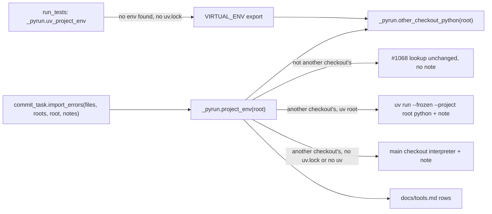
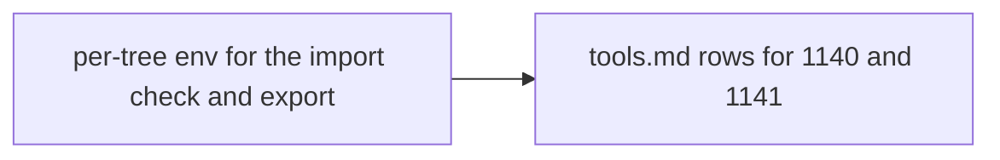

# B333: commit_task's import check and the VIRTUAL_ENV export follow #1133's per-tree rule (#1140); tools.md names #1131's state-folder defaults (#1141)

**Goal:** a root in a linked worktree or task tree without its own `.venv` no longer runs commit_task's import check in the main checkout's `.venv` (whose editable install may name main's source) when it can have its own environment: a uv project root runs `uv run --frozen --project <root> python`, any other root keeps the main checkout's interpreter with a note; #1120's VIRTUAL_ENV export of the main checkout's `.venv` says the same in its note. docs/tools.md names this (#1140) and #1131's state-folder defaults (#1141).
**Architecture:** `_pyrun.other_checkout_python(root)` names the main checkout's interpreter when `found_python(root)` would pick it for a root in a linked worktree (first `.git` up is a file) without a `.venv` of its own. `_pyrun.project_env(root) -> (argv, note)` applies #1133's rule to it; `project_cmd(root)` returns `project_env(root)[0]`. commit_task's `import_errors` calls `project_env`, adds the note as a `("venv", "", 0, note)` entry, and its printer prints `import check: <note>`. `uv_project_env`'s VIRTUAL_ENV export branch extends its note when the exported venv is `other_checkout_python(root)`'s. Docs: in-place clauses on existing rows plus one new `report` row.
**Tech stack:** Python 3 stdlib, pytest via `sl run_tests`; Markdown.
**Spec:** issues #1140 and #1141; shipped rulings B305 (#1068 lookup order), B320 (#1120 export), B328 (#1133 per-tree rule, main's ruling), B330 (#1131 defaults).
**Detail:** full
**Wave0:** none
**Coverage:** off

## Global constraints

- Files this batch may touch: docs/tools.md, skills/subagent-driven-development/scripts/_pyrun.py, skills/subagent-driven-development/scripts/commit_task.py, tests/scripts/test_commit_task_import_env_1068.py, tests/scripts/test_pyrun_uv_env_1120.py, tests/scripts/test_pyrun_worktree_env_1140.py, tests/scripts/test_docs_tools_1140_1141.py and this plan. Never edit skills/subagent-driven-development/scripts/guard_judge.py, guard_lex.py or tests/scripts/test_guard_heredoc_body_1142.py (batch B332 owns them). An existing test outside your Owns that breaks: name it in the report, do not edit it.
- Keep the repo's per-line `# O(...)` complexity comment on every new code line (see the existing lines of _pyrun.py).
- `found_python` and `project_python` keep their behaviour and order (root `.venv`, main checkout `.venv`, `VIRTUAL_ENV`): pt_review and probe_run read `project_python` and need an interpreter path.
- Builds: the verdict is `sl run_tests` (the project's test command; a project with `.maxapp` runs `maxapp test`, which a build pool may place on another Mac, and a full run whose tree a green maxapp test stamp covers returns that result without a run); task trees build in <tree>/.build/DerivedData and any build of your own goes under .build/ of the worktree, never -derivedDataPath outside the worktree (your session scratchpad included; backlog cleanup removes scratchpad build folders when the worktree goes); a product, simulator or device build stays on this machine and runs only when an issue's acceptance asks for a running-app check; copy this sentence into every worker brief.
- Simulators: append the UDID of each simulator you or a worker creates (`xcrun simctl create` or `clone`; a checker's `Simulators:` line marks its created ones) as one line to /Users/max/github/superlite/.claude/worktrees/superlite-b333-worktree-venv-and-tools-docs/.superlite/simulators.txt; never list one you did not create; ship cleanup shuts down and deletes each listed one; copy this sentence into every worker brief.

Ruling: the trigger is the main checkout's `.venv` picked by `found_python` for a root whose first `.git` up the tree is a file (a linked worktree or task tree) and which has no `.venv` of its own; the main checkout itself and its subfolders keep its `.venv` with no note (same checkout). This applies #1133's rule (main's ruling: per-tree uv --project environment) to the import check (lead's ruling).
Ruling: a uv project root (uv.lock and pyproject.toml, uv on PATH) runs the import check in `uv run --frozen --project <root> python`, which syncs the tree's own `.venv` once; later checks find that `.venv` first and print no note. A root without uv.lock, or without uv on PATH, keeps the main checkout's interpreter with an `import check: ... (#1140)` note (lead's ruling).
Ruling: VIRTUAL_ENV keeps its place after the main checkout's `.venv` (B305): only a root with no main checkout `.venv` uses it, unchanged (lead's ruling).
Ruling: #1120's export branch runs only for a root without uv.lock (a uv root is rewritten to `--frozen --project` before it), so #1133's rule keeps the export there; its note gains `the main checkout's, outside <root>; <root> has no uv.lock for an environment of its own, so the tests may import that folder's package, not <root>'s (#1140)` and keeps its `using the project's environment` text (lead's ruling).
Ruling: sl needs no change: it picks superlite's own interpreter, not the project's (lead's ruling).
Ruling: the end-to-end regression test builds a real `python -m venv --without-pip` main `.venv` whose `.pth` names main's source (an editable install) and a stand-in `uv` that runs the check under the test's interpreter; a real `uv run` would need a build backend from the network (B328's ruling for its own test) (lead's ruling).
LAYERS: unit

## Main diagram



## File structure

- skills/subagent-driven-development/scripts/_pyrun.py: `other_checkout_python`, `project_env`, `project_cmd` delegating, the export note, docstrings (T1).
- skills/subagent-driven-development/scripts/commit_task.py: `import_errors` uses `project_env` and records the note; the gate printer prints `import check: <note>` (T1).
- tests/scripts/test_pyrun_worktree_env_1140.py: unit cases for `project_env` and the export note (T1).
- tests/scripts/test_commit_task_import_env_1068.py: its `project_cmd` patches move to `project_env`; the nested-worktree regression and the CLI note test (T1).
- tests/scripts/test_pyrun_uv_env_1120.py: `test_main_checkout_venv_exported` expects the #1140 note (T1).
- docs/tools.md: rows for #1140 and #1141 (T2).
- tests/scripts/test_docs_tools_1140_1141.py: pins the new doc clauses and their quoted texts against the scripts (T2).

## Task graph

```mermaid
%% schedule
gantt
  title Predicted schedule (mm:ss)
  dateFormat X
  axisFormat %M:%S
  section lane 1
  T1 per-tree env for the import check and :t1, 0, 232s
  T2 tools.md rows for 1140 and 1141 :t2, 232, 191s
```





critical path: T1 → T2 (7.0 min) · peak width 1 · predicted build 7.0 min · predicted total ≈ 15.5 min

## Python helpers

### T1 per-tree env for the import check and export · Complexity 3 (O-1) · Est. context 50k
**Owns:** skills/subagent-driven-development/scripts/_pyrun.py, skills/subagent-driven-development/scripts/commit_task.py, tests/scripts/test_pyrun_worktree_env_1140.py, tests/scripts/test_commit_task_import_env_1068.py, tests/scripts/test_pyrun_uv_env_1120.py
**Components:** 2
**LOC owned:** 170
**Tests:** fast
**Kind:** design
**Model:** sonnet
**Est. time:** 5 min (2 components, about 170 LOC, fast tests)
**Consumes:** none
**Produces:** _pyrun.other_checkout_python(root) -> str | None · _pyrun.project_env(root) -> tuple[list[str], str] · _pyrun.project_cmd(root) -> list[str]
  e.g. project_env(<main>/.claude/worktrees/wt) with wt holding uv.lock and pyproject.toml, uv at /opt/bin/uv -> (["/opt/bin/uv", "run", "--frozen", "--project", "<wt>", "python"], "<main>/.venv is the main checkout's environment, outside <wt>; running the import check in <wt>'s own environment: uv run --frozen --project <wt> (#1140)")
  e.g. project_env(<wt>) with no uv.lock -> (["<main>/.venv/bin/python"], "<main>/.venv is the main checkout's environment, outside <wt>, and <wt> has no uv.lock for an environment of its own; the import check may import that folder's package, not <wt>'s (#1140)")
  e.g. project_env(<main>) -> (["<main>/.venv/bin/python"], "")
**Review Focus:** `test_import_check_in_a_nested_worktree_imports_the_worktree_code`: red before the change (main's `.pth` wins over the appended import root: `No module named 'where1140.only_tree'`), green after; `test_main_checkout_and_its_subfolder_keep_their_env`: no note, no uv run in the main checkout; `test_project_cmd_keeps_the_project_python_seam`; every test in tests/scripts/test_project_python_1068.py, test_project_python_callers.py, test_pyrun_uv_env_1120.py, test_run_tests_fast_tree_import_1133.py and test_run_tests_fast_filter_remote_1119_1120.py still passes.
**Steps:** 1 write tests/scripts/test_pyrun_worktree_env_1140.py and the test_commit_task_import_env_1068.py changes verbatim, and set test_pyrun_uv_env_1120.py's `test_main_checkout_venv_exported` last assert to the #1140 note below; 2 run the three files with `sl run_tests --fast <files> --task T1`: FAIL (record the summary line); 3 make the _pyrun.py and commit_task.py edits below; 4 run the three files plus tests/scripts/test_project_python_1068.py, tests/scripts/test_project_python_callers.py, tests/scripts/test_run_tests_fast_tree_import_1133.py, tests/scripts/test_run_tests_fast_filter_remote_1119_1120.py, tests/scripts/test_commit_import_gate_471.py: PASS.
**Notes:** in the CLI test, fix only its setup if commit_task refuses in the linked worktree for a state reason; keep its asserted text.

_pyrun.py edits:

1. Replace `project_cmd` with these four functions (same place):
```python
def other_checkout_python(root):  # O(d) the .git walk twice plus stat calls; git never runs
    """The main checkout's .venv interpreter that found_python picks for a root in a linked worktree or task tree (its first .git up the tree is a file) with no .venv of its own: another checkout's environment (#1140); else None."""  # O(1)
    if venv_python(Path(root) / ".venv"):  # the root's own environment | O(1)
        return None  # O(1)
    here = Path(root).resolve()  # O(d)
    dot_git = next((f / ".git" for f in (here, *here.parents) if (f / ".git").exists()), None)  # O(d) stat calls
    if dot_git is None or not dot_git.is_file():  # no repository, or the main checkout itself | O(1)
        return None  # O(1)
    main = main_checkout(root)  # O(d)
    return venv_python(main / ".venv") if main is not None else None  # O(1)


def _found_cmd(root, py):  # O(d + P) PATH search
    """#1068's argv prefix: a found interpreter, else uv run --frozen for a uv project, else ours."""  # O(1)
    if py != sys.executable or found_python(root):  # a found interpreter that equals ours is still found | O(d)
        return [py]  # O(1)
    uv = shutil.which("uv")  # O(P) PATH search
    if uv and (Path(root) / "uv.lock").is_file() and (Path(root) / "pyproject.toml").is_file():  # O(1) two stats
        return [uv, "run", "--frozen", "--project", str(root), "python"]  # O(1)
    return [py]  # O(1)


def project_env(root):  # O(d + P) PATH search
    """(argv prefix, note) for the project's python: #1068's choice, except that the main checkout's .venv picked for a linked worktree or task tree is another checkout's (#1140, #1133's rule): a uv project root runs in its own uv run --frozen --project root environment, any other root keeps that interpreter with a note."""  # O(1)
    py = project_python(root)  # O(d) read through the module: the seam tests patch
    other = other_checkout_python(root)  # O(d)
    if other is None or py != other:  # O(1)
        return _found_cmd(root, py), ""  # O(d + P)
    here = os.path.abspath(root)  # O(d)
    base = f"{Path(other).parent.parent} is the main checkout's environment, outside {here}"  # O(1)
    tail = f"the import check may import that folder's package, not {here}'s (#1140)"  # O(1)
    if not ((Path(root) / "uv.lock").is_file() and (Path(root) / "pyproject.toml").is_file()):  # O(1) two stats
        return [py], f"{base}, and {here} has no uv.lock for an environment of its own; {tail}"  # O(1)
    uv = shutil.which("uv")  # O(P) PATH search
    if not uv:  # O(1)
        return [py], f"{base}, and uv is not on PATH for {here}'s own environment; {tail}"  # O(1)
    return [uv, "run", "--frozen", "--project", str(root), "python"], f"{base}; running the import check in {here}'s own environment: uv run --frozen --project {here} (#1140)"  # O(1)


def project_cmd(root):  # O(d + P) PATH search
    """argv prefix for the project's python (project_env without its note)."""  # O(1)
    return project_env(root)[0]  # O(d + P)
```
2. In `uv_project_env`'s last branch replace the `if py:` block with:
```python
    if py:  # O(1)
        venv = str(Path(py).parent.parent)  # O(1)
        note = f"{base}; using the project's environment {venv} (VIRTUAL_ENV)"  # O(1)
        if py == other_checkout_python(root):  # the main checkout's: its package may shadow root's (#1140) | O(d)
            return command, {"VIRTUAL_ENV": venv}, f"{note}, the main checkout's, outside {root}; {root} has no uv.lock for an environment of its own, so the tests may import that folder's package, not {root}'s (#1140)"  # O(1)
        return command, {"VIRTUAL_ENV": venv}, f"{note} (#1120)"  # O(1)
```
3. Module docstring: after the `project_cmd(root) returns the argv prefix: ...` sentence add `project_env(root) adds a note: the main checkout's .venv picked for a linked worktree or task tree is another checkout's, so a uv project root runs in its own uv run --frozen --project root environment and any other root keeps it with a note (#1140, #1133's rule).` After the #1133 sentence add `An exported main-checkout venv says so in its note (#1140).`

commit_task.py edits:

1. In `import_errors` replace `cmd = _pyrun.project_cmd(root)  # O(1) file lookups, never run` with:
```python
    cmd, venv_note = _pyrun.project_env(root)  # O(d + P) file lookups, never run
    if venv_note and notes is not None:  # the main checkout's environment, or the tree's own (#1140) | O(1)
        notes.append(("venv", "", 0, venv_note))  # O(1)
```
   and in its docstring name `_pyrun.project_env` instead of `_pyrun.project_cmd` and add `the #1140 environment note goes to notes as ("venv", "", 0, note)`.
2. In the gate printer (`for kind, f, line, msg in gate:`) add before the final `else:`:
```python
            elif kind == "venv":  # O(1)
                print(f"import check: {msg}", file=sys.stderr)  # O(1)
```

**Test code (verbatim):** tests/scripts/test_pyrun_uv_env_1120.py, `test_main_checkout_venv_exported`'s last line becomes:
```python
    assert note == (f"uv run --no-project finds no environment from {wt}; using the project's environment {main / '.venv'} (VIRTUAL_ENV), "
                    f"the main checkout's, outside {wt}; {wt} has no uv.lock for an environment of its own, so the tests may import that folder's package, not {wt}'s (#1140)")
```

**Test code (verbatim):** tests/scripts/test_commit_task_import_env_1068.py: each `monkeypatch.setattr(_pyrun, "project_cmd", uv_cmd)` becomes `monkeypatch.setattr(_pyrun, "project_env", lambda root: (uv_cmd(root), ""))`, the `/x/venv/bin/python` one becomes `monkeypatch.setattr(_pyrun, "project_env", lambda root: (["/x/venv/bin/python"], ""))`; add `import os` to the imports and `from test_run_scripts import SCRIPTS, git, write` stays; append:
```python
WHERE_LIB = "packages/lib/src"
FAKE_UV = r'''
import os
import sys

args = sys.argv[1:]
with open(os.path.join(os.path.dirname(os.path.abspath(__file__)), "uv-args.txt"), "w") as f:
    f.write("\n".join(args))
i = args.index("python")
os.execv(sys.executable, [sys.executable, *args[i + 1:]])
'''


def editable_main(tmp_path):
    """A main checkout whose real .venv holds an editable-install .pth naming main's packages/lib/src, and a worktree nested in it."""
    main = tmp_path.resolve() / "main"
    write(main, f"{WHERE_LIB}/where1140/__init__.py", "WHERE = 'main'\n")
    subprocess.run([sys.executable, "-m", "venv", "--without-pip", str(main / ".venv")], check=True, capture_output=True)
    site = next((main / ".venv" / "lib").glob("python3*/site-packages"))
    (site / "where1140.pth").write_text(str(main / WHERE_LIB) + "\n")
    gitdir = main / ".git" / "worktrees" / "wt"
    gitdir.mkdir(parents=True)
    (gitdir / "commondir").write_text("../..\n")
    wt = main / ".claude" / "worktrees" / "wt"
    wt.mkdir(parents=True)
    (wt / ".git").write_text(f"gitdir: {gitdir}\n")
    write(wt, f"{WHERE_LIB}/where1140/__init__.py", "WHERE = 'tree'\n")
    write(wt, f"{WHERE_LIB}/where1140/only_tree.py", "from where1140 import WHERE\n\nassert WHERE == 'tree', WHERE\n")
    return main, wt


def fake_uv(tmp_path, monkeypatch):
    bindir = tmp_path / "bin"
    bindir.mkdir()
    (bindir / "fake_uv.py").write_text(FAKE_UV)
    uv = bindir / "uv"
    uv.write_text(f'#!/bin/sh\nexec "{sys.executable}" "{bindir / "fake_uv.py"}" "$@"\n')
    uv.chmod(0o755)
    monkeypatch.setenv("PATH", f"{bindir}{os.pathsep}{os.environ['PATH']}")
    return bindir / "uv-args.txt"


@pytest.mark.skipif(os.name == "nt", reason="posix sh script and venv layout")
def test_import_check_in_a_nested_worktree_imports_the_worktree_code(tmp_path, monkeypatch):
    main, wt = editable_main(tmp_path)
    write(wt, "uv.lock", "")
    write(wt, "pyproject.toml", "[project]\nname = 'where1140'\n")
    args = fake_uv(tmp_path, monkeypatch)
    notes = []
    errs = commit_task.import_errors([f"{WHERE_LIB}/where1140/only_tree.py"], [WHERE_LIB], root=wt, notes=notes)
    assert errs == []
    assert notes == [("venv", "", 0, f"{main / '.venv'} is the main checkout's environment, outside {wt}; "
                      f"running the import check in {wt}'s own environment: uv run --frozen --project {wt} (#1140)")]
    assert args.read_text().splitlines()[:5] == ["run", "--frozen", "--project", str(wt), "python"]


@pytest.mark.skipif(os.name == "nt", reason="posix venv layout")
def test_import_check_without_uv_lock_names_the_main_env(tmp_path, monkeypatch):
    main, wt = editable_main(tmp_path)
    notes = []
    errs = commit_task.import_errors([f"{WHERE_LIB}/where1140/only_tree.py"], [WHERE_LIB], root=wt, notes=notes)
    assert [e[:2] for e in errs] == [(f"{WHERE_LIB}/where1140/only_tree.py", 0)]
    assert notes[0] == ("venv", "", 0, f"{main / '.venv'} is the main checkout's environment, outside {wt}, and {wt} has no uv.lock "
                        f"for an environment of its own; the import check may import that folder's package, not {wt}'s (#1140)")


@pytest.mark.skipif(os.name == "nt", reason="posix symlink")
def test_commit_in_a_linked_worktree_prints_the_venv_note(tmp_path):
    repo = repo_with(tmp_path, task(1, ["app/a.py"]))
    py = repo / ".venv" / "bin" / "python"
    py.parent.mkdir(parents=True)
    py.symlink_to(sys.executable)
    wt = tmp_path / "wt"
    git(repo, "worktree", "add", "-q", str(wt))
    write(wt, "app/a.py", "X = 1\n")
    r = commit(wt, "T1")
    assert r.returncode == 0, r.stdout + r.stderr
    head = f"import check: {repo.resolve() / '.venv'} is the main checkout's environment, outside {wt.resolve()}, and {wt.resolve()} has no uv.lock"
    assert sum(ln.startswith(head) for ln in r.stderr.splitlines()) == 1, r.stderr
```

**Test code (verbatim):** tests/scripts/test_pyrun_worktree_env_1140.py
```python
"""#1140: commit_task's import check (_pyrun.project_env) and #1120's VIRTUAL_ENV export follow #1133's per-tree rule: the main checkout's .venv is another checkout's environment for a root in a linked worktree or task tree."""
import sys
from pathlib import Path

import pytest

sys.path.insert(0, str(Path(__file__).resolve().parents[2] / "skills" / "subagent-driven-development" / "scripts"))
import _pyrun  # noqa: E402

UV = "/opt/bin/uv"
CMD = "uv run --no-project --with pytest python -m pytest a.py -q"


@pytest.fixture(autouse=True)
def _no_virtual_env(monkeypatch):
    monkeypatch.delenv("VIRTUAL_ENV", raising=False)


@pytest.fixture
def uv_on_path(monkeypatch):
    monkeypatch.setattr(_pyrun.shutil, "which", lambda name: UV if name == "uv" else None)


def touch(base, rel, text=""):
    p = base / rel
    p.parent.mkdir(parents=True, exist_ok=True)
    p.write_text(text)
    return p


def linked(main, wt, name):
    """wt laid out as git writes a linked worktree of main (no git run)."""
    gitdir = main / ".git" / "worktrees" / name
    gitdir.mkdir(parents=True, exist_ok=True)
    (gitdir / "commondir").write_text("../..\n")
    wt.mkdir(parents=True, exist_ok=True)
    (wt / ".git").write_text(f"gitdir: {gitdir}\n")
    return wt


def uv_project(root):
    touch(root, "uv.lock")
    touch(root, "pyproject.toml", "[project]\nname = 'where1140'\n")


def nested(tmp_path):
    main = tmp_path.resolve() / "main"
    py = touch(main, ".venv/bin/python")
    return main, py, linked(main, main / ".claude" / "worktrees" / "wt", "wt")


def base(main, root):
    return f"{main / '.venv'} is the main checkout's environment, outside {root}"


def test_uv_worktree_runs_its_own_env(tmp_path, uv_on_path):
    main, py, wt = nested(tmp_path)
    uv_project(wt)
    argv = [UV, "run", "--frozen", "--project", str(wt), "python"]
    assert _pyrun.other_checkout_python(wt) == str(py)
    assert _pyrun.project_env(wt) == (argv, f"{base(main, wt)}; running the import check in {wt}'s own environment: uv run --frozen --project {wt} (#1140)")
    assert _pyrun.project_cmd(wt) == argv


def test_task_tree_in_a_worktree_runs_its_own_env(tmp_path, uv_on_path):
    main, py, wt = nested(tmp_path)
    tree = linked(main, wt / ".superlite" / "trees" / "T1", "T1")
    uv_project(tree)
    assert _pyrun.project_cmd(tree) == [UV, "run", "--frozen", "--project", str(tree), "python"]


def test_worktree_without_lock_keeps_main_env_with_note(tmp_path, uv_on_path):
    main, py, wt = nested(tmp_path)
    touch(wt, "pyproject.toml")
    assert _pyrun.project_env(wt) == ([str(py)], f"{base(main, wt)}, and {wt} has no uv.lock for an environment of its own; the import check may import that folder's package, not {wt}'s (#1140)")


def test_uv_missing_keeps_main_env_with_note(tmp_path, monkeypatch):
    main, py, wt = nested(tmp_path)
    uv_project(wt)
    monkeypatch.setattr(_pyrun.shutil, "which", lambda name: None)
    assert _pyrun.project_env(wt) == ([str(py)], f"{base(main, wt)}, and uv is not on PATH for {wt}'s own environment; the import check may import that folder's package, not {wt}'s (#1140)")


def test_own_venv_has_no_note(tmp_path, uv_on_path):
    main, py, wt = nested(tmp_path)
    uv_project(wt)
    own = touch(wt, ".venv/bin/python")
    assert _pyrun.other_checkout_python(wt) is None
    assert _pyrun.project_env(wt) == ([str(own)], "")


def test_main_checkout_and_its_subfolder_keep_their_env(tmp_path, uv_on_path):
    main, py, wt = nested(tmp_path)
    sub = main / "pkg"
    uv_project(sub)
    uv_project(main)
    assert _pyrun.project_env(main) == ([str(py)], "")
    assert _pyrun.other_checkout_python(sub) is None
    assert _pyrun.project_env(sub) == ([str(py)], "")


def test_no_repository_gives_no_other_checkout(tmp_path):
    assert _pyrun.other_checkout_python(tmp_path / "nowhere") is None


def test_virtual_env_without_main_venv_is_unchanged(tmp_path, monkeypatch, uv_on_path):
    main = tmp_path.resolve() / "main"
    (main / ".git").mkdir(parents=True)
    wt = linked(main, tmp_path.resolve() / "wt", "wt")
    uv_project(wt)
    vpy = touch(tmp_path, "venv/bin/python")
    monkeypatch.setenv("VIRTUAL_ENV", str(tmp_path / "venv"))
    assert _pyrun.project_env(wt) == ([str(vpy)], "")


def test_project_cmd_keeps_the_project_python_seam(tmp_path, monkeypatch):
    main, py, wt = nested(tmp_path)
    monkeypatch.setattr(_pyrun, "project_python", lambda root: "/x/venv/bin/python")
    assert _pyrun.project_env(wt) == (["/x/venv/bin/python"], "")


def test_export_of_the_main_checkout_venv_names_it(tmp_path):
    main = tmp_path.resolve() / "main"
    touch(main, ".venv/bin/python")
    wt = linked(main, tmp_path.resolve() / "wt", "wt")
    cmd, env, note = _pyrun.uv_project_env(CMD, wt, wt, {})
    assert (cmd, env) == (CMD, {"VIRTUAL_ENV": str(main / ".venv")})
    assert note == (f"uv run --no-project finds no environment from {wt}; using the project's environment {main / '.venv'} (VIRTUAL_ENV), "
                    f"the main checkout's, outside {wt}; {wt} has no uv.lock for an environment of its own, so the tests may import that folder's package, not {wt}'s (#1140)")


def test_export_of_the_root_own_venv_keeps_the_1120_note(tmp_path):
    root = tmp_path.resolve() / "proj"
    touch(root, ".venv/bin/python")
    cwd = tmp_path.resolve() / "elsewhere"
    cwd.mkdir()
    cmd, env, note = _pyrun.uv_project_env(CMD, root, cwd, {})
    assert env == {"VIRTUAL_ENV": str(root / ".venv")}
    assert note == f"uv run --no-project finds no environment from {cwd}; using the project's environment {root / '.venv'} (VIRTUAL_ENV) (#1120)"
```

## Docs

### T2 tools.md rows for 1140 and 1141 · Complexity 2 (O-1) · Est. context 40k
**Owns:** docs/tools.md, tests/scripts/test_docs_tools_1140_1141.py
**Components:** 1
**LOC owned:** 70
**Tests:** fast
**Kind:** design
**Model:** sonnet
**Est. time:** 3 min (1 component, about 70 LOC, fast tests)
**Consumes:** _pyrun.project_env(root) -> tuple[list[str], str] (T1)
**Produces:** none
**Review Focus:** `test_import_check_row_names_1140` and `test_run_tests_uv_row_names_1140`: each quoted note tail appears verbatim in _pyrun.py; `test_state_default_rows_1141`: each of the eight rows names its #1131 default; every existing tests/scripts/test_docs*.py and test_doc_contract test still passes.
**Steps:** 1 write tests/scripts/test_docs_tools_1140_1141.py (cases below); 2 run it with `sl run_tests --fast tests/scripts/test_docs_tools_1140_1141.py --task T2`: FAIL; 3 edit docs/tools.md; 4 run it plus every `tests/scripts/test_docs*.py` file and `tests/scripts/test_doc_contract*.py`: PASS.
**Notes:** read docs/tools.md by line (`grep -n`, then the lines you edit), never whole. Every row stays one table line ending in ` |`; escape a bare `|` as `\|`. Keep each row's title cell unchanged (existing pins find rows by it). The code wins: before writing a #1141 clause read the `state.default_dir()` or `state.default_root()` call in that tool's script and name the flag or path it really defaults; a clause the code contradicts is written as the code does it and the report names the difference.

Edits:
1. `| \`commit_task\` import check (#1068) |` row: replace `then the main checkout's \`.venv\` (from a worktree or task tree), ` with `then, for a root in a linked worktree or task tree without a \`.venv\` of its own, the root's own \`uv run --frozen --project <root> python\` environment when \`uv\` is on PATH and the root holds \`uv.lock\` and \`pyproject.toml\` (each tree syncs its own \`.venv\` once; stderr \`import check: <main>/.venv is the main checkout's environment, outside <root>; running the import check in <root>'s own environment: uv run --frozen --project <root> (#1140)\`), else the main checkout's \`.venv\` with the note ending \`the import check may import that folder's package, not <root>'s (#1140)\` (\`_pyrun.project_env\`, #1133's rule); the main checkout itself keeps its \`.venv\` with no note; `.
2. `| \`run_tests\` --fast filter and uv env (#1119, #1120, #1133) |` row: before its final ` |` add ` A main-checkout \`.venv\` exported as \`VIRTUAL_ENV\` for a root in a linked worktree (no \`uv.lock\`) gets the note ending \`so the tests may import that folder's package, not <root>'s (#1140)\`.`
3. #1141, rows `run_tests`, `history`, `metrics`: add one clause each naming its default paths that follow the session's state folder (`state.default_dir`, #1131): run_tests `--log`, `--ledger`, `--summary` and its warned, setup and stable.json files; history and metrics their `--dir` (or the path the code defaults).
4. #1141, new row right after the `metrics` row: `| \`report\` | End-of-build report: actual metrics next to the projected ones (\`--plan PLAN [--dir D] [--full \| --json]\`, \`--list\`, \`--show NAME\`); writes \`<plan>.build-report.md\` and \`.json\` beside the plan and a copy in the state folder; \`--dir\` defaults to the session's state folder (\`state.default_dir\`, #1131). |`
5. #1141, rows `testcmd`, `trees`, `autocommit`, `commit_task` (the anchor row, not its sub-rows): add the clause `Without --plan, from a cwd inside the plugin (its ./.superlite lies in the plugin) it works in the session's project (\`state.default_root\`, #1131) and exits 2 (\`state.Refused\`) when the session has none.` (testcmd: name `--write`, the flag that takes default_root).

**Test code:** tests/scripts/test_docs_tools_1140_1141.py reads docs/tools.md and _pyrun.py and finds a row by the start of its title cell:
- `test_import_check_row_names_1140`: the `commit_task` import check row contains `_pyrun.project_env`, `uv run --frozen --project <root> python`, `#1140`; the texts `running the import check in` , `own environment: uv run --frozen --project`, `the import check may import that folder's package, not` and `is the main checkout's environment, outside` each appear in both the row and _pyrun.py.
- `test_run_tests_uv_row_names_1140`: the run_tests --fast filter and uv env row contains `#1140` and `so the tests may import that folder's package, not`, which also appears in _pyrun.py.
- `test_state_default_rows_1141`: rows `run_tests`, `history`, `metrics`, `report` each contain `state.default_dir` and `#1131`; rows `testcmd`, `trees`, `autocommit`, `commit_task` each contain `state.default_root`, `state.Refused` and `#1131`.
- `test_report_row_is_one_and_after_metrics`: exactly one row starts with `| \`report\` |` and it is the line after the `metrics` row.
