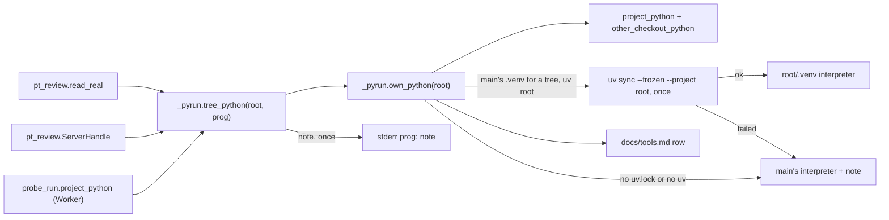

# B334: pt_review and probe_run use a linked worktree's own synced .venv, not the main checkout's (#1145)

**Goal:** pt_review's introspection and server runner and probe_run's worker no longer run in the main checkout's `.venv` (whose editable installs may name main's source) for a root in a linked worktree or task tree: a uv project root syncs its own `.venv` once (`uv sync --frozen --project <root>`) and they run its interpreter; a regression test proves they import the worktree's code.
**Architecture:** new `_pyrun.own_python(root) -> (interpreter, note)` applies #1140's trigger (`other_checkout_python(root)` equals `project_python(root)`'s pick) and, for a uv root with uv on PATH, runs one `uv sync --frozen --project <root>` per root per process (lock + memo), then returns `root/.venv`'s interpreter; else it keeps `project_python`'s pick with a note. `_pyrun.tree_python(root, prog)` prints the note to stderr once per process and returns the path. pt_review's two `pyrun.project_python(root)` calls and probe_run's `project_python` wrapper call `tree_python`. `project_python` and `found_python` stay file lookups that never run anything.
**Tech stack:** Python 3 stdlib, pytest via `sl run_tests`; Markdown.
**Spec:** issue #1145; main's ruling for B334 (sync root's own .venv once per tree); shipped rulings B305 (#1068 lookup), B328 (#1133), B333 (#1140).
**Detail:** full
**Wave0:** none
**Coverage:** off

## Global constraints

- Files this batch may touch: docs/tools.md (append-only: add lines, never reorder, rewrite or delete existing ones), skills/subagent-driven-development/probes/probe_run.py, skills/subagent-driven-development/scripts/_pyrun.py, skills/subagent-driven-development/scripts/pt_review.py, tests/scripts/test_pyrun_worktree_env_1145.py, the new tests/scripts/test_docs_tools_1145.py and this plan. An existing test outside your Owns that breaks: name it in the report, do not edit it.
- Keep the repo's per-line `# O(...)` complexity comment on every new code line (see the existing lines of _pyrun.py).
- `found_python`, `project_python`, `project_env`, `project_cmd` and `uv_project_env` keep their behaviour: commit_task and run_tests are not part of this batch.
- Builds: the verdict is `sl run_tests` (the project's test command; a project with `.maxapp` runs `maxapp test`, which a build pool may place on another Mac, and a full run whose tree a green maxapp test stamp covers returns that result without a run); task trees build in <tree>/.build/DerivedData and any build of your own goes under .build/ of the worktree, never -derivedDataPath outside the worktree (your session scratchpad included; backlog cleanup removes scratchpad build folders when the worktree goes); a product, simulator or device build stays on this machine and runs only when an issue's acceptance asks for a running-app check; copy this sentence into every worker brief.
- Simulators: append the UDID of each simulator you or a worker creates (`xcrun simctl create` or `clone`; a checker's `Simulators:` line marks its created ones) as one line to /Users/max/github/superlite/.claude/worktrees/superlite-b334-worktree-own-venv-pt-review-probe/.superlite/simulators.txt; never list one you did not create; ship cleanup shuts down and deletes each listed one; copy this sentence into every worker brief.

Ruling: main's ruling (sync root's own .venv once per tree) applies where #1140's rule fires: `project_python(root)` picks the main checkout's `.venv` for a root whose first `.git` up the tree is a file and which has no `.venv` of its own; the main checkout itself, a root with its own `.venv`, and a root whose main checkout has no `.venv` keep #1068's lookup unchanged, with no sync and no note (lead's ruling).
Ruling: the sync runs only for a root holding `uv.lock` and `pyproject.toml` with `uv` on PATH, as #1140 does; it runs in the root without `VIRTUAL_ENV` and `UV_PROJECT_ENVIRONMENT` (so it writes `root/.venv`), at most 300 s. A later process finds `root/.venv` first and prints nothing; a failed or timed-out sync keeps the main checkout's interpreter with a note and is not retried in the same process (memo per resolved root, under a lock so parallel probe workers start one sync) (lead's ruling).
Ruling: notes go to stderr as `pt_review: <note>` or `probe_run: <note>`, once per process; stdout and the packet are unchanged (lead's ruling).
Ruling: probe_run loads `_pyrun` by path once per process (cached), so its sync memo lives across worker spawns; its `project_python` wrapper stays the seam test_project_python_callers.py patches (lead's ruling).
Ruling: the regression tests use a real `python -m venv --without-pip` main `.venv` whose `.pth` names main's workspace member `packages/lib/src` (outside the `src` and root import paths pt_review and probe_run already put first, so only the environment can reach it) and a stand-in `uv` whose `sync` builds the tree's `.venv` the same way; a real `uv sync` would need a build backend from the network (B328 and B333 rulings for their tests) (lead's ruling).
Ruling: tests/scripts/test_docs_tools_1145.py is a new file no open batch lists; it pins the new tools.md row's quoted texts against _pyrun.py (B331's pin rule) (lead's ruling).
LAYERS: unit

## Main diagram



## File structure

- skills/subagent-driven-development/scripts/_pyrun.py: `SYNC_TIMEOUT`, `_SYNCED`, `_SYNC_LOCK`, `_NOTED`, `_sync_own_env`, `own_python`, `tree_python`, docstring (T1).
- skills/subagent-driven-development/scripts/pt_review.py: `read_real` and `ServerHandle` call `pyrun.tree_python(root, "pt_review")` (T1).
- skills/subagent-driven-development/probes/probe_run.py: cached by-path `_pyrun_module()`; `project_python` calls `tree_python(root, "probe_run")` (T1).
- tests/scripts/test_pyrun_worktree_env_1145.py: unit cases for `own_python`/`tree_python` and the two end-to-end regressions (T1).
- docs/tools.md: one new sub-row after the `probe_run` row (T2).
- tests/scripts/test_docs_tools_1145.py: pins that row's quoted texts against _pyrun.py (T2).

## Task graph


critical path: T1 → T2 (7.0 min) · peak width 1 · predicted build 7.0 min · predicted total ≈ 13.5 min

## Python helpers

### T1 own synced venv for pt_review and probe_run · Complexity 4 (O-1) · Est. context 45k
**Owns:** skills/subagent-driven-development/scripts/_pyrun.py, skills/subagent-driven-development/scripts/pt_review.py, skills/subagent-driven-development/probes/probe_run.py, tests/scripts/test_pyrun_worktree_env_1145.py
**Components:** 2
**LOC owned:** 200
**Tests:** fast
**Kind:** design
**Model:** sonnet
**Est. time:** 5 min (2 components, about 200 LOC, fast tests)
**Consumes:** none
**Produces:** _pyrun.own_python(root) -> tuple[str, str] · _pyrun.tree_python(root, prog) -> str
  e.g. own_python(<main>/.claude/worktrees/wt) with wt holding uv.lock and pyproject.toml, no wt/.venv, <main>/.venv/bin/python present, uv on PATH, sync green -> ("<wt>/.venv/bin/python", "<main>/.venv is the main checkout's environment, outside <wt>; synced <wt>'s own environment once: uv sync --frozen --project <wt> (#1145)")
  e.g. own_python(<wt>) with no uv.lock -> ("<main>/.venv/bin/python", "<main>/.venv is the main checkout's environment, outside <wt>, and <wt> has no uv.lock for an environment of its own; this check may import that folder's package, not <wt>'s (#1145)")
  e.g. own_python(<main>) -> ("<main>/.venv/bin/python", "")
**Review Focus:** `test_pt_review_introspects_the_worktree_package` and `test_probe_worker_runs_the_worktree_interpreter`: red before the change (main's `.pth` names main's `packages/lib/src`, so `where()` has no `x` and the worker runs `<main>/.venv/bin/python`), green after; `test_failed_sync_keeps_main_env_with_note_and_is_not_retried` (state: one sync per root per process); `test_sync_runs_in_the_root_without_virtual_env_or_project_environment`; every test in tests/scripts/test_project_python_callers.py, test_project_python_1068.py, test_pyrun_worktree_env_1140.py and test_pyrun_uv_env_1120.py still passes.
**Steps:** 1 write tests/scripts/test_pyrun_worktree_env_1145.py verbatim; 2 run it with `sl run_tests --fast tests/scripts/test_pyrun_worktree_env_1145.py --task T1`: FAIL (record the summary line); 3 make the edits below; 4 run it plus tests/scripts/test_project_python_callers.py, tests/scripts/test_project_python_1068.py, tests/scripts/test_pyrun_worktree_env_1140.py, tests/scripts/test_pyrun_uv_env_1120.py, tests/scripts/test_probe_run.py: PASS.
**Notes:** `run_tree` passes its keywords to Popen, so `text`, `encoding`, `errors`, `cwd` and `env` reach it as given. Do not change `project_python`'s docstring contract ("found by file lookup and never run").

_pyrun.py edits:

1. Add `import threading  # O(1)` to the imports (alphabetical, after `import sys`).
2. After `project_cmd`, add:
```python
SYNC_TIMEOUT = 300  # O(1) seconds one `uv sync` may take (#1145)
_SYNCED = {}  # O(1) resolved root -> (interpreter, note) of the one uv sync this process ran for it (#1145)
_SYNC_LOCK = threading.Lock()  # O(1) parallel probe workers wait for one sync, never start a second
_NOTED = set()  # O(1) notes tree_python printed already


def _sync_own_env(uv, root, py, base, tail):  # O(o) + one uv sync process, at most SYNC_TIMEOUT s
    """Run `uv sync --frozen --project root` in root; (root/.venv's interpreter, note), or (py, a note naming why) when it fails (#1145)."""  # O(1)
    here = os.path.abspath(root)  # O(d)
    env = {k: v for k, v in os.environ.items() if k not in ("VIRTUAL_ENV", "UV_PROJECT_ENVIRONMENT")}  # the sync writes root/.venv, no other venv | O(env)
    try:  # O(1)
        r = run_tree([uv, "sync", "--frozen", "--project", str(root)], timeout=SYNC_TIMEOUT, cwd=str(root), env=env,  # O(o) + process spawn
                     capture_output=True, text=True, encoding="utf-8", errors="replace")  # O(1)
        lines = (r.stderr or r.stdout or "").strip().splitlines()  # O(o)
        why = "" if r.returncode == 0 else (lines[-1].strip() if lines else f"exit {r.returncode}")  # O(1) uv's last line names the error
    except subprocess.TimeoutExpired:  # O(1)
        why = f"timed out after {SYNC_TIMEOUT} s"  # O(1)
    except OSError as e:  # uv vanished or is not runnable | O(1)
        why = str(e)  # O(1)
    own = None if why else venv_python(Path(root) / ".venv")  # O(1)
    if own:  # O(1)
        return own, f"{base}; synced {here}'s own environment once: uv sync --frozen --project {here} (#1145)"  # O(1)
    why = why or f"{os.path.join(here, '.venv')} holds no interpreter after the sync"  # O(1)
    return py, f"{base}; uv sync --frozen --project {here} failed: {why[:200]}; {tail}"  # O(1)


def own_python(root):  # O(d + P) stat calls and a PATH search; at most one uv sync per root per process
    """(interpreter, note) for callers that need an interpreter path (pt_review, probe_run; #1145): project_python's pick, except that the main checkout's .venv picked for a linked worktree or task tree is another checkout's (#1140's rule): a uv project root syncs its own .venv once (uv sync --frozen --project root) and uses it; a root without uv.lock, no uv on PATH or a failed sync keeps that interpreter with a note."""  # O(1)
    py = project_python(root)  # O(d) read through the module: the seam tests patch
    other = other_checkout_python(root)  # O(d)
    if other is None or py != other:  # O(1)
        return py, ""  # O(1)
    here = os.path.abspath(root)  # O(d)
    base = f"{Path(other).parent.parent} is the main checkout's environment, outside {here}"  # O(1)
    tail = f"this check may import that folder's package, not {here}'s (#1145)"  # O(1)
    if not ((Path(root) / "uv.lock").is_file() and (Path(root) / "pyproject.toml").is_file()):  # O(1) two stats
        return py, f"{base}, and {here} has no uv.lock for an environment of its own; {tail}"  # O(1)
    uv = shutil.which("uv")  # O(P) PATH search
    if not uv:  # O(1)
        return py, f"{base}, and uv is not on PATH for {here}'s own environment; {tail}"  # O(1)
    key = str(Path(root).resolve())  # O(d)
    with _SYNC_LOCK:  # O(1) one sync per root, also with parallel callers
        if key not in _SYNCED:  # O(1)
            _SYNCED[key] = _sync_own_env(uv, root, py, base, tail)  # O(o) + one uv sync process
        return _SYNCED[key]  # O(1)


def tree_python(root, prog):  # O(d + P) plus own_python's one sync
    """own_python's interpreter; its note goes to stderr as `<prog>: <note>`, once per process."""  # O(1)
    py, note = own_python(root)  # O(d + P)
    if note and note not in _NOTED:  # O(1)
        _NOTED.add(note)  # O(1)
        print(f"{prog}: {note}", file=sys.stderr)  # O(1)
    return py  # O(1)
```
3. Module docstring: after the `project_env(root) adds a note: ...` paragraph add `own_python(root) is project_python for callers that need an interpreter path (pt_review, probe_run): the main checkout's .venv picked for a linked worktree or task tree makes a uv project root sync its own .venv once (uv sync --frozen --project root, memo and lock per process) and use it; any other root, no uv or a failed sync keeps it with a note. tree_python(root, prog) prints that note to stderr once and returns the path (#1145).`

pt_review.py edits: in `read_real` and in `ServerHandle.__init__` replace `pyrun.project_python(root)` with `pyrun.tree_python(root, "pt_review")` (keep each line's `# O(1)` comment; the note goes to stderr only).

probe_run.py edits: add `import functools  # O(1)` to the imports; replace `def project_python` with:
```python
@functools.lru_cache(maxsize=1)  # O(1) one load per process: the sync memo (#1145) lives in that module
def _pyrun_module():  # O(module size) once per process
    """scripts/_pyrun.py loaded by path under a private name (no sys.path change, no clash)."""  # O(1)
    spec = importlib.util.spec_from_file_location(  # O(1)
        "_superlite_pyrun", HERE.parent / "scripts" / "_pyrun.py")  # O(1)
    pyrun = importlib.util.module_from_spec(spec)  # O(1)
    spec.loader.exec_module(pyrun)  # O(module size)
    return pyrun  # O(1)


def project_python(root: Path) -> str:  # O(d + P) file lookups; one uv sync per tree (#1145)
    """The project's own interpreter by _pyrun.tree_python: root/.venv; for a linked worktree or task tree
    without one, its own .venv synced once instead of the main checkout's (#1145); VIRTUAL_ENV; else ours.
    A copy of this file without the scripts folder falls back to sys.executable."""
    try:  # O(1)
        return _pyrun_module().tree_python(root, "probe_run")  # O(d + P)
    except Exception:  # missing or broken _pyrun | O(1)
        return sys.executable  # O(1)
```

**Test code (verbatim):** tests/scripts/test_pyrun_worktree_env_1145.py:
```python
"""#1145: pt_review (introspection, server runner) and probe_run's worker use a linked worktree's or task tree's own interpreter, not the main checkout's .venv: a uv project root syncs its own .venv once (uv sync --frozen --project <root>), #1140's rule."""
import importlib.util
import os
import subprocess
import sys
import types
from pathlib import Path

import pytest

SCRIPTS = Path(__file__).resolve().parents[2] / "skills" / "subagent-driven-development" / "scripts"
PROBE_RUN = SCRIPTS.parent / "probes" / "probe_run.py"
sys.path.insert(0, str(SCRIPTS))
import _pyrun  # noqa: E402
import pt_review  # noqa: E402

UV = "/opt/bin/uv"
LIB = "packages/lib/src"
posix_only = pytest.mark.skipif(os.name == "nt", reason="POSIX venv layout and a shell-script uv")


class Stop(Exception):
    pass


@pytest.fixture(autouse=True)
def _fresh(monkeypatch):
    monkeypatch.delenv("VIRTUAL_ENV", raising=False)
    monkeypatch.delenv("UV_PROJECT_ENVIRONMENT", raising=False)
    monkeypatch.setattr(_pyrun, "_SYNCED", {})
    monkeypatch.setattr(_pyrun, "_NOTED", set())


@pytest.fixture
def uv_on_path(monkeypatch):
    monkeypatch.setattr(_pyrun.shutil, "which", lambda name: UV if name == "uv" else None)


def touch(base, rel, text=""):
    p = base / rel
    p.parent.mkdir(parents=True, exist_ok=True)
    p.write_text(text)
    return p


def linked(main, wt, name="wt"):
    """wt laid out as git writes a linked worktree of main (no git run)."""
    gitdir = main / ".git" / "worktrees" / name
    gitdir.mkdir(parents=True, exist_ok=True)
    (gitdir / "commondir").write_text("../..\n")
    wt.mkdir(parents=True, exist_ok=True)
    (wt / ".git").write_text(f"gitdir: {gitdir}\n")
    return wt


def checkout(tmp_path, lock=True):
    """A main checkout with a .venv interpreter and a uv worktree nested in it without one."""
    main = tmp_path.resolve() / "main"
    touch(main, ".venv/bin/python")
    wt = linked(main, main / ".claude" / "worktrees" / "wt")
    touch(wt, "pyproject.toml", "[project]\nname = 'x'\n")
    if lock:
        touch(wt, "uv.lock")
    return main, wt


def base(main, wt):
    return f"{main / '.venv'} is the main checkout's environment, outside {wt}"


class FakeSync:
    """Stands in for _pyrun.run_tree: records each call; a green sync writes <project>/.venv/bin/python."""

    def __init__(self, returncode=0, stderr="", exc=None):
        self.calls, self.returncode, self.stderr, self.exc = [], returncode, stderr, exc

    def __call__(self, cmd, timeout=None, **kw):
        self.calls.append((cmd, timeout, kw))
        if self.exc:
            raise self.exc
        if self.returncode == 0:
            touch(Path(cmd[-1]), ".venv/bin/python")
        return subprocess.CompletedProcess(cmd, self.returncode, "", self.stderr)


def test_uv_worktree_syncs_its_own_venv_once(tmp_path, monkeypatch, uv_on_path):
    main, wt = checkout(tmp_path)
    sync = FakeSync()
    monkeypatch.setattr(_pyrun, "run_tree", sync)
    own = str(wt / ".venv" / "bin" / "python")
    assert _pyrun.own_python(wt) == (own, f"{base(main, wt)}; synced {wt}'s own environment once: uv sync --frozen --project {wt} (#1145)")
    assert [c[0] for c in sync.calls] == [[UV, "sync", "--frozen", "--project", str(wt)]]
    assert _pyrun.own_python(wt) == (own, "")
    assert len(sync.calls) == 1


def test_sync_runs_in_the_root_without_virtual_env_or_project_environment(tmp_path, monkeypatch, uv_on_path):
    main, wt = checkout(tmp_path)
    monkeypatch.setenv("VIRTUAL_ENV", str(main / ".venv"))
    monkeypatch.setenv("UV_PROJECT_ENVIRONMENT", str(tmp_path / "elsewhere"))
    sync = FakeSync()
    monkeypatch.setattr(_pyrun, "run_tree", sync)
    _pyrun.own_python(wt)
    (cmd, timeout, kw), = sync.calls
    assert timeout == _pyrun.SYNC_TIMEOUT == 300
    assert kw["cwd"] == str(wt)
    assert "VIRTUAL_ENV" not in kw["env"] and "UV_PROJECT_ENVIRONMENT" not in kw["env"]
    assert kw["env"]["PATH"] == os.environ["PATH"]


def test_failed_sync_keeps_main_env_with_note_and_is_not_retried(tmp_path, monkeypatch, uv_on_path):
    main, wt = checkout(tmp_path)
    sync = FakeSync(returncode=2, stderr="Resolved 3 packages\nerror: The lockfile at `uv.lock` needs to be updated\n")
    monkeypatch.setattr(_pyrun, "run_tree", sync)
    want = (str(main / ".venv" / "bin" / "python"),
            f"{base(main, wt)}; uv sync --frozen --project {wt} failed: error: The lockfile at `uv.lock` needs to be updated; "
            f"this check may import that folder's package, not {wt}'s (#1145)")
    assert _pyrun.own_python(wt) == want
    assert _pyrun.own_python(wt) == want
    assert len(sync.calls) == 1


def test_sync_timeout_keeps_main_env(tmp_path, monkeypatch, uv_on_path):
    main, wt = checkout(tmp_path)
    monkeypatch.setattr(_pyrun, "run_tree", FakeSync(exc=subprocess.TimeoutExpired(["uv"], 300)))
    py, note = _pyrun.own_python(wt)
    assert py == str(main / ".venv" / "bin" / "python")
    assert f"; uv sync --frozen --project {wt} failed: timed out after 300 s; this check may import" in note


def test_sync_without_an_interpreter_keeps_main_env(tmp_path, monkeypatch, uv_on_path):
    main, wt = checkout(tmp_path)
    monkeypatch.setattr(_pyrun, "run_tree", lambda cmd, timeout=None, **kw: subprocess.CompletedProcess(cmd, 0, "", ""))
    py, note = _pyrun.own_python(wt)
    assert py == str(main / ".venv" / "bin" / "python")
    assert f"failed: {wt / '.venv'} holds no interpreter after the sync; this check may import" in note


def test_worktree_without_lock_keeps_main_env_with_note(tmp_path, monkeypatch, uv_on_path):
    main, wt = checkout(tmp_path, lock=False)
    sync = FakeSync()
    monkeypatch.setattr(_pyrun, "run_tree", sync)
    assert _pyrun.own_python(wt) == (
        str(main / ".venv" / "bin" / "python"),
        f"{base(main, wt)}, and {wt} has no uv.lock for an environment of its own; this check may import that folder's package, not {wt}'s (#1145)")
    assert sync.calls == []


def test_uv_missing_keeps_main_env_with_note(tmp_path, monkeypatch):
    main, wt = checkout(tmp_path)
    monkeypatch.setattr(_pyrun.shutil, "which", lambda name: None)
    sync = FakeSync()
    monkeypatch.setattr(_pyrun, "run_tree", sync)
    assert _pyrun.own_python(wt)[1] == (
        f"{base(main, wt)}, and uv is not on PATH for {wt}'s own environment; this check may import that folder's package, not {wt}'s (#1145)")
    assert sync.calls == []


def test_own_venv_and_main_checkout_never_sync(tmp_path, monkeypatch, uv_on_path):
    main, wt = checkout(tmp_path)
    touch(main, "uv.lock")
    touch(main, "pyproject.toml")
    sync = FakeSync()
    monkeypatch.setattr(_pyrun, "run_tree", sync)
    assert _pyrun.own_python(main) == (str(main / ".venv" / "bin" / "python"), "")
    own = touch(wt, ".venv/bin/python")
    assert _pyrun.own_python(wt) == (str(own), "")
    assert sync.calls == []


def test_tree_python_prints_its_note_once(tmp_path, capsys):
    main, wt = checkout(tmp_path, lock=False)
    assert _pyrun.tree_python(wt, "pt_review") == str(main / ".venv" / "bin" / "python")
    _pyrun.tree_python(wt, "pt_review")
    assert capsys.readouterr().err == (
        f"pt_review: {base(main, wt)}, and {wt} has no uv.lock for an environment of its own; "
        f"this check may import that folder's package, not {wt}'s (#1145)\n")


def test_server_runner_asks_tree_python(tmp_path, monkeypatch):
    asked = []
    monkeypatch.setattr(_pyrun, "tree_python", lambda root, prog: asked.append((root, prog)) or "/tree/.venv/bin/python")

    def popen(cmd, *a, **k):
        asked.append(cmd[0])
        raise Stop

    monkeypatch.setattr(pt_review.subprocess, "Popen", popen)
    monkeypatch.setattr(pt_review.tempfile, "mkdtemp", lambda prefix="": str(tmp_path))
    with pytest.raises(Stop):
        pt_review.ServerHandle(tmp_path, "app:main", None, timeout=1)
    assert asked == [(tmp_path, "pt_review"), "/tree/.venv/bin/python"]


# A stand-in for uv: `sync --frozen --project P` builds P/.venv as a real venv whose .pth names
# P/packages/lib/src, as an editable install of a workspace member does; every call is logged.
FAKE_UV = r'''
import subprocess
import sys
from pathlib import Path

args = sys.argv[1:]
with open(Path(__file__).with_name("uv-calls.txt"), "a") as f:
    f.write(" ".join(args) + "\n")
if args[:1] != ["sync"]:
    sys.exit(2)
project = Path(args[args.index("--project") + 1])
subprocess.run([sys.executable, "-m", "venv", "--without-pip", str(project / ".venv")], check=True)
site = next((project / ".venv" / "lib").glob("python3*/site-packages"))
(site / "lib1145.pth").write_text(str(project / "packages" / "lib" / "src") + "\n")
'''


def editable_checkout(tmp_path):
    """A main checkout whose real .venv holds a .pth naming main's packages/lib/src (outside the src and root
    paths pt_review and probe_run put first), and a uv worktree nested in it whose member differs."""
    main = tmp_path.resolve() / "main"
    touch(main, f"{LIB}/lib1145/__init__.py", "def where():\n    return 'main'\n")
    subprocess.run([sys.executable, "-m", "venv", "--without-pip", str(main / ".venv")], check=True, capture_output=True)
    site = next((main / ".venv" / "lib").glob("python3*/site-packages"))
    (site / "lib1145.pth").write_text(str(main / LIB) + "\n")
    wt = linked(main, main / ".claude" / "worktrees" / "wt")
    touch(wt, "pyproject.toml", "[project]\nname = 'x'\n")
    touch(wt, "uv.lock")
    touch(wt, f"{LIB}/lib1145/__init__.py", "def where(x):\n    return 'tree'\n")
    return main, wt


def fake_uv_on_path(tmp_path, monkeypatch):
    bindir = tmp_path / "fakebin"
    bindir.mkdir()
    (bindir / "fake_uv.py").write_text(FAKE_UV)
    uv = bindir / "uv"
    uv.write_text(f'#!/bin/sh\nexec "{sys.executable}" "{bindir / "fake_uv.py"}" "$@"\n')
    uv.chmod(0o755)
    monkeypatch.setenv("PATH", f"{bindir}{os.pathsep}{os.environ['PATH']}")
    return bindir / "uv-calls.txt"


@posix_only
def test_pt_review_introspects_the_worktree_package(tmp_path, monkeypatch):
    main, wt = editable_checkout(tmp_path)
    calls = fake_uv_on_path(tmp_path, monkeypatch)
    got = pt_review.read_real(wt, [("lib1145", ["where"])])
    assert got[0]["ok"], got
    assert [p["name"] for p in got[0]["params"]] == ["x"]
    assert Path(got[0]["file"]).resolve().is_relative_to(wt)
    assert calls.read_text() == f"sync --frozen --project {wt}\n"


@posix_only
def test_probe_worker_runs_the_worktree_interpreter(tmp_path, monkeypatch):
    main, wt = editable_checkout(tmp_path)
    fake_uv_on_path(tmp_path, monkeypatch)
    spec = importlib.util.spec_from_file_location("probe_run_1145_mod", PROBE_RUN)
    mod = importlib.util.module_from_spec(spec)
    spec.loader.exec_module(mod)
    real_tmp, real_popen, seen = mod.tempfile.NamedTemporaryFile, subprocess.Popen, {}
    monkeypatch.setattr(mod.tempfile, "NamedTemporaryFile", lambda **kw: real_tmp(dir=tmp_path, **kw))

    def popen(cmd, *a, **k):
        if "--worker" not in cmd:  # the uv sync and the venv build run for real
            return real_popen(cmd, *a, **k)
        seen["cmd"] = cmd
        raise Stop

    monkeypatch.setattr(mod.subprocess, "Popen", popen)
    cfg = types.SimpleNamespace(root=wt, adapter=wt / "adapter.py", timeout=5.0, stats_lock=None, workers_started=0)
    with pytest.raises(Stop):
        mod.Worker(cfg)
    py = seen["cmd"][0]
    assert py == str(wt / ".venv" / "bin" / "python")
    r = real_popen([py, "-c", "import inspect, lib1145; print(lib1145.__file__, inspect.signature(lib1145.where))"],
                   cwd=wt, stdout=subprocess.PIPE, stderr=subprocess.PIPE, text=True)
    out, err = r.communicate(timeout=60)
    assert r.returncode == 0, err
    assert out.split() == [str(wt / LIB / "lib1145" / "__init__.py"), "(x)"]
```

**Probe entry:** none (helper functions that take a folder and may start uv; no one-text-argument entry)

## Docs

### T2 tools.md row for 1145 · Complexity 1 (O-1) · Est. context 30k
**Owns:** docs/tools.md, tests/scripts/test_docs_tools_1145.py
**Components:** 1
**LOC owned:** 40
**Tests:** fast
**Kind:** design
**Model:** sonnet
**Est. time:** 2 min (1 component, about 40 LOC, fast tests)
**Consumes:** _pyrun.own_python(root) -> tuple[str, str] (T1) · _pyrun.tree_python(root, prog) -> str (T1)
**Produces:** none
**Review Focus:** `test_row_1145_follows_probe_run` and `test_row_1145_quotes_pyrun`: the row sits right after the `probe_run` row and each quoted text appears verbatim in _pyrun.py; every existing tests/scripts/test_docs*.py and test_doc_contract test still passes.
**Steps:** 1 write tests/scripts/test_docs_tools_1145.py verbatim; 2 run it with `sl run_tests --fast tests/scripts/test_docs_tools_1145.py --task T2`: FAIL; 3 insert the row below into docs/tools.md as a new line right after the line starting ``| `probe_run` |`` (add only this line; change no other line); 4 run it plus every tests/scripts/test_docs*.py file and tests/scripts/test_doc_contract.py: PASS.
**Notes:** the row, one line:
```markdown
| `pt_review` and `probe_run` interpreter (#1145) | pt_review's introspection and server runner and probe_run's worker run under `_pyrun.tree_python(root, prog)`: the root's `.venv`; for a root in a linked worktree or task tree without a `.venv` of its own, where #1068's lookup would pick the main checkout's `.venv`, a root holding `uv.lock` and `pyproject.toml` with `uv` on PATH syncs its own `.venv` once (`uv sync --frozen --project <root>` in the root, without `VIRTUAL_ENV` and `UV_PROJECT_ENVIRONMENT`, at most 300 s; stderr `<prog>: <main>/.venv is the main checkout's environment, outside <root>; synced <root>'s own environment once: uv sync --frozen --project <root> (#1145)`) and uses it; a root without `uv.lock`, no `uv` on PATH or a failed sync (not retried in that process) keeps the main checkout's interpreter with a note ending `this check may import that folder's package, not <root>'s (#1145)`; each note prints once per process. |
```

**Test code (verbatim):** tests/scripts/test_docs_tools_1145.py:
```python
"""#1145: docs/tools.md names the per-tree synced interpreter of pt_review and probe_run; its quoted texts are the ones _pyrun.py prints."""
from pathlib import Path

ROOT = Path(__file__).resolve().parents[2]
TOOLS = (ROOT / "docs" / "tools.md").read_text(encoding="utf-8").splitlines()
PYRUN = (ROOT / "skills" / "subagent-driven-development" / "scripts" / "_pyrun.py").read_text(encoding="utf-8")
HEAD = "| `pt_review` and `probe_run` interpreter (#1145) |"


def row():
    rows = [i for i, line in enumerate(TOOLS) if line.startswith(HEAD)]
    assert len(rows) == 1, rows
    return rows[0]


def test_row_1145_follows_probe_run():
    i = row()
    assert TOOLS[i - 1].startswith("| `probe_run` |")
    assert TOOLS[i].endswith(" |") and TOOLS[i].count(" | ") == 2


def test_row_1145_quotes_pyrun():
    line = TOOLS[row()]
    for text in ("is the main checkout's environment, outside ", "'s own environment once: uv sync --frozen --project ",
                 "this check may import that folder's package, not ", "has no uv.lock for an environment of its own",
                 "uv is not on PATH for ", "(#1145)"):
        assert text in line, text
        assert text in PYRUN, text
    assert "`_pyrun.tree_python(root, prog)`" in line and "def tree_python(root, prog)" in PYRUN
    assert "at most 300 s" in line and "SYNC_TIMEOUT = 300" in PYRUN
```

**Probe entry:** none (documentation)

## Review Focus

- Python helpers (library): state (one sync per root per process, under a lock; a later process finds `root/.venv`), file (`root/.venv` written by uv, never by superlite), protocol (the uv argv and its environment). Specific risks: a sync that hangs (300 s cap), a failed sync retried per call, a note printed per call, the seams test_project_python_callers.py patches.
- Docs: the row's quoted texts match _pyrun.py.

## Self-review

Coverage: #1145's interpreter change and regression test (T1), docs (T2). No placeholders. T2 consumes T1's two Produces lines verbatim. One edge (T2's pin test reads T1's code). Fields filled; schedule and lint follow.
