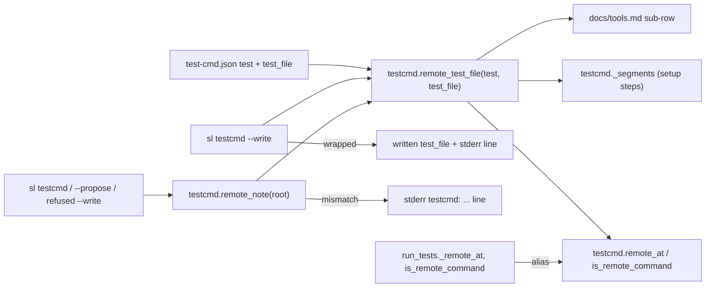
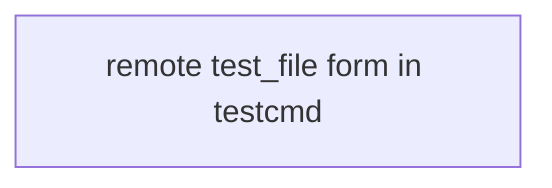

# B335: testcmd gives a maxapp remote test's per-file command the same maxapp remote form (#1147)

**Goal:** when test-cmd.json's `test` runs through `maxapp remote` and its `test_file` does not, `sl testcmd --write` writes `test_file` in the same `maxapp remote` form, and `sl testcmd` (default mode, `--propose`, a refused `--write`) names an existing file's mismatch with the form to set.
**Architecture:** new `testcmd.remote_test_file(test, test_file) -> str | None` derives the form (the remote `test`'s NAME=value words, `maxapp` word, `--host`/`--timeout`/`--no-cache`, then `--kind file` and one snippet: `test`'s `&&` setup steps, then `test_file`); `testcmd.remote_note(root) -> str` words the mismatch of the resolved config; `testcmd.main` calls both. run_tests' `_remote_at`, `is_remote_command`, `REMOTE_VALUE_OPTS`, `REMOTE_FLAGS` move into testcmd (`remote_at`, ...) and run_tests keeps its names as aliases. `testcmd.resolve` is unchanged.
**Tech stack:** Python 3 stdlib, pytest via `sl run_tests`; Markdown.
**Spec:** issue #1147 (feedback d78affc8b02f, 0d189f86fa2f); `maxapp remote --help` (`--kind file`: the small 2-core lane; `--fetch` paths are relative and come back only on success).
**Detail:** tests
**Wave0:** none
**Coverage:** off

## Global constraints

- Files this batch may touch: skills/subagent-driven-development/scripts/testcmd.py, tests/scripts/test_testcmd_remote_1147.py, plus (no open batch lists them) skills/subagent-driven-development/scripts/run_tests.py (alias lines only), docs/tools.md (one new sub-row; never reorder, rewrite or delete existing lines) and this plan. Never touch skills/subagent-driven-development/scripts/backlog.py, tests/scripts/test_backlog_cli.py or tests/scripts/test_backlog_plan_empty_1148.py (batch B336 owns them).
- Keep the repo's per-line `# O(...)` complexity comment on every new code line (see the existing lines of testcmd.py).
- The two user-facing messages are single-quoted Python f-strings so their text appears verbatim in testcmd.py (the docs row is pinned against it).
- Builds: the verdict is `sl run_tests` (the project's test command; a project with `.maxapp` runs `maxapp test`, which a build pool may place on another Mac, and a full run whose tree a green maxapp test stamp covers returns that result without a run); task trees build in <tree>/.build/DerivedData and any build of your own goes under .build/ of the worktree, never -derivedDataPath outside the worktree (your session scratchpad included; backlog cleanup removes scratchpad build folders when the worktree goes); a product, simulator or device build stays on this machine and runs only when an issue's acceptance asks for a running-app check.
- Simulators: append the UDID of each simulator you or a worker creates (`xcrun simctl create` or `clone`; a checker's `Simulators:` line marks its created ones) as one line to /Users/max/github/superlite/.claude/worktrees/superlite-b335-testcmd-remote-test-file/.superlite/simulators.txt; never list one you did not create; ship cleanup shuts down and deletes each listed one.

Ruling: `testcmd.resolve` stays unchanged: an existing file whose `test` is remote and whose `test_file` is local keeps running `test_file` here on `--fast`, because superlite's own main-checkout test-cmd.json has that shape on purpose (local `uv run` fast runs, remote full runs); only `sl testcmd` names the mismatch (lead's ruling).
Ruling: `--write` wraps a local `test_file` (from `--test-file` or the proposal) when the written `test` is remote, and says so on stderr; a pair that is already both remote or both local is written as given; with `--test` and no `--test-file` the proposal's `test_file` is still dropped (lead's ruling).
Ruling: the derived form keeps `--host`, `--timeout`, `--no-cache` and NAME=value words of `test`, drops `--fetch` (full-run artifacts) and `--kind`, adds `--kind file`; setup steps are kept only when every operator of `test`'s snippet is `&&` (lead's ruling).
Ruling: `{junit}` stays in the wrapped `test_file` as written: run_tests' JUnit file is a local temp path that never comes back, so run_tests reads the remote run's printed output (its existing no-JUnit path) (lead's ruling).
LAYERS: unit

## Main diagram



## File structure

- skills/subagent-driven-development/scripts/testcmd.py: `REMOTE_VALUE_OPTS`, `REMOTE_FLAGS`, `remote_at`, `is_remote_command` (moved from run_tests), `remote_test_file`, `remote_note`, the `--write`/default/`--propose` calls in `main`, module docstring (T1).
- skills/subagent-driven-development/scripts/run_tests.py: the four names become aliases of testcmd's (T1).
- tests/scripts/test_testcmd_remote_1147.py: unit and CLI cases, the alias check and the docs pin (T1).
- docs/tools.md: one sub-row after the `testcmd` row (T1).

## Task graph

```mermaid
%% schedule
gantt
  title Predicted schedule (mm:ss)
  dateFormat X
  axisFormat %M:%S
  section lane 1
  T1 remote test_file form in testcmd :t1, 0, 414s
```





critical path: T1 (6.9 min) · peak width 1 · predicted build 6.9 min · predicted total ≈ 19.4 min

## Package testcmd

### T1 remote test_file form in testcmd · Complexity 4 (O-1) · Est. context 40k
**Owns:** skills/subagent-driven-development/scripts/testcmd.py, skills/subagent-driven-development/scripts/run_tests.py, tests/scripts/test_testcmd_remote_1147.py, docs/tools.md
**Components:** 2
**LOC owned:** 190
**Tests:** fast
**Model:** sonnet
**Kind:** design
**Est. time:** 4 min (2 components, about 190 LOC, fast tests)
**Produces:** testcmd.remote_test_file(test: str | None, test_file: str | None) -> str | None · testcmd.remote_note(root: Path) -> str · testcmd.remote_at(words: list[str]) -> int · testcmd.is_remote_command(command: str) -> bool
e.g. remote_test_file("maxapp remote --timeout 40 'bun install --frozen-lockfile >/dev/null 2>&1 && bunx vitest run --reporter=default'", "bunx vitest run {files}") -> "maxapp remote --timeout 40 --kind file 'bun install --frozen-lockfile >/dev/null 2>&1 && bunx vitest run {files}'"
e.g. remote_test_file("bunx vitest run", "bunx vitest run {files}") -> None
e.g. remote_note(root with that remote test and a local test_file) -> '.superlite/test-cmd.json: "test" runs through maxapp remote but "test_file" runs on this machine, so run_tests --fast runs here; to run it there too, set "test_file" to: <remote_test_file(...)>'
**Review Focus:** `test_remote_test_file_options`: `--fetch` and `--kind full` dropped, `--host`, `--no-cache` and `CI=1` kept; `test_remote_test_file_other_operators_keep_no_setup`: a `;` or `|` in the snippet keeps no setup step; `test_resolve_keeps_a_configured_local_test_file`: resolve unchanged; `test_run_tests_uses_testcmd_remote_helpers`: one definition.
**Steps:**
1. Write tests/scripts/test_testcmd_remote_1147.py from the test code below; run it: FAIL (no `remote_test_file`).
2. testcmd.py: move `REMOTE_VALUE_OPTS`, `REMOTE_FLAGS`, `_remote_at` (as public `remote_at`) and `is_remote_command` from run_tests.py (they sit at run_tests.py's `REMOTE_VALUE_OPTS = ...` line; bodies unchanged), placed after `is_maxapp_command`. In run_tests.py replace those four definitions with `REMOTE_VALUE_OPTS = testcmd.REMOTE_VALUE_OPTS`, `REMOTE_FLAGS = testcmd.REMOTE_FLAGS`, `_remote_at = testcmd.remote_at`, `is_remote_command = testcmd.is_remote_command` (keep `PYTEST_VALUE_OPTS` and `SHELL_OPS` where they are).
3. `remote_test_file(test, test_file)`: None unless both are non-empty strings, `shlex.split(test)` parses (ValueError: None), `remote_at(words) >= 0`, and `test_file` is not itself `is_remote_command`. Walk the words after `remote`: `--host`/`--timeout` with their value are kept, `--kind`/`--fetch` with their value are dropped, `--no-cache` is kept, `--` ends the options (dropped), any other word ends them; a value option with no value: None. The rest is the snippet: one word as is, several words `shlex.join`ed, none empty. Setup steps: `_segments(snippet)`; when it has at least one operator and every operator is `&&`, the steps are the stripped command parts but the last, joined by ` && `. Snippet = `<steps> && <test_file>` or `test_file`. Return `shlex.join([*env_words, words[i], "remote", *kept_opts, "--kind", "file", snippet])`.
4. `remote_note(root)`: `cfg, src, origin = config_source(root)`; "" unless `cfg` is a dict and src in ("test-cmd.json", "user"); `form = remote_test_file(cfg.get("test"), cfg.get("test_file"))`; "" when None; else `f'{origin}: "test" runs through maxapp remote but "test_file" runs on this machine, so run_tests --fast runs here; to run it there too, set "test_file" to: {form}'`.
5. `main`: default mode prints `testcmd: {remote_note(root)}` to stderr when non-empty (after the seed note); `--propose` and the `--write` "already sets the test command" refusal print it the same way. `--write` after `--language` is applied: `form = remote_test_file(cfg.get("test"), cfg.get("test_file"))`; when set, `cfg["test_file"] = form` and stderr `f'testcmd: "test" runs through maxapp remote, so "test_file" does too: {form}'`.
6. Module docstring: the `--write` usage line adds "(a maxapp remote test gets a maxapp remote test_file)"; the Library list names remote_at, is_remote_command, remote_test_file (#1147), remote_note.
7. docs/tools.md: insert one table row directly after the row that starts with `| \`testcmd\` |`; it starts `| \`testcmd\` remote test_file (#1147) |` and names, inside backticks, both message texts `"test" runs through maxapp remote but "test_file" runs on this machine` and `"test" runs through maxapp remote, so "test_file" does too`, the form (`maxapp remote`, the remote test's NAME=value words, `--host`, `--timeout`, `--no-cache`, then `--kind file` and the `&&` setup steps of its snippet, then `test_file`), and that run_tests --fast still runs a configured local `test_file` here.
8. Run the verify command: PASS. Also run tests/scripts/test_run_tests_base_skips_999.py, tests/scripts/test_testcmd.py, tests/scripts/test_doc_contract.py in the same --fast call.
**Test code (verbatim):**
```python
"""testcmd gives a maxapp remote test's per-file command the same maxapp remote form (#1147)."""
from __future__ import annotations

import json
import sys
from pathlib import Path

ROOT = Path(__file__).resolve().parents[2]
sys.path.insert(0, str(ROOT / "skills" / "subagent-driven-development" / "scripts"))
import testcmd  # noqa: E402

PIX_TEST = "maxapp remote --timeout 40 'bun install --frozen-lockfile >/dev/null 2>&1 && bunx vitest run --reporter=default'"
PIX_FILE = "bunx vitest run {files} --reporter=default --reporter=junit --outputFile.junit={junit}"
PIX_REMOTE = ("maxapp remote --timeout 40 --kind file 'bun install --frozen-lockfile >/dev/null 2>&1 && "
              "bunx vitest run {files} --reporter=default --reporter=junit --outputFile.junit={junit}'")
NOTE = ('testcmd: .superlite/test-cmd.json: "test" runs through maxapp remote but "test_file" runs on this machine, '
        f'so run_tests --fast runs here; to run it there too, set "test_file" to: {PIX_REMOTE}')


def project(tmp_path, cfg):
    (tmp_path / ".superlite").mkdir()
    (tmp_path / ".superlite" / "test-cmd.json").write_text(json.dumps(cfg), encoding="utf-8")
    return tmp_path


def test_remote_test_file_keeps_setup_steps():
    assert testcmd.remote_test_file(PIX_TEST, PIX_FILE) == PIX_REMOTE


def test_remote_test_file_without_setup_steps():
    test = "maxapp remote --timeout 40 'uv run --group dev python -m pytest tests -q'"
    file = "uv run --group dev python -m pytest {files} -q --junitxml={junit}"
    assert testcmd.remote_test_file(test, file) == (
        "maxapp remote --timeout 40 --kind file 'uv run --group dev python -m pytest {files} -q --junitxml={junit}'")


def test_remote_test_file_keeps_every_setup_step():
    test = "maxapp remote 'cd app && bun install && bunx vitest run'"
    assert testcmd.remote_test_file(test, "bunx vitest run {files}") == (
        "maxapp remote --kind file 'cd app && bun install && bunx vitest run {files}'")


def test_remote_test_file_options():
    test = "CI=1 maxapp remote --host box --kind full --fetch out --no-cache -- 'npm test'"
    assert testcmd.remote_test_file(test, "npm test -- {files}") == (
        "CI=1 maxapp remote --host box --no-cache --kind file 'npm test -- {files}'")


def test_remote_test_file_other_operators_keep_no_setup():
    test = "maxapp remote 'bun install; bunx vitest run | tee log'"
    assert testcmd.remote_test_file(test, "bunx vitest run {files}") == "maxapp remote --kind file 'bunx vitest run {files}'"


def test_remote_test_file_several_words():
    test = "maxapp remote --timeout 5 bunx vitest run"
    assert testcmd.remote_test_file(test, "bunx vitest run {files}") == (
        "maxapp remote --timeout 5 --kind file 'bunx vitest run {files}'")


def test_remote_test_file_none_cases():
    assert testcmd.remote_test_file("bunx vitest run", PIX_FILE) is None
    assert testcmd.remote_test_file(PIX_TEST, PIX_REMOTE) is None
    assert testcmd.remote_test_file(PIX_TEST, None) is None
    assert testcmd.remote_test_file(PIX_TEST, "") is None
    assert testcmd.remote_test_file(None, PIX_FILE) is None
    assert testcmd.remote_test_file("maxapp remote 'unclosed", PIX_FILE) is None
    assert testcmd.remote_test_file("maxapp test", PIX_FILE) is None
    assert testcmd.remote_test_file("maxapp remote --timeout", PIX_FILE) is None


def test_write_wraps_local_test_file(tmp_path, capsys):
    assert testcmd.main(["--write", "--root", str(tmp_path), "--test", PIX_TEST, "--test-file", PIX_FILE]) == 0
    cfg = json.loads((tmp_path / ".superlite" / "test-cmd.json").read_text(encoding="utf-8"))
    assert cfg["test"] == PIX_TEST
    assert cfg["test_file"] == PIX_REMOTE
    assert f'testcmd: "test" runs through maxapp remote, so "test_file" does too: {PIX_REMOTE}' in capsys.readouterr().err


def test_write_keeps_a_remote_or_a_local_pair(tmp_path, capsys):
    a, b = tmp_path / "a", tmp_path / "b"
    a.mkdir()
    b.mkdir()
    assert testcmd.main(["--write", "--root", str(a), "--test", PIX_TEST, "--test-file", PIX_REMOTE]) == 0
    assert testcmd.main(["--write", "--root", str(b), "--test", "bunx vitest run", "--test-file", PIX_FILE]) == 0
    assert json.loads((a / ".superlite" / "test-cmd.json").read_text(encoding="utf-8"))["test_file"] == PIX_REMOTE
    assert json.loads((b / ".superlite" / "test-cmd.json").read_text(encoding="utf-8"))["test_file"] == PIX_FILE
    assert "maxapp remote" not in capsys.readouterr().err


def test_testcmd_names_an_existing_mismatch(tmp_path, capsys):
    project(tmp_path, {"language": "typescript", "test": PIX_TEST, "test_file": PIX_FILE, "junit": "{junit}"})
    assert testcmd.remote_note(tmp_path) == NOTE[len("testcmd: "):]
    assert testcmd.main(["--root", str(tmp_path)]) == 0
    assert NOTE in capsys.readouterr().err
    assert testcmd.main(["--propose", "--root", str(tmp_path)]) == 0
    assert NOTE in capsys.readouterr().err
    assert testcmd.main(["--write", "--root", str(tmp_path)]) == 2
    assert NOTE in capsys.readouterr().err


def test_testcmd_quiet_when_test_file_is_remote(tmp_path, capsys):
    project(tmp_path, {"language": "typescript", "test": PIX_TEST, "test_file": PIX_REMOTE})
    assert testcmd.remote_note(tmp_path) == ""
    assert testcmd.main(["--root", str(tmp_path)]) == 0
    assert "runs on this machine" not in capsys.readouterr().err


def test_resolve_runs_the_written_remote_form(tmp_path):
    project(tmp_path, {"language": "typescript", "test": PIX_TEST, "test_file": PIX_REMOTE})
    assert testcmd.resolve(tmp_path, ["src/a.test.ts"])["command"] == PIX_REMOTE.replace("{files}", "src/a.test.ts")


def test_resolve_keeps_a_configured_local_test_file(tmp_path):
    project(tmp_path, {"language": "typescript", "test": PIX_TEST, "test_file": PIX_FILE})
    assert testcmd.resolve(tmp_path, ["src/a.test.ts"])["command"] == PIX_FILE.replace("{files}", "src/a.test.ts")


def test_run_tests_uses_testcmd_remote_helpers():
    import run_tests
    assert run_tests.is_remote_command is testcmd.is_remote_command
    assert run_tests._remote_at is testcmd.remote_at
    assert run_tests.REMOTE_VALUE_OPTS is testcmd.REMOTE_VALUE_OPTS
    assert run_tests.REMOTE_FLAGS is testcmd.REMOTE_FLAGS


def test_tools_md_row_pins_the_messages():
    rows = (ROOT / "docs" / "tools.md").read_text(encoding="utf-8").splitlines()
    at = next(i for i, line in enumerate(rows) if line.startswith("| `testcmd` |"))
    row = rows[at + 1]
    assert row.startswith("| `testcmd` remote test_file (#1147) |")
    source = (ROOT / "skills" / "subagent-driven-development" / "scripts" / "testcmd.py").read_text(encoding="utf-8")
    for text in ('"test" runs through maxapp remote but "test_file" runs on this machine',
                 '"test" runs through maxapp remote, so "test_file" does too'):
        assert text in row
        assert text in source
    assert "--kind file" in row
```
**Verify:** `sl run_tests --fast tests/scripts/test_testcmd_remote_1147.py tests/scripts/test_run_tests_base_skips_999.py tests/scripts/test_testcmd.py tests/scripts/test_doc_contract.py --task T1 --background`, then its `wait:` line.
**Notes:** `_segments` already treats `2>&1` as a redirect, so the piX snippet splits into exactly one `&&`. Never edit run_tests.py beyond the four alias lines (and removing the moved bodies).

## Review Focus

- **T1 (testcmd, Python library + CLI, no runnable entry beyond `sl testcmd`):** categories boundary (option walking, empty and unparsable commands), string (shell quoting of the snippet), CLI contract (results on stdout, notes on stderr). Cases are named in T1's Review Focus line.
**Probe entry:** none (pure string functions and a CLI covered by the task's tests).

## Self-review

- Coverage: #1147 "seeded test_file goes through maxapp remote" = `--write` (steps 3, 5); "testcmd checks an existing file" = `remote_note` (steps 4, 5).
- No placeholders; one task, no edges; T1 owns every file it edits.
