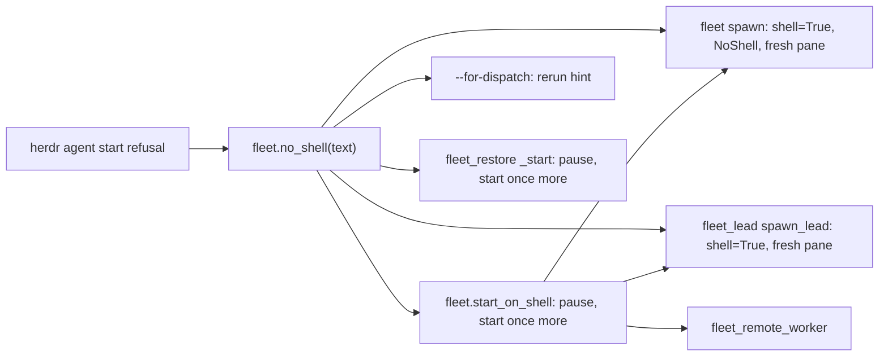

# B337: fleet spawn retries Herdr's canonical-mode refusal like a pane that is not a shell yet (#1151)

**Goal:** a worker spawn whose first start line Herdr refuses with `input contains a N-byte line but the terminal is in canonical mode with a 1024-byte limit; wait for the shell prompt and retry` gets the same retry as `not an available shell`: one more start on the same pane after SHELL_PAUSE_S, then one start in a fresh pane, and only then BLOCKED with the Herdr message and the usual `; retried once` / `; retried in a fresh pane after Wn` / `; rerun sl fleet spawn --for-dispatch` endings. Lead starts and `fleet restore` get the same retry, because they share these code paths.
**Architecture:** fleet.py gets `CANON_MSG` and `SHELL_MSGS` plus one predicate, `fleet.no_shell(text) -> bool`. Every place that now tests `SHELL_MSG in <message>` calls the predicate instead: `start_on_shell`, the worker spawn's `shell=` classification, the `--for-dispatch` rerun hint, fleet_lead.py's `shell=` classification and fleet_restore.py's `_start` retry. fleet_remote_worker.py already calls `start_on_shell` and needs no change.
**Tech stack:** Python 3 stdlib, pytest via `sl run_tests`; Markdown.
**Spec:** issue #1151 (feedback 213dbc3305e0, 458a49b10594, 90a1f9608a37); herdr 0.9.5 message text (src/client/shell/composition.rs): `input contains a N-byte line but the terminal is in canonical mode with a M-byte limit; wait for the shell prompt and retry`.
**Detail:** tests
**Wave0:** none
**Coverage:** off

## Global constraints

- Files this batch may touch: skills/subagent-driven-development/scripts/fleet.py, docs/fleet.md, plus (no open batch lists them) skills/subagent-driven-development/scripts/fleet_lead.py and skills/subagent-driven-development/scripts/fleet_restore.py (one predicate call each), docs/tools.md (the `fleet` row, two insertions only), tests/scripts/test_fleet_spawn_canonical_1151.py (new) and this plan. Never touch commands/backlog.md, skills/subagent-driven-development/backlog-main.md or tests/scripts/fixtures/rules_684/backlog.txt (batch B338 owns them).
- Keep the repo's per-line `# O(...)` complexity comment on every new or changed code line (see the existing lines of fleet.py).
- Pinned doc sentences stay byte-identical: tests/scripts/test_docs_b26.py pins docs/fleet.md's sentence that starts with "A start that fails with `not an available shell`", and tests/scripts/test_docs_b32_tools.py pins substrings of docs/tools.md's `fleet` row. Add text; never rewrite those sentences.
- Builds: the verdict is `sl run_tests` (the project's test command; a project with `.maxapp` runs `maxapp test`, which a build pool may place on another Mac, and a full run whose tree a green maxapp test stamp covers returns that result without a run); task trees build in <tree>/.build/DerivedData and any build of your own goes under .build/ of the worktree, never -derivedDataPath outside the worktree (your session scratchpad included; backlog cleanup removes scratchpad build folders when the worktree goes); a product, simulator or device build stays on this machine and runs only when an issue's acceptance asks for a running-app check.
- Simulators: append the UDID of each simulator you or a worker creates (`xcrun simctl create` or `clone`; a checker's `Simulators:` line marks its created ones) as one line to /Users/max/github/superlite/.claude/worktrees/superlite-b337-fleet-spawn-canonical-line-retry/.superlite/simulators.txt; never list one you did not create; ship cleanup shuts down and deletes each listed one.

Ruling: retry on the refusal rather than poll the pane for a shell prompt before the start, because Herdr itself names the state ("wait for the shell prompt and retry") and the pause-then-fresh-pane ladder of #295/#551 already handles a pane that is not a shell yet; a prompt poll would need a prompt heuristic per shell (lead's ruling).
Ruling: the match is the substring `terminal is in canonical mode`, not the byte counts, which vary with the argv and the tty (lead's ruling).
Ruling: the same pause, SHELL_PAUSE_S (3 s), because the fresh-pane step adds a second pause and a new shell; a longer pause would slow every freed-pane retry too (lead's ruling).
Ruling: lead starts (fleet_lead.py) and `fleet restore` (fleet_restore.py) use the same predicate, so they get the same retry. #1151 expects worker spawns to behave "as lead starts do", and a lead's start line can be over the limit too (lead's ruling).
LAYERS: unit

## Main diagram



## File structure

- skills/subagent-driven-development/scripts/fleet.py: `CANON_MSG`, `SHELL_MSGS`, `no_shell`, its three callers, module docstring lines (T1).
- skills/subagent-driven-development/scripts/fleet_lead.py: the `shell =` line calls `fleet.no_shell` (T1).
- skills/subagent-driven-development/scripts/fleet_restore.py: `_start`'s retry test calls `fleet.no_shell` (T1).
- tests/scripts/test_fleet_spawn_canonical_1151.py: predicate, spawn, `--for-dispatch`, lead, restore and doc cases (T1).
- docs/fleet.md: one new bullet after the fresh-pane bullet (T1).
- docs/tools.md: the `fleet` row names the canonical-mode refusal in two places (T1).

## Task graph

```mermaid
%% schedule
gantt
  title Predicted schedule (mm:ss)
  dateFormat X
  axisFormat %M:%S
  section lane 1
  T1 canonical-mode refusal retried as no :t1, 0, 679s
```




critical path: T1 (11.3 min) · peak width 1 · predicted build 11.3 min · predicted total ≈ 29.8 min

## Package fleet

### T1 canonical-mode refusal retried as no shell · Complexity 3 (O-1) · Est. context 45k
**Owns:** skills/subagent-driven-development/scripts/fleet.py, skills/subagent-driven-development/scripts/fleet_lead.py, skills/subagent-driven-development/scripts/fleet_restore.py, tests/scripts/test_fleet_spawn_canonical_1151.py, docs/fleet.md, docs/tools.md
**Components:** 2
**LOC owned:** 140
**Tests:** fast
**Model:** sonnet
**Kind:** design
**Est. time:** 3 min (2 components, about 140 LOC, fast tests)
**Produces:** fleet.no_shell(text: str | None) -> bool · fleet.CANON_MSG: str · fleet.SHELL_MSGS: tuple[str, str]
e.g. no_shell("agent target pane w6:p1 is not an available shell") -> True
e.g. no_shell("input contains a 1190-byte line but the terminal is in canonical mode with a 1024-byte limit; wait for the shell prompt and retry") -> True
e.g. no_shell("blocked during startup") -> False; no_shell(None) -> False
**Review Focus:** `test_spawn_blocks_after_the_fresh_pane_is_refused_too`: the BLOCKED reason carries the Herdr message, not the screen's first line; `test_other_startup_errors_still_get_no_retry`: a message without either marker is never retried; `test_restore_retries_the_canonical_refusal`: restore pauses once and starts twice.
**Steps:**
1. Write tests/scripts/test_fleet_spawn_canonical_1151.py from the test code below; run it: FAIL (no `fleet.no_shell`).
2. fleet.py, after `SHELL_MSG = ...`: `CANON_MSG = "terminal is in canonical mode"` (comment: herdr refuses a start line over the tty's canonical-mode line limit before the shell prompt, #1151), `SHELL_MSGS = (SHELL_MSG, CANON_MSG)`. After `start_on_shell`'s neighbours (directly above `def start_on_shell`): `def no_shell(text):` returning `any(m in (text or "") for m in SHELL_MSGS)`, with a comment that names both refusals.
3. fleet.py callers: `start_on_shell` re-raises unless `no_shell(getattr(e, "message", ""))`; the worker spawn's `shell = SHELL_MSG in (getattr(e, "message", "") or "")` becomes `shell = no_shell(getattr(e, "message", ""))`; the `--for-dispatch` hint's `if SHELL_MSG in why:` becomes `if no_shell(why):`. `start_on_shell`'s own comment says "a freed pane, or one whose shell has not drawn its prompt yet (#1151)".
4. fleet_lead.py: `shell = fleet.SHELL_MSG in (getattr(e, "message", "") or "")` becomes `shell = fleet.no_shell(getattr(e, "message", ""))`. fleet_restore.py `_start`: `if fleet.SHELL_MSG in _msg(e) and attempt == 0:` becomes `if fleet.no_shell(_msg(e)) and attempt == 0:`. No other change in either file.
5. fleet.py module docstring: the line "A worker whose pane is still no shell after the retry ..." and the line "A start that fails with `not an available shell` (a freed pane) is retried once ..." both add "or Herdr's canonical-mode refusal (`terminal is in canonical mode`, #1151)" after the shell wording.
6. docs/fleet.md: insert one new bullet directly after the bullet that starts "- A worker or lead whose pane is still not a shell after that 3 s retry". The new bullet says: Herdr's canonical-mode refusal (`input contains a N-byte line but the terminal is in canonical mode with a 1024-byte limit; wait for the shell prompt and retry`: the pane's shell has not drawn its prompt yet, so a start line longer than the tty's line limit is refused) counts as `not an available shell` for both retries above. Worker spawns, `--for-dispatch` and lead starts pause 3 s and start once more on the same pane, then once in a fresh pane, with the same `; retried once`, `; retried in a fresh pane after Wn` and `; rerun sl fleet spawn --for-dispatch` endings. `fleet restore` retries it once after the pause (#1151). It must hold the literal substrings `terminal is in canonical mode`, `fleet restore` and `(#1151)`.
7. docs/tools.md, the `fleet` row only: after "a start that fails with `not an available shell`", insert " or Herdr's canonical-mode refusal (`terminal is in canonical mode`, #1151)". After "only when the reason holds `not an available shell`", insert " or `terminal is in canonical mode`". Nothing else in the row changes.
8. Run the verify command: PASS.
**Test code (verbatim):**
```python
"""#1151: a start Herdr refuses because the pane's terminal is still in canonical mode (a start line over its line limit
before the shell prompt) is a pane that is not a shell yet: one pause, one more start, then one start in a fresh pane."""
import json
import os
from pathlib import Path

import pytest
from test_fleet import world  # noqa: F401  (world is a fixture)
from test_fleet_for_dispatch import dwld, FRESH, _go  # noqa: F401
from test_fleet_spawn_shell_retry import MSG, script, starts
from test_fleet_lead_shell_551 import lead
from test_fleet_restore_577 import w, idle_agent, fr  # noqa: F401  (w is a fixture)
import fleet
import fleet_lead as fl

REAL = os.environ.get("SUPERLITE_REAL") == "1"
pytestmark = pytest.mark.skipif(REAL, reason="scripted start failures need the in-process fake")
ROOT = Path(__file__).resolve().parents[2]
CANON = ("input contains a 1190-byte line but the terminal is in canonical mode with a 1024-byte limit; "
         "wait for the shell prompt and retry")
REFUSED = ("agent_start_failed", CANON)


@pytest.fixture
def pauses(monkeypatch):
    p = []
    monkeypatch.setattr(fleet, "_pause", p.append)
    return p


def test_no_shell_matches_both_refusals():
    assert fleet.CANON_MSG == "terminal is in canonical mode" and fleet.SHELL_MSGS == (fleet.SHELL_MSG, fleet.CANON_MSG)
    assert fleet.no_shell(MSG) and fleet.no_shell(CANON)
    assert not fleet.no_shell("blocked during startup") and not fleet.no_shell("") and not fleet.no_shell(None)


def test_start_on_shell_retries_the_canonical_refusal(world, pauses):
    script(world, {1: REFUSED})
    assert fleet.start_on_shell("a", "w6:p1", ["x"]) == "; retried once"
    assert len(starts(world)) == 2 and pauses == [fleet.SHELL_PAUSE_S]


def test_spawn_retries_the_canonical_refusal_on_the_same_pane(world, pauses):
    fleet.main(["on"]); script(world, {1: REFUSED})
    assert fleet.spawn(world.sd, world.plan, "sonnet", world.proj)["id"] == "W1"
    assert json.loads((world.sd / "fleet.json").read_text())["workers"]["W1"]["state"] == "ready"
    assert len(starts(world)) == 2 and pauses == [fleet.SHELL_PAUSE_S]


def test_spawn_starts_a_fresh_pane_after_two_canonical_refusals(world, pauses, capsys):
    fleet.main(["on"]); capsys.readouterr(); script(world, {1: REFUSED, 2: REFUSED})
    assert fleet.spawn(world.sd, world.plan, "sonnet", world.proj)["id"] == "W2"
    err = capsys.readouterr().err
    assert f"W1 startup: {CANON}; retried once; retrying in a fresh pane" in err
    assert len(starts(world)) == 3 and pauses == [fleet.SHELL_PAUSE_S]
    assert any(c[0] == "close_pane" for c in world.fh.calls)


def test_spawn_blocks_after_the_fresh_pane_is_refused_too(world, pauses, capsys):
    fleet.main(["on"]); capsys.readouterr()
    script(world, {n: REFUSED for n in (1, 2, 3, 4)})
    with pytest.raises(SystemExit) as e:
        fleet.spawn(world.sd, world.plan, "sonnet", world.proj)
    line = capsys.readouterr().out.splitlines()[0]
    assert e.value.code == 3 and line.startswith("BLOCKED: W2 account ")
    assert line.endswith(f"startup: {CANON}; retried once; retried in a fresh pane after W1")
    assert len(starts(world)) == 4 and len(pauses) == 2


def test_other_startup_errors_still_get_no_retry(world, pauses, capsys):
    fleet.main(["on"]); capsys.readouterr()
    script(world, {1: ("agent_start_failed", "the terminal refused the line")})
    with pytest.raises(SystemExit):
        fleet.spawn(world.sd, world.plan, "sonnet", world.proj)
    out = capsys.readouterr().out
    assert out.startswith("BLOCKED: ") and "retried" not in out
    assert len(starts(world)) == 1 and pauses == []


def test_for_dispatch_names_the_rerun_on_a_canonical_refusal(dwld, pauses, capsys):
    fleet.main(["on"]); capsys.readouterr()
    script(dwld, {n: REFUSED for n in (1, 2, 3, 4)})
    dwld.lines = [("T2", FRESH), ("T3", FRESH)]
    assert _go(dwld) == 3
    out = capsys.readouterr().out.splitlines()
    assert out[0].startswith("BLOCKED: T2 not sent (")
    assert out[0].endswith(f"{CANON}; retried once; retried in a fresh pane after W1; rerun sl fleet spawn --for-dispatch)")
    assert out[1:] == ["W3 T3 sent"]


def test_lead_starts_in_a_fresh_pane_after_two_canonical_refusals(world, tmp_path, monkeypatch, pauses, capsys):
    wt = lead(world, tmp_path, monkeypatch); capsys.readouterr(); script(world, {1: REFUSED, 2: REFUSED})
    r = fl.spawn_lead(world.sd, wt, "opus", env={"HOME": "/u"})
    out, err = capsys.readouterr()
    workers = json.loads((world.sd / "fleet.json").read_text())["workers"]
    assert r["id"] == "W2" and (workers["W1"]["state"], workers["W2"]["state"]) == ("blocked", "ready")
    assert len(starts(world)) == 3 and pauses == [fleet.SHELL_PAUSE_S] and "BLOCKED" not in out
    assert f"W1 startup: {CANON}; retried once; retrying in a fresh pane" in err


def test_restore_retries_the_canonical_refusal(w):
    w.fake.agents = [idle_agent()]
    w.fake.start_errors = [REFUSED]
    lines, blocked = w.run()
    assert not blocked and lines[0].startswith("W1 restored") and w.pauses == [fr.fleet.SHELL_PAUSE_S]
    assert sum(1 for c in w.fake.calls if c[0] == "start_agent") == 2


def test_docs_name_the_canonical_refusal():
    fleet_md = (ROOT / "docs" / "fleet.md").read_text(encoding="utf-8")
    bullet = next(x for x in fleet_md.splitlines() if "terminal is in canonical mode" in x)
    assert bullet.startswith("- ") and "(#1151)" in bullet and "fleet restore" in bullet
    row = next(x for x in (ROOT / "docs" / "tools.md").read_text(encoding="utf-8").splitlines() if x.startswith("| `fleet` |"))
    assert "`not an available shell` or Herdr's canonical-mode refusal (`terminal is in canonical mode`, #1151)" in row
    assert "only when the reason holds `not an available shell` or `terminal is in canonical mode`" in row
```
**Verify:** `sl run_tests --fast tests/scripts/test_fleet_spawn_canonical_1151.py tests/scripts/test_fleet_spawn_shell_retry.py tests/scripts/test_fleet_lead_shell_551.py tests/scripts/test_fleet_restore_577.py tests/scripts/test_docs_b26.py tests/scripts/test_docs_b32_tools.py tests/scripts/test_backlog_start_551.py --task T1 --background`, then its `wait:` line.
**Notes:** `world`'s fake `read_screen` returns a non-empty screen, so before the fix a canonical refusal BLOCKs with the screen's first line, not the Herdr message; the fixed `shell=True` path names `e.message`. If importing the `w` fixture next to `world` clashes in one module, keep the restore case and move only it into a second test file you own, `tests/scripts/test_fleet_restore_canonical_1151.py`, and say so in the report.

## Review Focus

- **T1 (fleet CLI, concurrency and Herdr protocol):** categories protocol (the Herdr error message as the only signal), state (a worker record left `blocked` and a pane closed before the fresh-pane start), boundary (a message holding neither marker, `None`). Cases are named in T1's Review Focus line.
**Probe entry:** none (the spawn path needs a Herdr fake; the task's tests cover it).

## Self-review

- Coverage: #1151 "worker spawn ... retries once after a short pause on this refusal, as lead starts do" = steps 2-4 (same pane), step 3 (fresh pane, BLOCKED text), step 4 (lead, restore).
- No placeholders; one task, no edges; T1 owns every file it edits.
