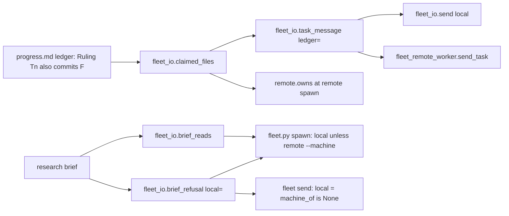
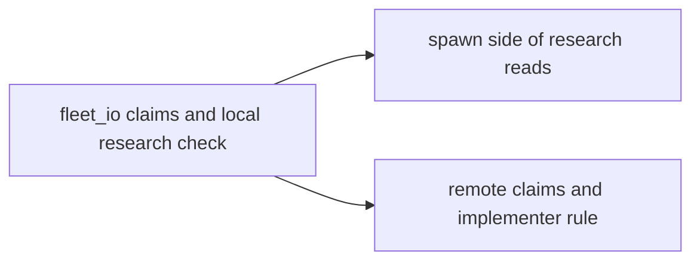

# B340: a task's claimed files are editable by its worker; a local research worker may read outside paths its brief names (#1156, #1158)

**Goal:** (#1156) a fleet worker is told it may edit every file the run rules to its task: its `**Also-touches:**` files (already on the `Also edit:` line) and the files a `commit_task Tn --claim F` or `--also F` ruling in the run's ledger names, so no worker stops NEEDS_CONTEXT over a file its task was ruled to edit. (#1158) a research worker on this machine may read outside paths its own brief names (read-only); write roles and remote research workers keep the #1015 refusal.
**Architecture:** fleet_io gains `claimed_files(ledger, tasks)` (the ledger's `Ruling: Tn also commits F - why` lines, read by `commit_task.also_owned`) and `task_message(..., ledger=None)` puts those files on one `Also edit (claimed):` line and keeps them out of `Do not touch`; `send` (local) and `fleet_remote_worker.send_task` (remote) pass `<sd>/progress.md`, and a remote implementer's recorded `remote.owns` adds them so the snapshot apply accepts them. `brief_refusal(..., local=False)` skips the named-path check for a local research worker (the brief-location check stays); `fleet send` passes `local=machine_of(sd, wid) is None`; `fleet spawn --role research --brief F` passes `local` when no remote `--machine` is given and pins such a worker to this machine when its brief names an outside path (`brief_reads`).
**Tech stack:** Python 3.10+ stdlib, pytest via `sl run_tests`.
**Spec:** this file, section Design; issues #1156, #1158; research R1, R2 in .superlite/fleet/reports/.
**Detail:** contracts
**Wave0:** none

## Global constraints

- Every new or changed code line in `skills/subagent-driven-development/scripts/*.py` keeps the trailing `# O(...)` complexity comment the existing lines carry.
- Texts that no claim or research change touches stay byte-identical: a task message with no ledger (or a ledger that rules nothing to the task) equals today's; the #1015 `error:` lines (`fleet.outside_error`, the brief-location line in fleet_io) keep their wording.
- `--note` checks and `plan_tools lint`'s OUTSIDE warning keep calling `brief_outside` without a role (strict); `brief_outside`'s research-line exemption (#1089) stays for a remote research worker.
- Existing tests stay green; an existing test file changes only when the task Owns it. Run `sl` as an executable; verify with `sl run_tests --fast <own test files> --task Tn`. No version edits.
- Builds: the verdict is `sl run_tests` (the project's test command; a project with `.maxapp` runs `maxapp test`, which a build pool may place on another Mac, and a full run whose tree a green maxapp test stamp covers returns that result without a run); task trees build in <tree>/.build/DerivedData and any build of your own goes under .build/ of the worktree, never -derivedDataPath outside the worktree (your session scratchpad included; backlog cleanup removes scratchpad build folders when the worktree goes); a product, simulator or device build stays on this machine and runs only when an issue's acceptance asks for a running-app check; copy this sentence into every worker brief.
- Simulators: append the UDID of each simulator you or a worker creates (`xcrun simctl create` or `clone`; a checker's `Simulators:` line marks its created ones) as one line to /Users/max/github/superlite/.claude/worktrees/superlite-b340-fleet-hook-also-touches-research-re/.superlite/simulators.txt; never list one you did not create; ship cleanup shuts down and deletes each listed one; copy this sentence into every worker brief.

Ruling: #1156 has no hook to change: hooks/block-coordinator-edits exits 0 for a fleet worker (R1), and in the reported AtlasKit run (B9, T7) the scripted edit was refused by Claude Code's auto-mode classifier, while the later Edit calls to the same file succeeded. T7 stopped because its lead had dropped T7's Also-touches line after lint's ALSO-TOUCHES warning and ruled the file to T7 in plan prose, so T7's message listed it under `Do not touch` (lead's ruling, from the B9 lead and worker transcripts).
Ruling: [scope] #1156's "or plan lint says the hook will refuse it" is not built: no hook refuses the edit. Instead a ledger claim (`commit_task Tn --claim F --ruling ...`, before or after dispatch) puts F on the task's message, and agents/implementer.md and implementer-haiku.md say the `Also edit` files are the worker's to edit (lead's ruling).
Ruling: a claimed file gets its own `Also edit (claimed):` line built in fleet_io; task.also_line and task.py stay unchanged (lead's ruling).
Ruling: #1158 per Max's decision (allow for research only): a research worker on this machine may name any existing outside path; the brief FILE still has to lie in the project, the run folder or the plugin skills folder; a research worker spawned or sent to a remote machine keeps today's check (lead's ruling on the remote case: a remote machine lacks the path).
Ruling: the spawn pins a research worker whose brief (with the plan's Global constraints) names an outside path to this machine itself, in fleet.py; fleet_placement.research_local stays unchanged (lead's ruling).
Ruling: a research worker's launch needs no `--add-dir`: a `--permission-mode dontAsk --allowedTools Read Grep Glob` session read a file outside its cwd (spike, 2026-11-24) (lead's ruling).
Ruling: fleet_remote_worker.py, agents/implementer.md, agents/implementer-haiku.md, docs/fleet.md, docs/tools.md, skills/subagent-driven-development/fleet.md, this plan and the tests the tasks own lie outside the brief's file list; no open batch lists them, so B340 edits them and names them in notes.md (lead's ruling).
LAYERS: unit

## Coverage

| Category | State | Basis |
|---|---|---|
| Scope and success criteria | settled | #1156: a ruled file is editable by the task's worker; #1158: Max's decision, research only, local |
| Domain and data model | n/a | ledger lines and fleet.json fields as they are |
| Persistence and migration | n/a | nothing stored anew |
| Interfaces and contracts | ruled | new `claimed_files`, `brief_reads`; `task_message(ledger=)`, `brief_refusal(local=)` keyword-only additions |
| UI states | n/a | CLI |
| Concurrency and state ownership | settled | the ledger is read at send time; commit_task already commits a claimed file with its claimer |
| Error handling and recovery | ruled | a missing or unreadable ledger means no claims; refusals keep their exit 2 lines |
| Security and privacy | ruled | research workers stay read-only (dontAsk, read allowlist); only research skips the named-path check, only locally |
| Performance and limits | ruled | one ledger read per send, O(lines) |
| Observability | ruled | one stderr `placement:` line when spawn pins a research worker while placement is on |
| Testing strategy | ruled | in-process tests per function plus the existing #1015/#1024 suites |
| Compatibility | ruled | no ledger claims: byte-identical messages |
| Rollout | n/a | next version |
| Research unknowns | settled | R1, R2, the outside-read spike |

## Main diagram

## File structure

- skills/subagent-driven-development/scripts/fleet_io.py: `claimed_files`, `task_message(ledger=)`, `send` passes the ledger, `brief_reads`, `brief_refusal(local=)`, the send command's `local` (T1).
- skills/subagent-driven-development/scripts/fleet.py: spawn passes `local`, pins research local, docstring (T2); docs/fleet.md, docs/tools.md, skills/subagent-driven-development/fleet.md name #1158 (T2).
- skills/subagent-driven-development/scripts/fleet_remote_worker.py: remote send passes the ledger, remote.owns adds claims; agents/implementer.md, agents/implementer-haiku.md: the Also edit rule (T3).

## Task graph

```mermaid
%% schedule
gantt
  title Predicted schedule (mm:ss)
  dateFormat X
  axisFormat %M:%S
  section lane 1
  T1 fleet_io claims and local research ch :t1, 0, 324s
  T2 spawn side of research reads :t2, 324, 320s
  section lane 2
  T3 remote claims and implementer rule :t3, 324, 313s
```

critical path: T1 → T2 (10.7 min) · peak width 2 · predicted build 10.7 min · predicted total ≈ 21.2 min

## fleet_io

**Probe entry:** none (library functions and CLI commands; covered by named tests)

### T1 fleet_io claims and local research check · Complexity 3 (O-1) · Est. context 50k
**Owns:** skills/subagent-driven-development/scripts/fleet_io.py, tests/scripts/test_task_message_claims_1156.py, tests/scripts/test_research_local_reads_1158.py, tests/scripts/test_fleet_send_brief_outside_1024.py
**Components:** 2
**LOC owned:** 190
**Tests:** fast
**Kind:** design
**Model:** sonnet
**Produces:** fleet_io.claimed_files(ledger, tasks) -> list[str] · fleet_io.task_message(plan, tasks, sl_path, superlite_root, tier="sonnet", ledger=None) -> str · fleet_io.brief_reads(sd, brief, plan=None) -> list[str] · fleet_io.brief_refusal(sd, brief, role="", plan=None, local=False) -> str | None
  e.g. ledger line `- Ruling: T7 also commits Sources/FakeStore.swift - T7 adds members` -> claimed_files(ledger, ["T7"]) == ["Sources/FakeStore.swift"]; claimed_files(ledger, ["T5"]) == []; claimed_files(tmp/"missing.md", ["T7"]) == []
  e.g. T7 Owns b.py, T5 Owns a.py, that ledger line for a.py -> task_message(plan, ["T7"], sl, root, ledger=ledger) holds the line `Also edit (claimed): a.py (ruled to this task in the run's ledger by commit_task --claim or --also; commit_task commits them with this task)` and its haiku `Do not touch:` line does not name a.py
  e.g. a brief naming an existing file /tmp/x/ref.md outside the project -> brief_refusal(sd, b, "research", local=True) is None; brief_refusal(sd, b, "research") and brief_refusal(sd, b, "implementer", local=True) are the `fleet.outside_error` line; brief_reads(sd, b) == ["/tmp/x/ref.md"]
**Review Focus:** state, file
**Test code (contracts):**
- `test_claimed_files_reads_ruling_lines`: the e.g. lines above; two lines for T7 (a.py, then dir/) -> `["a.py", "dir/"]`; a repeated line counts once; claimed_files(ledger, ["T5", "T7"]) holds T7's files.
- `test_claimed_file_goes_on_its_own_also_edit_line`: the second e.g.; the claimed line comes right after the `Also edit:` line when the task has Also-touches, else right after `Owns:`; tier "sonnet" text holds it too.
- `test_no_claim_keeps_message_byte_identical`: task_message(..., ledger=None), task_message(...) and task_message(..., ledger=<ledger ruling only T5's files to T5>) are equal strings.
- `test_claim_already_in_also_touches_is_not_repeated`: T7 Also-touches a.py and the ledger claims a.py for T7 -> a.py is on the `Also edit:` line only; no `Also edit (claimed):` line.
- `test_also_touches_of_independent_owner_is_editable`: T7 Also-touches a.py owned by T5, no taskgraph edge -> haiku message has `Also edit: a.py` and its `Do not touch:` line lacks a.py (#1156 part 1 regression guard).
- `test_send_passes_run_ledger`: a fleet.json with local worker W1 (tier sonnet), `task_message` and `_prompt` monkeypatched -> `send(sd, plan, "W1", ["T7"], sl, root)` calls task_message with `ledger == Path(sd) / "progress.md"`.
- `test_local_research_may_name_outside_path`: the third e.g.
- `test_local_research_brief_file_outside_still_refused`: a brief file outside project, run folder and skills folder -> brief_refusal(sd, b, "research", local=True) is the `error: brief ... is outside the project` line.
- `test_brief_reads_adds_constraint_paths`: a plan whose Global constraints name another existing outside file -> brief_reads(sd, b, plan=plan) lists both, brief's first.
- `test_send_research_local_passes_remote_refused`: fleet.json W1 role research without `machine` -> `main(["send", "W1", "--brief", b, ...])` reaches `send_brief` (monkeypatched); with `"machine": "mxn"` it exits 2, stderr has the outside_error line, send_brief not called.
**Steps:** 1 failing tests, 2 run: FAIL, 3 implement, 4 run: PASS
**Notes:** `claimed_files`: `commit_task.also_owned(ledger)` (fleet_io already loads commit_task through findings; a lazy `import commit_task` inside the function) and keep entries whose task is in TASKS, ledger order. In `task_message` the claimed files exclude `owns` and the `also` list and join the files kept out of `others`. `brief_reads`: the location-independent part of `brief_refusal` (read the brief, add `fleet.with_constraints` when `plan`, then `brief_outside(text, state.project(sd), sd)` with no role); `brief_refusal` reuses it, so no second reader. `brief_refusal`: when `role == "research" and local`, return None after the location check. The send command (`a.brief` branch, about line 1421): `brief_refusal(sd, a.brief, role, local=machine_of(sd, a.wid) is None)`. `send` passes `ledger=Path(sd) / "progress.md"`. test_fleet_send_brief_outside_1024.py: `research` leaves the refused-roles parametrize for a local worker; add it to a remote-worker case that stays refused; keep the other assertions.

## spawn

**Probe entry:** none (CLI; covered by named tests)

### T2 spawn side of research reads · Complexity 3 (O-1) · Est. context 50k
**Owns:** skills/subagent-driven-development/scripts/fleet.py, tests/scripts/test_fleet_spawn_research_reads_1158.py, tests/scripts/test_fleet_brief_outside_1015.py, docs/fleet.md, docs/tools.md, skills/subagent-driven-development/fleet.md
**Components:** 2
**LOC owned:** 150
**Tests:** fast
**Kind:** design
**Model:** sonnet
**Consumes:** fleet_io.brief_refusal(sd, brief, role="", plan=None, local=False) -> str | None (T1) · fleet_io.brief_reads(sd, brief, plan=None) -> list[str] (T1)
**Review Focus:** state, protocol
**Test code (contracts):**
- `test_spawn_local_research_naming_outside_path_starts`: `fleet.main(["spawn", "--role", "research", "--brief", b, "--plan", sd])`, b naming an existing outside file, `spawn` and `send_brief` monkeypatched -> exit 0 and the worker spawned without a machine.
- `test_spawn_pins_research_local`: placement on (`fleet_placement.enabled` -> True), `fleet._placed` monkeypatched to fail the test when called -> it is not called and stderr has `placement: research worker stays local: its brief names paths outside the project that only this machine has (#1158)`; with placement off no such line.
- `test_spawn_research_brief_without_outside_path_is_placed`: a brief naming only project paths -> `_placed` is asked as today.
- `test_spawn_research_on_remote_machine_still_refused`: `--machine mxn` (`fleet_placement.machine_refusal` -> None) -> exit 2, stderr is the outside_error line naming the path, no spawn.
- `test_spawn_implementer_still_refused`: `--role implementer` with the same brief -> exit 2.
- `test_docs_name_1158`: docs/fleet.md, docs/tools.md and skills/subagent-driven-development/fleet.md each contain `#1158`.
**Steps:** 1 failing tests, 2 run: FAIL, 3 implement, 4 run: PASS
**Notes:** In `main`'s spawn brief check (about line 1786): `local = a.role == "research" and a.machine in (None, "local")`; pass `local=local` to `brief_refusal`. When `local` and `a.machine is None` and `brief_reads(sd, a.brief, plan=plan)` is non-empty, set `a.machine = "local"` (`_spawn_cmd` then forces this machine) and print the stderr line when `fleet_placement.enabled(sd)` is true (any exception: no line). Docstring (about line 48): one sentence: a research worker on this machine may name any existing outside path; a remote one keeps the check; spawn keeps such a worker here (#1158). docs/fleet.md line 35 bullet and line 198 bullet, docs/tools.md `fleet` brief checks row (line 61), skills/subagent-driven-development/fleet.md Other roles sentence on the #1015 refusal: one clause each naming the same rule and #1158; check tests that pin these texts (`grep -rl "1089\|1132\|1015" tests/scripts/test_docs*`) and keep them green. test_fleet_brief_outside_1015.py: the cases that spawn `research` with an outside path and expect a refusal (`test_spawn_refuses_brief_naming_outside_path`, `test_every_worker_role_is_checked[research]`, `test_global_constraints_are_checked_too`, `test_brief_and_constraint_paths_share_one_line`) switch to `implementer` or a remote `--machine`; `test_spawn_calls_fleet_io_brief_refusal` keeps `seen[0][1:3] == (brief, "research")`.

## remote and rules

**Probe entry:** none (remote record and agent text; covered by named tests)

### T3 remote claims and implementer rule · Complexity 2 (O-1) · Est. context 40k
**Owns:** skills/subagent-driven-development/scripts/fleet_remote_worker.py, agents/implementer.md, agents/implementer-haiku.md, tests/scripts/test_remote_claims_1156.py
**Components:** 2
**LOC owned:** 90
**Tests:** fast
**Kind:** design
**Model:** sonnet
**Consumes:** fleet_io.claimed_files(ledger, tasks) -> list[str] (T1) · fleet_io.task_message(plan, tasks, sl_path, superlite_root, tier="sonnet", ledger=None) -> str (T1)
**Review Focus:** state, file
**Test code (contracts):**
- `test_remote_owns_include_ledger_claims`: as tests/scripts/test_fleet_remote_worker_1109_1112.py records an implementer's remote spawn, with `<sd>/progress.md` holding `- Ruling: T1 also commits c.py - why` -> the recorded `remote.owns` is `[*owns, *also_touches, "c.py", "tests/regression/**"]`; a claim already in owns is not repeated; no ledger -> today's list.
- `test_remote_send_task_passes_ledger`: `fio.task_message` monkeypatched -> `send_task(sd, "W1", plan, ["T1"], sl)` calls it with `ledger == Path(sd) / "progress.md"`.
- `test_implementer_rules_name_also_edit`: agents/implementer.md and agents/implementer-haiku.md each hold the line `- The files your task message's \`Also edit\` lines name are yours to edit too; commit_task commits them with your task.` directly after the `- Format only the files you changed: ...` line; tests/scripts/test_worker_format_own_files_568.py stays green unchanged.
**Steps:** 1 failing tests, 2 run: FAIL, 3 implement, 4 run: PASS
**Notes:** In `spawn` (about line 143) `claimed = fio.claimed_files(sd / "progress.md", [task])` and the record's owns (about line 167) add the claimed entries not already in `owns` or `also`; the start commit stays Owns-only. `send_task` (about line 501) passes `ledger=Path(sd) / "progress.md"`.

## Review Focus

- fleet_io (library): state (ledger claims at send time, byte-identical texts without them), file (brief location, outside paths), protocol (send's local flag from fleet.json `machine`).
- fleet.py spawn (CLI): state (placement pinned local only for research naming outside paths), protocol (remote `--machine` keeps the refusal).
- fleet_remote_worker (remote record): state (remote.owns adds claims), file.

## Self-review

Every requirement maps to a task (#1156: T1, T3; #1158: T1, T2). No two parallel tasks share a file (T2 and T3 run together: disjoint Owns). Consumes match T1's Produces.
