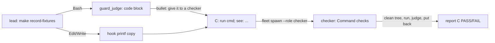
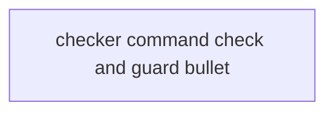

# B341: a lead runs a project check that writes files through a checker; the guard's block text names it (#1157)

**Goal:** a lead whose reproduction or verification command writes a tracked (often task-owned) file, such as `make record-fixtures` rewriting a recorded fixture, has one documented way to run it: a checker task with a command check. The coordinator guard's code block (Bash through guard_judge.py, Edit and Write through the hook's own copy) names that way, so no lead reruns the command by hand into `.superlite/scratch/` again.
**Architecture:** documentation plus block text only, no new tool. agents/checker.md gains a `## Command checks` section (the `C<n>: run <command>; see: <what must hold>` line, a clean-tree precheck, judging from the command's output, putting back what the command wrote); skills/subagent-driven-development/fleet.md's Checker bullet names the route; guard_judge.MESSAGES["code"] and the hook's Edit/Write copy gain one identical bullet right after the render_edit bullet; docs/hooks.md gains one #1157 bullet.
**Tech stack:** Markdown, Python 3 stdlib, bash; pytest via `sl run_tests`.
**Spec:** issue #1157 (feedback b49b96b279a4: AtlasKit lead, `make record-fixtures` writes recorded-v2.json, blocked by the coordinator guard; expected: a documented way, named in the guard's block text).
**Detail:** tests
**Wave0:** none
**Coverage:** off

## Global constraints

- The new block bullet is exactly this one line (identical in `guard_judge.MESSAGES["code"]` and in the hook's Edit/Write `printf` list, inserted directly after the line that starts `- A throwaway edit to check a render`):
  `` - A project check that writes files (a reproduction or verification command such as `make record-fixtures`): give it to a checker as a `C<n>: run <command>; see: <what must hold>` line (fleet on: `sl fleet spawn --role checker --brief <file>`; fleet off: Agent `superlite:checker`); it runs the command in the run root, reports, and puts back what it wrote (agents/checker.md, Command checks). ``
- Keep every existing line of MESSAGES["code"], the hook's list and agents/checker.md; append sentences to existing checker.md bullets, never reword them (tests/scripts/test_checker_agent_600.py, test_docs_checker_600.py, test_fleet_roles_checker_600.py, test_hook_inline_owns_599.py, test_guard_inline_owns_599.py pin texts and order).
- Files this batch may touch: the six Owns files of T1 and this plan. An existing test that breaks: name it in the report, do not edit it without the lead's word.
- Builds: the verdict is `sl run_tests` (the project's test command; a project with `.maxapp` runs `maxapp test`, which a build pool may place on another Mac, and a full run whose tree a green maxapp test stamp covers returns that result without a run); task trees build in <tree>/.build/DerivedData and any build of your own goes under .build/ of the worktree, never -derivedDataPath outside the worktree (your session scratchpad included; backlog cleanup removes scratchpad build folders when the worktree goes); a product, simulator or device build stays on this machine and runs only when an issue's acceptance asks for a running-app check; copy this sentence into every worker brief.
- Simulators: append the UDID of each simulator you or a worker creates (`xcrun simctl create` or `clone`; a checker's `Simulators:` line marks its created ones) as one line to /Users/max/github/superlite/.claude/worktrees/superlite-b341-lead-reproduction-check-route/.superlite/simulators.txt; never list one you did not create; ship cleanup shuts down and deletes each listed one; copy this sentence into every worker brief.

Ruling: main's ruling for #1157 (document a checker task, name it in block text) is built as a checker command check, not a new tool or run mode (main's ruling).
Ruling: the checker puts back what its command wrote with `git -C <ROOT> checkout HEAD -- <path>` and by deleting the untracked paths the command created, only after `git -C <ROOT> status --porcelain` printed nothing before the run; `sl render_edit` is not the route because it refuses a file a plan task owns, the #1157 case (lead's ruling).
Ruling: a scratch-copy run mode (the issue's other example) is not built: a copy lacks the untracked inputs a project command needs (.venv, node_modules, local config), and main ruled the checker route (lead's ruling).
Ruling: the hook's Edit/Write copy gets the same bullet, so every code block names the route; sized bounded: one sonnet task (lead's ruling).

## Main diagram



## File structure

- skills/subagent-driven-development/scripts/guard_judge.py: MESSAGES["code"] gains the bullet.
- hooks/block-coordinator-edits: the Edit/Write `printf` list gains the same bullet.
- agents/checker.md: description, two appended rule sentences, the `## Command checks` section, one report sentence.
- skills/subagent-driven-development/fleet.md: the Checker bullet names command checks.
- docs/hooks.md: one `block-coordinator-edits`, project checks (#1157) bullet.
- tests/scripts/test_checker_command_check_1157.py: the tests below.

## Task graph

```mermaid
%% schedule
gantt
  title Predicted schedule (mm:ss)
  dateFormat X
  axisFormat %M:%S
  section lane 1
  T1 checker command check and guard bulle :t1, 0, 496s
```





critical path: T1 (8.3 min) · peak width 1 · predicted build 8.3 min · predicted total ≈ 22.8 min

## Checker command check

**Probe entry:** none (text only; the named tests read the files and run the judge and the hook)

### T1 checker command check and guard bullet · Complexity 2 (O-1) · Est. context 40k
**Owns:** skills/subagent-driven-development/scripts/guard_judge.py, hooks/block-coordinator-edits, agents/checker.md, skills/subagent-driven-development/fleet.md, docs/hooks.md, tests/scripts/test_checker_command_check_1157.py
**Components:** 2
**LOC owned:** 120
**Tests:** fast
**Kind:** design
**Model:** sonnet
**Produces:** guard_judge.MESSAGES["code"] line `- A project check that writes files ...` (Global constraints) · agents/checker.md section `## Command checks`
**Review Focus:** `test_judge_block_names_checker_route`: `make record-fixtures` in an active run exits 2 and stderr holds the bullet; `test_hook_edit_block_names_checker_route`: an Edit of an unowned src file exits 2 and the bullet sits right after the render line; `test_checker_md_command_checks`: the section names the line form, the clean-tree precheck, the put-back commands and the git exception.
**Test code (verbatim):**

```python
"""#1157: a lead's project check that writes files goes to a checker; the guard's block text names that route."""
import io
import json
import os
import shutil
import subprocess
import sys
from pathlib import Path

import pytest

ROOT = Path(__file__).resolve().parents[2]
sys.path.insert(0, str(ROOT / "skills" / "subagent-driven-development" / "scripts"))
import guard_judge as gj  # noqa: E402

HOOK = ROOT / "hooks" / "block-coordinator-edits"
BASH = shutil.which("bash")
BULLET = ("- A project check that writes files (a reproduction or verification command such as `make record-fixtures`): "
          "give it to a checker as a `C<n>: run <command>; see: <what must hold>` line (fleet on: "
          "`sl fleet spawn --role checker --brief <file>`; fleet off: Agent `superlite:checker`); it runs the command "
          "in the run root, reports, and puts back what it wrote (agents/checker.md, Command checks).")
RENDER = "- A throwaway edit to check a render"
TWO = "# Plan\n\n### T1 a\n**Owns:** src/a.py\n\n### T2 b\n**Owns:** src/b.py\n"


def test_messages_hold_the_bullet_once_after_render_line():
    code = gj.MESSAGES["code"]
    assert code.count(BULLET) == 1
    i = code.index(BULLET)
    assert code[i - 1].startswith(RENDER)
    assert code[-1].startswith("- After the run,")


@pytest.fixture
def proj(tmp_path):
    p = tmp_path / "proj"
    (p / "src").mkdir(parents=True)
    (p / "docs" / "plans").mkdir(parents=True)
    (p / ".superlite").mkdir()
    plan = p / "docs" / "plans" / "plan.md"
    plan.write_text(TWO)
    (p / "Makefile").write_text("record-fixtures:\n\tpython3 rec.py > src/recorded-v2.json\n")
    subprocess.run(["git", "init", "-q", str(p)], check=True)
    (p / ".superlite" / "stable.json").write_text(json.dumps({"plan": str(plan), "stable": []}))
    return p


def test_judge_block_names_checker_route(proj, monkeypatch, capsys):
    raw = json.dumps({"tool_name": "Bash", "tool_input": {"command": "make record-fixtures"}, "cwd": str(proj)})
    monkeypatch.setattr(sys, "stdin", io.StringIO(raw))
    rc = gj.main(["--mode", "active", "--project", str(proj), "--sd", str(proj / ".superlite")])
    err = capsys.readouterr().err.splitlines()
    assert rc == 2
    assert BULLET in err
    assert err[err.index(BULLET) - 1].startswith(RENDER)


def _hook(p, tool, path):
    env = {k: v for k, v in os.environ.items()
           if k not in ("SUPERLITE_STATE_DIR", "SUPERLITE_SESSION_ID") and not k.startswith("SUPERLITE_FLEET_")}
    env["CLAUDE_PROJECT_DIR"] = str(p)
    raw = json.dumps({"tool_name": tool, "tool_input": {"file_path": path}, "cwd": str(p)})
    return subprocess.run([BASH, str(HOOK)], input=raw, capture_output=True, text=True, env=env)


@pytest.mark.parametrize("tool", ["Edit", "Write"])
def test_hook_edit_block_names_checker_route(proj, tool):
    r = _hook(proj, tool, str(proj / "src" / "a.py"))
    lines = r.stderr.splitlines()
    assert r.returncode == 2
    assert lines.count(BULLET) == 1
    assert lines[lines.index(BULLET) - 1].startswith(RENDER)
    assert lines[-1] == "Blocked target: src/a.py"


def test_checker_md_command_checks():
    text = (ROOT / "agents" / "checker.md").read_text(encoding="utf-8")
    sec = text.split("## Command checks", 1)[1].split("\n## ", 1)[0]
    for part in ("`C<n>: run <command>; see: <what must hold>`", "`make record-fixtures`",
                 "`git -C <ROOT> status --porcelain`", "NOT REACHABLE", "`git -C <ROOT> checkout HEAD -- <path>`",
                 "`??`", "`.superlite/check/C<n>-"):
        assert part in sec, part
    assert "Change no product or test file, commit nothing, and leave git alone (no stash, checkout, reset or branch)." in text
    assert "a command check puts back what its own command wrote (Command checks)" in text
    assert "A command check is judged from its command's output instead (Command checks)." in text


def test_fleet_md_and_hooks_md_name_the_route():
    fleet = (ROOT / "skills" / "subagent-driven-development" / "fleet.md").read_text(encoding="utf-8")
    checker = next(x for x in fleet.splitlines() if x.startswith("- Checker: `--role checker`"))
    for part in ("`make record-fixtures`", "`C<n>: run <command>; see: <what must hold>`", "Command checks", "#1157"):
        assert part in checker, part
    hooks = (ROOT / "docs" / "hooks.md").read_text(encoding="utf-8")
    bullet = [x for x in hooks.splitlines() if x.startswith("- `block-coordinator-edits`, project checks that write files (#1157):")]
    assert len(bullet) == 1
    assert "agents/checker.md" in bullet[0] and "Edit and Write" in bullet[0]
```

**Steps:** 1 write the test file, 2 run: FAIL, 3 edit the five files, 4 run: PASS, 5 run the pinned neighbours: `tests/scripts/test_checker_agent_600.py tests/scripts/test_docs_checker_600.py tests/scripts/test_fleet_roles_checker_600.py tests/scripts/test_hook_inline_owns_599.py tests/scripts/test_guard_inline_owns_599.py tests/scripts/test_block_coordinator_edits.py tests/scripts/test_guard_build_logs_1070.py tests/scripts/test_docs_hooks_1087.py`.
**Notes:**
- agents/checker.md `description:` appends ` Also runs a lead's project command check (a reproduction that writes files) and puts back what it wrote.`
- The `Judge from the screen` bullet appends ` A command check is judged from its command's output instead (Command checks).`; the `You report; you never fix` bullet appends ` The one exception: a command check puts back what its own command wrote (Command checks).`
- New section `## Command checks (no running app)` after `## Every check runs`, four bullets: (1) a `C<n>: run <command>; see: <what must hold>` line is a project command the lead may not run itself (a reproduction or verification check that writes tracked files, such as `make record-fixtures`); a brief of only command checks names no target and no build command: skip Build, Simulators, macOS apps, Web apps and Screenshots. (2) Before each one `git -C <ROOT> status --porcelain` must print nothing; otherwise that check is NOT REACHABLE, naming the changed paths: never put back what you did not write. (3) Run the command once from ROOT; judge it from its exit code, its output and what `git -C <ROOT> status --porcelain` and `git -C <ROOT> diff` show afterwards, against `see:`; a written file kept as evidence is copied first to `<ROOT>/.superlite/check/C<n>-<file name>`. (4) Then put the tree back before the next check: `git -C <ROOT> checkout HEAD -- <path>` for each tracked path the command changed, delete each untracked path it created (a `??` line), until `git -C <ROOT> status --porcelain` prints nothing again; these are the only git commands you run; ignored output (`.build/`) stays.
- Report section: append one bullet: a command check's line says what the command showed (exit code, the deciding output line) and names its evidence file or none.
- fleet.md Checker bullet appends: `A project command the coordinator guard blocks because it writes tracked files (a reproduction or verification check such as \`make record-fixtures\`) goes to a checker too, whenever the run root is clean: brief \`.superlite/briefs/check-<name>.md\` with the absolute \`sl\` path, \`PLAN\`, \`ROOT\` and \`C<n>: run <command>; see: <what must hold>\` lines, no target or build command; it runs each, reports, and puts back what the command wrote (\`agents/checker.md\` Command checks, #1157).`
- docs/hooks.md: one new bullet right after the `known-variable log targets (#1070)` bullet: `` - `block-coordinator-edits`, project checks that write files (#1157): the code block's message names the way out for a reproduction or verification command that writes tracked files (`make record-fixtures`): a checker runs it as a `C<n>: run <command>; see: <what must hold>` line and puts back what it wrote (`agents/checker.md`, Command checks); Edit and Write blocks print the same bullet. ``
- In the hook the bullet goes inside single quotes (it holds no `'`).

## Self-review

Coverage: #1157's "documented way" is checker.md, fleet.md and docs/hooks.md; "named in the guard's block text" is MESSAGES["code"] plus the hook copy. No placeholders; one task, no edges; pinned orders (INLINE before render, `- After the run` last, `Blocked target` last) are kept by inserting after the render line.
