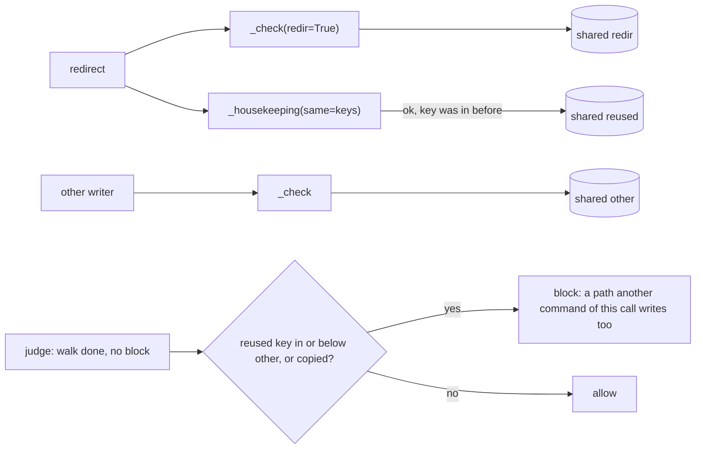
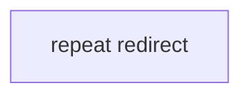

# B342: a second redirect to the same ignored log passes as housekeeping (#1161)

**Goal:** in an active run, a later redirect to a git-ignored file that only earlier redirects of the same Bash call wrote passes as housekeeping (`make record-fixtures > .build/verify-record.log 2>&1; echo record exit $? >> .build/verify-record.log`); any other write of that file, or of a folder above it, anywhere in the call keeps the block.
**Architecture:** `guard_judge.py` (coordinator guard, `block-coordinator-edits`). `_check` records which written keys came from redirects (`redir`) and which from any other non-rm writer (`other`); `_housekeeping` lets the target's own key pass the "wrote earlier" check when only redirects wrote it; `judge` re-checks every key that passed that way against the whole call's other writes once the walk ends (order-independent: loops, `find -exec`, `xargs` bodies that run again).
**Tech stack:** Python 3.10+ stdlib, pytest.
**Spec path:** issue #1161 (this plan restates it under Design).
**Detail:** tests
**Wave0:** none
**Coverage:** off
**Target-min:** 11

Global constraints:
- Builds: the verdict is `sl run_tests` (the project's test command; a project with `.maxapp` runs `maxapp test`, which a build pool may place on another Mac, and a full run whose tree a green maxapp test stamp covers returns that result without a run); task trees build in <tree>/.build/DerivedData and any build of your own goes under .build/ of the worktree, never -derivedDataPath outside the worktree (your session scratchpad included; backlog cleanup removes scratchpad build folders when the worktree goes); a product, simulator or device build stays on this machine and runs only when an issue's acceptance asks for a running-app check.
- Simulators: append the UDID of each simulator you or a worker creates (`xcrun simctl create` or `clone`; a checker's `Simulators:` line marks its created ones) as one line to /Users/max/github/superlite/.claude/worktrees/superlite-b342-guard-repeat-redirect-same-log/.superlite/simulators.txt; never list one you did not create; ship cleanup shuts down and deletes each listed one.
- The change only relaxes one block: every other housekeeping rule (ignored through a tracked .gitignore, no task Owns it, no symlink or hard link, `.git`/`.superlite`/`.claude` kept, a run plan to read) still applies to the second redirect. Every existing guard test stays green unchanged.
- Existing block text stays: `below a path this command wrote earlier` is unchanged; the one new reason text is exactly `a path another command of this call writes too`.

## Design

Sighting (#1157, B341): the second redirect appends to the log the first redirect of the same call wrote; `_housekeeping` refuses any target whose path (or a folder above it) is in `st.shared["wrote"]` (B159: "anything below a path the same Bash call wrote earlier, mkdir excepted"). The rule exists because an earlier command may have made that path a link (`ln -s ../src build/x; echo > build/x/a.py`). A redirect cannot make its target a link or a folder: it writes a regular file or writes through what is already there, and the first redirect's own housekeeping already checked that.

Rules:
1. Keys: every place that records a written path also records where it came from, in two new shared sets: `redir` (keys a redirect's `_check` recorded) and `other` (keys any other `_check` write recorded, its `inner` file keys, and `_record_text` keys from a copy). `rm`, `rmdir` and `unlink` add nothing to `other` (removing makes no second name); `mkdir` stays excepted as today.
2. At a redirect, the target's own keys (`_clean(v.abs)`, its real path) pass the wrote-earlier check when each such key that is in `wrote` is also in the `redir` set as it was before this redirect's `_check`, and `_written_below(keys, st, only=other)` and `_copied(key, st)` are false for them. Folders above the target keep today's check unchanged.
3. Each key that passed through rule 2 (housekeeping ok and the key was in `before`) is stored once in shared `reused` with its verdict. When the walk ends with no block, `judge` blocks with the first stored verdict whose key `_written_below((key,), st, only=other)` or `_copied(key, st)` reports, its `why` set to `a path another command of this call writes too`.

Ruling: only shell redirects get the exemption; `tee -a`, `cp`, interpreter writes to a file the call wrote earlier keep today's block (because #1161 names redirects; YAGNI).
Ruling: the order-independent end check (rule 3) ships with the exemption (because a loop, function, `find -exec` or `xargs` body is walked once but runs again, so a write later in the text can still precede a repeat of the redirect).
Ruling: one task is the whole plan, so MISSED TARGET (11.8 vs 11 min) stands (because the fix is one module and its test).
Ruling: rule 2 also checks `other` at use time, so a non-redirect write before the redirect keeps the old `below a path this command wrote earlier` text (because the message then names the real cause).



## File structure

- skills/subagent-driven-development/scripts/guard_judge.py: shared `redir`, `other`, `reused`; `_check(..., redir=False)`; `_record_text(..., other=True)`; `_housekeeping(..., same=())`; the redirect loop's exemption; `judge`'s end check.
- tests/scripts/test_guard_repeat_redirect_1161.py: the judge cases below.
- docs/hooks.md: one #1161 bullet after the known-variable log targets (#1070) bullet.

## Task graph

```mermaid
%% schedule
gantt
  title Predicted schedule (mm:ss)
  dateFormat X
  axisFormat %M:%S
  section lane 1
  T1 Same-log redirect passes as housekeep :t1, 0, 197s
```





critical path: T1 (3.3 min) · peak width 1 · predicted build 3.3 min · predicted total ≈ 11.8 min (target ✗ 11.0)

## Guard

### T1 Same-log redirect passes as housekeeping · Complexity 4 · Est. context 50k
**Owns:** skills/subagent-driven-development/scripts/guard_judge.py, tests/scripts/test_guard_repeat_redirect_1161.py, docs/hooks.md
**Components:** 1
**LOC owned:** 130
**Tests:** fast
**Kind:** design
**Model:** sonnet
**Est. time:** 3 min (1 component, about 130 LOC, fast tests)
**Produces:** guard_judge.judge(command, cwd, project, mode, sds=(), transcript=None) -> Verdict | None (unchanged signature; new behaviour per Design rules 1-3)
**Review Focus:** state: `test_other_write_after_reuse_blocks` (a tree copy into the folder after the reused redirect blocks with the new text); state: `test_earlier_other_write_keeps_old_text`; deep: `bash -c` body and `( ... )` subshell share `st.shared`; encoding: keys compare case-folded through `_written_below`.
**Steps:** 1 write the test file below, 2 run it: `test_repeat_redirect_passes` and `test_other_write_after_reuse_blocks` FAIL, 3 implement Design rules 1-3 in guard_judge.py (Notes), 4 add the docs/hooks.md bullet, 5 run the new file plus tests/scripts/test_judge_housekeeping.py, test_guard_judge.py, test_guard_targets.py, test_guard_scratch_script.py and every tests/scripts/test_guard_*.py: PASS.
**Notes:** `_check`'s recording block (the `if ctx.cmd != "mkdir":` branch near line 636) is where both sets fill: `redir=True` adds `(w, realpath(w))` to `redir`; otherwise, unless `ctx.cmd in ("rm", "rmdir", "unlink")`, add those keys and the `inner` keys to `other`. Glob and brace redirects go through `_check_flagged` without the flag and so count as `other` (conservative). In the redirect loop take `redir0 = set(st.shared["redir"])` next to `before`, pass `redir=True` to `_check`, compute `same` per rule 2 before `_housekeeping`, and record `reused` from `v` before `v = None`. `_housekeeping` applies `same` only to the first `p0` of each of its two forms (the target itself), never to a folder above it. `_redirect_text`'s `_record_text` call passes `other=False`. In `judge`, keep the `_State` in a variable so the end check reads its `shared`; the `_Unknown` branch is unchanged. If `make record-fixtures` alone does not pass in the fixture (`j(P, "make record-fixtures") is not None`), stop and report NEEDS_CONTEXT with its verdict; drop no other case without naming it and its verdict `why` in the report. docs/hooks.md bullet: "- `block-coordinator-edits`, repeated log redirects (#1161): a redirect to a git-ignored file that only earlier redirects of the same call wrote (`cmd > .build/x.log 2>&1; echo $? >> .build/x.log`) passes the wrote-earlier check; any other write of that file or a folder above it anywhere in the call (a copy, a link, an interpreter write; `rm` excepted) blocks it, before the redirect as `below a path this command wrote earlier`, after it as `a path another command of this call writes too`."
**Test code (verbatim):**
```python
"""#1161: a later redirect to a git-ignored file that only earlier redirects of the same Bash call wrote passes as
housekeeping; any other write of that file, or of a folder above it, anywhere in the call keeps the block."""
import json, subprocess, sys
import pytest
from test_plan_tools import SCRIPTS
sys.path.insert(0, str(SCRIPTS))
import guard_judge as gj  # noqa: E402

WROTE = "below a path this command wrote earlier"
OTHER = "a path another command of this call writes too"
SIGHTING = "make record-fixtures > build/verify-record.log 2>&1; echo record exit $? >> build/verify-record.log"


def git(P, *a):
    subprocess.run(["git", "-C", str(P), "-c", "user.email=t@t", "-c", "user.name=t", *a], check=True,
                   capture_output=True)


@pytest.fixture
def P(tmp_path):
    p = tmp_path / "proj"
    (p / "src").mkdir(parents=True)
    (p / ".superlite").mkdir()
    (p / "docs" / "plans").mkdir(parents=True)
    plan = p / "docs" / "plans" / "plan.md"
    plan.write_text("# Plan\n\n### T1 a\n**Owns:** src/a.py\n")
    (p / "src" / "a.py").write_text("x = 1\n")
    (p / ".gitignore").write_text("build/\n")
    subprocess.run(["git", "init", "-q", str(p)], check=True)
    git(p, "add", "-A")
    git(p, "commit", "-q", "-m", "init")
    (p / "build").mkdir()
    (p / ".superlite" / "stable.json").write_text(json.dumps({"plan": str(plan), "stable": []}))
    return p


@pytest.fixture
def D(tmp_path):
    d = tmp_path / "data"
    d.mkdir()
    (d / "f.txt").write_text("plain\n")
    return d


def j(P, cmd, mode="active"):
    return gj.judge(cmd, cwd=str(P), project=str(P), mode=mode, sds=(str(P / ".superlite"),))


def test_sighting_parts_pass_alone(P):
    assert j(P, "make record-fixtures") is None
    assert j(P, "make record-fixtures > build/verify-record.log 2>&1") is None


@pytest.mark.parametrize("cmd", [
    SIGHTING,
    "echo a > build/x.log; echo b >> build/x.log; echo c >> build/x.log",
    "echo a > build/x.log 2>&1 && echo b >> build/x.log || echo c >> build/x.log",
    "echo a >> build/x.log; echo b > build/x.log",
    "echo a > build/x.log; echo b 2>> build/x.log",
    "echo a &> build/x.log; echo b &>> build/x.log",
    "echo a > build/x.log; cd build; echo b >> x.log",
    "echo a > build/x.log; (echo b >> build/x.log)",
    "echo a > build/x.log; for i in 1 2; do echo $i >> build/x.log; done",
    "LOG=build/x.log; echo a > \"$LOG\"; echo b >> \"$LOG\"",
])
def test_repeat_redirect_passes(P, cmd):
    assert j(P, cmd) is None, cmd


def test_earlier_other_write_keeps_old_text(P):
    v = j(P, "cp src/a.py build/x.log; echo b >> build/x.log")
    assert v is not None and v.kind == "code" and v.why == WROTE, v


def test_link_between_redirects_blocks(P):
    v = j(P, "echo a > build/x.log; ln -sf ../src/a.py build/x.log; echo b >> build/x.log")
    assert v is not None and v.kind == "code", v


def test_other_write_after_reuse_blocks(P, D):
    assert j(P, f"cp -R {D}/. build/") is None
    v = j(P, f"echo a > build/x.log; echo b >> build/x.log; cp -R {D}/. build/")
    assert v is not None and v.kind == "code" and v.why == OTHER, v


def test_other_write_in_loop_blocks(P, D):
    v = j(P, f"echo a > build/x.log; for i in 1 2; do echo $i >> build/x.log; cp -R {D}/. build/; done")
    assert v is not None and v.kind == "code", v


def test_tracked_file_still_blocks(P):
    v = j(P, "echo a > src/a.py; echo b >> src/a.py")
    assert v is not None and v.kind == "code", v


def test_different_files_unchanged(P):
    assert j(P, "echo a > build/a.log; echo b >> build/b.log") is None


def test_no_run_plan_still_blocks(P):
    (P / ".superlite" / "stable.json").unlink()
    v = j(P, SIGHTING)
    assert v is not None and v.kind == "code", v
```

## Review Focus

App type: library (the guard judge, called in-process). **Probe entry:** none (judge needs a git fixture and four arguments; its cases are the named tests in T1).
- state: rule 3's end check sees writes after the reuse (`test_other_write_after_reuse_blocks`, `test_other_write_in_loop_blocks`); a key in `reused` never skips the parent-folder check.
- state: `redir0` is taken before this redirect's `_check`, so the first redirect of a file never counts as its own earlier redirect.
- deep: nested bodies (`bash -c`, `( ... )`, `sh script` from a heredoc) fork `_State` but share `shared`, so `redir`, `other` and `reused` span the whole call.
- encoding: `other` matches case-folded and by unknown-part prefix through `_written_below`.

## Self-review

Coverage: #1161's expected behaviour and its regression test are T1. No placeholders. One task, no edges. Limits: under 15k chars.
