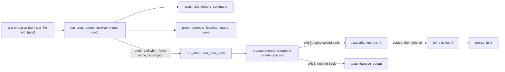
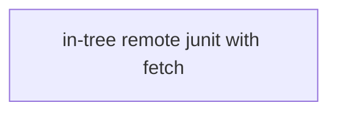

# B345: a maxapp remote test command's {junit} is an in-tree report fetched back (#1169)

**Goal:** a test command that runs through `maxapp remote` and names `{junit}` (the per-file form `sl testcmd` proposes since #1147, a remote full command, the `--base-skips` rerun) gets a report path the remote host can write and that comes back, so `run_tests --fast PATHS` runs that form end to end.
**Architecture:** new `testcmd.remote_fetch(command, path) -> str | None` inserts `--fetch <path>` right after the `maxapp remote` words of a shell command string, keeping every other character as written. New `run_tests.remote_junit(command, cwd) -> (str, Path | None)`: for a `maxapp remote` command holding `{junit}`, `{junit}` becomes `.superlite-junit-<12 hex>.xml` (relative: maxapp runs the snippet at the remote repository root) and `--fetch` that name is added; the local report is `<git top of cwd>/<name>`. `run_other` and `run_base_tests` call it, copy a fetched report into their temp `junit.xml` (the path the rest of the code reads) and delete it. `testcmd.remote_test_file` and the stored form are unchanged.
**Tech stack:** Python 3 stdlib, pytest via `sl run_tests`; Markdown.
**Spec:** issue #1169 (feedback 1dffd4c8704d); `maxapp remote --help` and max-core tools/maxapp-remote: `--fetch PATH` is relative to the repository root, copied back only after the command exited 0 (else stderr `maxapp remote: --fetch skipped: the command failed`, exit 1), a successful command whose path is missing exits 2; the snippet runs at the remote repository root (`git rev-parse --show-toplevel` of the local cwd is what ships).
**Detail:** tests
**Wave0:** none
**Coverage:** off

## Global constraints

- Files this batch may touch: skills/subagent-driven-development/scripts/run_tests.py, skills/subagent-driven-development/scripts/testcmd.py, tests/scripts/test_testcmd_remote_1169.py, docs/tools.md (one new row; never reorder, rewrite or delete existing lines), and this plan. Never touch docs/fleet.md, skills/subagent-driven-development/fleet.md or tests/scripts/test_docs_fleet_stop_wait_1170.py (batch B346 owns them).
- Keep the repo's per-line `# O(...)` complexity comment on every new code line (see the existing lines of both scripts).
- Builds: the verdict is `sl run_tests` (the project's test command; a project with `.maxapp` runs `maxapp test`, which a build pool may place on another Mac, and a full run whose tree a green maxapp test stamp covers returns that result without a run); task trees build in <tree>/.build/DerivedData and any build of your own goes under .build/ of the worktree, never -derivedDataPath outside the worktree (your session scratchpad included; backlog cleanup removes scratchpad build folders when the worktree goes); a product, simulator or device build stays on this machine and runs only when an issue's acceptance asks for a running-app check.
- Simulators: append the UDID of each simulator you or a worker creates (`xcrun simctl create` or `clone`; a checker's `Simulators:` line marks its created ones) as one line to /Users/max/github/superlite/.claude/worktrees/superlite-b345-testcmd-remote-junit-path/.superlite/simulators.txt; never list one you did not create; ship cleanup shuts down and deletes each listed one.

Ruling: main's ruling "In-tree {junit} + maxapp remote --fetch" is built at run time in run_tests: the stored form from `sl testcmd` (B335, piX's Left undone edit) stays as written and runs end to end without a rewrite; `testcmd.remote_test_file` is unchanged (lead's ruling).
Ruling: the report is `.superlite-junit-<uuid4 hex[:12]>.xml` at the git top of the folder the command runs in (a task tree is its own worktree, so its top is the tree): a top-level file needs no remote folder and passes maxapp's symlink check, while `.superlite/` is a symlink in task trees, which `--fetch` refuses (lead's ruling).
Ruling: a red remote run brings no report back (maxapp fetches only after exit 0); run_tests then reads the printed output, its existing no-JUnit path (lead's ruling).
Ruling: a command that already passes `--fetch <that name>` gets no second one; a `maxapp remote` command whose `remote` word cannot be located as written (quoted or escaped) still gets the in-tree name, without `--fetch`, and a stderr note (lead's ruling).
LAYERS: unit

## Main diagram



## File structure

- skills/subagent-driven-development/scripts/testcmd.py: `remote_fetch` after `remote_test_file`; module docstring Library list names it (T1).
- skills/subagent-driven-development/scripts/run_tests.py: `remote_junit` near `narrowed_remote`; its calls in `run_other` and `run_base_tests` (T1).
- tests/scripts/test_testcmd_remote_1169.py: helper cases, the end-to-end runs against a fake `maxapp remote`, the docs pin (T1).
- docs/tools.md: one row after the `testcmd` remote test_file (#1147) row (T1).

## Task graph

```mermaid
%% schedule
gantt
  title Predicted schedule (mm:ss)
  dateFormat X
  axisFormat %M:%S
  section lane 1
  T1 in-tree remote junit with fetch :t1, 0, 326s
```





critical path: T1 (5.4 min) · peak width 1 · predicted build 5.4 min · predicted total ≈ 15.9 min

## Package run_tests

### T1 in-tree remote junit with fetch · Complexity 4 (O-1) · Est. context 45k
**Owns:** skills/subagent-driven-development/scripts/testcmd.py, skills/subagent-driven-development/scripts/run_tests.py, tests/scripts/test_testcmd_remote_1169.py, docs/tools.md
**Components:** 2
**LOC owned:** 210
**Tests:** fast
**Model:** sonnet
**Kind:** design
**Est. time:** 4 min (2 components, about 210 LOC, fast tests)
**Produces:** testcmd.remote_fetch(command: str, path: str) -> str | None · run_tests.remote_junit(command: str, cwd: Path) -> tuple[str, Path | None]
e.g. remote_fetch("maxapp remote --timeout 40 'x'", "r.xml") -> "maxapp remote --fetch r.xml --timeout 40 'x'"
e.g. remote_fetch("bunx vitest run", "r.xml") -> None
e.g. remote_junit("maxapp remote 'r --o={junit}'", repo) -> ("maxapp remote --fetch .superlite-junit-0123456789ab.xml 'r --o=.superlite-junit-0123456789ab.xml'", repo / ".superlite-junit-0123456789ab.xml")
**Review Focus:** `test_remote_fetch_keeps_the_head_words_as_written`: a quoted NAME value holding ` remote ` and an absolute maxapp path stay byte for byte; `test_fast_runs_the_proposed_remote_form_end_to_end`: green with counts only the fetched report holds, no report left in the tree; `test_red_remote_run_reads_the_printed_output`: red counts from output, nothing left; `test_base_rerun_of_a_remote_full_command_fetches_its_report`: the `--base-skips` path.
**Steps:**
1. Write tests/scripts/test_testcmd_remote_1169.py from the test code below; run it: FAIL (no `remote_fetch`; the end-to-end cases red with the fake runner's `EACCES`).
2. testcmd.py, after `remote_test_file`: `remote_fetch(command, path)`: `words = shlex.split(command)` (ValueError: None); `i = remote_at(words)`; None when `i < 0`. Walk the option words after `remote` (from `i + 2`) while the word is in `REMOTE_VALUE_OPTS` or `REMOTE_FLAGS`: a value option steps 2, a flag 1; a `--fetch` whose next word equals `path` returns `command` unchanged. Then for each `m` of `re.finditer(r"(?<!\S)remote(?!\S)", command)`: when `shlex.split(command[:m.end()])` parses and equals `words[:i + 2]`, return `command[:m.end()] + " --fetch " + shlex.quote(path) + command[m.end():]`; none matched: None. Add `remote_fetch` (#1169) to the module docstring's Library list.
3. run_tests.py, after `narrowed_remote`: `remote_junit(command, cwd)`: return `(command, None)` unless `"{junit}" in command` and `is_remote_command(command)`. `top` = stripped stdout of `subprocess.run(["git", "-C", str(cwd), "rev-parse", "--show-toplevel"], capture_output=True, text=True)`; non-zero exit or empty: `(command, None)`. `name = f".superlite-junit-{uuid.uuid4().hex[:12]}.xml"`; `named = command.replace("{junit}", name)`; `fetched = testcmd.remote_fetch(named, name)`; None: print `run_tests: WARNING: cannot add --fetch to the maxapp remote command; its JUnit report stays on the remote host, so its printed output is read` to stderr and return `(named, None)`; else `(fetched, Path(top) / name)`.
4. `run_other`: before `runs = ...`, `command, report = remote_junit(spec["command"], Path(workdir) if workdir else root)`; `runs` uses `sub(command)` where it used `sub(spec["command"])` (both places in that line); the `cj = ...` line and everything that checks `spec["command"]` (XCODEBUILD, `built_platforms`, `outside_bundles`) stay as they are. Wrap the `results = [...]` line in `try:` / `finally:` that, when `report` is not None and `report.is_file()`, does `xml_path.write_bytes(report.read_bytes())` then `report.unlink()`.
5. `run_base_tests`: after `command = with_derived_data(spec["command"], tree)`, `command, report = remote_junit(command, tree)` (so `ran` holds the fetching command); wrap that branch's `r = run_captured(...)` in the same `try:` / `finally:`, copying into `xml`.
6. docs/tools.md: insert one row directly after the row that starts with `` | `testcmd` remote test_file (#1147) | ``. It starts `` | `run_tests` remote {junit} (#1169) | `` and says: a `maxapp remote` command (`test`, `test_file`, the `--base-skips` rerun) that names `{junit}` gets the in-tree report `.superlite-junit-<12 hex>.xml` at the git top of the folder it runs in instead of a local temp path the remote host cannot write; run_tests adds `--fetch <that file>` after `maxapp remote` (none when the command already fetches it), reads the fetched report and deletes it; maxapp copies it back only after the command exited 0, so a red remote run is read from its printed output.
7. Run the verify command: PASS. Also run tests/scripts/test_testcmd_remote_1147.py, tests/scripts/test_run_tests_base_skips_999.py, tests/scripts/test_run_tests_run_folder_817.py and tests/scripts/test_doc_contract.py in the same --fast call.
**Test code (verbatim):**
```python
"""A maxapp remote test command's {junit} is an in-tree report fetched back with --fetch (#1169)."""
from __future__ import annotations

import json
import os
import re
import subprocess
import sys
from pathlib import Path
from types import SimpleNamespace

ROOT = Path(__file__).resolve().parents[2]
SCRIPTS = ROOT / "skills" / "subagent-driven-development" / "scripts"
sys.path.insert(0, str(SCRIPTS))
import run_tests as rt  # noqa: E402
import testcmd  # noqa: E402

RUN_TESTS = SCRIPTS / "run_tests.py"
TEST = "maxapp remote --timeout 40 'true && fakerunner tests'"
TEST_FILE = "fakerunner {files} --outputFile.junit={junit}"
FORM = "maxapp remote --timeout 40 --kind file 'true && fakerunner {files} --outputFile.junit={junit}'"
NAME = re.compile(r"^\.superlite-junit-[0-9a-f]{12}\.xml$")

# A fake remote host. `maxapp remote` ships the git tree (tracked and untracked, not ignored) to a fresh folder, runs the
# snippet there and copies each --fetch path back only after exit 0, as maxapp remote does; it logs its words as JSON lines.
FAKE_MAXAPP = r'''#!/usr/bin/env python3
import json, os, shlex, shutil, subprocess, sys, tempfile
args = sys.argv[1:]
with open(os.environ["FAKE_MAXAPP_LOG"], "a", encoding="utf-8") as log:
    log.write(json.dumps(args) + "\n")
assert args[0] == "remote", args
args, fetch = args[1:], []
while args and args[0].startswith("--"):
    opt = args.pop(0)
    if opt == "--fetch":
        fetch.append(args.pop(0))
    elif opt in ("--host", "--timeout", "--kind"):
        args.pop(0)
    elif opt == "--":
        break
snippet = args[0] if len(args) == 1 else shlex.join(args)
top = subprocess.run(["git", "rev-parse", "--show-toplevel"], capture_output=True, text=True, check=True).stdout.strip()
remote = tempfile.mkdtemp(prefix="fake-remote-")
listed = subprocess.run(["git", "-C", top, "ls-files", "-z", "--cached", "--others", "--exclude-standard"], capture_output=True, check=True).stdout
for name in filter(None, listed.decode("utf-8").split("\0")):
    if os.path.isfile(os.path.join(top, name)):
        os.makedirs(os.path.dirname(os.path.join(remote, name)), exist_ok=True)
        shutil.copy(os.path.join(top, name), os.path.join(remote, name))
rc = subprocess.run(["sh", "-c", snippet], cwd=remote, env={**os.environ, "FAKE_REMOTE_ROOT": remote}).returncode
if rc != 0:
    if fetch:
        print("maxapp remote: --fetch skipped: the command failed", file=sys.stderr)
    sys.exit(1)
for p in fetch:
    if not os.path.exists(os.path.join(remote, p)):
        print(f"maxapp remote: --fetch {p}: not found after the command", file=sys.stderr)
        sys.exit(2)
for p in fetch:
    shutil.copy(os.path.join(remote, p), os.path.join(top, p))
sys.exit(0)
'''

# Its test runner refuses a report outside the shipped tree, as the remote container does (EACCES mkdir); two cases per
# file, the second fails when the file says "fail"; it prints counts only when red, so a green count comes from the report.
FAKE_RUNNER = r'''#!/usr/bin/env python3
import os, sys
files = [a for a in sys.argv[1:] if not a.startswith("--")]
out = next(a.split("=", 1)[1] for a in sys.argv[1:] if a.startswith("--outputFile.junit="))
root = os.path.realpath(os.environ.get("FAKE_REMOTE_ROOT", os.getcwd()))
if os.path.commonpath([root, os.path.realpath(os.path.abspath(out))]) != root:
    print(f"Error: EACCES: permission denied, mkdir '{os.path.dirname(out)}'")
    sys.exit(1)
fail = any("fail" in open(f, encoding="utf-8").read() for f in files)
bad = '<failure message="expected 2">x</failure>' if fail else ""
cases = "".join(f'<testcase classname="{f}" name="adds" file="{f}"/><testcase classname="{f}" name="subtracts" file="{f}">{bad}</testcase>' for f in files)
with open(out, "w", encoding="utf-8") as fh:
    fh.write(f'<?xml version="1.0"?><testsuites><testsuite name="s">{cases}</testsuite></testsuites>')
if fail:
    print(f" FAIL  {files[0]} > subtracts")
    print(" Tests  1 failed | 1 passed (2)")
    sys.exit(1)
print("ran")
'''


def git(repo, *args):
    env = {k: v for k, v in os.environ.items() if k not in ("GIT_DIR", "GIT_INDEX_FILE", "GIT_WORK_TREE")}
    subprocess.run(["git", "-C", str(repo), "-c", "user.email=t@t", "-c", "user.name=t", *args], check=True, capture_output=True, env=env)


def project(tmp_path, cfg, body="ok"):
    (tmp_path / "tests").mkdir()
    (tmp_path / "tests" / "a_test.sh").write_text(body, encoding="utf-8")
    (tmp_path / ".gitignore").write_text(".superlite/\nbin/\nmaxapp.log\n", encoding="utf-8")
    (tmp_path / ".superlite").mkdir()
    (tmp_path / ".superlite" / "test-cmd.json").write_text(json.dumps(cfg), encoding="utf-8")
    (tmp_path / "bin").mkdir()
    for name, text in (("maxapp", FAKE_MAXAPP), ("fakerunner", FAKE_RUNNER)):
        (tmp_path / "bin" / name).write_text(text, encoding="utf-8")
        (tmp_path / "bin" / name).chmod(0o755)
    git(tmp_path, "init", "-q")
    git(tmp_path, "add", "-A")
    git(tmp_path, "commit", "-q", "-m", "init")


def go(tmp_path, *args):
    env = {k: v for k, v in os.environ.items() if k not in ("GIT_DIR", "GIT_INDEX_FILE", "GIT_WORK_TREE") and not k.startswith("SUPERLITE_")}
    env.update(SUPERLITE_GUI_CHECK="0", PYTHONIOENCODING="utf-8", FAKE_MAXAPP_LOG=str(tmp_path / "maxapp.log"),
               PATH=f"{tmp_path / 'bin'}{os.pathsep}{os.environ['PATH']}")
    cp = subprocess.run([sys.executable, str(RUN_TESTS), *args], capture_output=True, cwd=tmp_path, env=env, timeout=120)
    cp.both = cp.stdout.decode("utf-8") + cp.stderr.decode("utf-8")
    return cp


def summary(tmp_path):
    return json.loads((tmp_path / ".superlite" / "test-summary.json").read_text(encoding="utf-8"))


def calls(tmp_path):
    return [json.loads(x) for x in (tmp_path / "maxapp.log").read_text(encoding="utf-8").splitlines()]


def leftovers(tmp_path):
    return sorted(p.name for p in tmp_path.glob(".superlite-junit-*"))


def test_remote_fetch_inserts_after_maxapp_remote():
    assert testcmd.remote_fetch("maxapp remote --timeout 40 --kind file 'x --o=r.xml'", "r.xml") == (
        "maxapp remote --fetch r.xml --timeout 40 --kind file 'x --o=r.xml'")
    assert testcmd.remote_fetch("maxapp remote", "r.xml") == "maxapp remote --fetch r.xml"


def test_remote_fetch_keeps_the_head_words_as_written():
    assert testcmd.remote_fetch("CI=1 X='a remote b' /opt/bin/maxapp remote 'x'", "r.xml") == (
        "CI=1 X='a remote b' /opt/bin/maxapp remote --fetch r.xml 'x'")
    assert testcmd.remote_fetch("maxapp remote 'x'", "a b.xml") == "maxapp remote --fetch 'a b.xml' 'x'"


def test_remote_fetch_adds_no_second_fetch():
    cmd = "maxapp remote --timeout 40 --fetch r.xml 'x'"
    assert testcmd.remote_fetch(cmd, "r.xml") == cmd
    assert testcmd.remote_fetch("maxapp remote --fetch out 'x'", "r.xml") == "maxapp remote --fetch r.xml --fetch out 'x'"


def test_remote_fetch_none_cases():
    assert testcmd.remote_fetch("bunx vitest run", "r.xml") is None
    assert testcmd.remote_fetch("echo 'maxapp remote'", "r.xml") is None
    assert testcmd.remote_fetch("maxapp remote 'unclosed", "r.xml") is None
    assert testcmd.remote_fetch("maxapp 'remote' 'x'", "r.xml") is None


def test_remote_junit_names_an_in_tree_report(tmp_path):
    git(tmp_path, "init", "-q")
    cmd, report = rt.remote_junit("maxapp remote --timeout 40 'r --o={junit}'", tmp_path)
    name = report.name
    assert NAME.match(name)
    assert report == Path(subprocess.run(["git", "-C", str(tmp_path), "rev-parse", "--show-toplevel"], capture_output=True, text=True).stdout.strip()) / name
    assert cmd == f"maxapp remote --fetch {name} --timeout 40 'r --o={name}'"
    assert rt.remote_junit("r --o={junit}", tmp_path) == ("r --o={junit}", None)
    assert rt.remote_junit("maxapp remote 'r'", tmp_path) == ("maxapp remote 'r'", None)


def test_fast_runs_the_proposed_remote_form_end_to_end(tmp_path):
    assert testcmd.remote_test_file(TEST, TEST_FILE) == FORM
    project(tmp_path, {"language": "other", "test": TEST, "test_file": FORM, "lock": False})
    cp = go(tmp_path, "--fast", "tests/a_test.sh")
    assert cp.returncode == 0, cp.both
    s = summary(tmp_path)
    assert (s["passed"], s["failed"], s["mode"]) == (2, 0, "fast")
    (words,) = calls(tmp_path)
    assert words[:2] == ["remote", "--fetch"] and NAME.match(words[2]), words
    assert words[-1] == f"true && fakerunner tests/a_test.sh --outputFile.junit={words[2]}"
    assert leftovers(tmp_path) == []


def test_red_remote_run_reads_the_printed_output(tmp_path):
    project(tmp_path, {"language": "other", "test": TEST, "test_file": FORM, "junit": "{junit}", "lock": False}, body="fail")
    cp = go(tmp_path, "--fast", "tests/a_test.sh")
    assert cp.returncode == 1, cp.both
    s = summary(tmp_path)
    assert (s["passed"], s["failed"]) == (1, 1)
    assert "--fetch skipped: the command failed" in cp.both
    assert "EACCES" not in cp.both
    assert leftovers(tmp_path) == []


def test_base_rerun_of_a_remote_full_command_fetches_its_report(tmp_path, monkeypatch):
    full = "maxapp remote --timeout 40 'fakerunner tests/a_test.sh --outputFile.junit={junit}'"
    project(tmp_path, {"language": "other", "test": full, "lock": False})
    monkeypatch.chdir(tmp_path)
    monkeypatch.setenv("PATH", f"{tmp_path / 'bin'}{os.pathsep}{os.environ['PATH']}")
    monkeypatch.setenv("FAKE_MAXAPP_LOG", str(tmp_path / "maxapp.log"))
    got = rt.run_base_tests(SimpleNamespace(limit=None), tmp_path, tmp_path, ["tests/a_test.sh"])
    assert not isinstance(got, int), got
    _skipped, counts, _seconds, host, ran = got
    assert host == "remote"
    assert counts == {"passed": 2, "failed": 0, "skipped": 0}
    assert ran.startswith("maxapp remote --fetch .superlite-junit-")
    assert leftovers(tmp_path) == []


def test_tools_md_row_names_the_in_tree_report():
    rows = (ROOT / "docs" / "tools.md").read_text(encoding="utf-8").splitlines()
    at = next(i for i, r in enumerate(rows) if r.startswith("| `testcmd` remote test_file (#1147) |"))
    row = rows[at + 1]
    assert row.startswith("| `run_tests` remote {junit} (#1169) |")
    for text in ("`.superlite-junit-<12 hex>.xml`", "`--fetch", "exited 0", "printed output", "--base-skips"):
        assert text in row, text
```
**Notes:** `{files}` in the form is already the quoted paths when `run_other` sees the command; the name holds only `[.a-z0-9-]`, so it needs no quoting inside the single-quoted snippet. `uuid` is already imported in run_tests.py.

## Review Focus

Package run_tests · app type: CLI library · categories: protocol (the `maxapp remote` word layout and `--fetch` contract), state (the report file left behind on every exit path), boundary (quoted head words, a command already fetching, a non-remote command).
**Probe entry:** `uv run --group dev python -m pytest tests/scripts/test_testcmd_remote_1169.py -q`

## Self-review

Coverage: issue #1169's expected behaviour (in-tree `{junit}` for an `is_remote_command` command, fetched back with `--fetch`; `sl testcmd`'s proposed form runs end to end; a test against a fake `maxapp remote` that refuses writes outside the tree) maps to T1. No placeholders. One task, no edges. Docs follow the code in the same task.
