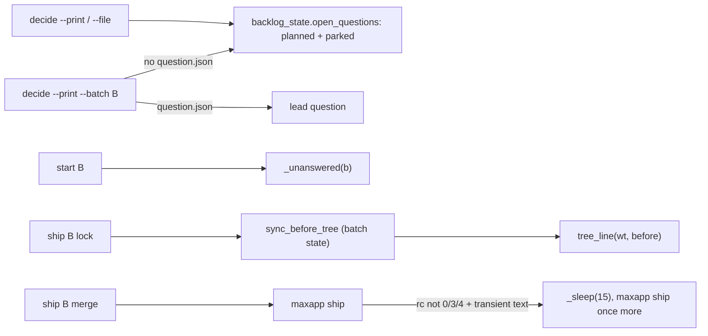
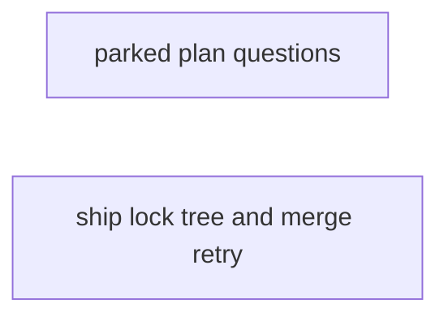

# B309: parked plan questions answerable; ship lock TREE after a CONFLICT; merge retries a transient GitHub error (#1073, #1074, #1075)

**Goal:** a parked batch's open plan questions show in `decide --print` (also `--batch B`), `decide --file` records them and `start B` then runs (#1073); a ship lock rerun after a resolved CONFLICT compares the tree before the first sync, not the rebased HEAD, and asks for a full run when they differ (#1074); `ship B merge` reruns `maxapp ship` once, after a 15 s pause, when it failed on a transient GitHub error (#1075).
**Architecture:** `backlog_state.open_questions` lists plan questions of planned and parked batches; `decide --print --batch B` prints B's open plan questions when B has no lead question.json. `backlog_ship._lock` keeps the pre-sync tree in the batch key `sync_before_tree` on a CONFLICT exit (first one wins), takes `before` from it on the rerun and clears it once the sync is clean or the lock is released. `backlog_ship._merge` matches a transient GitHub error in a failed `maxapp ship` run (rc not 0, 3 or 4) and reruns it once after `_sleep(15)`.
**Tech stack:** Python 3 stdlib, pytest via `sl run_tests`.
**Spec:** issues #1073, #1074, #1075 (bodies quoted in the Goal); research reports .superlite/fleet/reports/R1.md, R2.md.
**Detail:** contracts
**Wave0:** none
**Coverage:** off

## Global constraints

- Root causes (lead, read on fa226487): `backlog_state.open_questions` adds plan questions only `if b["state"] == "planned"` (backlog_state.py:198), so `decide --print`, `decide --file` (`bs.answer` -> `no open question`) and `start B` (`_unanswered` -> `has open decisions`) dead-end for a parked batch; `decide --print --batch B` (backlog.py:764-789) reads only the lead's question.json. `_lock` reads `before = HEAD^{tree}` each run (backlog_ship.py:232) and drops it on the CONFLICT exit, so the rerun after `git rebase --continue` compares HEAD with itself. `maxapp ship` retries a 5xx merge error itself (its exit 4), but a GraphQL `Something went wrong` is its exit 1, which `_merge` maps to `BLOCKED: maxapp ship failed`.
- Every new or changed code line in `skills/subagent-driven-development/scripts/*.py` ends with its `# O(...)` complexity comment like its neighbours; each changed module's docstring names its issue (#1073, #1074, #1075) in one clause.
- Files this batch may touch: skills/subagent-driven-development/scripts/backlog.py, backlog_run.py, backlog_ship.py, backlog_state.py, the new test files the tasks own and this plan. An existing test that breaks and is not in your Owns: name it in the report, do not edit it.
- A hook blocks Bash text that names the backlog decide command, also in test code: write test files with the Write tool, never a heredoc.
- Builds: the verdict is `sl run_tests` (the project's test command; a project with `.maxapp` runs `maxapp test`, which a build pool may place on another Mac, and a full run whose tree a green maxapp test stamp covers returns that result without a run); task trees build in <tree>/.build/DerivedData and any build of your own goes under .build/ of the worktree, never -derivedDataPath outside the worktree (your session scratchpad included; backlog cleanup removes scratchpad build folders when the worktree goes); a product, simulator or device build stays on this machine and runs only when an issue's acceptance asks for a running-app check; copy this sentence into every worker brief.
- Simulators: append the UDID of each simulator you or a worker creates (`xcrun simctl create` or `clone`; a checker's `Simulators:` line marks its created ones) as one line to /Users/max/github/superlite/.claude/worktrees/superlite-b309-backlog-park-ship-retry/.superlite/simulators.txt; never list one you did not create; ship cleanup shuts down and deletes each listed one; copy this sentence into every worker brief.

Ruling: `decide --print --batch B` prints the lead's question.json when it exists (unchanged), else B's open plan questions in the `decide --print` shape (texts prefixed `B: ` as `decide --file` expects; cut and step lines and the answers-file line on stderr), else `B has no open question`; planned batches get the fallback too (lead's ruling) - cost if wrong: one more branch to drop.
Ruling: #1074 compares against the tree before the first sync (batch key `sync_before_tree`), not a maxapp test stamp: superlite's own suite writes no stamp and `suite_stamp.green_base` walks first-parent history, which a rebase rewrites (lead's ruling) - cost if wrong: a stamp lookup later.
Ruling: `merge --from-main` keeps its abort-on-conflict sync and gets no stored tree; it shares the merge retry through `_merge` (lead's ruling) - cost if wrong: none seen.
Ruling: the retry pause is 15 s (the lock poll's interval) and the transient markers are `Something went wrong`, `submitted too quickly`, `HTTP 5xx`, `returned error: 5xx`, `Internal Server Error`, `Bad Gateway`, `Service Unavailable`, `Gateway Time-out`/`Timeout`, case-insensitive; a real refusal (not mergeable, review required) is never retried (lead's ruling) - cost if wrong: one more BLOCKED and a manual rerun.
Ruling: Detail `contracts`: the existing fixtures (`sh`, `real` in test_backlog_ship*.py, `bk`/`cli` in test_backlog_cli.py, `batch(..., questions=1)` in backlog_fixtures) carry the tests; named tests with exact inputs and outputs suffice (lead's ruling) - cost if wrong: a reviewer round.
LAYERS: unit

## Main diagram

## File structure

- skills/subagent-driven-development/scripts/backlog_state.py: `open_questions` takes parked batches (T1).
- skills/subagent-driven-development/scripts/backlog.py: `decide --print --batch` plan-question fallback (T1).
- tests/scripts/test_backlog_parked_decide_1073.py: #1073 tests (T1).
- skills/subagent-driven-development/scripts/backlog_ship.py: stored pre-sync tree, merge retry (T2).
- tests/scripts/test_backlog_ship_conflict_retry_1074_1075.py: #1074 and #1075 tests (T2).

## Task graph

```mermaid
%% schedule
gantt
  title Predicted schedule (mm:ss)
  dateFormat X
  axisFormat %M:%S
  section lane 1
  T2 ship lock tree and merge retry :t2, 0, 411s
  section lane 2
  T1 parked plan questions :t1, 0, 407s
```

critical path: T2 (6.8 min) · peak width 2 · predicted build 6.8 min · predicted total ≈ 19.3 min

## Backlog decide

**Probe entry:** none (CLI subcommands that write backlog state; the cases are the named tests below)

### T1 parked plan questions · Complexity 3 · Est. context 40k
**Owns:** skills/subagent-driven-development/scripts/backlog_state.py, skills/subagent-driven-development/scripts/backlog.py, tests/scripts/test_backlog_parked_decide_1073.py
**Components:** 2
**LOC owned:** 110
**Tests:** fast
**Model:** sonnet
**Kind:** design
**Produces:** backlog_state.open_questions(data: dict) -> list
e.g. open_questions({"batches": [parked B2 with question "Keep the v1 API?" unanswered], "approved_ship": {...}}) -> [{"question": "B2: Keep the v1 API?", ...}]
e.g. open_questions({"batches": [shipped B3 with an unanswered question], "approved_ship": {...}}) -> []
**Review Focus:** state: `test_open_questions_list_a_parked_batch` (parked B2, one unanswered plan question -> one entry `B2: <question>`), `test_open_questions_skip_running_and_shipped` (running and shipped batches with unanswered questions add nothing); protocol: `test_decide_file_answers_a_parked_batch` (decide --file with `"by": "user"` on the parked batch's `B2: <question>` exits 0, `answers[<question>]` is the label, `bs._unanswered(b) == []`, batch state stays parked), `test_decide_print_lists_a_parked_batch` (decide --print JSON holds `B2: <question>`), `test_decide_print_batch_falls_back_to_plan_questions` (parked B2 with no worktree and one unanswered question: exit 0, stdout JSON `questions[0].question == "B2: <question>"`), `test_decide_print_batch_prefers_question_json` (worktree question.json present plus a plan question: stdout is the question.json's questions), `test_decide_print_batch_without_questions` (no worktree, no plan question: `B2 has no open question`); test_backlog_decide_batch_737.py, test_backlog_cli.py and test_backlog_run.py stay green.
**Steps:** 1 failing tests, 2 run: FAIL, 3 implement, 4 run: PASS
**Notes:** `open_questions` widens `b["state"] == "planned"` to `in ("planned", "parked")`; `answer` and `start` need nothing else. The `--batch` fallback reuses `bs.open_questions(d)` filtered to entries whose question starts with `f"{bid}: "` (B1 never matches B10), then `bc.ask_shape`, the step lines and `BY_LINE` on stderr as the no-`--batch` branch does; an unreadable or invalid question.json stays BLOCKED exit 3 as today. Build tests on `bk`/`cli` from test_backlog_cli.py and `batch(..., "parked", questions=1)` from backlog_fixtures.

## Backlog ship

**Probe entry:** none (`ship` runs git, gh and maxapp ship; the cases are the named tests below)

### T2 ship lock tree and merge retry · Complexity 4 · Est. context 45k
**Owns:** skills/subagent-driven-development/scripts/backlog_ship.py, tests/scripts/test_backlog_ship_conflict_retry_1074_1075.py
**Components:** 2
**LOC owned:** 150
**Tests:** fast
**Model:** sonnet
**Kind:** design
**Produces:** backlog_ship.transient(out: str) -> bool
e.g. transient("gh pr merge 201 failed: GraphQL: Something went wrong while executing your query. (mergePullRequest)") -> True
e.g. transient("HTTP 502: Bad Gateway (https://api.github.com/graphql)") -> True
e.g. transient("gh pr merge 201 failed: Pull request is not mergeable") -> False
**Review Focus:** state: `test_conflict_rerun_names_the_rebased_tree` (`real` fixture: origin and feat both change f.txt, lock exits 5, the test resolves it, `git add f.txt`, `GIT_EDITOR=true git rebase --continue`; lock again exits 0 and its first line starts `TREE: changed by the sync (` and ends `run the full suite once (sl run_tests --full) before bump`; batch `sync_before_tree` is then None or absent), `test_second_conflict_keeps_the_first_tree` (`sh` fixture: `git rev-parse HEAD^{tree}` -> `t1`, conflict; then `t2`, conflict again: batch `sync_before_tree == "t1"`), `test_clean_rerun_uses_and_clears_the_stored_tree` (stored `t1`, clean sync: `tree_line` gets before `t1`; key cleared), `test_release_clears_the_stored_tree`; protocol: `test_merge_retries_a_graphql_error_once` (first maxapp ship (1, GraphQL Something went wrong), second (0, `merged #201 as abc`): exit 0, output holds `maxapp ship hit a transient GitHub error; retried once after 15 s` and `B1 shipped PR #201`, sleeps `[15]`, 2 maxapp ship calls), `test_merge_blocks_after_a_second_transient_error` (both fail: exit 3, first line the retry line, last line `BLOCKED: maxapp ship failed (...); lock held`, 2 calls), `test_merge_never_retries_a_real_refusal` (`not mergeable`: exit 3, 1 call, no sleep), `test_merge_never_retries_red_or_timeout` (rc 3 or 4 whose text says Something went wrong: today's RED/RERUN, 1 call); test_backlog_ship.py, test_backlog_ship_tree_639.py and test_backlog_ship_587_588.py stay green.
**Steps:** 1 failing tests, 2 run: FAIL, 3 implement, 4 run: PASS
**Notes:** in `_lock`, `before = stored or HEAD^{tree}`; the CONFLICT exit sets `sync_before_tree` via `_set` only when unset; a clean sync clears it (`_set(root, bid, sync_before_tree=None)`) after `tree_line`; `_release` clears it too. A fetch failure keeps it. In `_merge`, only an rc other than 0, 3 and 4 whose output `transient` matches gets `_sleep(15)` and one more `_run(cmd, wt)`; then the existing branches read the second result; the retry line goes into `ctx["pre"]` and leads every output of that merge (also the BLOCKED one). Sequenced replies need a list-popping `_run` stub over the `sh` fixture; `_sleep` stubs collect the seconds.

## Self-review

Coverage: #1073 -> T1, #1074 and #1075 -> T2. No placeholders. T1 and T2 share no file and have no edge. Probe entries are none with named tests.
