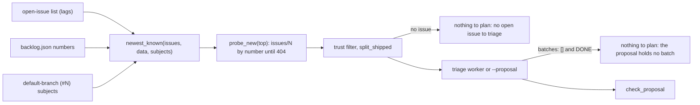
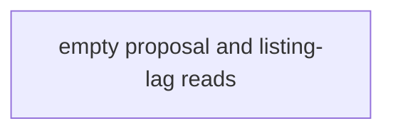

# B336: backlog plan reads new issues by number; an empty proposal is nothing to plan (#1148)

**Goal:** a plain `sl backlog plan` right after `gh issue create` plans the new issue the lagging open-issue list misses (read by number), and a triage proposal with no batch reads as `nothing to plan` without a `BLOCKED: proposal rejected` line (#1148).
**Architecture:** two pure-ish helpers in backlog.py (`newest_known`, `probe_new`) called from `cmd_plan` on a plain GitHub plan; `cmd_plan` gains an empty-proposal branch before `check_proposal` and a no-open-issue branch before triage; the reject path loses its `nb == 0` block.
**Tech stack:** Python 3.10+ stdlib; pytest via `sl run_tests`.
**Spec:** issue #1148 (quoted in Global constraints); B205-era ruling: `plan --issues N` reads a pinned number the lagging list misses once by number (`read_issue`).
**Detail:** contracts
**Wave0:** none
**Coverage:** off

## Global constraints

- #1148 Expected: "an empty proposal reads as `nothing to plan` without a BLOCKED line, and plan reads issues filed in the last minutes by number (or names the listing lag and the `--issues N` retry)."
- Files this batch may touch: skills/subagent-driven-development/scripts/backlog.py, tests/scripts/test_backlog_cli.py, tests/scripts/test_backlog_plan_empty_1148.py, tests/scripts/test_backlog_plan_reasons_472.py, docs/tools.md and this plan. Another existing test that breaks because its `_gh` fake now sees probe reads: fix only its fake (never its assertions) and name the file in the report; any other break: report it, do not edit.
- Builds: the verdict is `sl run_tests` (the project's test command; a project with `.maxapp` runs `maxapp test`, which a build pool may place on another Mac, and a full run whose tree a green maxapp test stamp covers returns that result without a run); task trees build in <tree>/.build/DerivedData and any build of your own goes under .build/ of the worktree, never -derivedDataPath outside the worktree (your session scratchpad included; backlog cleanup removes scratchpad build folders when the worktree goes); a product, simulator or device build stays on this machine and runs only when an issue's acceptance asks for a running-app check; copy this sentence into every worker brief.
- Simulators: append the UDID of each simulator you or a worker creates (`xcrun simctl create` or `clone`; a checker's `Simulators:` line marks its created ones) as one line to /Users/max/github/superlite/.claude/worktrees/superlite-b336-plan-empty-proposal-and-listing-lag/.superlite/simulators.txt; never list one you did not create; ship cleanup shuts down and deletes each listed one; copy this sentence into every worker brief.

Ruling: one task, because every change sits in cmd_plan and its tests (about 90 lines of code) (lead's ruling).
Ruling: the probe runs only on a plain GitHub plan (no --issues, no --proposal, no Jira source): a pinned plan already reads its pins by number, a --proposal file was triaged without the new issue, and Jira has no number sequence (lead's ruling).
Ruling: the probe reads at most 10 numbers past the newest known one and stops at the first `HTTP 404`; a PR or a closed issue keeps it going (issue and PR numbers share one sequence), a 10-read cap or another gh error prints one `listing:` hint naming `--issues <n> --add` (lead's ruling).
Ruling: an empty proposal is `batches: []` with a status that starts with DONE (a missing status counts as DONE, as in a `--proposal` file); it exits 0 and writes no state and no backlog-proposal.json, like the existing `every issue is already shipped` path; a non-DONE worker with no batch stays `BLOCKED: proposal rejected`, now without the `not planned` and `nothing to plan` lines (lead's ruling).
Ruling: adjacent fix: a plan with no trusted and no outside issue (and no --proposal) prints `nothing to plan: no open issue to triage` and starts no triage worker (lead's ruling).
Ruling: docs: one paragraph in docs/tools.md; commands/backlog.md and skills/**/backlog-main.md stay untouched (they would add the headless and evals layers for one sentence) (lead's ruling).

## Main diagram

## File structure

- skills/subagent-driven-development/scripts/backlog.py: `PROBE_LIMIT`, `newest_known`, `probe_new`; `cmd_plan` probe call, no-open-issue branch, empty-proposal branch, reject path without the `nb == 0` block.
- tests/scripts/test_backlog_plan_empty_1148.py: the named tests below (reuse `bk`, `cli`, `load`, `briefed`, `ISSUES`, `BATCH` from test_backlog_cli; a `_gh` fake like `lagging` in test_backlog_plan_pin_433.py).
- tests/scripts/test_backlog_plan_reasons_472.py: `test_empty_proposal_names_reasons_and_skip` expects the new exit and lines.
- docs/tools.md: one paragraph after the `backlog plan` leaves out an issue another session builds paragraph.

## Task graph

```mermaid
%% schedule
gantt
  title Predicted schedule (mm:ss)
  dateFormat X
  axisFormat %M:%S
  section lane 1
  T1 empty proposal and listing-lag reads :t1, 0, 511s
```

critical path: T1 (8.5 min) · peak width 1 · predicted build 8.5 min · predicted total ≈ 23.0 min

## Test layers

**Probe entry:** none (CLI code path covered by the named tests through `bl.main`)

### T1 empty proposal and listing-lag reads · Complexity 4 (O-1) · Est. context 45k
**Owns:** skills/subagent-driven-development/scripts/backlog.py, tests/scripts/test_backlog_plan_empty_1148.py, tests/scripts/test_backlog_plan_reasons_472.py, tests/scripts/test_backlog_cli.py, docs/tools.md
**Components:** 2
**LOC owned:** 260
**Tests:** fast
**Model:** sonnet
**Produces:** `PROBE_LIMIT = 10` · `newest_known(issues: list, data: dict, subjects: list[str]) -> int` (e.g. `newest_known([{"number": 3}], {"batches": [{"issues": [7]}], "outside": [{"number": 5}, {"number": "PIX-1"}], "titles": {"9": "x", "PIX-2": "y"}, "admitted": [2], "skipped": [11]}, ["a\tFix (#8)", "b\tno ref"]) == 11`) · `probe_new(top: int, limit: int = PROBE_LIMIT) -> tuple[list, list[str]]` (found open issues shaped like the listing, plus lines)
**Review Focus:** state: the empty-proposal branch writes no backlog.json and no backlog-proposal.json; boundary: the probe's 404 stop, PR/closed continue, cap and non-404 stop; trust: a probed outsider issue lands in outside[], never in the triage brief.
**Test code:** named tests, each through `bl.main` unless marked unit; `direct_reads(bk)` = the N of every `["api", "repos/{owner}/{repo}/issues/N", "--jq", bl.ISSUE_JQ]` call; `rest(...)` as in test_backlog_pin_433; a number not in the fake's read map raises `RuntimeError("gh api repos/{owner}/{repo}/issues/N failed: gh: Not Found (HTTP 404)")`; `bl._subjects` monkeypatched to `lambda root, ref: SUBJ` (default `[]`).
- `test_newest_known_1148` (unit): the Produces example gives 11; bools and non-digit title keys are ignored; `newest_known([], {}, [])` is 0; a subject without a trailing `(#N)` adds nothing.
- `test_empty_done_proposal_reads_nothing_to_plan_1148`: bk.batches = [], status DONE, summary "all covered": rc 0; no line starts with `BLOCKED`; `not planned (triage): #1 #2` and `triage worker DONE: all covered` are lines; the last line is `nothing to plan: the proposal holds no batch; sl backlog skip <issue> keeps an issue out of every later plan`; `.superlite/backlog-proposal.json` does not exist; `load(bk)["batches"] == []`.
- `test_empty_proposal_file_reads_nothing_to_plan_1148`: `plan --proposal F` with F = `{"batches": []}`: rc 0; no `BLOCKED` and no `triage worker` line; no `spawn` call; the last line as above.
- `test_failed_worker_empty_proposal_stays_blocked_1148`: status NEEDS_CONTEXT, batches []: rc 3; `BLOCKED: proposal rejected` in out; no line starts with `nothing to plan` or `not planned`.
- `test_plain_plan_reads_new_issue_by_number_1148`: reads {4: rest(4, "Four")}, bk.batches = [{**BATCH, "issues": [1, 2, 4]}]: rc 0; `listing lag: #4 read by number (not in the open-issue list yet)` is a line; #4 is in `briefed(bk)`; direct_reads == [4, 5]; no line starts with `listing: `.
- `test_probe_walks_past_prs_and_closed_issues_1148`: reads {4: rest(4, "P", pull=True), 5: rest(5, "C", state="closed"), 6: rest(6, "Six")}: direct_reads == [4, 5, 6, 7]; briefed numbers are [1, 2, 6]; exactly one `listing lag:` line (#6).
- `test_probe_starts_above_newest_known_number_1148`: backlog.json outside [{"number": 10, "title": "Ten", "reason": "not planned (triage)"}], SUBJ = ["abc\tFix x (#12)"]: direct_reads[0] == 13.
- `test_probe_cap_prints_listing_hint_1148`: reads hold closed issues 4 to 20: direct_reads == [4, ..., 13]; the line `listing: read #4 to #13 by number and stopped at the 10-read cap; an issue filed in the last minutes may be missing: sl backlog plan --issues <n> --add plans it`.
- `test_probe_gh_failure_prints_listing_hint_1148`: issues/4 raises `RuntimeError("gh api repos/{owner}/{repo}/issues/4 failed: HTTP 502 Bad Gateway")`: direct_reads == [4]; the line `listing: stopped reading by number at #4 (HTTP 502 Bad Gateway); an issue filed in the last minutes may be missing: sl backlog plan --issues <n> --add plans it`.
- `test_pinned_plan_does_not_probe_1148`: reads {}, `plan --issues 1`, bk.batches = [{**BATCH, "issues": [1]}]: rc 0, direct_reads == [].
- `test_proposal_plan_does_not_probe_1148`: reads {}, `plan --proposal F` with F holding [{**BATCH, "issues": [1]}]: rc 0, direct_reads == [].
- `test_no_open_issue_plans_nothing_without_a_worker_1148`: the open list is [] and reads {}: rc 0; the last line is `nothing to plan: no open issue to triage`; no `spawn` call; direct_reads == [1].
- `test_probed_outsider_stays_outside_1148`: public repo, reads {4: rest(4, "Four", assoc="NONE", login="eve")}, bk.batches = [BATCH]: rc 0; #4 not in `briefed(bk)`; `{"number": 4, "title": "Four", "author": "eve"}` in `load(bk)["outside"]`.
- 472 `test_empty_proposal_names_reasons_and_skip`: rc 0; `not planned (triage: needs a human): #1` and `not planned (triage): #2` still lines; the new last line above; the `triage worker` line is `triage worker DONE: x` (no `holds 0 batches`).
**Steps:** 1 write the tests, 2 run: FAIL (keep the `Red run:` line), 3 implement, 4 run: PASS, 5 run every tests/scripts/test_backlog*.py and tests/regression/test_backlog_gh_intake.py file with `run_tests --fast PATHS --task T1`.
**Notes:**
- `newest_known`: max over int numbers (bool excluded) of `issues[].number`, `data["batches"][].issues`, `data["outside"][].number`, digit-string keys of `data["titles"]`, `data["admitted"]`, `data["skipped"]`, and each subject's trailing ref (`backlog_intake.TRAIL_RE` on the text after the tab); missing or malformed fields count as empty.
- `probe_new`: for n in top+1 .. top+limit, `_gh(["api", f"repos/{{owner}}/{{repo}}/issues/{n}", "--jq", ISSUE_JQ])`. RuntimeError holding `HTTP 404`: stop, no line. Other RuntimeError: stop with `listing: stopped reading by number at #n (<why>); an issue filed in the last minutes may be missing: sl backlog plan --issues <n> --add plans it`, `<why>` cut exactly as `read_issue` cuts it. Answer not a dict or `number != n`: stop, no line (the bk fake answers a list). `pull` true or state not open: next number. Open: keep it without `state`/`pull` and add `listing lag: #n read by number (not in the open-issue list yet)`. All `limit` reads answered: `listing: read #<top+1> to #<top+limit> by number and stopped at the <limit>-read cap; ...` (same tail).
- `cmd_plan`: compute `br`, `ref`, `subjects` right after `info`; on a plain GitHub plan (`not jira and pin is None and proposal is None`) add the probe's issues not already listed to `issues` and its lines to `notes`, before the carry sort and the 200 cut. After the existing all-shipped branch: `not trusted and not outside and proposal is None` prints `notes` then `nothing to plan: no open issue to triage`, returns 0. Before `check_proposal`: the empty-proposal branch prints `notes`, the `not planned (triage[: reason]): ...` group lines (moved from the reject path), `triage worker <status>: <why>` (worker path only, `why` sanitised as the reject path does), then the `nothing to plan: the proposal holds no batch; ...` line; returns 0 before `bs.update`. The reject path keeps its other lines and drops the `nb == 0` block.
- docs/tools.md paragraph: `` `backlog plan` (#1148): a plain GitHub plan reads by number each issue past the newest number it knows (listed issues, backlog.json, the default branch's `(#N)` subjects), at most 10 and until a 404, so a new issue the lagging open-issue list misses is planned (`listing lag: #N read by number (not in the open-issue list yet)`); the cap or a gh error prints one `listing:` line naming `--issues <n> --add`. A triage proposal with no batch prints its `not planned` lines and `nothing to plan: the proposal holds no batch; ...` (exit 0, no BLOCKED line, nothing stored); no open issue prints `nothing to plan: no open issue to triage` without a triage worker. ``
