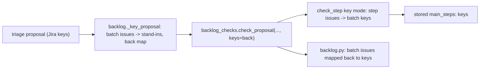
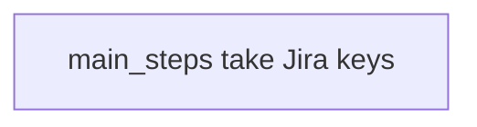

# B312: backlog plan accepts Jira keys in main_steps (#1095)

**Goal:** with a Jira source, `sl backlog plan` accepts a triage proposal whose `main_steps[].issues` name the batch's Jira keys (`["PIX-123"]`, any case) and stores them as keys; a bare number (`[123]`, what the triage worker writes today) is matched to the batch key whose number it is, or named in the error.
**Architecture:** `backlog.py` keeps mapping batch issues to stand-in numbers (`_key_proposal`) and now passes its `back` map (stand-in -> key) to `backlog_checks.check_proposal(..., keys=back)`; `check_proposal` hands it to `check_step`, which in key mode checks each step issue against the batch's keys and stores the matched keys. Without `keys` (GitHub source, answers files) `check_step` behaves byte for byte as before.
**Tech stack:** Python 3 stdlib, pytest via `sl run_tests`.
**Spec:** issue #1095; feedback 58f600d75acc 794943466a9f dd684af0da7e 0e3cc7b14c73 61e29c7a9ee3.
**Detail:** tests
**Wave0:** none
**Coverage:** off

## Global constraints

- Evidence (lead, read on aeb610fe): `backlog._key_proposal` (backlog.py:265) maps only `batch["issues"]` (trusted key i -> stand-in i, anything else -> a number above); `check_proposal` (backlog_checks.py:407) calls `check_step(st, f"{bid} main_steps {k}", sorted(set(issues)))` with those stand-ins, and `check_step` (backlog_checks.py:44) accepts only ints in that list, so `["KEY-123"]` fails on type and `[123]` fails unless 123 happens to be a stand-in. After the check, backlog.py:661-663 maps only `b["issues"]` back to keys. Readers of stored step issues (`backlog_state.py:362`, `backlog_brief.step_text`) print them through `ref()`, which already shows a string as the key itself.
- Every new or changed code line in `skills/subagent-driven-development/scripts/backlog_checks.py` inside `check_step` ends with its `# O(...)` complexity comment like its neighbours; `check_step`'s docstring names #1095.
- Files this batch may touch: skills/subagent-driven-development/scripts/backlog_checks.py, skills/subagent-driven-development/scripts/backlog.py (one call line), tests/scripts/test_backlog_steps_jira_1095.py and this plan. backlog_brief.py belongs to another batch: never edit it. An existing test that breaks and is not in your Owns: name it in the report, do not edit it.
- Builds: the verdict is `sl run_tests` (the project's test command; a project with `.maxapp` runs `maxapp test`, which a build pool may place on another Mac, and a full run whose tree a green maxapp test stamp covers returns that result without a run); task trees build in <tree>/.build/DerivedData and any build of your own goes under .build/ of the worktree, never -derivedDataPath outside the worktree (your session scratchpad included; backlog cleanup removes scratchpad build folders when the worktree goes); a product, simulator or device build stays on this machine and runs only when an issue's acceptance asks for a running-app check; copy this sentence into every worker brief.
- Simulators: append the UDID of each simulator you or a worker creates (`xcrun simctl create` or `clone`; a checker's `Simulators:` line marks its created ones) as one line to /Users/max/github/superlite/.claude/worktrees/superlite-b312-backlog-plan-jira-main-steps/.superlite/simulators.txt; never list one you did not create; ship cleanup shuts down and deletes each listed one; copy this sentence into every worker brief.

Ruling: the key matching lives in `backlog_checks.check_step` behind a new `keys` argument (stand-in number -> Jira key) that `check_proposal` passes through, and backlog.py changes one call line; mapping steps inside `backlog._key_proposal` plus a second back-map was the alternative, rejected because it splits one rule over two files and leaves the error text to a regex rewrite (lead's ruling) - cost if wrong: one extra parameter on a pure checker.
Ruling: a bare number in a Jira-source step matches the batch key whose part after the last `-` is that number, never a stand-in index; none matching names `N matches no Jira key of this batch (K1, K2)`, two or more name `N matches K1 and K2; write the key`; a key not in the batch names `KEY is not one of this batch's issues (K1, K2)`; an empty list or an item neither string nor int (bool included) keeps today's message (lead's ruling, the issue's expected) - cost if wrong: a reworded error line.
Ruling: stored step issues of a Jira plan are the matched upper-case keys in the step's order, each once (`[123, "PIX-123"]` -> `["PIX-123"]`); a GitHub-source step keeps today's check, message and stored list byte for byte (lead's ruling) - cost if wrong: none seen; status and briefs already print strings as keys.
Ruling: the triage brief (backlog_brief.py TRIAGE_RUN, `"issues": [<n>]` for main_steps regardless of source) belongs to B313: its Jira wording is a follow-up in notes.md; the bare-number match makes today's worker output plan anyway (lead's ruling).
LAYERS: unit

## Main diagram



## File structure

- skills/subagent-driven-development/scripts/backlog_checks.py: `check_step(..., keys)` key mode, `check_proposal(..., keys)` passes it on (T1).
- skills/subagent-driven-development/scripts/backlog.py: the Jira `check_proposal` call passes `keys=back` (T1).
- tests/scripts/test_backlog_steps_jira_1095.py: #1095 tests (T1).

## Task graph

```mermaid
%% schedule
gantt
  title Predicted schedule (mm:ss)
  dateFormat X
  axisFormat %M:%S
  section lane 1
  T1 main_steps take Jira keys :t1, 0, 553s
```





critical path: T1 (9.2 min) · peak width 1 · predicted build 9.2 min · predicted total ≈ 25.7 min

## backlog plan checks

**Probe entry:** none (a pure checker inside `sl backlog plan`; the cases are the named tests below)

### T1 main_steps take Jira keys · Complexity 3 · Est. context 36k
**Owns:** skills/subagent-driven-development/scripts/backlog_checks.py, skills/subagent-driven-development/scripts/backlog.py, tests/scripts/test_backlog_steps_jira_1095.py
**Components:** 1
**LOC owned:** 90
**Tests:** fast
**Model:** sonnet
**Kind:** design
**Produces:** backlog_checks.check_step(obj: object, where: str, issues: list | None = None, keys: dict | None = None) -> tuple
e.g. check_step({"issues": [123, "pix-7"], "runs": "main", "command": "c"}, "w", [1, 2], {1: "PIX-123", 2: "PIX-7"}) -> ({"issues": ["PIX-123", "PIX-7"], "runs": "main", "command": "c"}, [])
e.g. check_step({"issues": [1], "runs": "main", "command": "c"}, "w", [1, 2], {1: "PIX-123", 2: "PIX-7"}) -> (None, ["w issues: 1 matches no Jira key of this batch (PIX-123, PIX-7)"])
**Produces:** backlog_checks.check_proposal(obj: dict, known: set, batches: frozenset = frozenset(), keys: dict | None = None) -> tuple[list[dict], list[str]]
e.g. check_proposal({"batches": [{"id": "B1", "topic": "t", "issues": [1, 2], "files": ["a.py"], "depends": [], "main_steps": [{"issues": [7], "runs": "main", "command": "c"}]}]}, {1, 2}, keys={1: "PIX-123", 2: "PIX-7"}) -> batch issues [1, 2], main_steps [{"issues": ["PIX-7"], "runs": "main", "command": "c"}]
**Review Focus:** state: `test_bare_number_matches_its_key_not_the_index`, `test_without_keys_numbers_only_as_before`; deep: `test_plan_stores_step_keys`, `test_plan_names_an_unmatched_number` (end to end through `sl backlog plan --jql`); tests/scripts/test_backlog_steps_checks_674.py, test_backlog_jira_208.py and test_backlog_answer*.py stay green.
**Test code (verbatim):**
```python
"""#1095: a Jira-source plan's main_steps name the batch's Jira keys; a bare number is matched to its key or named."""
import sys

from test_backlog_cli import bk, cli, load  # noqa: F401  bk is the CLI fixture jk builds on
from test_backlog_jira_208 import JB, jk  # noqa: F401
from test_plan_tools import SCRIPTS

sys.path.insert(0, str(SCRIPTS))
import backlog_checks as bc  # noqa: E402

KEYS = {1: "PIX-123", 2: "PIX-7"}
GEN = "w issues: a non-empty list of this batch's issues"


def step(issues):
    return {"issues": issues, "runs": "main", "command": "git lfs install"}


def test_key_kept_and_upper_cased():
    assert bc.check_step(step(["PIX-7"]), "w", [1, 2], KEYS) == (step(["PIX-7"]), [])
    assert bc.check_step(step(["pix-123"]), "w", [1, 2], KEYS) == (step(["PIX-123"]), [])


def test_bare_number_matches_its_key_not_the_index():
    assert bc.check_step(step([123, 7]), "w", [1, 2], KEYS) == (step(["PIX-123", "PIX-7"]), [])
    assert bc.check_step(step([1]), "w", [1, 2], KEYS) == (None, ["w issues: 1 matches no Jira key of this batch (PIX-123, PIX-7)"])


def test_same_issue_twice_kept_once():
    assert bc.check_step(step([123, "PIX-123"]), "w", [1, 2], KEYS) == (step(["PIX-123"]), [])


def test_key_of_another_batch_named():
    assert bc.check_step(step(["PIX-7"]), "w", [1], KEYS) == (None, ["w issues: PIX-7 is not one of this batch's issues (PIX-123)"])


def test_number_two_keys_share_is_named():
    keys = {1: "PIX-5", 2: "ABC-5"}
    assert bc.check_step(step([5]), "w", [1, 2], keys) == (None, ["w issues: 5 matches PIX-5 and ABC-5; write the key"])


def test_empty_or_odd_items_keep_the_old_message():
    for bad in ([], "PIX-7", [True], [None], [1.5]):
        assert bc.check_step(step(bad), "w", [1, 2], KEYS) == (None, [GEN])


def test_without_keys_numbers_only_as_before():
    assert bc.check_step(step(["PIX-7"]), "w", [12]) == (None, [GEN])
    assert bc.check_step(step([12]), "w", [12]) == (step([12]), [])


def test_proposal_stores_keys():
    p = {"batches": [{"id": "B1", "topic": "t", "issues": [1, 2], "files": ["a.py"], "depends": [], "main_steps": [step([7])]}]}
    out, errs = bc.check_proposal(p, {1, 2}, keys=KEYS)
    assert errs == [] and out[0]["main_steps"] == [step(["PIX-7"])] and out[0]["issues"] == [1, 2]


def test_plan_stores_step_keys(jk, capsys):
    jk.batches = [{**JB, "main_steps": [step(["PIX-2"]), {"issues": [1], "runs": "user", "command": "acli jira auth login"}]}]
    rc, out = cli(capsys, "plan", "--jql", "x")
    assert rc == 0, out
    assert load(jk)["batches"][0]["main_steps"] == [step(["PIX-2"]), {"issues": ["PIX-1"], "runs": "user", "command": "acli jira auth login"}]
    assert "step B1: main runs this: git lfs install (PIX-2)" in out and "step B1: Max runs this: acli jira auth login (PIX-1)" in out


def test_plan_names_an_unmatched_number(jk, capsys):
    jk.batches = [{**JB, "main_steps": [step([9])]}]
    rc, out = cli(capsys, "plan", "--jql", "x")
    assert rc == 3 and "B1 main_steps 1 issues: 9 matches no Jira key of this batch (PIX-1, PIX-2)" in out
```
**Steps:** 1 write the test file, 2 run it: FAIL, 3 implement, 4 run it plus test_backlog_steps_checks_674.py and test_backlog_jira_208.py: PASS
**Notes:** in key mode `have = [keys[n] for n in issues if n in keys]` (the batch's keys in its stand-in order). Per step item, in order: a `str` matches `item.upper()` in `have`; an `int` that is not a `bool` matches every `k` in `have` with `k.rsplit("-", 1)[-1] == str(item)` and must match exactly one; the first failing item sets the one error for that step (`not a list`, empty, or a non-str/non-int item: today's message). Store the matched keys with `list(dict.fromkeys(...))`. The `keys is None` path keeps today's three lines unchanged. In backlog.py only line 628 changes: `bc.check_proposal(cp, set(range(1, len(trusted) + 1)), known_b, keys=back)`; the error rewrite on the next line stays (the new messages hold no `#`).

## Review Focus

- T1: a Jira step issue is matched to this batch's key (string any case, or a bare number by its key number, never by stand-in index) and stored as that key; the first unmatched item of a step is named with the batch's keys; a GitHub plan's step check is unchanged.

## Self-review

- Coverage: #1095 expected 1 (keys accepted like batch issues) -> `test_key_kept_and_upper_cased`, `test_plan_stores_step_keys`; expected 2 (bare number matched or named) -> `test_bare_number_matches_its_key_not_the_index`, `test_number_two_keys_share_is_named`, `test_plan_names_an_unmatched_number`.
- No placeholders; Produces lines match the code names; one task, no edges.
