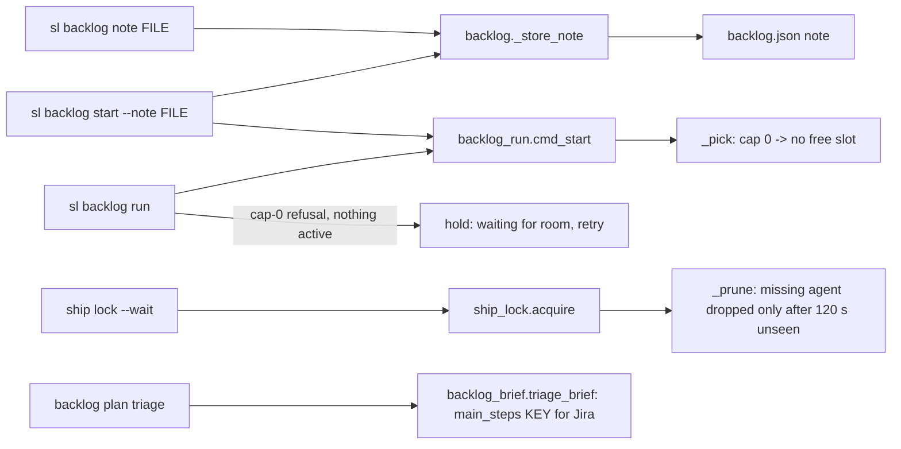
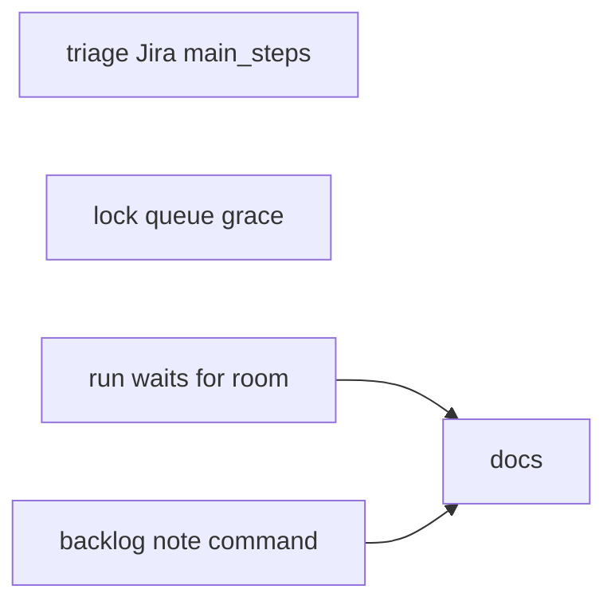

# B324: backlog note, run waits for room at cap 0, ship lock queue keeps a polling head, Jira main_steps keys (#1110, #1113, #1114, #1115)

**Goal:** (#1110) the triage brief tells the worker to write main_steps `issues` as Jira keys for a Jira source; (#1113) `sl backlog note FILE` stores or clears the standing note and starts no batch, and every hint that names the clear command names it; (#1114) `sl backlog run` with lead cap 0 and a planned batch waits for room instead of ending `no running batch`; (#1115) a ship lock waiter that is still polling keeps its queue place when one Herdr agent read misses its agent.
**Architecture:** backlog_brief.triage_brief swaps `[<n>]` for `["<KEY>"]` in the main_steps shape; backlog.py gains a `note` subcommand sharing `_store_note` with the start route; backlog_run._pick refuses cap 0 with a `no free slot` line and cmd_run holds (no run end) while that refusal stands and nothing is active; ship_lock._prune drops a waiter for a missing agent only after it is unseen for LIVE_GRACE_MS.
**Tech stack:** Python 3 stdlib, pytest via `sl run_tests`.
**Spec:** issues #1110, #1113, #1114, #1115.
**Detail:** tests
**Wave0:** none
**Coverage:** off

## Global constraints

- Every code line in the scripts ends with its `# O(...)` complexity comment like its neighbours.
- Files this batch may touch: skills/subagent-driven-development/scripts/backlog.py, backlog_brief.py, backlog_run.py, backlog_ship.py, backlog_state.py, ship_lock.py (all under skills/subagent-driven-development/scripts/), commands/backlog.md, skills/subagent-driven-development/backlog-main.md, the test files each task owns and this plan. plan_tools.py, predict.py, run_tests.py, pt_review.py, state.py, findings.py, fleet.py, fleet_io.py, fleet_placement.py, fleet_remote_collect.py, fleet_remote_worker.py, docs/fleet.md and docs/tools.md belong to other batches: never edit them. An existing test that breaks outside your Owns: name it in the report, do not edit it.
- Builds: the verdict is `sl run_tests` (the project's test command; a project with `.maxapp` runs `maxapp test`, which a build pool may place on another Mac, and a full run whose tree a green maxapp test stamp covers returns that result without a run); task trees build in <tree>/.build/DerivedData and any build of your own goes under .build/ of the worktree, never -derivedDataPath outside the worktree (your session scratchpad included; backlog cleanup removes scratchpad build folders when the worktree goes); a product, simulator or device build stays on this machine and runs only when an issue's acceptance asks for a running-app check; copy this sentence into every worker brief.
- Simulators: append the UDID of each simulator you or a worker creates (`xcrun simctl create` or `clone`; a checker's `Simulators:` line marks its created ones) as one line to /Users/max/github/superlite/.claude/worktrees/superlite-b324-backlog-run-start-lock-fixes/.superlite/simulators.txt; never list one you did not create; ship cleanup shuts down and deletes each listed one; copy this sentence into every worker brief.
- Exact texts: cap-0 refusal `f"no free slot for {bid} (cap {cap}); rerun once the cap: line shows room"` (printed as `BLOCKED: ...` by `_refuse`); run hold line `f"waiting for room: cap {cap}; start retried every {a.retry} s until --timeout"`; run end note line ends `"still goes into every later lead brief; sl backlog note /dev/null clears it"`; status note line ends `"(sl backlog note FILE replaces it, an empty file clears it)"`; note refusal in a fleet worker `"BLOCKED: sl backlog note runs only in the main session"` (exit 2).

Ruling: #1113 per main's ruling: a new `sl backlog note FILE` (an empty file or /dev/null clears) stores the note and starts nothing; `start --note FILE` keeps working unchanged (stores, then starts), and every hint that named `start --note` as the clear or replace command now names `sl backlog note` (lead's ruling).
Ruling: #1114: run waits for room only for a cap-0 refusal while no batch is running or needs_decision; it retries start every `--retry` s (300) and ends on TIMEOUT as before; disk and machine-load refusals keep today's end (lead's ruling).
Ruling: #1115 cause from the B106 transcript (piX, 2026-11-24): its place went from 1 of 2 to 2 of 2 while it polled every 15 s, so its entry was pruned and re-appended; the only prune that hits a polling waiter is the Herdr agent-list check; a waiter seen within 120 s is never dropped for a missing agent; a gone agent's entry still leaves after 120 s, an unseen one after 10 min (lead's ruling).

## Main diagram



## File structure

- scripts/backlog_brief.py: triage main_steps shape per source; NOTE_HEAD names `sl backlog note`.
- scripts/ship_lock.py: LIVE_GRACE_MS, `_prune`, docstring.
- scripts/backlog_run.py: `_pick` cap-0 refusal, `cmd_run` hold, run-end note line.
- scripts/backlog.py, scripts/backlog_state.py: `note` subcommand, `_store_note`, help and status texts.
- commands/backlog.md, skills/subagent-driven-development/backlog-main.md: name `sl backlog note` and the room wait (docs/fleet.md is B323's run's, docs/tools.md B326's: follow-ups).

## Task graph

```mermaid
%% schedule
gantt
  title Predicted schedule (mm:ss)
  dateFormat X
  axisFormat %M:%S
  section lane 1
  T4 sl backlog note FILE stores the note :t4, 0, 584s
  T5 docs name sl backlog note and the roo :t5, 584, 550s
  section lane 2
  T3 backlog run waits for room at cap 0 :t3, 0, 583s
  section lane 3
  T2 ship lock queue keeps a polling waite :t2, 0, 550s
  section lane 4
  T1 triage brief main_steps names Jira ke :t1, 0, 546s
```





critical path: T4 → T5 (18.9 min) · peak width 4 · predicted build 18.9 min · predicted total ≈ 35.4 min

## Brief

### T1 triage brief main_steps names Jira keys · Complexity 1 (O-1) · Est. context 30k
**Owns:** skills/subagent-driven-development/scripts/backlog_brief.py, tests/scripts/test_backlog_brief_steps_1110.py
**Components:** 1
**LOC owned:** 30
**Tests:** fast
**Kind:** mechanical
**Model:** haiku
**Produces:** backlog_brief.triage_run(jira: bool) -> str
**Ticket:** #1110
**Review Focus:** `test_jira_triage_steps_name_keys`: a Jira triage brief's Rules line holds `{"issues": ["<KEY>"], "runs": "main"` and not `{"issues": [<n>], "runs"`; `test_github_triage_steps_keep_numbers`: the GitHub brief is unchanged.
**Test code (verbatim):**
```python
# tests/scripts/test_backlog_brief_steps_1110.py
import sys
from test_plan_tools import SCRIPTS
sys.path.insert(0, str(SCRIPTS))
import backlog_brief as bb  # noqa: E402

CTX = {"repo": "o/r", "max_batches": 3}


def test_triage_run_by_source():
    assert bb.triage_run(False) == bb.TRIAGE_RUN
    assert '{"issues": [<n>], "runs": "main"' in bb.TRIAGE_RUN
    assert bb.triage_run(True) == bb.TRIAGE_RUN.replace('{"issues": [<n>], ', '{"issues": ["<KEY>"], ')


def test_jira_triage_steps_name_keys():
    t = bb.triage_brief([{"number": "PIX-1272", "title": "Fix login", "body": "b"}], CTX)
    assert '{\"issues\": [\"<KEY>\"], \"runs\": \"main\"' in t
    assert '{"issues": [<n>], "runs"' not in t


def test_github_triage_steps_keep_numbers():
    t = bb.triage_brief([{"number": 3, "title": "T", "body": "b"}], CTX)
    assert '{"issues": [<n>], "runs": "main"' in t and '"<KEY>"' not in t


def test_note_head_names_note_command():
    assert bb.NOTE_HEAD.startswith("Standing note from main (sl backlog note):")
```
**Steps:** 1 write the test, 2 run: FAIL, 3 add `triage_run(jira)` (returns TRIAGE_RUN, with `'{"issues": [<n>], '` replaced by `'{"issues": ["<KEY>"], '` when jira) and use it in triage_brief's Rules line instead of TRIAGE_RUN; change NOTE_HEAD's `(sl backlog start --note)` to `(sl backlog note)`, 4 run: PASS.

## Lock

### T2 ship lock queue keeps a polling waiter's place · Complexity 2 (O-1) · Est. context 32k
**Owns:** skills/subagent-driven-development/scripts/ship_lock.py, tests/scripts/test_ship_lock_grace_1115.py, tests/scripts/test_ship_lock_fifo_588.py
**Components:** 1
**LOC owned:** 60
**Tests:** fast
**Model:** sonnet
**Produces:** ship_lock.LIVE_GRACE_MS: int = 120000
**Ticket:** #1115
**Review Focus:** state: `test_polling_head_survives_a_missed_agent_read` (B2 at place 1, B3's read misses a3, release B1: B3 refused, B2 acquires); `test_gone_waiter_dropped_after_grace` (exactly at 120000 ms kept, 1 ms later dropped); the 10-minute unseen drop and the holder's `_stale` stay as they are.
**Test code (verbatim):**
```python
# tests/scripts/test_ship_lock_grace_1115.py
"""A waiter that still polls keeps its queue place when one Herdr read misses its agent (#1115)."""
from test_plan_tools import SCRIPTS  # noqa: F401
import ship_lock as sl

B1 = {"batch": "B1", "lead": "W2", "agent": "a2", "repo": "o/r"}
B2 = {"batch": "B2", "lead": "W3", "agent": "a3", "repo": "o/r"}
B3 = {"batch": "B3", "lead": "W4", "agent": "a4", "repo": "o/r"}
LIVE = {"a2", "a3", "a4"}


def test_grace_values():
    assert (sl.LIVE_GRACE_MS, sl.QUEUE_STALE_MS) == (120000, 600000)


def test_polling_head_survives_a_missed_agent_read(tmp_path):
    p = sl.lock_path("o/r", tmp_path)
    assert sl.acquire(p, B1, LIVE, 1000)["acquired"]
    sl.acquire(p, B2, LIVE, 2000)
    sl.acquire(p, B3, LIVE, 3000)
    r = sl.acquire(p, B3, {"a2", "a4"}, 4000)
    assert (r["place"], r["queued"], r["first"]["batch"]) == (2, 2, "B2")
    assert sl.release(p, "B1")
    r = sl.acquire(p, B3, {"a4"}, 5000)
    assert not r["acquired"] and r["place"] == 2 and r["first"]["batch"] == "B2"
    assert sl.acquire(p, B2, LIVE, 6000)["acquired"]


def test_gone_waiter_dropped_after_grace(tmp_path):
    p = sl.lock_path("o/r", tmp_path)
    sl.acquire(p, B1, LIVE, 1000)
    sl.acquire(p, B2, LIVE, 2000)
    sl.acquire(p, B3, LIVE, 3000)
    sl.release(p, "B1")
    assert not sl.acquire(p, B3, {"a4"}, 2000 + sl.LIVE_GRACE_MS)["acquired"]
    assert sl.acquire(p, B3, {"a4"}, 2001 + sl.LIVE_GRACE_MS)["acquired"]


def test_unreadable_herdr_keeps_waiters(tmp_path):
    p = sl.lock_path("o/r", tmp_path)
    sl.acquire(p, B1, LIVE, 1000)
    sl.acquire(p, B2, LIVE, 2000)
    sl.release(p, "B1")
    assert not sl.acquire(p, B3, None, 2000 + sl.LIVE_GRACE_MS + 1)["acquired"]
```
**Steps:** 1 write the test, 2 run: FAIL, 3 in `_prune` keep the 10-minute and holder checks first, then drop an entry for an agent missing from `live` only when `now_ms - seen > LIVE_GRACE_MS`; add `LIVE_GRACE_MS = 120000` beside QUEUE_STALE_MS; docstring: "a waiter whose agent Herdr no longer lists and that is unseen for 2 minutes, or any waiter unseen for 10 minutes, is dropped", 4 in test_ship_lock_fifo_588.py `test_dead_waiter_is_skipped` acquire at `2001 + sl.LIVE_GRACE_MS` instead of 4000 (its intent stays: a dead waiter is skipped), 5 run both files: PASS.

## Run

### T3 backlog run waits for room at cap 0 · Complexity 4 (O-1) · Est. context 45k
**Owns:** skills/subagent-driven-development/scripts/backlog_run.py, tests/scripts/test_backlog_run_room_1114.py, tests/scripts/test_backlog_run_end_note_777.py
**Components:** 2
**LOC owned:** 80
**Tests:** fast
**Model:** sonnet
**Ticket:** #1114
**Review Focus:** state: the hold applies only while the last start round printed a cap-0 refusal and no batch is running or needs_decision; the hold line prints once per hold; a later round with room starts the batch; TIMEOUT still ends the run; `_pick` with explicit ids is unchanged; cap ≥ 1 with full slots stays quiet (`no startable batch`).
**Test code (verbatim):**
```python
# tests/scripts/test_backlog_run_room_1114.py
import sys
from backlog_fixtures import batch as b
from test_backlog_run import bk, put, get, run, running  # noqa: F401
from test_backlog_run_loop_673 import clock  # noqa: F401
from test_plan_tools import SCRIPTS
sys.path.insert(0, str(SCRIPTS))
import backlog_run as br  # noqa: E402

REFUSAL = "BLOCKED: no free slot for B2 (cap 0); rerun once the cap: line shows room"


def test_start_cap_zero_refuses(bk, capsys):
    put(bk, b("B2", ["b.py"]))
    assert run(capsys, "start", "--cap", "0") == (2, REFUSAL + "\n")
    assert get(bk, "B2")["state"] == "planned"


def test_start_cap_zero_without_planned_batch_stays_quiet(bk, capsys):
    put(bk)
    assert run(capsys, "start", "--cap", "0") == (0, "no startable batch\n")


def test_start_full_cap_stays_quiet(bk, capsys):
    running(bk)
    put(bk, get(bk, "B1"), b("B2", ["b.py"]))
    assert run(capsys, "start", "--cap", "1") == (0, "no startable batch\n")


def test_run_waits_for_room_at_cap_zero(bk, capsys, clock):
    put(bk, b("B2", ["b.py"]))
    rc, out = run(capsys, "run", "--cap", "0", "--timeout", "25", "--poll", "10", "--retry", "5")
    assert rc == 0 and out.splitlines() == [REFUSAL, "waiting for room: cap 0; start retried every 5 s until --timeout", "TIMEOUT"]
    assert clock == [10, 10, 10] and get(bk, "B2")["state"] == "planned"


def test_run_starts_once_room_frees(bk, capsys, clock, monkeypatch):
    import backlog_cap
    caps = iter([(0, "cap: 0 (room 0)")])
    monkeypatch.setattr(backlog_cap, "start_cap", lambda *a, **k: next(caps, (1, "cap: 1 (room 2)")))
    put(bk, b("B2", ["b.py"]))
    rc, out = run(capsys, "run", "--timeout", "25", "--poll", "10", "--retry", "5")
    lines = out.splitlines()
    assert lines[:3] == ["cap: 0 (room 0)", REFUSAL, "waiting for room: cap 0; start retried every 5 s until --timeout"]
    assert "cap: 1 (room 2)" in lines and any(x.startswith("B2 running lead=") for x in lines)
    assert get(bk, "B2")["state"] == "running" and "no running batch" not in out


def test_run_ends_when_a_batch_needs_main(bk, capsys, clock):
    put(bk, b("B1", ["a.py"], "needs_decision"), b("B2", ["b.py"]))
    rc, out = run(capsys, "run", "--cap", "0", "--timeout", "25", "--poll", "10")
    assert rc == 0 and "waiting for room" not in out and "no running batch" in out
```
**Steps:** 1 write the test, 2 run: FAIL, 3 `_pick`: with no ids and `cap < 1`, take `bs.startable(data, len(active) + 1)`; when it names a batch return `([], [<cap-0 refusal for its first id>])`, else go on as today; 4 `cmd_run`: in the start branch set `room = any(x.startswith("BLOCKED: no free slot") and "(cap 0)" in x ... )` per the refusal text (use `f"(cap {cap})"` with `cap < 1`), at the `no running batch` check hold instead of `_no_running` when `room` and no batch is in ACTIVE: print the hold line once (a `held` flag, reset by a start round without the refusal), then the deadline check and `time.sleep(a.poll)` as usual; 5 run_end: the note line ends `sl backlog note /dev/null clears it`; in tests/scripts/test_backlog_run_end_note_777.py change the same text in its expected line; 6 run the new file, test_backlog_run_loop_673.py, test_backlog_run.py and test_backlog_run_end_note_777.py: PASS.
**Notes:** the refusal goes through `_refuse` (exit 2); in cmd_run `retry_refusal` already matches `no free slot`, so the retry cadence and the `seen` de-duplication need no change. A cap-0 refusal while a batch runs changes nothing: the running batch keeps the loop alive.

## Note

### T4 sl backlog note FILE stores the note and starts nothing · Complexity 3 (O-1) · Est. context 42k
**Owns:** skills/subagent-driven-development/scripts/backlog.py, skills/subagent-driven-development/scripts/backlog_state.py, tests/scripts/test_backlog_note_1113.py, tests/scripts/test_backlog_start_note_504.py, tests/scripts/test_backlog_b237.py, tests/scripts/test_backlog_state_b89.py
**Components:** 2
**LOC owned:** 90
**Tests:** fast
**Model:** sonnet
**Produces:** backlog._store_note(f: str) -> int · backlog.cmd_note(a: argparse.Namespace) -> int
**Ticket:** #1113
**Review Focus:** `test_note_stores_and_starts_nothing` (backlog_run.main never called); `/dev/null` clears; running leads named; a fleet worker is refused and nothing is written; `start --note` behaves as before (test_backlog_start_note_504.py stays green apart from its HELP constant).
**Test code (verbatim):**
```python
# tests/scripts/test_backlog_note_1113.py
import shlex
from test_backlog_cli import bk, cli, load, bs, bl  # noqa: F401
from test_backlog_start_note_504 import run, note  # noqa: F401


def test_note_stores_and_starts_nothing(run, capsys, tmp_path):
    f = note(tmp_path, "Use uv.\nNo emojis.")
    rc, out = cli(capsys, "note", str(f))
    assert rc == 0 and run.routed == []
    assert out.splitlines() == [f"note: stored from {f.resolve()} (2 lines, 18 of 2000 characters); every lead brief from now on carries it"]
    assert load(run.bk)["note"]["text"] == "Use uv.\nNo emojis."
    assert [x["state"] for x in load(run.bk)["batches"]] == ["planned"]


def test_note_dev_null_clears(run, capsys, tmp_path):
    cli(capsys, "note", str(note(tmp_path, "Use uv.")))
    rc, out = cli(capsys, "note", "/dev/null")
    assert (rc, out) == (0, "note: cleared; lead briefs carry no note\n")
    assert "note" not in load(run.bk) and run.routed == []


def test_note_names_running_leads(run, capsys, tmp_path):
    bs.update(bs.path(run.bk.root), lambda d: d["batches"].append({"id": "B2", "state": "running", "lead": "W4", "issues": [2], "files": ["b.py"], "depends": [], "decisions": []}))
    f = note(tmp_path, "Use uv.")
    rc, out = cli(capsys, "note", str(f))
    src = shlex.quote(str(f.resolve()))
    assert rc == 0 and out.splitlines()[1] == f'note: B2 lead W4 started before this note; sl backlog tell B2 --text "$(cat {src})" tells it'


def test_note_refused_in_fleet_worker(run, capsys, tmp_path, monkeypatch):
    monkeypatch.setenv("SUPERLITE_FLEET_WORKER", "W3")
    rc, out = cli(capsys, "note", str(note(tmp_path, "x")))
    assert (rc, out) == (2, "BLOCKED: sl backlog note runs only in the main session\n") and "note" not in load(run.bk)


def test_bad_note_file_refused(run, capsys, tmp_path):
    p = str(tmp_path / "missing.md")
    rc, out = cli(capsys, "note", p)
    assert rc == 2 and out.startswith(f"BLOCKED: --note {p} unreadable:") and run.routed == []


def test_status_note_line_names_note_command():
    line = bs.note_line({"note": {"text": "a", "file": "/f", "time": "t"}})
    assert line.endswith("(sl backlog note FILE replaces it, an empty file clears it)")
```
**Steps:** 1 write the test, 2 run: FAIL, 3 backlog.py: move the store-and-print block of `_start` into `_store_note(f)` (read_note ValueError -> `BLOCKED: <e>`, return 2; else store, print the message and the `note: B lead W started before this note; ...` lines, return 0) and call it from `_start`; add `cmd_note` (fleet worker refusal, else `_store_note(a.file)`) as argparse subcommand `note` with positional `file` and help `"store FILE as the standing note every later lead brief carries (an empty file or /dev/null clears it); starts no batch"`; NOTE_HELP and the `start` help entry add `; sl backlog note FILE stores it without starting a batch`; the module docstring names `note FILE (#1113)`; 4 backlog_state.note_line ends with the new status text; 5 update the pinned old texts in test_backlog_start_note_504.py (HELP), test_backlog_b237.py and test_backlog_state_b89.py; 6 run those four files: PASS.

## Docs

### T5 docs name sl backlog note and the room wait · Complexity 2 (O-1) · Est. context 40k
**Owns:** commands/backlog.md, skills/subagent-driven-development/backlog-main.md, tests/scripts/test_docs_backlog_note_room_1113.py, tests/scripts/test_backlog_docs_773_777.py, tests/scripts/test_docs_b237_fleet.py
**Components:** 1
**LOC owned:** 50
**Tests:** fast
**Model:** sonnet
**Consumes:** backlog.cmd_note(a: argparse.Namespace) -> int (T4)
**Ticket:** #1113
**Review Focus:** each doc names `"$SL" backlog note FILE` as the note-only form and says `start --note` also starts every startable batch; the run-end note line and step 8's clear command name `sl backlog note /dev/null`; backlog-main.md step 5 names the cap-0 room wait; existing sentences other tests pin (test_backlog_docs_b89.py, tests/scripts/fixtures/rules_684/backlog.txt, test_docs_b26.py) are kept word for word: add sentences, do not rewrite them.
**Test code (verbatim):**
```python
# tests/scripts/test_docs_backlog_note_room_1113.py
from pathlib import Path

ROOT = Path(__file__).resolve().parents[2]
NOTE = "run end: standing note from <file> (<time>, <n> lines) still goes into every later lead brief; sl backlog note /dev/null clears it"
HOLD = "waiting for room: cap 0; start retried every 300 s until --timeout"


def flat(rel):
    return " ".join((ROOT / rel).read_text().split())


def test_docs_name_note_command():
    for rel in ("commands/backlog.md", "skills/subagent-driven-development/backlog-main.md"):
        t = flat(rel)
        assert "backlog note FILE" in t and "starts no batch" in t, rel


def test_docs_name_run_end_note_clear():
    for rel in ("commands/backlog.md", "skills/subagent-driven-development/backlog-main.md"):
        assert NOTE in flat(rel), rel


def test_main_rules_name_room_wait():
    t = flat("skills/subagent-driven-development/backlog-main.md")
    assert HOLD in t and "no free slot for B (cap 0)" in t
```
**Steps:** 1 write the test, 2 run: FAIL, 3 edit the two docs (commands/backlog.md steps 5 and 8, backlog-main.md steps 4, 5 and 8); docs/fleet.md is B323's and docs/tools.md B326's: never edit them; 4 in test_backlog_docs_773_777.py set NOTE to the new run-end text, step 8's assertion to `'"$SL" backlog note /dev/null'` and the backlog-main assertion to `"backlog note /dev/null"` (leave `test_tools_row_names_note_line` as is: docs/tools.md is another batch's); in test_docs_b237_fleet.py `test_fleet_names_standing_note_end` keep the FLEET assertion and assert `"sl backlog note /dev/null"` in backlog_run.py; 5 run the three test files plus test_backlog_docs_b89.py, test_backlog_rules_split_684.py and test_docs_b26.py: PASS.

## Review Focus

- Package Brief (T1): no runnable entry; string contract only. Probe entry: none (pure text builder).
- Package Lock (T2): state category, cases in T2. Probe entry: `ship_lock.acquire(p, owner, live, now_ms)`.
- Package Run (T3): state category, cases in T3. Probe entry: `sl backlog run --cap 0 --timeout 0`.
- Package Note (T4): cases in T4. Probe entry: `sl backlog note FILE`.
- Package Docs (T5): doc tests only. Probe entry: none.

## Self-review

Every issue maps to a task (#1110 T1, #1113 T4 and T5 plus the hint texts in T1 and T3, #1114 T3, #1115 T2); no two parallel tasks share a file; T5 waits for T3 and T4 because its tests read backlog_run.py and describe T4's command.
