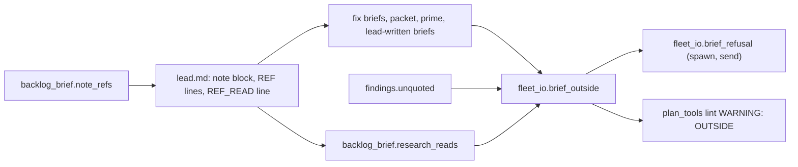
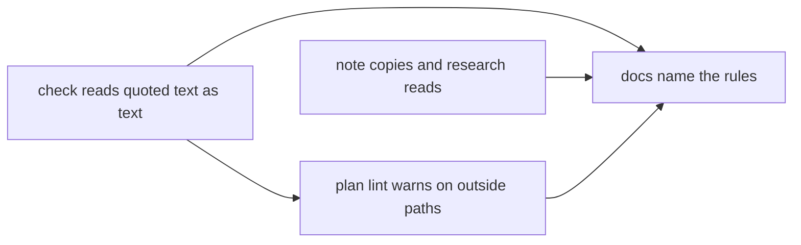

# B313: every brief superlite generates passes its own #1015 check (#1089), and plan lint warns on outside paths (#1086)

**Goal:** the #1015 brief check (`fleet_io.brief_refusal`) reads quoted text and paths missing on this machine as text, so fix briefs, the review packet and lead-written briefs that copy the standing note or a finding's quote pass (#1089); a research worker may name an outside path the standing note names (#1089); `plan_tools lint` warns, naming the line, when a plan names an existing outside path (#1086).
**Architecture:** `findings.unquoted` blanks the quoted forms superlite writes (the standing-note block, a finding's `quote:` span); `fleet_io.brief_outside` = `fleet.outside_paths(unquoted(text))` minus missing paths minus, for research, the paths the lead brief's research line lists; `brief_refusal` and `plan_tools lint` call it; `backlog_brief.note_refs` drops missing paths from its not-copied line and writes the research line, `research_reads` parses it.
**Tech stack:** Python 3.10+ stdlib; pytest via `sl run_tests`.
**Spec:** issues #1089 and #1086 (bodies); R1-R4 research reports in .superlite/fleet/reports/.
**Detail:** tests
**Wave0:** none
**Coverage:** off

## Global constraints

- Files this batch may touch: skills/subagent-driven-development/scripts/findings.py, skills/subagent-driven-development/scripts/fleet_io.py, skills/subagent-driven-development/scripts/backlog_brief.py, skills/subagent-driven-development/scripts/plan_tools.py, skills/subagent-driven-development/backlog.md, docs/fleet.md, the test files the tasks own, and this plan. Never edit fleet.py, fleet_placement.py, fleet_remote.py, fleet_remote_account.py, fleet_waits.py, fleet_report.py, state.py, commit_task.py, docs/tools.md, docs/hooks.md or agents/package-reviewer.md (other batches own them).
- Builds: the verdict is `sl run_tests` (the project's test command; a project with `.maxapp` runs `maxapp test`, which a build pool may place on another Mac, and a full run whose tree a green maxapp test stamp covers returns that result without a run); task trees build in <tree>/.build/DerivedData and any build of your own goes under .build/ of the worktree, never -derivedDataPath outside the worktree (your session scratchpad included; backlog cleanup removes scratchpad build folders when the worktree goes); a product, simulator or device build stays on this machine and runs only when an issue's acceptance asks for a running-app check.
- Simulators: append the UDID of each simulator you or a worker creates (`xcrun simctl create` or `clone`; a checker's `Simulators:` line marks its created ones) as one line to /Users/max/github/superlite/.claude/worktrees/superlite-b313-brief-path-check-generated-briefs/.superlite/simulators.txt; never list one you did not create; ship cleanup shuts down and deletes each listed one.
- Every new or changed code line keeps the repo's trailing `# O(...)` complexity comment style.
- The #1015 `error:` lines (fleet.outside_error and the brief-location line in fleet_io) stay byte-identical; docs tests pin them.

Ruling: the fix lives in `fleet_io.brief_outside`, a wrapper around `fleet.outside_paths`, because fleet.py belongs to B315; spawn already calls `brief_refusal` (fleet.py:1727), so spawn and send both get it. fleet.py's own `--note` check (line 1702) stays on `outside_paths` and is a follow-up for B315 (lead's ruling).
Ruling: quoted text is recognised, not re-fenced: the standing-note block (a line whose strip equals `backlog_brief.NOTE_HEAD` and the lines starting with four spaces right after it, as `findings.standing_note` reads it) and a finding's ` quote: `...`` span, wherever a generated or lead-written brief carries them; no writer's format changes, so the prime, packet and fix-brief tests stay as they are and fleet.py's review briefs are covered too (lead's ruling).
Ruling: a path that does not exist on this machine is text for the check, the lint and `note_refs` (no longer named `missing` on the not-copied line), as #1089 expects; a brief naming a new file to write in an outside folder now passes the check and its worker's write is refused by its permissions instead (lead's ruling).
Ruling: research may name an outside path at or below a path the standing note names that exists, does not hold the worktree and is readable (copied or over the cap); `note_refs` lists them on one `REF_READ` line after the note block, `research_reads` parses it, and the line tells the lead to spawn such a researcher with `--machine local`, since a remote machine lacks the path (R4 spike: a local research worker reads and greps an outside repository without a prompt). This changes B304's lead ruling that a lead-written brief naming a sibling repository stays refused, for research only, because #1089 asks for it (lead's ruling).
Ruling: "a stored note is re-checked at start" already holds: `backlog_run._write_brief` rewrites the lead brief from the stored original note through `note_refs` on every start (R2); T2 pins it with a test, no code change (lead's ruling).
Ruling: the packet carries no Global constraints today (R1, R3); the lint warning covers every unfenced plan line, since Global constraints reach every spawn brief through `with_constraints` (lead's ruling).

## Main diagram



## File structure

- skills/subagent-driven-development/scripts/findings.py: `QUOTE_SPAN`, `unquoted(text)`.
- skills/subagent-driven-development/scripts/fleet_io.py: `local_path(tok, project)`, `brief_outside(text, project, sd, role)`; `brief_refusal` uses it; module docstring names the rule.
- skills/subagent-driven-development/scripts/backlog_brief.py: `REF_READ`, `research_reads(sd)`; `note_refs` drops missing paths and writes `REF_READ`.
- skills/subagent-driven-development/scripts/plan_tools.py: the `WARNING: OUTSIDE:` lint warning.
- docs/fleet.md, skills/subagent-driven-development/backlog.md: one bullet each.
- tests/scripts/test_brief_quoted_text_1089.py, test_research_reads_1089.py, test_plan_lint_outside_1086.py, test_docs_b313.py: new; test_backlog_note_refs_1067.py: the missing-path case changes.

## Task graph

```mermaid
%% schedule
gantt
  title Predicted schedule (mm:ss)
  dateFormat X
  axisFormat %M:%S
  section lane 1
  T1 check reads quoted text as text :t1, 0, 410s
  T3 plan lint warns on outside paths :t3, 410, 373s
  T4 docs name the rules :t4, 783, 367s
  section lane 2
  T2 note copies and research reads :t2, 0, 406s
```





critical path: T1 → T3 → T4 (19.2 min) · peak width 2 · predicted build 19.2 min · predicted total ≈ 31.7 min

## Test layers

**Probe entry:** none (text scans of briefs and plans; the named tests cover each case)

### T1 check reads quoted text as text · Complexity 3 (O-1) · Est. context 40k
**Owns:** skills/subagent-driven-development/scripts/findings.py, skills/subagent-driven-development/scripts/fleet_io.py, tests/scripts/test_brief_quoted_text_1089.py, tests/scripts/test_fleet_brief_outside_1015.py
**Components:** 2
**LOC owned:** 150
**Tests:** fast
**Model:** sonnet
**Consumes:** backlog_brief.research_reads(sd: Path) -> list[str] (T2)
**Produces:** findings.unquoted(text: str) -> str
  e.g. unquoted("x\n" + NOTE_HEAD + "\n    Read /o/a.md\ny\n") -> "x\n\n\ny\n"
  e.g. unquoted("- F-2 a.py:3 - p - f (tier 2, from R1) quote: `see ~/g/o`") -> "- F-2 a.py:3 - p - f (tier 2, from R1) quote: ``"
**Produces:** fleet_io.local_path(tok: str, project) -> str
  e.g. local_path("../o/a.md", "/p/w") -> "/p/o/a.md"
  e.g. local_path("//abs/x", "/p") -> "/abs/x"
**Produces:** fleet_io.brief_outside(text: str, project, sd, role: str = "") -> list[str]
  e.g. brief_outside("Read <home>/github/other/src/a.py", proj, sd) -> ["<home>/github/other/src/a.py"]
  e.g. brief_outside("Deploy to ~/app", proj, sd) -> []
**Review Focus:** `test_note_block_and_quote_pass`, `test_missing_paths_are_text`, `test_research_may_name_paths_the_note_lists`, `test_brief_refusal_uses_the_text_rules` (seam: spawn and send both reach brief_refusal).
**Test code (verbatim):** new file tests/scripts/test_brief_quoted_text_1089.py:
```python
"""The #1015 brief check reads quoted text and missing paths as text; research may name the outside paths the standing note lists (#1089)."""
import os, sys, types
import pytest
from test_plan_tools import SCRIPTS
sys.path.insert(0, str(SCRIPTS))
import backlog_brief as bb  # noqa: E402
import findings  # noqa: E402
import fleet_io  # noqa: E402
import fleet_roles  # noqa: E402


def F(quote=None, fp=None, tier=1):
    d = {"id": "F-1", "file": "a.py", "line": 3, "problem": "p", "fix": "f", "tier": tier, "label": "R1"}
    return findings.finding_line({**d, **({"quote": quote} if quote else {}), **({"fp": fp} if fp else {})})


@pytest.fixture
def r(tmp_path, monkeypatch):
    tmp = tmp_path.resolve(); home = tmp / "home"; home.mkdir()
    monkeypatch.setenv("HOME", str(home))
    monkeypatch.setattr(fleet_roles, "SKILLS", tmp / "plug" / "skills")
    proj = tmp / "proj"; sd = proj / ".superlite"; sd.mkdir(parents=True)
    other = home / "github" / "other"; (other / "src").mkdir(parents=True); (other / "src" / "a.py").write_text("a\n")
    (home / ".local" / "share").mkdir(parents=True)
    return types.SimpleNamespace(home=home, proj=proj, sd=sd, other=other)


def test_unquoted_blanks_the_standing_note_block():
    text = f"x\n{bb.NOTE_HEAD}\n    Read /o/a.md\n    and /o/b.md\ny\n"
    assert findings.unquoted(text) == "x\n\n\n\ny\n"


def test_unquoted_empties_a_finding_quote_span():
    assert findings.unquoted(F("x = '~/github/other' `y`", "ab12")) == "- F-1 a.py:3 - p - f (tier 1, from R1) quote: `` fp: ab12"
    assert findings.unquoted(F("see ~/github/other", tier=2)) == "- F-1 a.py:3 - p - f (tier 2, from R1) quote: ``"


def test_unquoted_leaves_other_text_alone():
    text = "Read ~/github/other/src/a.py\n```\n/o/x\n```\n"
    assert findings.unquoted(text) == text


def test_local_path_expands_and_joins():
    assert fleet_io.local_path("~/x/../y.md", "/p") == os.path.expanduser("~/y.md")
    assert fleet_io.local_path("../o/a.md", "/p/w") == "/p/o/a.md"
    assert fleet_io.local_path("//abs/x", "/p") == "/abs/x"


def test_existing_outside_path_is_still_named(r):
    assert fleet_io.brief_outside(f"Read {r.other}/src/a.py\n", r.proj, r.sd) == [f"{r.other}/src/a.py"]


def test_missing_paths_are_text(r):
    text = "Deploy to ~/app and ~/.local/share/app/db.sqlite on the host.\n"
    assert fleet_io.brief_outside(text, r.proj, r.sd) == []


def test_note_block_and_quote_pass(r):
    text = f"{bb.NOTE_HEAD}\n    Reference: {r.other}/src/a.py read-only\n\nFindings:\n{F(f'ROOT = {r.other!s}')}\n"
    assert fleet_io.brief_outside(text, r.proj, r.sd) == []


def test_research_may_name_paths_the_note_lists(r, monkeypatch):
    monkeypatch.setattr(bb, "research_reads", lambda sd: [str(r.other)], raising=False)
    text = f"Read {r.other}/src/a.py and {r.home}/github\n"
    assert fleet_io.brief_outside(text, r.proj, r.sd, role="research") == [f"{r.home}/github"]
    assert fleet_io.brief_outside(text, r.proj, r.sd, role="implementer") == [f"{r.other}/src/a.py", f"{r.home}/github"]


def test_brief_refusal_uses_the_text_rules(r):
    brief = r.sd / "briefs" / "fix.md"; brief.parent.mkdir()
    brief.write_text(f"{bb.NOTE_HEAD}\n    Reference: {r.other}/src/a.py\nDeploy to ~/app.\n")
    assert fleet_io.brief_refusal(r.sd, brief, "fixer") is None
    brief.write_text(f"Read {r.other}/src/a.py\n")
    assert fleet_io.brief_refusal(r.sd, brief, "fixer").startswith("error: brief ")
```
**Steps:** 1 write the test file, 2 run: FAIL, 3 implement, 4 run: PASS, 5 run tests/scripts/test_fleet_brief_outside_1015.py, test_findings_brief_603.py, test_backlog_note_refs_1067.py and fix only what this task's change breaks.
**Notes:** `findings.QUOTE_SPAN = re.compile(r" quote: `.*`(?=(?: fp: \S+)?$)", re.M)`, replaced by ` quote: ``; `unquoted` keeps the line count (a blanked note line becomes an empty line) and imports backlog_brief lazily for NOTE_HEAD, as `standing_note` does. `local_path` holds the normalisation `fleet.outside_paths` uses (expanduser, a leading `../` joined to project, normpath, a leading `//` collapsed). `brief_outside`: `fl.outside_paths(findings.unquoted(text), project, sd)`, keep a token only when `os.path.exists(local_path(tok, project))`; only for `role == "research"`, drop a token whose resolved path equals or lies below a resolved `bb.research_reads(Path(sd))` entry (call it only for research: T2 may not have landed). `brief_refusal` calls `brief_outside(text, proj, sd, role)` in place of `fl.outside_paths`. Add one sentence to fleet_io's module docstring at the `send --brief` paragraph: quoted text (fences, the standing-note block, a finding's quote) and paths missing on this machine are text; research may name a path the lead brief's research line lists (#1089).

### T2 note copies and research reads · Complexity 2 (O-1) · Est. context 36k
**Owns:** skills/subagent-driven-development/scripts/backlog_brief.py, tests/scripts/test_backlog_note_refs_1067.py, tests/scripts/test_research_reads_1089.py
**Components:** 2
**LOC owned:** 110
**Tests:** fast
**Model:** sonnet
**Produces:** backlog_brief.REF_READ: str
**Produces:** backlog_brief.research_reads(sd: Path) -> list[str]
  e.g. research_reads(sd) with sd/briefs/lead.md holding REF_READ.format(items="~/github/other; /opt/x") -> ["<home>/github/other", "/opt/x"]
  e.g. research_reads(sd) without sd/briefs/lead.md -> []
**Review Focus:** `test_copied_and_capped_paths_are_listed_for_research`, `test_missing_path_is_neither_copied_nor_named`, `test_start_rewrites_a_stale_lead_brief`.
**Test code (verbatim):** new file tests/scripts/test_research_reads_1089.py:
```python
"""Standing-note copies: a missing path is text; the lead brief lists the outside paths research may read (#1089)."""
import sys
from test_plan_tools import SCRIPTS
sys.path.insert(0, str(SCRIPTS))
from test_backlog_note_refs_1067 import w, B, CTX  # noqa: F401,E402
import backlog_brief as bb  # noqa: E402
import findings  # noqa: E402
import fleet  # noqa: E402


def test_missing_path_is_neither_copied_nor_named(w):
    note, lines = bb.note_refs("Deploy to ~/app and ~/app/data.db on the host.", w.wt)
    assert note == "Deploy to ~/app and ~/app/data.db on the host." and lines == []


def test_copied_and_capped_paths_are_listed_for_research(w, monkeypatch):
    monkeypatch.setattr(bb, "REF_CAP", (10, 5000))
    text = f"Read {w.other}/docs/spec.md and {w.other}/README.md; all of {w.tmp}; write {w.other}/new.md."
    _, lines = bb.note_refs(text, w.wt)
    assert lines == [bb.REF_COPIED.format(n=1, ref=w.ref),
                     bb.REF_SKIPPED.format(items=f"{w.other}/README.md (over the copy cap); {w.tmp} (holds the worktree)"),
                     bb.REF_READ.format(items=f"{w.other}/docs/spec.md; {w.other}/README.md")]


def test_research_reads_parses_the_line(w):
    (w.wt / ".superlite" / "briefs").mkdir(parents=True)
    (w.wt / ".superlite" / "briefs" / "lead.md").write_text("head\n" + bb.REF_READ.format(items="~/github/other; /opt/x") + "\ntail\n")
    assert bb.research_reads(w.wt / ".superlite") == [f"{w.home}/github/other", "/opt/x"]


def test_research_reads_without_a_lead_brief_is_empty(tmp_path):
    assert bb.research_reads(tmp_path) == []


def test_lead_brief_lists_the_note_paths_for_research(w):
    t = bb.lead_brief(B, {**CTX, "note": f"Reference: {w.other}", "worktree": str(w.wt)})
    (w.wt / ".superlite" / "briefs" / "lead.md").write_text(t)
    assert bb.research_reads(w.wt / ".superlite") == [str(w.other)]
    assert bb.REF_READ.split("{items}")[0] in t and "--machine local" in bb.REF_READ
```
**Steps:** 1 write the test file, 2 run: FAIL, 3 implement, 4 run: PASS, 5 update `test_missing_capped_and_enclosing_paths_are_named_not_copied` in test_backlog_note_refs_1067.py (no `(missing)` item, a third `REF_READ` line naming `{w.other}/docs/spec.md; {w.other}/README.md`) and `test_rewritten_note_passes_the_spawn_scan` only if it breaks, 6 add `test_start_rewrites_a_stale_lead_brief` to test_research_reads_1089.py: write `<wt>/.superlite/briefs/lead.md` holding `{bb.NOTE_HEAD}\n    Reference: {w.other}/docs/spec.md\n` (a brief from before the copy rule), set `bb.STANDING = {"note": f"Reference: {w.other}/docs/spec.md", "owned": {}}` (monkeypatch), call `backlog_run._write_brief(sd, {"repo": "o/r"}, {**B, "state": "planned"}, w.wt, "b1", {"lead": {"text": "default"}}, "single", ([], 0))` with any `sd` folder; assert `findings.standing_note(w.wt / ".superlite") == [bb.NOTE_HEAD, f"    Reference: {w.ref}/github/other/docs/spec.md"]`; adjust only the call's arguments to `_write_brief`'s real needs, never backlog_run.py.
**Notes:** `REF_READ = "Standing note: a research worker may read these outside paths read-only; name them in its brief and spawn it with --machine local, since a remote machine lacks them: {items} (#1089)."`; items are the note's original tokens joined by `"; "`, in first-seen order: every copied token and every `over the copy cap` token (not `holds the worktree`, not `unreadable`); no line when none. A missing path is skipped silently (no `(missing)` item). `research_reads` reads `<sd>/briefs/lead.md` (OSError: []), takes the first line that starts with the `REF_READ` text before `{items}` and ends with the text after it, splits the middle on `"; "` and returns `os.path.normpath(os.path.expanduser(tok))` for each.

### T3 plan lint warns on outside paths · Complexity 2 (O-1) · Est. context 34k
**Owns:** skills/subagent-driven-development/scripts/plan_tools.py, tests/scripts/test_plan_lint_outside_1086.py
**Components:** 1
**LOC owned:** 90
**Tests:** fast
**Model:** sonnet
**Consumes:** fleet_io.brief_outside(text: str, project, sd, role: str = "") -> list[str] (T1)
**Review Focus:** `test_lint_warns_on_an_existing_outside_path_with_its_line`, `test_fenced_missing_and_inside_paths_do_not_warn`.
**Test code:** new file tests/scripts/test_plan_lint_outside_1086.py, each test runs `plan_tools.py lint --plan <plan>` through `test_plan_tools.run` on a plan from `test_plan_tools.make_plan(tmp_path, [{"id": "T1", "components": 1, "loc": 20, "tests": "fast", "model": "sonnet"}], header=H)` inside a `git init` folder (`tmp_path` itself), with an outside file `<tmp_path.parent>/<unique>/spec.md` created by the test:
- `test_lint_warns_on_an_existing_outside_path_with_its_line`: H = `"Ruling: mirror <outside>/spec.md (lead's ruling)."`; stdout holds exactly one line starting `WARNING: OUTSIDE: line N names a path outside the project: <outside>/spec.md` where N is that header line's 1-based number in the plan file; the return code is what the same plan without H returns.
- `test_fenced_missing_and_inside_paths_do_not_warn`: H names `<outside>/spec.md` only inside a ``` fence, plus `<outside>/gone.md` (missing) and `<tmp_path>/docs/x.md` unfenced; stdout holds no `OUTSIDE:`.
- `test_a_path_named_twice_warns_once`: H names `<outside>/spec.md` on two unfenced lines; one `OUTSIDE:` line naming the first.
**Steps:** 1 write the tests, 2 run: FAIL, 3 implement, 4 run: PASS.
**Notes:** in `lint_plan`, after the placeholder loop: `root = stable_root(str(plan.path))`, `sd = root / ".superlite"`; lazily `import fleet_io`; for each unfenced line i (draft lines included) call `fleet_io.brief_outside(ln, root, sd)` and append, once per token, `f"WARNING: OUTSIDE: line {i + 1} names a path outside the project: {tok}; plan text reaches worker briefs (Global constraints, the review packet) and the #1015 check refuses it there: copy the file into {sd}/briefs/ and name the copy, or drop the path (#1086)"`. A warning only: exit code unchanged. Skip the check when `plan.path` is unset (plans built from text).

### T4 docs name the rules · Complexity 1 (O-1) · Est. context 22k
**Owns:** docs/fleet.md, skills/subagent-driven-development/backlog.md, tests/scripts/test_docs_b313.py
**Components:** 1
**LOC owned:** 40
**Tests:** fast
**Kind:** mechanical
**Model:** haiku
**Review Focus:** `test_fleet_md_names_the_text_rules`, `test_backlog_md_names_research_reads`.
**Test code (verbatim):** new file tests/scripts/test_docs_b313.py:
```python
"""docs/fleet.md and backlog.md name the #1089 text rules and the #1086 lint warning."""
from test_plan_tools import ROOT

FLEET = ("- The #1015 check reads quoted text as text, not as a path a worker must read (#1089): fenced blocks, the standing-note "
         "block (its `Standing note from main` line and the four-space lines after it, wherever a brief copies it) and a finding's "
         "`quote:` span; a path missing on this machine (a deploy host's `~/app`) is text too. A research worker may name an outside "
         "path the lead brief's research line lists (spawn it with `--machine local`). `plan_tools lint` prints `WARNING: OUTSIDE:` "
         "with the line for each existing outside path a plan names (#1086).")
BACKLOG = ("- A path the standing note names that is missing on this machine is text: neither copied nor named. Each one that is "
           "copied or over the copy cap is listed on the brief's `Standing note: a research worker may read` line: a research brief "
           "may name it or a path below it; spawn that researcher with `--machine local`, since a remote machine lacks it (#1089).")


def test_fleet_md_names_the_text_rules():
    assert FLEET in (ROOT / "docs" / "fleet.md").read_text(encoding="utf-8")


def test_backlog_md_names_research_reads():
    assert BACKLOG in (ROOT / "skills" / "subagent-driven-development" / "backlog.md").read_text(encoding="utf-8")
```
**Steps:** 1 write the test file, 2 run: FAIL, 3 add FLEET as one bullet right after the docs/fleet.md bullet that starts `- The project root never counts as outside`, and BACKLOG as one bullet right after the backlog.md bullet that names `.superlite/briefs/ref/` (#1067), 4 run: PASS.

## Review Focus

Package `brief path check` (app type: CLI scripts; categories: input, seam). Probe entry: none (the named tests cover each case).
- T1: `test_note_block_and_quote_pass`, `test_missing_paths_are_text`, `test_research_may_name_paths_the_note_lists`, `test_brief_refusal_uses_the_text_rules`.
- T2: `test_copied_and_capped_paths_are_listed_for_research`, `test_missing_path_is_neither_copied_nor_named`, `test_start_rewrites_a_stale_lead_brief`.
- T3: `test_lint_warns_on_an_existing_outside_path_with_its_line`, `test_fenced_missing_and_inside_paths_do_not_warn`.
- T4: `test_fleet_md_names_the_text_rules`, `test_backlog_md_names_research_reads`.

## Self-review

Coverage: #1089 remote-host paths (T1 missing = text, T2), unfenced note copies (T1 note block), quoted lines (T1 quote span), research sibling repos (T1 + T2), stored notes (T2 test, Ruling); #1086 (T3). Owns do not overlap; T1 and T2 run at once (T1 fakes `research_reads`).
