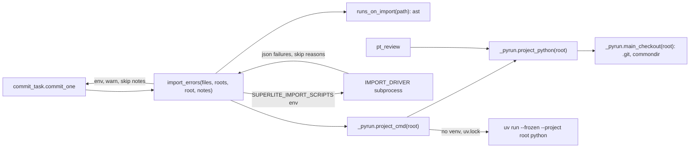

# B305: commit_task's import check runs in the project's environment (#1068)

**Goal:** `commit_task`'s import check (`import_errors`) runs under the project's own environment in a lead worktree or a task tree too: the main checkout's `.venv` found through the git common dir, else `uv run --frozen` for a uv project; a missing declared main dependency is a non-blocking environment gap, never a code exception or an incident; a standalone script's top-level code is never run by the check (#1068).
**Architecture:** `_pyrun.project_python(root)` gains a second lookup, the main checkout's `.venv` (`_pyrun.main_checkout(root)` reads `.git` files, never runs git), between `root/.venv` and `VIRTUAL_ENV`; new `_pyrun.project_cmd(root)` returns the argv prefix: the found interpreter, else `uv run --frozen --project <root> python` when root holds `uv.lock` and `pyproject.toml` and uv is on PATH, else superlite's interpreter. `commit_task.import_errors` runs `project_cmd`, turns a missing declared main dependency and a uv environment that never starts the check into `("env", ...)` notes, and passes the files whose module-level code runs the program (`commit_task.runs_on_import`) to the import driver, which skips them after the module-name check. pt_review keeps calling `project_python` and gets the main-checkout lookup for free.
**Tech stack:** Python 3 stdlib (ast, tomllib), pytest via `sl run_tests`.
**Spec:** issue #1068.
**Detail:** tests
**Wave0:** none
**Coverage:** off

## Global constraints

- Root cause (lead, read on 0daf27a1): `_pyrun.project_python(root)` looks only at `root/.venv`, then `VIRTUAL_ENV`, then `sys.executable`; a lead worktree (`.claude/worktrees/<b>`) and a task tree (`.superlite/trees/Tn`, a detached git worktree) have no `.venv`, so the check runs under superlite's interpreter without the project's packages. The import driver imports every named file, so a script's unguarded top-level code runs.
- `project_python` and `project_cmd` only look files up (stat and small reads of `.git` and `commondir`); they never run git, uv or the interpreter. The main-checkout `.venv` interpreter path is returned unresolved (no symlink resolution of the python file), like the other two lookups.
- Every code line in `_pyrun.py` and `commit_task.py` ends with its `# O(...)` complexity comment like its neighbours (docstrings and comments excepted); each module docstring names the new behaviour in one or two sentences with `#1068`.
- Existing tests stay green, except the one T2 rewrites (`test_commit_import_gate_471.py::test_main_dependency_still_blocks`, whose expectation #1068 reverses). Another existing test that breaks: name it in the report, do not edit it without the lead's word.
- Files this batch may touch: skills/subagent-driven-development/scripts/_pyrun.py, skills/subagent-driven-development/scripts/commit_task.py, the test files the tasks own, and this plan. docs/tools.md belongs to another batch: never edit it.
- Builds: the verdict is `sl run_tests` (the project's test command; a project with `.maxapp` runs `maxapp test`, which a build pool may place on another Mac, and a full run whose tree a green maxapp test stamp covers returns that result without a run); task trees build in <tree>/.build/DerivedData and any build of your own goes under .build/ of the worktree, never -derivedDataPath outside the worktree (your session scratchpad included; backlog cleanup removes scratchpad build folders when the worktree goes); a product, simulator or device build stays on this machine and runs only when an issue's acceptance asks for a running-app check; copy this sentence into every worker brief.
- Simulators: append the UDID of each simulator you or a worker creates (`xcrun simctl create` or `clone`; a checker's `Simulators:` line marks its created ones) as one line to /Users/max/github/superlite/.claude/worktrees/superlite-b305-commit-task-import-env/.superlite/simulators.txt; never list one you did not create; ship cleanup shuts down and deletes each listed one; copy this sentence into every worker brief.

Ruling: lookup order root/.venv, main checkout's .venv, VIRTUAL_ENV, uv run, superlite's interpreter: the main checkout's venv is the same project's environment, while VIRTUAL_ENV is whatever the session inherited (lead's ruling).
Ruling: the main checkout is found by walking up from root to the first `.git`: a folder is that checkout itself; a file's `gitdir:` (relative to the folder holding it) with a `commondir` file whose target is named `.git` gives its parent; anything else (a submodule, a bare repo, an unreadable link) gives none (lead's ruling).
Ruling: `uv run --frozen --project <root> python` is the fallback only when no interpreter was found and root holds both `uv.lock` and `pyproject.toml`; uv then creates `root/.venv` once (git-ignored by uv's own `.venv/.gitignore`) and later lookups find it; the main checkout's venv is never synced from a branch (lead's ruling).
Ruling: a ModuleNotFoundError whose missing name is exactly a top-level name (`No module named 'x'`, no dot) that is a main dependency of root/pyproject.toml (`project.dependencies` or poetry dependencies, names normalised as today) is an environment gap: stderr `import warning F:LINE <error> (declared dependency not installed under <cmd>; environment gap, not blocking)`, no block, no incident; `No module named 'pkg.sub'` still blocks (lead's ruling).
Ruling: under the uv command, a check that never printed its first `@import-check` mark (timeout or crash while uv builds the environment) is an environment gap per file, `import check not run under <cmd>: <why> (environment gap, not blocking)`; once a mark is printed, the timeout and crash blocks stay as they are (lead's ruling).
Ruling: a standalone script is a file whose module-level code (outside def, async def and lambda bodies and outside the body of `if __name__ == "__main__":`, class bodies included) reads `sys.argv` (or `argv` imported from sys), calls `.parse_args(` or `.parse_known_args(`, calls `sys.exit`, `os._exit`, `exit` or `quit`, or raises `SystemExit`; it is never imported (`import check skipped (script: top-level code runs the program): F`) and py_compile still checks it; a file with no module name keeps the `no module name` note (lead's ruling).

## Main diagram



## File structure

- skills/subagent-driven-development/scripts/_pyrun.py: `main_checkout`, the new `project_python` order, `project_cmd`; docstring.
- skills/subagent-driven-development/scripts/commit_task.py: `runs_on_import`, `import_errors` under `project_cmd` with env-gap notes and script skips, the driver's script skip, the `env` note print in `commit_one`; docstring.
- tests/scripts/test_project_python_1068.py: T1's tests.
- tests/scripts/test_commit_task_import_env_1068.py: T2's tests; tests/scripts/test_commit_import_gate_471.py: one test rewritten.

## Task graph


critical path: T1 → T2 (19.3 min) · peak width 1 · predicted build 19.3 min · predicted total ≈ 35.8 min

## Project environment

**Probe entry:** none (internal helpers; the named tests drive `_pyrun` and `commit_task.import_errors` with fake checkouts)

### T1 main checkout venv and uv command · Complexity 3 (O-1) · Est. context 40k
**Owns:** skills/subagent-driven-development/scripts/_pyrun.py, tests/scripts/test_project_python_1068.py
**Components:** 1
**LOC owned:** 150
**Tests:** fast
**Model:** sonnet
**Produces:** _pyrun.main_checkout(root) -> Path | None · _pyrun.project_cmd(root) -> list[str]
e.g. main_checkout("/w/main/.claude/worktrees/b1") -> Path("/w/main") when b1/.git reads `gitdir: /w/main/.git/worktrees/b1` and that folder's commondir reads `../..`
e.g. project_cmd("/w/t") -> ["/w/main/.venv/bin/python"] when /w/t is a linked worktree of /w/main, /w/t has no .venv and /w/main/.venv/bin/python exists
e.g. project_cmd("/w/t") -> ["/opt/bin/uv", "run", "--frozen", "--project", "/w/t", "python"] when no interpreter is found, /w/t holds uv.lock and pyproject.toml and shutil.which("uv") is "/opt/bin/uv"; otherwise [sys.executable]
**Review Focus:** file: `test_lead_worktree_uses_main_checkout_venv`, `test_task_tree_inside_a_lead_worktree_uses_main_checkout_venv`, `test_relative_gitdir_is_read_from_the_folder_holding_dot_git`, `test_unreadable_worktree_link_gives_no_main_checkout` (missing gitdir, no gitdir line, submodule gitdir without commondir), `test_bare_common_dir_gives_no_main_checkout`, `test_real_git_worktree`; state: `test_own_venv_wins_over_main_checkout_venv`, `test_main_checkout_venv_wins_over_virtual_env`, `test_project_cmd_reads_project_python_through_the_module`; test_project_python.py and test_project_python_callers.py stay green.
**Test code (verbatim):**
```python
"""#1068: project_python finds the main checkout's .venv from a linked worktree or task tree; project_cmd falls back to uv run."""
import os
import shutil
import subprocess
import sys
from pathlib import Path

import pytest

sys.path.insert(0, str(Path(__file__).resolve().parents[2] / "skills" / "subagent-driven-development" / "scripts"))
import _pyrun  # noqa: E402


@pytest.fixture(autouse=True)
def _no_virtual_env(monkeypatch):
    monkeypatch.delenv("VIRTUAL_ENV", raising=False)


def touch(base, rel):
    p = base / rel
    p.parent.mkdir(parents=True, exist_ok=True)
    p.write_text("")
    return p


def linked(main, wt, name, gitdir_text=None):
    """wt laid out as git writes a linked worktree of main (no git run): wt/.git names main/.git/worktrees/<name>."""
    gitdir = main / ".git" / "worktrees" / name
    gitdir.mkdir(parents=True, exist_ok=True)
    (gitdir / "commondir").write_text("../..\n")
    wt.mkdir(parents=True, exist_ok=True)
    (wt / ".git").write_text(f"gitdir: {gitdir_text or gitdir}\n")
    return wt


def same(a, b):
    return Path(a).resolve() == Path(b).resolve()


def test_lead_worktree_uses_main_checkout_venv(tmp_path):
    main = tmp_path / "main"
    py = touch(main, ".venv/bin/python")
    wt = linked(main, main / ".claude" / "worktrees" / "b1", "b1")
    assert same(_pyrun.main_checkout(wt), main)
    assert same(_pyrun.project_python(wt), py)


def test_task_tree_inside_a_lead_worktree_uses_main_checkout_venv(tmp_path):
    main = tmp_path / "main"
    py = touch(main, ".venv/bin/python")
    wt = linked(main, tmp_path / "wt", "wt")
    tree = linked(main, wt / ".superlite" / "trees" / "T1", "T1")
    assert same(_pyrun.project_python(tree), py)


def test_relative_gitdir_is_read_from_the_folder_holding_dot_git(tmp_path):
    main = tmp_path / "main"
    py = touch(main, ".venv/bin/python")
    wt = linked(main, tmp_path / "wt", "wt", gitdir_text="../main/.git/worktrees/wt")
    assert same(_pyrun.project_python(wt), py)


def test_own_venv_wins_over_main_checkout_venv(tmp_path):
    main = tmp_path / "main"
    touch(main, ".venv/bin/python")
    wt = linked(main, tmp_path / "wt", "wt")
    own = touch(wt, ".venv/bin/python")
    assert _pyrun.project_python(wt) == str(own)


def test_main_checkout_venv_wins_over_virtual_env(tmp_path, monkeypatch):
    main = tmp_path / "main"
    py = touch(main, ".venv/bin/python")
    other = tmp_path / "other"
    touch(other, "bin/python")
    monkeypatch.setenv("VIRTUAL_ENV", str(other))
    wt = linked(main, tmp_path / "wt", "wt")
    assert same(_pyrun.project_python(wt), py)


def test_main_checkout_without_venv_falls_through_to_virtual_env(tmp_path, monkeypatch):
    main = tmp_path / "main"
    (main / ".git").mkdir(parents=True)
    venv = tmp_path / "venv"
    vpy = touch(venv, "bin/python")
    monkeypatch.setenv("VIRTUAL_ENV", str(venv))
    wt = linked(main, tmp_path / "wt", "wt")
    assert _pyrun.project_python(wt) == str(vpy)


def test_main_checkout_itself_and_a_subfolder(tmp_path):
    main = tmp_path / "main"
    (main / ".git").mkdir(parents=True)
    sub = main / "pkg"
    sub.mkdir()
    assert same(_pyrun.main_checkout(main), main)
    assert same(_pyrun.main_checkout(sub), main)
    assert _pyrun.project_python(main) == sys.executable
    py = touch(main, ".venv/bin/python")
    assert same(_pyrun.project_python(sub), py)


@pytest.mark.parametrize("dot_git", ["gitdir: {missing}\n", "not a gitdir line\n", "gitdir: {nocommon}\n"])
def test_unreadable_worktree_link_gives_no_main_checkout(tmp_path, dot_git):
    nocommon = tmp_path / "modules" / "sub"  # a submodule's gitdir: no commondir file
    nocommon.mkdir(parents=True)
    wt = tmp_path / "wt"
    wt.mkdir()
    (wt / ".git").write_text(dot_git.format(missing=tmp_path / "gone", nocommon=nocommon))
    assert _pyrun.main_checkout(wt) is None
    assert _pyrun.project_python(wt) == sys.executable


def test_bare_common_dir_gives_no_main_checkout(tmp_path):
    bare = tmp_path / "repo.git"
    gitdir = bare / "worktrees" / "wt"
    gitdir.mkdir(parents=True)
    (gitdir / "commondir").write_text("../..\n")
    touch(tmp_path, ".venv/bin/python")  # beside the bare repo: never used
    wt = tmp_path / "wt"
    wt.mkdir()
    (wt / ".git").write_text(f"gitdir: {gitdir}\n")
    assert _pyrun.main_checkout(wt) is None
    assert _pyrun.project_python(wt) == sys.executable


@pytest.mark.skipif(shutil.which("git") is None, reason="needs git")
def test_real_git_worktree(tmp_path):
    main = tmp_path / "main"
    main.mkdir()
    env = {**os.environ, "GIT_CONFIG_GLOBAL": os.devnull, "GIT_CONFIG_NOSYSTEM": "1"}

    def git(*args):
        subprocess.run(["git", *args], cwd=main, check=True, capture_output=True, env=env)
    git("init", "-q")
    git("-c", "user.email=t@example.com", "-c", "user.name=t", "commit", "-q", "--allow-empty", "-m", "base")
    git("worktree", "add", "-q", "--detach", str(tmp_path / "wt"))
    py = touch(main, ".venv/bin/python")
    assert same(_pyrun.main_checkout(tmp_path / "wt"), main)
    assert same(_pyrun.project_python(tmp_path / "wt"), py)


def test_project_cmd_is_the_found_interpreter(tmp_path, monkeypatch):
    py = touch(tmp_path, ".venv/bin/python")
    touch(tmp_path, "uv.lock")
    touch(tmp_path, "pyproject.toml")
    monkeypatch.setattr(_pyrun.shutil, "which", lambda name: "/opt/bin/uv")
    assert _pyrun.project_cmd(tmp_path) == [str(py)]


def test_project_cmd_uv_run_for_a_uv_project_without_venv(tmp_path, monkeypatch):
    touch(tmp_path, "uv.lock")
    touch(tmp_path, "pyproject.toml")
    monkeypatch.setattr(_pyrun.shutil, "which", lambda name: "/opt/bin/uv" if name == "uv" else None)
    assert _pyrun.project_cmd(tmp_path) == ["/opt/bin/uv", "run", "--frozen", "--project", str(tmp_path), "python"]


@pytest.mark.parametrize("files,uv", [(["uv.lock", "pyproject.toml"], None),
                                      (["pyproject.toml"], "/opt/bin/uv"),
                                      (["uv.lock"], "/opt/bin/uv")])
def test_project_cmd_without_uv_or_lock_is_our_interpreter(tmp_path, monkeypatch, files, uv):
    for f in files:
        touch(tmp_path, f)
    monkeypatch.setattr(_pyrun.shutil, "which", lambda name: uv)
    assert _pyrun.project_cmd(tmp_path) == [sys.executable]


def test_project_cmd_reads_project_python_through_the_module(tmp_path, monkeypatch):
    """The seam test_project_python_callers.py patches: project_cmd calls the module's project_python."""
    monkeypatch.setattr(_pyrun, "project_python", lambda root: "/x/venv/bin/python")
    assert _pyrun.project_cmd(tmp_path) == ["/x/venv/bin/python"]
```
**Steps:** 1 add the test file, 2 run: FAIL (no `main_checkout` or `project_cmd` on 0daf27a1), 3 implement, 4 run: PASS, 5 run tests/scripts/test_project_python.py and tests/scripts/test_project_python_callers.py: PASS
**Notes:** `main_checkout` walks `Path(root).resolve()` and its parents and stops at the first `.git` entry; read the `.git` file and `commondir` with `encoding="utf-8"`, strip them, catch OSError; `commondir` may hold an absolute path. `project_python` checks `<main>/.venv` only when `main_checkout(root)` is not `Path(root).resolve()` (the own `.venv` was checked first) and returns `venv_python(main / ".venv")` as is. `project_cmd` calls `project_python(root)` by its module-global name (a test patches it), and offers uv only when that returned `sys.executable`; call `shutil.which("uv")` at call time; the uv argv holds `str(root)` as given.

### T2 import check env gap and script skip · Complexity 4 (O-1) · Est. context 50k
**Owns:** skills/subagent-driven-development/scripts/commit_task.py, tests/scripts/test_commit_task_import_env_1068.py, tests/scripts/test_commit_import_gate_471.py
**Components:** 2
**LOC owned:** 230
**Tests:** fast
**Model:** sonnet
**Consumes:** _pyrun.project_cmd(root) -> list[str] (T1)
**Produces:** commit_task.runs_on_import(path) -> bool
e.g. runs_on_import(Path("scripts/bump.py")) -> True when the file reads `import sys\nN = int(sys.argv[1])\n`
e.g. runs_on_import(Path("tool.py")) -> False when sys.argv is read only inside a def or under `if __name__ == "__main__":`
**Review Focus:** protocol: `test_missing_declared_dependency_is_an_environment_gap` (project, extras and poetry spellings), `test_undeclared_missing_module_still_blocks`, `test_missing_submodule_of_a_declared_package_still_blocks`; state: `test_uv_environment_that_never_starts_is_a_gap`, `test_uv_environment_that_fails_to_build_is_a_gap`, `test_uv_check_that_started_and_blocked_still_names_the_file`, `test_interpreter_crash_without_uv_still_blocks`; file: `test_script_is_never_imported` (its top-level code writes no file), `test_unnamed_script_keeps_the_no_module_name_note`, `test_script_inside_a_package_is_skipped`; the rewritten `test_main_dependency_is_an_environment_gap`; test_commit_import_gate_471.py, test_commit_task_import_839.py, test_commit_import_packages.py, test_commit_task_pythonpath_712.py, test_commit_task_b94.py and test_project_python_callers.py stay green.
**Test code (verbatim):**
```python
"""#1068: commit_task's import check: a missing declared dependency is an environment gap, a uv environment
that never starts the check is one too, and a standalone script's top-level code never runs."""
import json
import subprocess
import sys
from pathlib import Path

import pytest

HERE = Path(__file__).resolve().parent
sys.path.insert(0, str(HERE))
from test_commit_pix_v2 import commit, repo_with, task  # noqa: E402
from test_run_scripts import SCRIPTS, git, write  # noqa: E402

sys.path.insert(0, str(SCRIPTS))
import _pyrun  # noqa: E402
import commit_task  # noqa: E402

NEW_PY = pytest.mark.skipif(sys.version_info < (3, 11), reason="needs tomllib")
GAP = "; environment gap, not blocking)"
SKIP = "script: top-level code runs the program"


@pytest.fixture(autouse=True)
def _no_virtual_env(monkeypatch):
    monkeypatch.delenv("VIRTUAL_ENV", raising=False)


def uv_cmd(root):
    return ["/opt/bin/uv", "run", "--frozen", "--project", str(root), "python"]


@NEW_PY
@pytest.mark.parametrize("pyproject,module", [
    ('[project]\ndependencies = ["fastapi_absent_xyz>=0.100"]\n', "fastapi_absent_xyz"),
    ('[project]\ndependencies = ["Pydantic-Settings-Absent-Xyz[dotenv]>=2"]\n', "pydantic_settings_absent_xyz"),
    ('[tool.poetry.dependencies]\npython = "^3.11"\ntyper_absent_xyz = "^0.9"\n', "typer_absent_xyz"),
])
def test_missing_declared_dependency_is_an_environment_gap(tmp_path, pyproject, module):
    write(tmp_path, "pyproject.toml", pyproject)
    write(tmp_path, "app/api.py", f"import os\nimport {module}\n")
    notes = []
    assert commit_task.import_errors(["app/api.py"], [], root=tmp_path, notes=notes) == []
    assert len(notes) == 1
    kind, f, line, msg = notes[0]
    assert (kind, f, line) == ("env", "app/api.py", 2)
    assert msg.startswith(f"ModuleNotFoundError: No module named '{module}' (declared dependency not installed under ")
    assert msg.endswith(GAP)


@NEW_PY
def test_undeclared_missing_module_still_blocks(tmp_path):
    write(tmp_path, "pyproject.toml", '[project]\ndependencies = ["fastapi_absent_xyz"]\n')
    write(tmp_path, "app/api.py", "import fastapi_absent_xyz_typo\n")
    notes = []
    errs = commit_task.import_errors(["app/api.py"], [], root=tmp_path, notes=notes)
    assert errs == [("app/api.py", 1, "ModuleNotFoundError: No module named 'fastapi_absent_xyz_typo'")]
    assert notes == []


@NEW_PY
def test_missing_submodule_of_a_declared_package_still_blocks(tmp_path):
    write(tmp_path, "pyproject.toml", '[project]\ndependencies = ["libx"]\n')
    write(tmp_path, "libx/__init__.py", "")
    write(tmp_path, "app/api.py", "import libx.nothere\n")
    notes = []
    errs = commit_task.import_errors(["app/api.py"], [], root=tmp_path, notes=notes)
    assert len(errs) == 1 and errs[0][:2] == ("app/api.py", 1)
    assert errs[0][2].startswith("ModuleNotFoundError: No module named 'libx.nothere'")
    assert notes == []


SCRIPT_SRC = {
    "argv": "import sys\nN = int(sys.argv[1])\n",
    "from_argv": "from sys import argv\nN = argv[1]\n",
    "argparse": "import argparse\nparser = argparse.ArgumentParser()\nargs = parser.parse_args()\n",
    "known_args": "import argparse\nargs, rest = argparse.ArgumentParser().parse_known_args()\n",
    "sys_exit": "import sys\ndef main():\n    return 0\nsys.exit(main())\n",
    "exit_builtin": "print('hi')\nexit(0)\n",
    "raise": "def main():\n    return 0\nraise SystemExit(main())\n",
    "nested": "import sys\ntry:\n    if len(sys.argv) > 1:\n        pass\nexcept Exception:\n    pass\n",
    "class_body": "import sys\nclass Cfg:\n    ARGS = sys.argv[1:]\n",
    "else_of_main_guard": "import sys\nif __name__ == '__main__':\n    pass\nelse:\n    sys.exit(2)\n",
}
MODULE_SRC = {
    "guarded": "import sys\ndef main():\n    return sys.argv[1:]\nif __name__ == '__main__':\n    sys.exit(main())\n",
    "reversed_guard": "import sys\nif '__main__' == __name__:\n    N = int(sys.argv[1])\n",
    "function": "import argparse\ndef cli(argv=None):\n    return argparse.ArgumentParser().parse_args(argv)\n",
    "async_function": "import sys\nasync def run():\n    sys.exit(1)\n",
    "method": "import sys\nclass C:\n    def run(self):\n        sys.exit(1)\n",
    "lambda": "import sys\nARGS = lambda: sys.argv\n",
    "other_attr": "import os\nHOME = os.environ.get('HOME')\n",
}


@pytest.mark.parametrize("name", sorted(SCRIPT_SRC))
def test_runs_on_import_finds_script_top_level_code(tmp_path, name):
    write(tmp_path, "scripts/s.py", SCRIPT_SRC[name])
    assert commit_task.runs_on_import(tmp_path / "scripts" / "s.py") is True


@pytest.mark.parametrize("name", sorted(MODULE_SRC))
def test_runs_on_import_leaves_guarded_code_alone(tmp_path, name):
    write(tmp_path, "scripts/m.py", MODULE_SRC[name])
    assert commit_task.runs_on_import(tmp_path / "scripts" / "m.py") is False


def test_runs_on_import_is_false_for_unparsable_or_missing_files(tmp_path):
    write(tmp_path, "bad.py", "def (:\n")
    assert commit_task.runs_on_import(tmp_path / "bad.py") is False
    assert commit_task.runs_on_import(tmp_path / "gone.py") is False


def test_script_is_never_imported(tmp_path):
    write(tmp_path, "scripts/bump.py", 'from pathlib import Path\nPath(__file__).with_name("ran.txt").write_text("x")\n'
          "import sys\nN = int(sys.argv[1])\n")
    write(tmp_path, "scripts/helper.py", "import sys\ndef args():\n    return sys.argv[1:]\n")
    notes = []
    assert commit_task.import_errors(["scripts/bump.py", "scripts/helper.py"], [], root=tmp_path, notes=notes) == []
    assert notes == [("skip", "scripts/bump.py", 0, SKIP)]
    assert not (tmp_path / "scripts" / "ran.txt").exists()


def test_unnamed_script_keeps_the_no_module_name_note(tmp_path):
    write(tmp_path, "tools-x/run.py", "import sys\nsys.exit(int(sys.argv[1]))\n")
    notes = []
    assert commit_task.import_errors(["tools-x/run.py"], [], root=tmp_path, notes=notes) == []
    assert notes == [("skip", "tools-x/run.py", 0, "no module name")]


def test_script_inside_a_package_is_skipped(tmp_path):
    write(tmp_path, "tools-x/pkg/__init__.py", "")
    write(tmp_path, "tools-x/pkg/cli.py", "import sys\nN = int(sys.argv[1])\n")
    notes = []
    assert commit_task.import_errors(["tools-x/pkg/cli.py"], [], root=tmp_path, notes=notes) == []
    assert notes == [("skip", "tools-x/pkg/cli.py", 0, SKIP)]


def test_uv_command_runs_the_check(tmp_path, monkeypatch):
    seen = {}
    monkeypatch.setattr(_pyrun, "project_cmd", uv_cmd)

    def fake_run(cmd, *a, **k):
        seen["cmd"], seen["env"] = cmd, k.get("env") or {}
        return subprocess.CompletedProcess(cmd, 0, "@import-check app/a.py\n[]\n", "")
    monkeypatch.setattr(commit_task.subprocess, "run", fake_run)
    assert commit_task.import_errors(["app/a.py"], ["src"], root=tmp_path) == []
    assert seen["cmd"][:9] == [*uv_cmd(tmp_path), "-I", "-c", commit_task.IMPORT_DRIVER]
    assert seen["cmd"][9:] == [str(tmp_path), json.dumps(["src"]), "app/a.py"]
    assert json.loads(seen["env"]["SUPERLITE_IMPORT_SCRIPTS"]) == []


def test_uv_environment_that_never_starts_is_a_gap(tmp_path, monkeypatch):
    monkeypatch.setattr(_pyrun, "project_cmd", uv_cmd)

    def slow(cmd, *a, **k):
        raise subprocess.TimeoutExpired(cmd, k.get("timeout"), output="", stderr="Resolved 40 packages")
    monkeypatch.setattr(commit_task.subprocess, "run", slow)
    monkeypatch.setenv("SUPERLITE_IMPORT_TIMEOUT", "7")
    notes = []
    assert commit_task.import_errors(["app/a.py", "app/b.py"], [], root=tmp_path, notes=notes) == []
    assert [n[:3] for n in notes] == [("env", "app/a.py", 0), ("env", "app/b.py", 0)]
    assert notes[0][3] == (f"import check not run under {' '.join(uv_cmd(tmp_path))}: "
                           "the environment did not start in 7 s (environment gap, not blocking)")


def test_uv_environment_that_fails_to_build_is_a_gap(tmp_path, monkeypatch):
    monkeypatch.setattr(_pyrun, "project_cmd", uv_cmd)
    monkeypatch.setattr(commit_task.subprocess, "run", lambda cmd, *a, **k: subprocess.CompletedProcess(
        cmd, 2, "", "error: Failed to fetch: `https://pypi.org/simple/fastapi/`\n"))
    notes = []
    assert commit_task.import_errors(["app/a.py"], [], root=tmp_path, notes=notes) == []
    assert notes == [("env", "app/a.py", 0, f"import check not run under {' '.join(uv_cmd(tmp_path))}: "
                      "error: Failed to fetch: `https://pypi.org/simple/fastapi/` (environment gap, not blocking)")]


def test_uv_check_that_started_and_blocked_still_names_the_file(tmp_path, monkeypatch):
    monkeypatch.setattr(_pyrun, "project_cmd", uv_cmd)

    def slow(cmd, *a, **k):
        raise subprocess.TimeoutExpired(cmd, 7, output="@import-check app/a.py\n@import-check app/b.py\n", stderr="")
    monkeypatch.setattr(commit_task.subprocess, "run", slow)
    monkeypatch.setenv("SUPERLITE_IMPORT_TIMEOUT", "7")
    notes = []
    errs = commit_task.import_errors(["app/a.py", "app/b.py"], [], root=tmp_path, notes=notes)
    assert [e[:2] for e in errs] == [("app/b.py", 0)]
    assert errs[0][2].startswith("TimeoutExpired: import did not finish in 7 s")
    assert notes == []


def test_interpreter_crash_without_uv_still_blocks(tmp_path, monkeypatch):
    monkeypatch.setattr(_pyrun, "project_cmd", lambda root: ["/x/venv/bin/python"])
    monkeypatch.setattr(commit_task.subprocess, "run", lambda cmd, *a, **k: subprocess.CompletedProcess(cmd, 1, "", "boom"))
    notes = []
    errs = commit_task.import_errors(["app/a.py"], [], root=tmp_path, notes=notes)
    assert errs == [("app/a.py", 0, "import check crashed under /x/venv/bin/python: boom")]
    assert notes == []


@NEW_PY
def test_commit_goes_through_an_environment_gap_and_skips_a_script(tmp_path):
    repo = repo_with(tmp_path, task(1, ["app/api.py", "scripts/bump.py"]))
    write(repo, "pyproject.toml", '[project]\ndependencies = ["fastapi_absent_xyz"]\n')
    git(repo, "add", "-A")
    git(repo, "commit", "-q", "-m", "pyproject")
    write(repo, "app/api.py", "import fastapi_absent_xyz\n")
    write(repo, "scripts/bump.py", "import sys\nN = int(sys.argv[1])\n")
    r = commit(repo, "T1")
    assert r.returncode == 0, r.stdout + r.stderr
    assert r.stderr.count(f"import check skipped ({SKIP}): scripts/bump.py") == 1
    head = ("import warning app/api.py:1 ModuleNotFoundError: No module named 'fastapi_absent_xyz' "
            "(declared dependency not installed under ")
    warn = [ln for ln in r.stderr.splitlines() if ln.startswith(head)]
    assert len(warn) == 1 and warn[0].endswith(GAP)
    log = repo / ".superlite" / "incidents.jsonl"
    assert "fastapi_absent_xyz" not in (log.read_text(encoding="utf-8") if log.exists() else "")
```
In tests/scripts/test_commit_import_gate_471.py replace `test_main_dependency_still_blocks` (the whole function, its `@NEW_PY` mark kept) with:
```python
@NEW_PY
def test_main_dependency_is_an_environment_gap(tmp_path):
    """#1068 reverses #471's block: a declared main dependency missing from the environment is a gap, not a code error."""
    write(tmp_path, "pyproject.toml", '[project]\ndependencies = ["marimo_absent_xyz"]\n' + OPT)
    write(tmp_path, "notebooks/frame.py", "import marimo_absent_xyz\n")
    notes = []
    assert commit_task.import_errors(["notebooks/frame.py"], [], root=tmp_path, notes=notes) == []
    assert [n[:3] for n in notes] == [("env", "notebooks/frame.py", 1)]
```
**Steps:** 1 add the test file and the rewritten test, 2 run: FAIL (no `runs_on_import`, a declared dependency blocks, scripts run), 3 implement, 4 run: PASS, 5 run the stay-green files named under Review Focus: PASS
**Notes:**
- `import_errors`: `cmd = _pyrun.project_cmd(root)` (module attribute, tests patch it); `shown = os.path.abspath(cmd[0])` for a one-item cmd, else `" ".join(cmd)`; the uv command is any cmd longer than one item. Run `[*cmd, "-I", "-c", IMPORT_DRIVER, str(root), json.dumps(list(roots or [])), *files]` with env `{**os.environ, "PYTHONDONTWRITEBYTECODE": "1", "SUPERLITE_IMPORT_SCRIPTS": json.dumps([f for f in files if runs_on_import(Path(root) / f)])}`. The existing `crashed under` and TimeoutExpired texts keep their wording with `shown` in place of the interpreter path.
- Under the uv command only: a TimeoutExpired whose output holds no `@import-check ` line gives one `("env", f, 0, f"import check not run under {shown}: the environment did not start in {secs:g} s (environment gap, not blocking)")` note per file; a run whose stdout has no JSON last line and no `@import-check ` line gives one `("env", f, 0, f"import check not run under {shown}: {r.stderr.strip()[-150:]} (environment gap, not blocking)")` note per file; both return `[]`. With notes None, still return `[]`.
- Env gap: after the optional-dependency `warn` rule, an error matching `^ModuleNotFoundError: No module named '([^'.]+)'$` whose normalised name is in `main` (from `_pyproject_deps(root)`) appends `("env", file, line, f"{error} (declared dependency not installed under {shown}; environment gap, not blocking)")` and is no error.
- Driver: read `scripts = set(json.loads(os.environ.get("SUPERLITE_IMPORT_SCRIPTS") or "[]"))` once; for a file whose name check passed (either the `parts` or the `dotted` branch), `if rel in scripts:` append `{"file": rel, "skip": "script: top-level code runs the program"}` and continue before importing. The parent maps `skip: True` to `"no module name"` and a string to itself.
- `commit_one`'s gate loop prints `import warning {f}:{line} {msg}` for kind `env`; `skip` and `warn` lines stay as they are. No incident is logged for an `env` note.
- `runs_on_import(path)`: `ast.parse` the file (`read_text(encoding="utf-8", errors="replace")`; OSError, SyntaxError, ValueError give False); walk module-level statements without entering FunctionDef, AsyncFunctionDef or Lambda nodes; an `If` whose test compares `__name__` with `"__main__"` (either side, `==`) has its body skipped and its orelse walked; class bodies are walked. True on: an Attribute `sys.argv`; a Name `argv` when the module has `from sys import argv`; a Call whose func is an Attribute named `parse_args` or `parse_known_args`, the Attribute `sys.exit` or `os._exit`, or the Name `exit` or `quit`; a Raise of `SystemExit` (the Name or a Call of it).
- Docstring: the import-check sentence names the env gap note, the uv `not run` note, the script skip and #1068.
