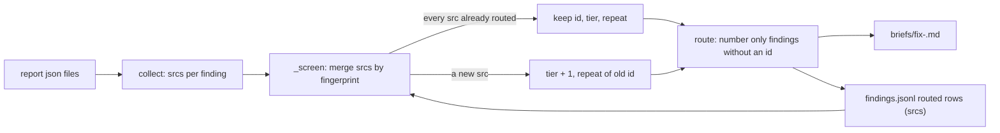

# B339: a re-route of the same report keeps each finding's tier and id (#1155)

**Goal:** a second `findings route` call for a report already routed (for example to add `--also` files) keeps each finding's id and tier; only a new report that finds a routed finding again raises it one tier and names it `repeat of <id>` (#1155).
**Architecture:** findings.py only: `collect` stamps each finding with the report sources it came from, `_screen` keeps a finding's id, tier and repeat marker when every source of it was already routed for its fingerprint, `route` numbers only findings without a kept id, and ledger rows record the sources.
**Tech stack:** Python 3.10+ stdlib; pytest via `sl run_tests`.
**Spec:** issue #1155 (quoted in Global constraints).
**Detail:** contracts
**Wave0:** none
**Coverage:** off

## Global constraints

- #1155 Expected: "a re-route that only adds `--also` files keeps each finding's tier and id; only a real failed fix raises the tier."
- Files this batch may touch: skills/subagent-driven-development/scripts/findings.py, tests/scripts/test_findings_reroute_1155.py, tests/scripts/test_findings_screen.py, docs/tools.md and this plan. Another existing test that breaks: report it, do not edit it.
- Builds: the verdict is `sl run_tests` (the project's test command; a project with `.maxapp` runs `maxapp test`, which a build pool may place on another Mac, and a full run whose tree a green maxapp test stamp covers returns that result without a run); task trees build in <tree>/.build/DerivedData and any build of your own goes under .build/ of the worktree, never -derivedDataPath outside the worktree (your session scratchpad included; backlog cleanup removes scratchpad build folders when the worktree goes); a product, simulator or device build stays on this machine and runs only when an issue's acceptance asks for a running-app check; copy this sentence into every worker brief.
- Simulators: append the UDID of each simulator you or a worker creates (`xcrun simctl create` or `clone`; a checker's `Simulators:` line marks its created ones) as one line to /Users/max/github/superlite/.claude/worktrees/superlite-b339-findings-reroute-keeps-tier-id/.superlite/simulators.txt; never list one you did not create; ship cleanup shuts down and deletes each listed one; copy this sentence into every worker brief.

Ruling: one task, because every change sits in findings.py's collect, _screen and route plus their tests (about 40 lines of code) (lead's ruling).
Ruling: a report source is `<label>@<first 12 hex of sha256 over json.dumps(the report's findings list, sort_keys=True, ensure_ascii=False)>`, not the file bytes, because a re-collect may rewrite the report's metadata while a new review changes its findings (lead's ruling).
Ruling: a finding is a re-route only when every one of its sources (a duplicate dropped by collect or merged by _screen adds its source) is on an earlier `routed` ledger row of its fingerprint; a finding with no source (a library caller of `screen`) or a ledger without sources (rows written before this change) keeps the old one-tier raise (lead's ruling).
Ruling: a re-route keeps the newest routed row's id even when its target task changed, and its tier is the larger of that row's tier and the reported one; it keeps that row's `repeat` marker and adds no stderr line (lead's ruling).
Ruling: every route call stays a new ledger round; a re-routed finding's rows repeat its id (lead's ruling).
Ruling: docs: one clause in docs/tools.md's `findings` row and findings.py's docstring; skills/subagent-driven-development/fleet.md and fixing.md stay untouched (their "repeat ... one tier up" sentences stay true and editing them adds the headless layer for no behaviour change) (lead's ruling).

## Main diagram

## File structure

- skills/subagent-driven-development/scripts/findings.py: `report_src`, `collect` srcs, `_screen` re-route branch, `route` id numbering, `_row` srcs field, docstring.
- tests/scripts/test_findings_reroute_1155.py: the named tests below (reuse `run`, `f`, `put` from test_findings_route and `QUOTE` from test_findings_screen).
- tests/scripts/test_findings_screen.py: `test_repeat_moves_up_one_tier_and_names_the_earlier_id` routes a new report each round.
- docs/tools.md: one clause in the `findings` row.

## Task graph

```mermaid
%% schedule
gantt
  title Predicted schedule (mm:ss)
  dateFormat X
  axisFormat %M:%S
  section lane 1
  T1 re-route keeps tier and id :t1, 0, 378s
```

critical path: T1 (6.3 min) · peak width 1 · predicted build 6.3 min · predicted total ≈ 18.8 min

## Test layers

**Probe entry:** none (library code path covered by the named tests through `findings.route` and `findings.main`)

### T1 re-route keeps tier and id · Complexity 4 (O-1) · Est. context 40k
**Owns:** skills/subagent-driven-development/scripts/findings.py, tests/scripts/test_findings_reroute_1155.py, tests/scripts/test_findings_screen.py, docs/tools.md
**Components:** 1
**LOC owned:** 150
**Tests:** fast
**Model:** sonnet
**Produces:** `report_src(label: str, items) -> str` (e.g. `report_src("FR1", [])` is `"FR1@" + sha256(b"[]").hexdigest()[:12]`, so `"FR1@4f53cda18c2b"`; a non-list `items` hashes as `[]`) · each `collect` finding gains `srcs: list[str]` · each ledger row gains `srcs: list[str]`
**Review Focus:** state: a re-route never raises a tier and never renames an id; a new report repeating a routed fingerprint still raises; boundary: one report re-routed together with a new report holding the same finding raises; compatibility: ledger rows without `srcs` and `screen` callers without `srcs` keep the old raise.
**Test code:** named tests in tests/scripts/test_findings_reroute_1155.py, each through `findings.route(sd, plan, [...], "/sl/sl", ...)` unless marked; `r1 = report("FR1", [f("src/a.py", 12, 1, "off by one", quote=QUOTE)])`; `brief(sd, name)` reads `sd / "briefs" / name`.
- `test_report_src_1155` (unit): the Produces example; the same items in another key order give the same source; another label or another problem gives another source.
- `test_reroute_with_also_keeps_tier_and_id_1155`: route [r1]; route [r1] with `also=["src/c.py"]`: both lines start `fixer tier=sonnet brief=<sd>/briefs/fix-F-T1-1.md`; the second line's files are `src/a.py,src/c.py`; `fix-F-T1-1.md` lists `src/c.py` and holds `(tier 1, from FR1)` without `repeat of`; `fix-F-T1-2.md` does not exist; the ledger ids are `["F-T1-1", "F-T1-1"]`, tiers `[1, 1]`, rounds `[1, 2]`, each row's `srcs` is `[findings.report_src("FR1", <r1's findings list>)]`.
- `test_reroute_through_cli_keeps_tier_and_id_1155` (`findings.main(["route", "--plan", plan, r1])` twice, the second with `--also src/c.py`): both exit 0; the second stdout line starts `fixer tier=sonnet ` and names `fix-F-T1-1.md`.
- `test_new_report_still_raises_a_repeat_1155`: route [r1]; then `r2 = report("FR2", [f("src/a.py", 12, 1, "off by one", quote=QUOTE)])` routed alone: the line starts `fixer tier=sonnet-high `; `fix-F-T1-2.md` holds `repeat of F-T1-1` and `(tier 2,`; a re-route of [r2] then stays `sonnet-high` and names `fix-F-T1-2.md` with `repeat of F-T1-1` kept.
- `test_rewritten_report_same_label_raises_1155`: route [r1]; rewrite FR1 with the same finding but problem text `off by one again`: the line starts `fixer tier=sonnet-high ` and the id is `F-T1-2`.
- `test_old_and_new_report_together_raise_1155`: route [r1]; then route [r1, r2] (r2 as above): one line, `sonnet-high`, id `F-T1-2`, `repeat of F-T1-1`.
- `test_reroute_mixed_with_a_new_finding_1155`: route [r1]; then rewrite nothing, add `r3 = report("FR3", [f("src/a.py", 30, 1, "leak", quote="x = open(p)")])` and route [r1, r3]: one T1 line at `sonnet`; its brief is `fix-F-T1-1.md` and lists `F-T1-1` (src/a.py:12) and `F-T1-2` (src/a.py:30).
- `test_legacy_rows_without_srcs_still_raise_1155`: route [r1]; drop `srcs` from every row of `<sd>/findings.jsonl`; route [r1]: `sonnet-high`, id `F-T1-2`.
- `test_screen_without_srcs_still_raises_1155` (unit, `findings.screen`): after route [r1], `findings.screen([{**f("src/a.py", 12, 1, "off by one", quote=QUOTE), "label": "FR1"}], root, sd)` returns one finding with tier 2 and `repeat` `F-T1-1`.
- test_findings_screen.py `test_repeat_moves_up_one_tier_and_names_the_earlier_id`: each round routes a new report (labels `T1`, `T1b`, `T1c`, `T1d`, the same finding): tiers sonnet, sonnet-high, opus, opus as now; `fix-F-T1-2.md` holds `repeat of F-T1-1` and `(tier 2,`; rounds `[1, 2, 3, 4]`.
**Steps:** 1 write the tests, 2 run: FAIL (keep the `Red run:` line), 3 implement, 4 run: PASS, 5 run every tests/scripts/test_findings*.py and tests/scripts/test_finding_check.py file with `run_tests --fast PATHS --task T1`.
**Notes:**
- `collect`: compute `src = report_src(label, items)` once per report; a new finding gets `srcs = [src]`; a duplicate key appends `src` to the kept finding's `srcs` when absent.
- `_screen`: on a fingerprint merge, append the merged finding's sources missing from the kept one's `srcs`. After the dismissed check, with `old` the newest routed row: `seen` = the union of `srcs` of every `routed` row with this fingerprint; when `f.get("srcs")` is non-empty, every source is in `seen` and `old.get("id")` is non-empty, set `f["id"] = old["id"]`, `f["tier"] = max(f["tier"], int(old tier or 1))` (a bad tier keeps `f["tier"]`), `f["repeat"] = old.get("repeat") or ""`; otherwise the existing raise.
- `route`: per group, `n = last_n(sd, tid)` and number only the items without an `id` (`n + 1`, `n + 2`, ... in the sorted order); the brief stays `fix-<items[0]['id']>.md`.
- `_row` writes `"srcs": list(f.get("srcs") or [])`.
- Docstring: replace "raises a repeat of an earlier routed finding by one tier" with "raises a finding a new report repeats by one tier (`repeat of <id>`), while a re-route of a report already routed for it (to add `--also` files) keeps its id and tier".
- docs/tools.md `findings` row: append before the closing `|`: `; routing a report again (to add --also files) keeps each finding's id and tier, and only a new report that repeats a routed finding raises it one tier (#1155)`.
