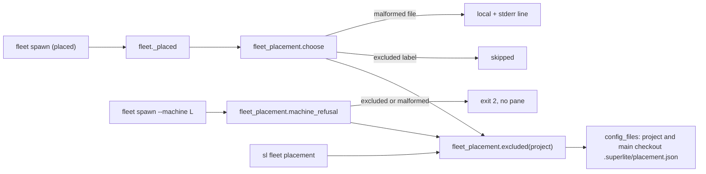
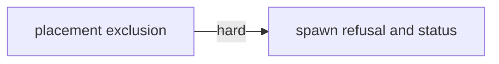

# B316: a project config entry keeps machines out of its fleet (#1096)

**Goal:** A project names machines its fleet must never use in `.superlite/placement.json` (`{"exclude": ["<label>", ...]}`). Placement (`fleet_placement.choose`) never picks one; `fleet spawn --machine <label>` naming one exits 2 before any pane; a lead's worktree also reads the main checkout's file, so every spawn of the project's leads and workers sees it (#1096).
**Architecture:** new `fleet_placement.config_files`, `excluded`, `is_excluded`, `machine_refusal`; `choose` skips excluded labels and keeps every worker local when the file is malformed. fleet.py's `_spawn_cmd` calls `machine_refusal` for an explicit `--machine`; `fleet placement` prints the exclusions.
**Tech stack:** Python 3 stdlib, pytest via `sl run_tests`.
**Spec:** issue #1096.
**Detail:** tests
**Wave0:** none
**Coverage:** off

## Global constraints

- Config file: `<project>/.superlite/placement.json`. `fleet_placement.config_files(project) -> list[Path]`: `[Path(project) / ".superlite" / "placement.json"]`, then `<main>/.superlite/placement.json` when `git -C <project> rev-parse --path-format=absolute --git-common-dir` (subprocess, `capture_output=True, text=True, timeout=10`) exits 0 and its output's parent `.resolve()` differs from `Path(project).resolve()`; any git failure (non-zero exit, OSError, SubprocessError) gives the first path alone.
- `fleet_placement.excluded(project) -> tuple[set[str], list[Path], str | None]`: reads each existing file of `config_files(project)` in order; returns (the union of every valid file's `exclude` entries, `.strip().lower()`; the files that exist, in order; the first error or None). Errors, exactly `f"{path}: {why}"` with why: `unreadable` (OSError on read), `not valid JSON` (ValueError), `not a JSON object` (not a dict), `exclude must be a list of machine names` (`exclude` present and not a list, or an item not a str or empty after strip). A dict without `exclude` excludes nothing. A malformed file adds no names.
- `fleet_placement.is_excluded(label, names) -> bool`: `label.strip().lower().split(".")[0]` is in `{n.split(".")[0] for n in names}`.
- `fleet_placement.choose`: after the role, `enabled` and `_swift` checks, `names, files, err = excluded(project)`; with `err` it prints `f"placement: {err}; every worker of this project stays local (#1096)"` to stderr and returns None; in the machine loop a label with `is_excluded(label, names)` is skipped like a skipped machine.
- `fleet_placement.machine_refusal(project, machine) -> str | None`: None for a falsy machine or `"local"`; with an error `f"error: {err}; fix it before a remote spawn (#1096)"`; when `is_excluded(machine, names)` `f"error: machine {machine} is excluded from this project's fleet by {', '.join(str(f) for f in files)}; drop --machine or pass --machine local (#1096)"`; else None. The error check comes first.
- Every code line in fleet_placement.py and fleet.py ends with its `# O(...)` complexity comment like its neighbours.
- Files this batch may touch: skills/subagent-driven-development/scripts/fleet_placement.py, skills/subagent-driven-development/scripts/fleet.py, docs/fleet.md, the test files each task owns and this plan. fleet_io.py, plan_tools.py, findings.py, backlog_brief.py, commit_task.py, docs/tools.md, docs/hooks.md and every other file belong to other batches: never edit them. An existing test that breaks: name it in the report, do not edit it without the lead's word.
- Builds: the verdict is `sl run_tests` (the project's test command; a project with `.maxapp` runs `maxapp test`, which a build pool may place on another Mac, and a full run whose tree a green maxapp test stamp covers returns that result without a run); task trees build in <tree>/.build/DerivedData and any build of your own goes under .build/ of the worktree, never -derivedDataPath outside the worktree (your session scratchpad included; backlog cleanup removes scratchpad build folders when the worktree goes); a product, simulator or device build stays on this machine and runs only when an issue's acceptance asks for a running-app check; copy this sentence into every worker brief.
- Simulators: append the UDID of each simulator you or a worker creates (`xcrun simctl create` or `clone`; a checker's `Simulators:` line marks its created ones) as one line to /Users/max/github/superlite/.claude/worktrees/superlite-b316-fleet-machine-exclusion/.superlite/simulators.txt; never list one you did not create; ship cleanup shuts down and deletes each listed one; copy this sentence into every worker brief.

Ruling: the config is `<project>/.superlite/placement.json` with an `exclude` list, the project folder's file plus the main checkout's, lists added up: `.superlite/` is never committed, only the main checkout's persists across batches (like test-cmd.json), and a worktree may add its own (lead's ruling on main's "Project config entry").
Ruling: a malformed file fails closed: placement keeps every worker local and an explicit remote `--machine` is refused until it is fixed; a missing file or a dict without `exclude` excludes nothing (lead's ruling).
Ruling: a label matches an entry by its part before the first dot, ignoring case (`mxn` excludes `mxn.lan` and `MXN`); over-matching only keeps a worker local (lead's ruling).
Ruling: [scope] an explicit `fleet spawn --machine <label>` (plain, `--for-dispatch`, `--for-review`) naming an excluded machine exits 2 before any pane: the issue asks for an exclusion "read by every spawn", and a machine the project must not run on stays out also when named (lead's ruling).
Ruling: no CLI setter; the file is written by hand and documented in docs/fleet.md; `sl fleet placement` shows what it read (lead's ruling).

## Main diagram



## File structure

- skills/subagent-driven-development/scripts/fleet_placement.py: `config_files`, `excluded`, `is_excluded`, `machine_refusal`; `choose` skips excluded labels; docstring line.
- skills/subagent-driven-development/scripts/fleet.py: `_spawn_cmd` refusal; `fleet placement` output; docstring line.
- docs/fleet.md: one Placement bullet.
- tests/scripts/test_fleet_placement_exclude_1096.py, tests/scripts/test_fleet_spawn_exclude_1096.py: new.

## Task graph

```mermaid
%% schedule
gantt
  title Predicted schedule (mm:ss)
  dateFormat X
  axisFormat %M:%S
  section lane 1
  T1 placement reads the project's exclude :t1, 0, 288s
  T2 spawn refuses an excluded machine pla :t2, 288, 314s
```





critical path: T1 → T2 (10.0 min) · peak width 1 · predicted build 10.0 min · predicted total ≈ 20.5 min

## Placement

### T1 placement reads the project's excluded machines · Complexity 3 (O-1) · Est. context 40k
**Owns:** skills/subagent-driven-development/scripts/fleet_placement.py, tests/scripts/test_fleet_placement_exclude_1096.py
**Components:** 1
**LOC owned:** 140
**Tests:** fast
**Model:** sonnet
**Kind:** design
**Est. time:** 4 min
**Produces:** fleet_placement.config_files(project) -> list[Path] · fleet_placement.excluded(project) -> tuple[set[str], list[Path], str | None] · fleet_placement.is_excluded(label: str, names: set[str]) -> bool · fleet_placement.machine_refusal(project, machine: str | None) -> str | None
e.g. excluded(Path("/p")) with /p/.superlite/placement.json `{"exclude": ["Box"]}` -> ({"box"}, [Path("/p/.superlite/placement.json")], None)
e.g. excluded(Path("/p")) with no file -> (set(), [], None)
e.g. machine_refusal(Path("/p"), "box") with that file -> "error: machine box is excluded from this project's fleet by /p/.superlite/placement.json; drop --machine or pass --machine local (#1096)"
**Review Focus:** `test_excluded_machine_is_never_chosen`; `test_unreadable_config_keeps_every_worker_local`; `test_worktree_reads_the_main_checkout_config`
**Steps:** 1 write the tests below, 2 run: FAIL, 3 implement per Global constraints; add to the module docstring: "A project keeps machines out of its fleet with `.superlite/placement.json` `{\"exclude\": [\"<label>\", ...]}` (the project's and, from a linked worktree, the main checkout's; a malformed file keeps every worker local) (#1096).", 4 run: PASS
**Test code (verbatim):**
```python
"""A project config entry keeps named machines out of fleet placement (#1096)."""
import json, subprocess, sys
import pytest
from test_fleet_placement import env, workers  # noqa: F401 (env is the fixture)
from test_plan_tools import SCRIPTS
sys.path.insert(0, str(SCRIPTS))
import fleet_placement as fp  # noqa: E402

THREE = {"machines": [{"name": "host1", "state": "ready", "room": 12}, {"name": "box", "state": "ready", "room": 12},
                      {"name": "mxn", "state": "ready", "room": 20}]}


def cfg(folder, data):
    p = folder / ".superlite" / "placement.json"; p.parent.mkdir(parents=True, exist_ok=True)
    p.write_text(data if isinstance(data, str) else json.dumps(data))
    return p


def test_no_config_keeps_placement(env):
    assert fp.excluded(env.proj) == (set(), [], None)
    workers(env, None, None, None)
    assert fp.choose(env.sd, "implementer", env.proj, now=1.0) == "box"


def test_excluded_machine_is_never_chosen(env):
    p = cfg(env.proj, {"exclude": [" Box "]})
    assert fp.excluded(env.proj) == ({"box"}, [p], None)
    workers(env, None, None, None)
    assert fp.choose(env.sd, "implementer", env.proj, now=1.0) is None


def test_other_machines_still_placed(env, monkeypatch):
    monkeypatch.setenv("FAKE_ROOM_JSON", json.dumps(THREE))
    monkeypatch.setattr(fp.hc, "machines", lambda: [{"label": "box", "enabled": True}, {"label": "mxn", "enabled": True}])
    workers(env, None, None, None)
    assert fp.choose(env.sd, "implementer", env.proj, now=1.0) == "mxn"
    cfg(env.proj, {"exclude": ["MXN.lan"]})
    assert fp.choose(env.sd, "implementer", env.proj, now=2.0) == "box"


def test_is_excluded_by_short_name():
    assert fp.is_excluded("box.lan", {"box"}) and fp.is_excluded("BOX", {"box"}) and fp.is_excluded("box", {"box.lan"})
    assert not fp.is_excluded("boxer", {"box"}) and not fp.is_excluded("box", set())


@pytest.mark.parametrize("bad,why", [("{", "not valid JSON"), ("[]", "not a JSON object"),
                                     ('{"exclude": "box"}', "exclude must be a list of machine names"),
                                     ('{"exclude": ["box", " "]}', "exclude must be a list of machine names")])
def test_unreadable_config_keeps_every_worker_local(env, capsys, bad, why):
    p = cfg(env.proj, bad)
    assert fp.excluded(env.proj) == (set(), [p], f"{p}: {why}")
    workers(env, None, None, None)
    assert fp.choose(env.sd, "implementer", env.proj, now=1.0) is None
    assert f"placement: {p}: {why}; every worker of this project stays local (#1096)" in capsys.readouterr().err


def test_object_without_exclude_excludes_nothing(env):
    p = cfg(env.proj, {"note": "x"})
    assert fp.excluded(env.proj) == (set(), [p], None)


def git(*a):
    subprocess.run(["git", "-c", "user.email=t@t", "-c", "user.name=t", *a], check=True, capture_output=True)


def test_worktree_reads_the_main_checkout_config(tmp_path):
    main = tmp_path / "main"; main.mkdir()
    git("-C", str(main), "init", "-q"); git("-C", str(main), "commit", "-q", "--allow-empty", "-m", "x")
    wt = tmp_path / "wt"; git("-C", str(main), "worktree", "add", "-q", str(wt))
    pm, pw = cfg(main, {"exclude": ["mxn"]}), cfg(wt, {"exclude": ["box"]})
    names, files, err = fp.excluded(wt)
    assert names == {"mxn", "box"} and err is None
    assert [f.resolve() for f in files] == [pw.resolve(), pm.resolve()]
    assert [f.resolve() for f in fp.config_files(main)] == [pm.resolve()]
    assert [f.resolve() for f in fp.config_files(tmp_path / "nogit")] == [(tmp_path / "nogit" / ".superlite" / "placement.json").resolve()]


def test_machine_refusal(env):
    assert fp.machine_refusal(env.proj, "box") is None
    p = cfg(env.proj, {"exclude": ["box"]})
    assert fp.machine_refusal(env.proj, "Box") == f"error: machine Box is excluded from this project's fleet by {p}; drop --machine or pass --machine local (#1096)"
    assert fp.machine_refusal(env.proj, "mxn") is None and fp.machine_refusal(env.proj, "local") is None and fp.machine_refusal(env.proj, None) is None
    cfg(env.proj, "{")
    assert fp.machine_refusal(env.proj, "mxn") == f"error: {p}: not valid JSON; fix it before a remote spawn (#1096)"


def test_docstring_names_the_config():
    assert ".superlite/placement.json" in fp.__doc__ and "(#1096)" in fp.__doc__
```
**Notes:** `env.proj` is not a git checkout, so `config_files` gives its own file alone there. Keep `choose`'s `except Exception: return None`.

## Spawn and status

### T2 spawn refuses an excluded machine; placement shows the list · Complexity 2 (O-1) · Est. context 40k
**Owns:** skills/subagent-driven-development/scripts/fleet.py, docs/fleet.md, tests/scripts/test_fleet_spawn_exclude_1096.py
**Components:** 2
**LOC owned:** 90
**Tests:** fast
**Model:** sonnet
**Kind:** design
**Est. time:** 3 min
**Consumes:** fleet_placement.excluded(project) -> tuple[set[str], list[Path], str | None] (T1) · fleet_placement.is_excluded(label: str, names: set[str]) -> bool (T1) · fleet_placement.machine_refusal(project, machine: str | None) -> str | None (T1)
**Review Focus:** `test_explicit_excluded_machine_refused`; `test_explicit_excluded_machine_refused_for_dispatch`; `test_placement_command_names_exclusions`
**Steps:** 1 write the tests below, 2 run: FAIL, 3 in `_spawn_cmd`, right after the `error: --machine works with ...` check: when `a.machine` is set, `why = fleet_placement.machine_refusal(state.project(sd), a.machine)` (lazy import like its neighbours); a non-None `why` is printed to stderr and returns 2. In the `placement` command, after the mode line: `names, files, err = fp.excluded(state.project(sd))`; with `err` print `excluded: {err}; every worker of this project stays local`; else with names print `excluded: {', '.join(sorted(names))} ({', '.join(str(f) for f in files)})`; each room row whose label is not `local` and `fp.is_excluded(label, names)` ends ` (excluded)`. Add to fleet.py's module docstring: "A machine the project's `.superlite/placement.json` excludes is never placed, and `fleet spawn --machine` naming it exits 2 (#1096)." In docs/fleet.md add a Placement bullet after the `--machine <label>` bullet: the file and its shape, the main checkout's file read from a worktree (lists add up), the short-name match, the refusal line, the malformed-file rule and the `excluded:` line of `sl fleet placement`, ending `(#1096)`. 4 run: PASS
**Test code (verbatim):**
```python
"""fleet spawn refuses a machine the project excludes; fleet placement names the exclusions (#1096)."""
import json, sys
from test_fleet import world  # noqa: F401 (fixture)
from test_fleet_placement_spawn import pl, disp  # noqa: F401 (fixtures)
from test_plan_tools import SCRIPTS
sys.path.insert(0, str(SCRIPTS))
import fleet  # noqa: E402
import fleet_placement as fp  # noqa: E402


def cfg(proj, data):
    p = proj / ".superlite" / "placement.json"; p.write_text(data if isinstance(data, str) else json.dumps(data))
    return p


def test_explicit_excluded_machine_refused(pl, capsys):
    p = cfg(pl.proj, {"exclude": ["box"]})
    assert fleet.main(["spawn", "--machine", "box", "--role", "research", "--brief", str(pl.brief)]) == 2
    assert f"error: machine box is excluded from this project's fleet by {p}; drop --machine or pass --machine local (#1096)" in capsys.readouterr().err
    assert pl.remote == [] and pl.local == []


def test_explicit_excluded_machine_refused_for_dispatch(disp, capsys):
    cfg(disp.proj, {"exclude": ["BOX"]})
    disp.lines = [("T3", "fresh tier=sonnet agent=superlite:implementer")]
    assert fleet.main(["spawn", "--for-dispatch", "--machine", "box", "--plan", str(disp.plan2)]) == 2
    assert disp.remote == [] and disp.local == [] and disp.fsends == []


def test_explicit_other_machine_still_spawns(pl):
    cfg(pl.proj, {"exclude": ["mxn"]})
    assert fleet.main(["spawn", "--machine", "box", "--role", "research", "--brief", str(pl.brief)]) == 0
    assert [x[2] for x in pl.remote] == ["box"]


def test_machine_local_ignores_a_broken_config(pl):
    cfg(pl.proj, "{")
    assert fleet.main(["spawn", "--machine", "local", "--role", "research", "--brief", str(pl.brief)]) == 0
    assert pl.remote == [] and len(pl.local) == 1


def test_broken_config_refuses_an_explicit_remote(pl, capsys):
    p = cfg(pl.proj, "{")
    assert fleet.main(["spawn", "--machine", "box", "--role", "research", "--brief", str(pl.brief)]) == 2
    assert f"error: {p}: not valid JSON; fix it before a remote spawn (#1096)" in capsys.readouterr().err


def placement_out(world, tmp_path, monkeypatch, capsys, data):
    home = tmp_path / "home"; home.mkdir(); monkeypatch.setenv("SUPERLITE_HOME", str(home))
    (home / "machine.json").write_text(json.dumps({"remote_room": ["x"], "remote_tree": ["y"]}))
    monkeypatch.setattr(fp, "room", lambda sd, **k: {"local": {"state": "ready", "room": 12}, "box": {"state": "ready", "room": 10},
                                                     "far": {"state": "ready", "room": 4}})
    fleet.main(["on"]); capsys.readouterr()
    p = cfg(world.proj, data)
    assert fleet.main(["placement"]) == 0
    return p, capsys.readouterr().out


def test_placement_command_names_exclusions(world, tmp_path, monkeypatch, capsys):
    p, out = placement_out(world, tmp_path, monkeypatch, capsys, {"exclude": ["mxn", "box"]})
    assert f"excluded: box, mxn ({p})" in out.splitlines()
    assert "box: ready room 10 (excluded)" in out and "far: ready room 4\n" in out and "local: ready room 12\n" in out


def test_placement_command_names_a_broken_config(world, tmp_path, monkeypatch, capsys):
    p, out = placement_out(world, tmp_path, monkeypatch, capsys, "[]")
    assert f"excluded: {p}: not a JSON object; every worker of this project stays local" in out.splitlines()


def test_fleet_doc_and_docs_name_the_config():
    assert "(#1096)" in fleet.__doc__
    text = (SCRIPTS.parents[2] / "docs" / "fleet.md").read_text(encoding="utf-8")
    assert ".superlite/placement.json" in text and "(#1096)" in text
```
**Notes:** `state.project(world.sd)` is `world.proj` (no git there). If the `pl` or `disp` fixture needs more setup, fix the test setup, never the asserted values.

## Review Focus

Package placement (T1, T2): app type CLI; categories contract, state, error. Probe entry: `sl fleet placement --plan .superlite` and `sl fleet spawn --machine <label> --role research --brief F --plan .superlite` with `.superlite/placement.json` present, herdr faked. Cases: the tests named in T1 and T2.

## Self-review

#1096 maps to T1 (placement and config) and T2 (explicit spawn, status, docs). No placeholders. T2's tests run T1's code through fleet.main, so the edge is hard. Layers: unit only (scripts, tests, docs).
