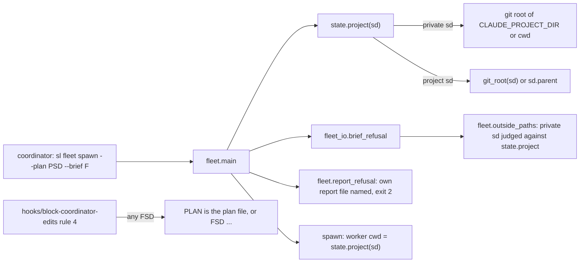
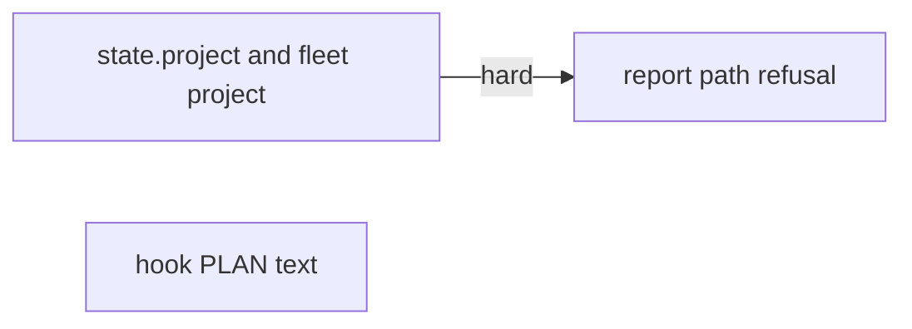

# B315: a private state folder's fleet starts in the launch project; spawn refuses a brief naming its own report file (#1088, #1094)

**Goal:** A fleet spawned from a session's private state folder (`<superlite home>/sessions/<sid>.d/.superlite`) starts its workers in the launch folder's git root and its #1015 brief check passes project paths (#1088); the Agent-block hook names that folder as PLAN again. `sl fleet spawn --brief F` refuses (exit 2, before any pane) a brief that names the worker's own report file `<run>/fleet/reports/<label>.md` or `.json`, which `fleet wait` overwrites with the worker's final reply (#1094).
**Architecture:** new `state.private(sd)` and `state.project(sd)`; fleet.py takes every project from `state.project(sd)`, and `fleet.outside_paths` judges a private folder against `state.project(sd)` whatever project its caller passes (fleet_io.brief_refusal calls it). New `fleet.report_refusal(sd, brief, label, project)` runs in `fleet.main` after the #1015 check. The hook drops its private-folder sentence.
**Tech stack:** Python 3 stdlib, bash builtins (hook), pytest via `sl run_tests`.
**Spec:** issues #1088 and #1094.
**Detail:** tests
**Wave0:** none
**Coverage:** off

## Global constraints

- `state.private(sd) -> bool`: True when sd, as `state._abs` gives it, equals or lies under `_abs(home() / "sessions")`, or its `.resolve()` equals or lies under that folder's `.resolve()`; else False.
- `state.project(sd) -> Path`: for `private(sd)`: `launch = _abs(os.environ.get("CLAUDE_PROJECT_DIR") or ".")`, return `git_root(launch) or launch` (the private check comes first, so a superlite home inside a git checkout still gives the launch project); otherwise return `git_root(sd) or Path(sd).parent`, byte for byte today's value.
- `fleet.outside_paths(text, project, sd, skills=None)`: when `state.private(sd)`, `project = state.project(sd)` before anything else uses it; nothing else changes.
- `fleet.report_refusal(sd, brief, label, project) -> str | None`: rid = `label.split(",")[0]`; rd = `Path(sd).resolve() / "fleet" / "reports"`; reserved = `{(rd / f"{rid}.md"), (rd / f"{rid}.json")}`. Tokens: `re.finditer(r"(?:file://)?([^\s`'\"()\[\]{}<>,;:=]*fleet/reports/" + re.escape(rid) + r"\.(?:md|json))(?![\w-]|\.\w)", text)` over the brief file's text. A token (after `os.path.expanduser`) that is absolute is its own candidate; a relative one has three: `project / tok`, `Path(sd) / tok`, `Path(sd).parent / tok`. The first token with a candidate whose `.resolve()` is in reserved gives exactly: `f"error: brief {Path(brief).resolve()} names {tok}: fleet wait saves the worker's reply as {rd}/{rid}.md and {rd}/{rid}.json and would overwrite a report the worker writes there; name another file, such as {rd}/{rid}-full.md (#1094)"`; no such token gives None.
- Every code line in state.py and fleet.py ends with its `# O(...)` complexity comment like its neighbours. The hook stays bash builtins only.
- Files this batch may touch: skills/subagent-driven-development/scripts/fleet.py, skills/subagent-driven-development/scripts/state.py, hooks/block-coordinator-edits, docs/fleet.md, the test files each task owns and this plan. fleet_io.py, findings.py, fleet_placement.py and every other file belong to other batches: never edit them. An existing test that breaks: name it in the report, do not edit it without the lead's word.
- Builds: the verdict is `sl run_tests` (the project's test command; a project with `.maxapp` runs `maxapp test`, which a build pool may place on another Mac, and a full run whose tree a green maxapp test stamp covers returns that result without a run); task trees build in <tree>/.build/DerivedData and any build of your own goes under .build/ of the worktree, never -derivedDataPath outside the worktree (your session scratchpad included; backlog cleanup removes scratchpad build folders when the worktree goes); a product, simulator or device build stays on this machine and runs only when an issue's acceptance asks for a running-app check; copy this sentence into every worker brief.
- Simulators: append the UDID of each simulator you or a worker creates (`xcrun simctl create` or `clone`; a checker's `Simulators:` line marks its created ones) as one line to /Users/max/github/superlite/.claude/worktrees/superlite-b315-fleet-report-and-private-dir/.superlite/simulators.txt; never list one you did not create; ship cleanup shuts down and deletes each listed one; copy this sentence into every worker brief.

Ruling: the private check runs before `git_root(sd)`, so a superlite home inside a dotfiles checkout still spawns in the launch project (lead's ruling).
Ruling: #1094 is fixed by refusal at `fleet spawn --brief` (fleet.py); keeping the file beside the saved reply would change `fleet_io._finish`, B313's file; `fleet send --brief` (fleet_io) gets the same check as a follow-up (lead's ruling).
Ruling: the refusal matches only this worker's own report names (`<rid>.md`, `<rid>.json`), so a brief may still name other workers' reports and `<rid>-full.md` as inputs or outputs (lead's ruling).
Ruling: sequential [T1->T3] - T1 and T3 both edit fleet.py (lead's ruling).

## Main diagram



## File structure

- skills/subagent-driven-development/scripts/state.py: `private`, `project`.
- skills/subagent-driven-development/scripts/fleet.py: every `state.git_root(sd) or sd.parent` becomes `state.project(sd)`; `outside_paths` private case; `report_refusal` and its call in `main`; module docstring lines for #1088 and #1094.
- hooks/block-coordinator-edits: rule 4 keeps one PLAN sentence for every FSD.
- docs/fleet.md: one line each for #1088 and #1094.
- tests/scripts/test_fleet_private_project_1088.py, tests/scripts/test_fleet_report_path_1094.py: new. tests/scripts/test_guard_fleet_private_plan_1072.py: the private-folder expectation flips.

## Task graph

```mermaid
%% schedule
gantt
  title Predicted schedule (mm:ss)
  dateFormat X
  axisFormat %M:%S
  section lane 1
  T1 state.project and fleet's project :t1, 0, 316s
  T3 spawn refuses a brief naming its own :t3, 316, 315s
  section lane 2
  T2 the Agent-block hook names a private :t2, 0, 279s
```





critical path: T1 → T3 (10.5 min) · peak width 2 · predicted build 10.5 min · predicted total ≈ 21.0 min

## Fleet project

### T1 state.project and fleet's project · Complexity 3 (O-1) · Est. context 40k
**Owns:** skills/subagent-driven-development/scripts/state.py, skills/subagent-driven-development/scripts/fleet.py, tests/scripts/test_fleet_private_project_1088.py
**Components:** 2
**LOC owned:** 110
**Tests:** fast
**Model:** sonnet
**Kind:** design
**Est. time:** 3 min
**Produces:** state.private(sd) -> bool · state.project(sd) -> Path
e.g. state.project(Path("/h/sessions/s1.d/.superlite")) with cwd /p/src and /p/.git -> Path("/p")
e.g. state.project(Path("/a/app/.superlite")) with /a/.git -> Path("/a")
e.g. state.project(Path("/b/.superlite")) outside git -> Path("/b")
**Review Focus:** `test_home_inside_a_git_checkout_still_takes_the_launch_project`; `test_spawn_from_private_folder_starts_in_the_project`: the project passed to `fleet.spawn` is the launch git root
**Steps:** 1 write the tests below, 2 run: FAIL, 3 add `private` and `project` to state.py after `private_dir`, replace all ten `state.git_root(sd) or sd.parent` in fleet.py with `state.project(sd)`, add the private case at the top of `outside_paths`, add one fleet.py docstring line: "A session's private state folder (`<superlite home>/sessions/<sid>.d/.superlite`) spawns its workers in the launch folder's git root (`$CLAUDE_PROJECT_DIR`, else the cwd; `state.project`), and its brief check judges paths against that project (#1088).", 4 run: PASS
**Test code (verbatim):**
```python
"""A fleet spawned from a session's private state folder starts its workers in the launch folder's project (#1088)."""
import types
from pathlib import Path

import pytest
from test_fleet import world, SCRIPTS  # noqa: F401
import fleet  # noqa: E402
import fleet_io  # noqa: E402
import state  # noqa: E402


@pytest.fixture
def priv(tmp_path, monkeypatch):
    home = tmp_path / "home"; psd = home / "sessions" / "s1.d" / ".superlite"; psd.mkdir(parents=True)
    proj = tmp_path / "proj"; (proj / ".git").mkdir(parents=True); (proj / "src").mkdir(); (proj / "src" / "a.py").write_text("x")
    monkeypatch.setenv("SUPERLITE_HOME", str(home))
    for v in ("CLAUDE_PROJECT_DIR", "SUPERLITE_STATE_DIR"):
        monkeypatch.delenv(v, raising=False)
    monkeypatch.chdir(proj / "src")
    return types.SimpleNamespace(home=home, psd=psd, proj=proj, tmp=tmp_path)


def test_private_folder_takes_the_launch_git_root(priv):
    assert state.private(priv.psd) is True
    assert state.project(priv.psd).resolve() == priv.proj.resolve()


def test_claude_project_dir_wins_over_the_cwd(priv, monkeypatch):
    other = priv.tmp / "other"; (other / ".git").mkdir(parents=True); (other / "sub").mkdir()
    monkeypatch.setenv("CLAUDE_PROJECT_DIR", str(other / "sub"))
    assert state.project(priv.psd).resolve() == other.resolve()


def test_launch_folder_outside_git_is_the_project(priv, monkeypatch):
    plain = priv.tmp / "plain"; plain.mkdir(); monkeypatch.chdir(plain)
    assert state.project(priv.psd).resolve() == plain.resolve()


def test_home_inside_a_git_checkout_still_takes_the_launch_project(priv):
    (priv.home / ".git").mkdir()
    assert state.project(priv.psd).resolve() == priv.proj.resolve()


def test_project_folder_keeps_git_root_or_parent(priv):
    a = priv.tmp / "a"; (a / ".git").mkdir(parents=True); (a / "app" / ".superlite").mkdir(parents=True)
    assert state.private(a / "app" / ".superlite") is False
    assert state.project(a / "app" / ".superlite") == a
    b = priv.tmp / "b" / ".superlite"; b.mkdir(parents=True)
    assert state.project(b) == priv.tmp / "b"


def test_outside_paths_judges_a_private_folder_against_its_project(priv):
    assert fleet.outside_paths(f"Read {priv.proj}/src/a.py.\n", priv.psd.parent, priv.psd) == []
    other = priv.tmp / "other"; other.mkdir(); (other / "x.md").write_text("x")
    assert fleet.outside_paths(f"Read {other}/x.md.\n", priv.psd.parent, priv.psd) == [f"{other}/x.md"]


def test_spawn_from_private_folder_starts_in_the_project(world, tmp_path, monkeypatch):
    home = tmp_path / "home"; psd = home / "sessions" / "s1.d" / ".superlite"; psd.mkdir(parents=True)
    monkeypatch.setenv("SUPERLITE_HOME", str(home)); monkeypatch.delenv("CLAUDE_PROJECT_DIR", raising=False)
    (world.proj / ".git").mkdir(); (world.proj / "src").mkdir(); (world.proj / "src" / "a.py").write_text("x")
    assert fleet.main(["on", "--plan", str(psd)]) == 0
    brief = psd / "briefs" / "R1.md"; brief.parent.mkdir(); brief.write_text(f"Read {world.proj}/src/a.py and answer.\n")
    seen = {}

    def fake_spawn(sd, plan, tier, project, **k):
        seen["project"] = Path(project)
        return {"id": "W1"}
    monkeypatch.setattr(fleet, "spawn", fake_spawn)
    monkeypatch.setattr(fleet_io, "send_brief", lambda *a, **k: None)
    assert fleet.main(["spawn", "--role", "research", "--brief", str(brief), "--plan", str(psd)]) == 0
    assert seen["project"].resolve() == world.proj.resolve()


def test_fleet_takes_every_project_from_state_project():
    src = (SCRIPTS / "fleet.py").read_text(encoding="utf-8")
    assert "state.git_root(sd) or sd.parent" not in src
    assert src.count("state.project(sd)") >= 10
    assert "(#1088)" in fleet.__doc__
```
**Notes:** fleet.py's `trees.is_busy(sd.parent, ...)` in `stop` and `_plan_problem`'s `sd.parent` are not projects: leave them. If `fleet.main(["on", "--plan", psd])` needs more setup in the world fixture, fix the test setup, never the asserted values.

## Hook text

### T2 the Agent-block hook names a private folder as PLAN again · Complexity 1 (O-1) · Est. context 30k
**Owns:** hooks/block-coordinator-edits, tests/scripts/test_guard_fleet_private_plan_1072.py
**Components:** 1
**LOC owned:** 40
**Tests:** fast
**Model:** sonnet
**Kind:** design
**Est. time:** 2 min
**Review Focus:** `test_private_folder_named_as_plan_again`: researcher, writer and final-reviewer messages for a private FSD carry today's project text
**Steps:** 1 replace the test file's `test_private_folder_never_named_as_plan` with the test below (keep `_private`, the fixture and `test_project_folder_text_unchanged`; the first line comment becomes `# ...: rule 4 names a session's private state folder as PLAN like any other (#1072, #1088)`), 2 run: FAIL, 3 in rule 4 delete the `norm "$FSD"; pfsd=...; psess=...` line and the `if [[ $pfsd == "$psess"/* ]]; then ... fi` block, and in the header comment replace "a session's private folder (under <superlite home>/sessions/) is never named: a worker spawned with it starts outside the project (#1072)." with "a session's private folder too, since fleet spawn starts its workers in the launch folder's project (#1088).", 4 run: PASS
**Test code (verbatim):**
```python
@pytest.mark.parametrize("agent,tail", [("superlite:researcher", "before a plan exists."),
                                        ("superlite:writer", "for a build without a plan."),
                                        ("superlite:final-reviewer", "for a build without a plan.")])
def test_private_folder_named_as_plan_again(e, agent, tail):
    p = _private(e)
    r = e.call(e.main, agent=agent)
    assert r.returncode == 2
    assert f"PLAN is the plan file, or {p} {tail}" in r.stderr
    assert "never " not in r.stderr and "#1072" not in r.stderr
    rows = (p / "incidents.jsonl").read_text().splitlines()
    assert json.loads(rows[-1])["rule"] == "fleet"
```
**Notes:** `norm` stays used earlier in the hook; only the private-folder lines go.

## Report path

### T3 spawn refuses a brief naming its own report file · Complexity 3 (O-1) · Est. context 40k
**Owns:** skills/subagent-driven-development/scripts/fleet.py, docs/fleet.md, tests/scripts/test_fleet_report_path_1094.py
**Components:** 2
**LOC owned:** 100
**Tests:** fast
**Model:** sonnet
**Kind:** design
**Est. time:** 3 min
**Consumes:** state.project(sd) -> Path (T1)
**Produces:** fleet.report_refusal(sd, brief, label, project) -> str | None
**Review Focus:** `test_relative_and_absolute_forms_are_refused`; `test_other_reports_are_not_refused`; `test_spawn_refuses_before_any_pane`
**Steps:** 1 write the tests below, 2 run: FAIL, 3 add `report_refusal` to fleet.py after `outside_error` (Global constraints give the regex and message); in `main`, inside `if a.brief and not is_lead:`, after the brief_refusal check: `why = report_refusal(sd, a.brief, a.label or Path(a.brief).stem, state.project(sd))`, print it to stderr and return 2 when set; add the fleet.py docstring line "`spawn --brief F` (every role but lead) refuses with exit 2 before any pane when F names the worker's own report file (`<run>/fleet/reports/<label>.md` or `.json`): fleet wait overwrites it with the worker's reply (#1094)."; in docs/fleet.md after the `fleet report Wn` bullet add the bullet "- `fleet spawn --brief F` refuses (exit 2, before any pane) a brief that names the worker's own report file, `<run>/fleet/reports/<label>.md` or `.json`: fleet wait saves the worker's final reply there and would overwrite a report the worker wrote; name another file such as `<label>-full.md` (#1094). A fleet whose state folder is the session's private one starts its workers in the launch folder's git root (#1088)." 4 run: PASS
**Test code (verbatim):**
```python
"""fleet spawn refuses a brief that names the worker's own report file, which fleet wait overwrites with its reply (#1094)."""
import json

import pytest
from test_fleet import world, SCRIPTS  # noqa: F401
import fleet  # noqa: E402
import fleet_io  # noqa: E402


def _brief(world, text, name="R1.md"):
    b = world.sd / "briefs" / name; b.parent.mkdir(exist_ok=True); b.write_text(text)
    return b


@pytest.mark.parametrize("form", ["{sd}/fleet/reports/R1.md", ".superlite/fleet/reports/R1.md", "fleet/reports/R1.json",
                                  "`{sd}/fleet/reports/R1.md`", "file://{sd}/fleet/reports/R1.md"])
def test_relative_and_absolute_forms_are_refused(world, form):
    tok = form.format(sd=world.sd).strip("`").removeprefix("file://")
    b = _brief(world, f"Write your full report to {form.format(sd=world.sd)}.\n")
    rd = world.sd.resolve() / "fleet" / "reports"
    assert fleet.report_refusal(world.sd, b, "R1", world.proj) == (
        f"error: brief {b.resolve()} names {tok}: fleet wait saves the worker's reply as {rd}/R1.md and {rd}/R1.json "
        f"and would overwrite a report the worker writes there; name another file, such as {rd}/R1-full.md (#1094)")


def test_other_reports_are_not_refused(world):
    b = _brief(world, f"Read {world.sd}/fleet/reports/R2.md and fleet/reports/R10.md, write {world.sd}/fleet/reports/R1-full.md "
                      f"and {world.sd}/fleet/reports/R1.md.bak; the folder is {world.sd}/fleet/reports/.\n")
    assert fleet.report_refusal(world.sd, b, "R1", world.proj) is None


def test_batch_label_reserves_its_first_id(world):
    b = _brief(world, "Write fleet/reports/T3.md when done.\n")
    assert fleet.report_refusal(world.sd, b, "T3,T4", world.proj).endswith("(#1094)")
    assert fleet.report_refusal(world.sd, b, "T4,T3", world.proj) is None


def test_spawn_refuses_before_any_pane(world, capsys):
    fleet.main(["on"])
    b = _brief(world, f"Write your full report to {world.sd}/fleet/reports/R1.md.\n")
    n = len(world.fh.calls)
    assert fleet.main(["spawn", "--role", "research", "--brief", str(b), "--plan", str(world.sd)]) == 2
    assert "(#1094)" in capsys.readouterr().err
    assert len(world.fh.calls) == n
    assert json.loads((world.sd / "fleet.json").read_text()).get("workers", {}) == {}


def test_label_flag_moves_the_reserved_name(world, monkeypatch):
    fleet.main(["on"])
    b = _brief(world, f"Write your full report to {world.sd}/fleet/reports/R1.md.\n")
    monkeypatch.setattr(fleet, "spawn", lambda *a, **k: {"id": "W1"})
    monkeypatch.setattr(fleet_io, "send_brief", lambda *a, **k: None)
    assert fleet.main(["spawn", "--role", "research", "--brief", str(b), "--label", "R9", "--plan", str(world.sd)]) == 0


def test_docs_name_both_fixes():
    doc = (SCRIPTS.parents[2] / "docs" / "fleet.md").read_text(encoding="utf-8")
    assert "(#1094)" in doc and "(#1088)" in doc
    assert "(#1094)" in fleet.__doc__
```
**Notes:** the check runs after the #1015 `brief_refusal`, so an outside path is reported first. A lead spawn is never checked (`is_lead` skips the block).

## Review Focus

Package fleet-project (T1, T3): app type CLI; categories state, contract. Probe entry: `sl fleet spawn --role research --brief <psd>/briefs/R1.md --plan <psd>` from a project cwd, with herdr faked. Cases: the tests named in T1 and T3.
Package hook (T2): app type hook; category contract. Probe entry: the rule-4 Agent call with a private FSD (test_guard_fleet_private_plan_1072.py's `Env`). Case: `test_private_folder_named_as_plan_again`.

## Self-review

Both issues map to tasks (#1088: T1, T2; #1094: T3). No placeholders. T3 consumes T1's `state.project`; T1 and T3 both own fleet.py, so the edge is hard. Layers: unit (scripts, tests), headless (hooks/**).
