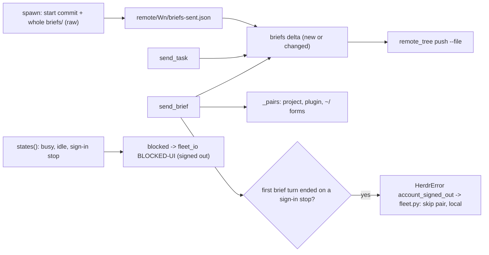

# B314: remote workers get the run's briefs folder and the host's sl path; logged-out accounts are skipped and named (#1090, #1093)

**Goal:** (#1090) a remote fleet worker finds every file of the run's `.superlite/briefs/` folder in its tree, also files written after its spawn, and every brief and prompt it gets names the host's plugin path (so its `sl` path works); (#1093) a remote account whose login expired is skipped by placement after its first brief turn (named once, the brief goes local), and `fleet wait` reports a logged-out remote pane as BLOCKED-UI naming the signed-out account instead of ASKED then UNKNOWN.
**Architecture:** `fleet_remote_worker.spawn` puts the whole briefs folder (raw) into the start commit and records what it shipped in `<sd>/remote/<wid>/briefs-sent.json`; `send_brief` and `send_task` push the briefs files new or changed since then. `send_brief` maps paths with the same pairs as `_mapper` (plugin root included; `~/` forms of the project and the plugin root too). `fleet_remote_account.signed_out_stop(rec)` reads a stop record's `last` line; `send_brief` raises `account_signed_out` when the first brief's turn ended on one (fleet.py's existing fallback then skips the pair and spawns local), and `fleet_remote_worker.states` reports such an ended busy worker as `blocked`, so fleet_io's existing blocked branch prints BLOCKED-UI with the `(signed out: ...)` suffix that `accounts.sign_in_screen` now matches.
**Tech stack:** Python 3 stdlib, pytest via `sl run_tests`.
**Spec:** issues #1090, #1093; feedback f30b3431ad1c cd38d3441cce 86a17c85225f 8014f872a2e9 21f8db917504 a827cb77f0d1 feb4956d9c5f a3bf805e91c5 74402693dadb d8465db6fcbd 48cb73aea430 be922c5fcd6f 7c7e67d1f830.
**Detail:** contracts
**Wave0:** none
**Coverage:** off

## Global constraints

- Evidence (lead, read on f7a89d09): #1067 (1.5.330, after most feedback) already ships the briefs files a brief, prime or plan names at spawn (`named_brief_files`, fleet_remote_worker.py:55, :114-118). Left over: `send_brief` builds its own pairs without `(SUPERLITE_ROOT, plugin)` (fleet_remote_worker.py:367), so a local `sl` path in a sent brief stays local; no `~/` form is mapped anywhere (feedback a3bf805e91c5 names `~/github/superlite/...`); `send_brief` ships only files its own brief names and `send_task` ships none, so files written after the spawn never arrive.
- Evidence (#1093, a real logged-out remote researcher, dashmax W83): its mirrored stop records carry `"last": "Login reached its time limit · Please run /login"` and the transcript's synthetic assistant message has `"error": "authentication_failed"`. The prompt itself succeeded (the turn ran and ended), so `_login_after_prompt` never ran; fleet_io's wait (fleet_io.py:1257-1266, another batch's file) asked once, then wrote UNKNOWN. `fra.LOGIN_MARKS` and `accounts.SIGN_IN_MARKS` match neither `Login reached its time limit` nor `Not logged in`. A remote implementer is already caught at spawn: its prime reply contains `Please run /login` (fleet_remote_worker.py:166-170).
- `remote_tree push --file P` overlays a file only at its own repository-relative path, so a briefs file pushed after the spawn rides raw; only the brief itself and the prompt are mapped (as today).
- Every new or changed code line in `skills/subagent-driven-development/scripts/*.py` ends with its `# O(...)` complexity comment like its neighbours; new functions name the issue in their trailing comment.
- Files this batch may touch: fleet_placement.py, fleet_remote.py, fleet_remote_account.py, fleet_waits.py (the brief's list) and, unlisted by any open batch, fleet_remote_worker.py, accounts.py, docs/fleet.md, the tests named below and this plan. Never edit fleet.py, fleet_io.py, fleet_report.py, state.py, findings.py, plan_tools.py, backlog_brief.py or commit_task.py (other batches own them); a fix needed there goes into the report as a follow-up. fleet_placement.py is also listed by B316: call `fleet_placement.skip`, never edit that file. An existing test that breaks and is not in your Owns: name it in the report, do not edit it.
- Builds: the verdict is `sl run_tests` (the project's test command; a project with `.maxapp` runs `maxapp test`, which a build pool may place on another Mac, and a full run whose tree a green maxapp test stamp covers returns that result without a run); task trees build in <tree>/.build/DerivedData and any build of your own goes under .build/ of the worktree, never -derivedDataPath outside the worktree (your session scratchpad included; backlog cleanup removes scratchpad build folders when the worktree goes); a product, simulator or device build stays on this machine and runs only when an issue's acceptance asks for a running-app check; copy this sentence into every worker brief.
- Simulators: append the UDID of each simulator you or a worker creates (`xcrun simctl create` or `clone`; a checker's `Simulators:` line marks its created ones) as one line to /Users/max/github/superlite/.claude/worktrees/superlite-b314-fleet-remote-briefs-and-login/.superlite/simulators.txt; never list one you did not create; ship cleanup shuts down and deletes each listed one; copy this sentence into every worker brief.

Ruling: a remote worker gets the whole `<sd>/briefs/` folder (every regular file, symlinks and symlinked folders skipped, raw, at `.superlite/briefs/<rel>`) in its start commit; `named_brief_files` and its two unit tests go, since the folder covers every name (issue's first expectation; also files named only indirectly, such as standing.md) (lead's ruling) - cost if wrong: bigger start commits; the store's git push sends only new objects, and ref/ copies are capped at 50 MB / 5000 files when made.
Ruling: after the spawn, `send_brief` and `send_task` push the briefs files whose (size, mtime_ns) differ from `<sd>/remote/<wid>/briefs-sent.json` or that are new, never the sent brief itself, then rewrite that file; an sd outside the project pushes none after the spawn (`--file` needs a project path) (lead's ruling) - cost if wrong: one stat per briefs file per send.
Ruling: send_brief maps with the `_mapper` pairs plus its copies' pairs; `_pairs` adds the `~/` form of the project and of `SUPERLITE_ROOT` when they lie under the home folder (lead's ruling) - cost if wrong: none seen; the mapper still matches whole path heads only.
Ruling: the login check before a brief stays the start-screen read (`fra.login_screen`, now also matching `Not logged in` and `Login reached its time limit`); a one-turn remote worker has no API call before its brief, so its first brief's turn is the probe: an ended turn whose stop record `last` is a sign-in error raises `account_signed_out` and fleet.py's existing send fallback skips the pair and spawns local. No extra probe prompt per spawn (lead's ruling) - cost if wrong: one wasted remote start per expired account per 15 min.
Ruling: `fleet_remote_worker.states` reports a busy remote worker whose herdr state is idle or done and whose latest mirrored stop record since its send is a sign-in error as `blocked`, and records the pair through `fleet_placement.skip` (its named-once stderr line); fleet_io then prints BLOCKED-UI. The same check for local workers' ended branch is fleet_io.py (B313): a follow-up (lead's ruling) - cost if wrong: a local logged-out worker still ends ASKED/UNKNOWN until B313 adds it.
LAYERS: unit

## Main diagram

## File structure

- skills/subagent-driven-development/scripts/fleet_remote_worker.py: whole-folder start commit, briefs delta and manifest, `_pairs` (T1); first-brief sign-in check, `states` override (T2).
- skills/subagent-driven-development/scripts/fleet_remote_account.py: `LOGIN_MARKS`, `signed_out_stop` (T2).
- skills/subagent-driven-development/scripts/accounts.py: `SIGN_IN_MARKS`, `_TUI` gains `⎿` (T2).
- docs/fleet.md: line 34's remote briefs sentence (T1); #1093 sentence in "Remote machines" (T2).
- tests/scripts/test_fleet_remote_briefs_1090.py (T1), tests/scripts/test_fleet_remote_briefs_1067.py (T1 updates), tests/scripts/test_fleet_remote_login_1093.py (T2).

## Task graph

```mermaid
%% schedule
gantt
  title Predicted schedule (mm:ss)
  dateFormat X
  axisFormat %M:%S
  section lane 1
  T1 remote briefs folder and sl path :t1, 0, 499s
  T2 logged-out remote accounts :t2, 499, 497s
```

critical path: T1 → T2 (16.6 min) · peak width 1 · predicted build 16.6 min · predicted total ≈ 31.1 min

## Remote fleet workers

**Probe entry:** none (remote herdr and remote_tree calls; the cases are the named tests below, against the `world` fixture of tests/scripts/test_fleet_remote_worker.py)

### T1 remote briefs folder and sl path · Complexity 4 · Est. context 48k
**Owns:** skills/subagent-driven-development/scripts/fleet_remote_worker.py, docs/fleet.md, tests/scripts/test_fleet_remote_briefs_1090.py, tests/scripts/test_fleet_remote_briefs_1067.py
**Components:** 2
**LOC owned:** 140
**Tests:** fast
**Model:** sonnet
**Kind:** design
**Produces:** fleet_remote_worker._pairs(sd: Path, project: Path, tree: str, plugin: str, plan: str | None) -> list[tuple[str, str]]
e.g. with HOME=/u and SUPERLITE_ROOT=/u/github/superlite: _pairs(Path("/w/p/.superlite"), Path("/w/p"), "/h/t", "/h/plug", None) contains ("/w/p", "/h/t"), ("/u/github/superlite", "/h/plug") and ("~/github/superlite", "/h/plug")
**Produces:** fleet_remote_worker.briefs_listing(sd: Path) -> dict[str, list[int]]
e.g. briefs_listing(sd) -> {"r.md": [8, 1795522091548000000], "ref/x/README.md": [6, 1795522091549000000]} (rel posix path under <sd>/briefs -> [size, mtime_ns]; a symlink is left out)
**Produces:** fleet_remote_worker.briefs_delta(sd: Path, wid: str, skip: frozenset = frozenset()) -> tuple[list[str], dict]
e.g. right after spawn: briefs_delta(sd, "W1") -> ([], {...listing...}); after writing briefs/later.md: -> (["later.md"], {...}); a missing briefs-sent.json counts every file as new
**Review Focus:** file: `test_spawn_ships_the_whole_briefs_folder` (briefs/r.md the brief, briefs/unnamed.md "u", briefs/ref/x/README.md "readme", briefs/link.md a symlink to a file outside: start commit has .superlite/briefs/unnamed.md == "u" and the README, not link.md; briefs-sent.json lists r.md, unnamed.md, ref/x/README.md); `test_send_brief_ships_files_written_after_spawn` (spawn research without brief, write briefs/later.md, send_brief q.md: the tree has .superlite/briefs/later.md, the push's `--file` list holds later.md and the q.md copy and not unnamed.md); `test_send_task_ships_new_briefs_files` (implementer spawn with plan, write briefs/addendum.md, send_task T3: the tree has it); `test_unchanged_briefs_are_not_pushed_twice` (two send_brief calls with nothing new: the second push lists only the brief copy); `test_outside_sd_pushes_no_briefs_files` (sd outside the project: send_brief succeeds, no briefs file in its push); encoding: `test_send_brief_maps_the_plugin_path` (brief text `Run {SUPERLITE_ROOT}/skills/subagent-driven-development/scripts/sl run_tests` arrives as `Run {plugin}/skills/subagent-driven-development/scripts/sl run_tests` in .superlite/remote/W1/briefs/q.md, plugin = the record's remote plugin); `test_tilde_plugin_path_is_mapped` (HOME and SUPERLITE_ROOT monkeypatched so the root is `$HOME/github/superlite`: `~/github/superlite/skills/subagent-driven-development/scripts/sl` maps to the plugin path, in spawn's start-commit brief and in send_brief's copy); `test_pairs_tilde_forms` (the `_pairs` example); `test_docs_name_1090` (docs/fleet.md holds `(#1090)` and `briefs-sent.json`). In test_fleet_remote_briefs_1067.py drop the two `named_brief_files` tests and change the spawn and send tests to the whole-folder rule (unnamed.md now ships); keep `test_docs_name_the_rule` passing.
**Steps:** 1 failing tests, 2 run: FAIL, 3 implement (`_pairs` used by `_mapper` and `send_brief`; spawn walks `briefs_listing`; manifest written after a successful push; `send_brief` and `send_task` push `briefs_delta` paths), 4 run: PASS
**Notes:** docs/fleet.md line 34: replace the last sentence (`A remote worker gets every file under ... (#1067).`) with: "A remote worker gets the run's whole `.superlite/briefs/` folder (each regular file; symlinks skipped) raw at the same path in its tree (#1067, #1090); `fleet send` and a remote task send push the files new or changed since its last push, tracked in `<sd>/remote/<wid>/briefs-sent.json`. Its brief and the send's prompt name the host's paths, the plugin's `sl` included, also written `~/...` (#1090)."

### T2 logged-out remote accounts · Complexity 4 · Est. context 46k
**Owns:** skills/subagent-driven-development/scripts/fleet_remote_account.py, skills/subagent-driven-development/scripts/accounts.py, skills/subagent-driven-development/scripts/fleet_remote_worker.py, docs/fleet.md, tests/scripts/test_fleet_remote_login_1093.py
**Components:** 2
**LOC owned:** 120
**Tests:** fast
**Model:** sonnet
**Kind:** design
**Produces:** fleet_remote_account.signed_out_stop(rec: dict | None) -> bool
e.g. signed_out_stop({"last": "Login reached its time limit · Please run /login"}) -> True
e.g. signed_out_stop({"last": "Not logged in · Please run /login"}) -> True; signed_out_stop({"last": "Invalid API key · Please run /login"}) -> True
e.g. signed_out_stop({"last": "Status: DONE; the pane said Not logged in · run /login"}) -> False; signed_out_stop({"last": "Not logged in\nStatus: DONE /login"}) -> False; signed_out_stop(None) -> False
**Review Focus:** encoding: `test_signed_out_stop_examples` (the e.g. lines); `test_login_screen_new_marks` (fra.login_screen of "Not logged in · run /login" and of "  ⎿  Login reached its time limit · Please run /login" -> True); `test_sign_in_screen_new_marks` (accounts.sign_in_screen of "> Read q.md\n  ⎿  Login reached its time limit · Please run /login\n" and of "Not logged in · Please run /login" -> True; of "The pane said Not logged in · run /login" -> False); state: `test_first_brief_on_logged_out_account_raises` (world fixture, research spawn, a stop record after the send with that `last`: send_brief raises hc.HerdrError code `account_signed_out`, message `account <acct> is not signed in on box; run /login for it there`, acct = the record account before `@`; no resend); `test_first_brief_report_is_not_signed_out` (stop `last` "Status: DONE": send_brief returns its label); `test_states_blocks_logged_out_busy_worker` (busy remote W1, herdr idle, mirrored stop after `sent` with `last` "Not logged in · Please run /login": states(sd) maps its name to "blocked", room-skip.json gains the pair, stderr names it once over two calls); `test_states_leaves_working_and_reported_alone` (herdr working with that stop -> "working"; idle with `last` "Status: DONE" -> "idle"; a stop before `sent` -> "idle"); protocol: `test_wait_reports_blocked_ui_signed_out` (fleet_io.wait over that W1 prints `BLOCKED-UI` and `(signed out: account`, never `ASKED`); `test_placed_spawn_goes_local_on_logged_out_brief` (fleet spawn --brief placed on box, the first brief turn ends on the sign-in stop: output has `placement: account <acct> skipped on box (not signed in there); local` and a local worker gets the brief; reuse the fixtures of tests/scripts/test_fleet_placement_signed_out_932.py). tests/scripts/test_accounts_signed_out_782.py, test_fleet_remote_account.py, test_fleet_remote_brief_taken_971.py and test_fleet_io_signed_out_782.py stay green.
**Steps:** 1 failing tests, 2 run: FAIL, 3 implement, 4 run: PASS
**Notes:** `signed_out_stop`: `last` stripped is one line, starts with one of `AUTH_ERRORS = ("Login reached its time limit", "Not logged in", "Invalid API key")` and contains `/login`. `LOGIN_MARKS` gains `Not logged in` and `Login reached its time limit` (substring, as today). `accounts.SIGN_IN_MARKS` gains the three `AUTH_ERRORS` texts (line start, as today) and `_TUI` gains `⎿` (`⎿`). In `send_brief`, after the first brief's `_took` (and after the resend's), `fio.latest_stop(sd, wid, sent)` that is `signed_out_stop` raises the same `HerdrError(SIGNED_OUT, ...)` text `_login_after_prompt` builds (one shared helper). In `states`, only workers whose fleet state is `busy` and herdr state `idle` or `done` are checked, with `fio.latest_stop(sd, wid, int(w.get("sent") or 0))`; the pair goes to `fleet_placement.skip(sd, label, f"account {acct} is not signed in on {label}")`. docs/fleet.md "Remote machines" paragraph gains: "A remote account whose login expired (`Not logged in`, `Login reached its time limit`, `Invalid API key` on its pane or as its turn's last line) is skipped: a start screen or a first brief turn that shows one makes placement skip that account on that machine for 15 minutes and start the worker here; a busy remote worker whose turn ended on one reports BLOCKED-UI `(signed out: ...)` in `fleet wait`, never ASKED (#1093)."

## Self-review

Coverage: #1090 briefs folder and files written later (T1), sl path and `~/` path (T1); #1093 placement skip (start screen marks and first brief, T2), wait naming the cause (T2). No placeholders; T2 edits T1's file after it (hard edge). Local workers' ended branch: follow-up for fleet_io.py (B313).
