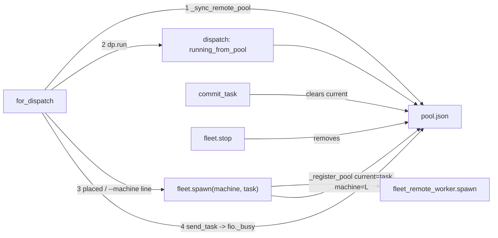

# B301: a remote dispatch worker gets its pool.json entry, its task is never sent twice (#1057)

**Goal:** `sl fleet spawn --for-dispatch` that starts a remote implementer (placement, or `--machine L`) writes that worker's `pool.json` entry, busy on its task, like a local worker's, so the next dispatch round never hands the same task to a second worker (#1057, seen in B296: T2 went to W2 on mxn and to W4 locally).
**Architecture:** `fleet.spawn`'s machine branch registers a dispatch write worker (a `task` was given, role implementer) through `_register_pool`, which now takes `current=` and `machine=`; the entry is busy on the task from the start, so `dispatch.running_from_pool` counts it. `for_dispatch` first runs a new `_sync_remote_pool(sd)`: it re-adds the entry of this run's busy or blocked remote implementer that pool.json lacks (`orchestrator resume`'s `pool.prune` drops remote entries as "gone from Herdr", since their agents live on another machine's Herdr) and drops a remote entry that holds no task (commit_task cleared it), so a remote write worker is never offered for reuse as `agent=Wn`. Only fleet.py changes; dispatch.py and pool.py stay as they are.
**Tech stack:** Python 3 stdlib, pytest via `sl run_tests`.
**Spec:** issue #1057.
**Detail:** tests
**Wave0:** none
**Coverage:** off

## Global constraints

- Root cause (lead, read on 1384af78): `fleet.spawn(machine=...)` returns `fleet_remote_worker.spawn`'s worker without `_register_pool`; `fleet_io._busy` marks the pool only for a worker it lists (KeyError swallowed); `dispatch.fleet_running` skips the remote record because its `state_dir` is `<sd>/remote/<wid>`, not `<sd>`. So neither source of running tasks names the remote worker's task.
- A remote pool entry is `{"id", "tier", "backend": "herdr", "account", "machine": <label>, "current": <task>, "busy": true, ...}` (pool.add's other defaults); it leaves the pool through `fleet.stop` (its remote branch already removes it), commit_task (clears `current`, then `_sync_remote_pool` drops it) or `sl pool remove`.
- `_sync_remote_pool` judges only this run's remote implementers: a fleet.json record with `machine`, role implementer (missing role = implementer) and `state_dir` resolving to `<sd>/remote/<wid>` (missing state_dir counts as ours). It never touches a local worker's entry, never creates pool.json when nothing is to be added, saves only when something changed, prints nothing, and works under `fs.locked(sd)` like `_register_pool`.
- Every code line in fleet.py ends with its `# O(...)` complexity comment like its neighbours; the module docstring gets one line naming #1057.
- Files this batch may touch: skills/subagent-driven-development/scripts/fleet.py, tests/scripts/test_fleet_for_dispatch.py and this plan. An existing test that breaks: name it in the report, do not edit it without the lead's word.
- Builds: the verdict is `sl run_tests` (the project's test command; a project with `.maxapp` runs `maxapp test`, which a build pool may place on another Mac, and a full run whose tree a green maxapp test stamp covers returns that result without a run); task trees build in <tree>/.build/DerivedData and any build of your own goes under .build/ of the worktree, never -derivedDataPath outside the worktree (your session scratchpad included; backlog cleanup removes scratchpad build folders when the worktree goes); a product, simulator or device build stays on this machine and runs only when an issue's acceptance asks for a running-app check; copy this sentence into every worker brief.
- Simulators: append the UDID of each simulator you or a worker creates (`xcrun simctl create` or `clone`; a checker's `Simulators:` line marks its created ones) as one line to /Users/max/github/superlite/.claude/worktrees/superlite-b301-fleet-spawn-remote-pool-entry/.superlite/simulators.txt; never list one you did not create; ship cleanup shuts down and deletes each listed one; copy this sentence into every worker brief.

Ruling: the fix is the pool entry the issue asks for, not a `dispatch.fleet_running` change that counts `<sd>/remote/<wid>` records: the entry keeps the task running until commit_task, as a local worker's does, while a stopped remote record (fleet_io._release stops it right after its snapshot is collected) would free the task before its commit (lead's ruling).
Ruling: `_sync_remote_pool` re-adds a busy remote implementer's missing entry, because `orchestrator resume`'s prune drops it as "gone from Herdr" and the task would then go out twice again; pool.py's prune stays unchanged (lead's ruling).
Ruling: a remote entry whose task commit_task cleared is dropped before dispatch, never reused through `agent=Wn`: a remote write worker takes one task (fleet_io._release stops it once collected) (lead's ruling).

## Main diagram



## File structure

- skills/subagent-driven-development/scripts/fleet.py: `_register_pool(current=, machine=)`, spawn's machine branch registers a dispatch write worker, new `_sync_remote_pool`, called first in `for_dispatch`.
- tests/scripts/test_fleet_for_dispatch.py: an `rw` fixture (fake remote spawn and send) and the #1057 tests.

## Task graph

```mermaid
%% schedule
gantt
  title Predicted schedule (mm:ss)
  dateFormat X
  axisFormat %M:%S
  section lane 1
  T1 remote dispatch worker in pool.json :t1, 0, 199s
```




critical path: T1 (3.3 min) · peak width 1 · predicted build 3.3 min · predicted total ≈ 11.8 min

## Fleet dispatch

**Probe entry:** none (CLI library; the named tests drive `fleet.main(["spawn", "--for-dispatch", ...])` with a fake Herdr and fake remote worker)

### T1 remote dispatch worker in pool.json · Complexity 4 (O-1) · Est. context 45k
**Owns:** skills/subagent-driven-development/scripts/fleet.py, tests/scripts/test_fleet_for_dispatch.py
**Components:** 1
**LOC owned:** 140
**Tests:** fast
**Model:** sonnet
**Produces:** fleet._register_pool(sd, wid, tier, account, current=None, machine=None) -> None · fleet._sync_remote_pool(sd) -> tuple[list[str], list[str]]
e.g. _sync_remote_pool(sd) -> (["W1"], []) when fleet.json W1 is {"machine": "box", "state": "busy", "task": "T1", "state_dir": "<sd>/remote/W1"} and pool.json lacks W1
e.g. _sync_remote_pool(sd) -> ([], ["W1"]) when pool.json W1 has no current and fleet.json W1 has "machine": "box"
e.g. _sync_remote_pool(sd) -> ([], []) for a local worker's idle entry
**Review Focus:** state: `test_remote_dispatch_worker_gets_a_pool_entry_and_its_task_is_not_sent_twice` (red on 1384af78); `test_pruned_remote_entry_comes_back_before_dispatch`; `test_sync_remote_pool_adds_drops_and_skips`; `test_failed_remote_send_leaves_no_pool_entry`; test_fleet_placement_spawn.py, test_fleet.py, test_fleet_remote_worker.py, test_fleet_for_dispatch.py and test_dispatch*.py stay green.
**Test code (verbatim):**
```python
# add to the imports of tests/scripts/test_fleet_for_dispatch.py
import fleet_remote_worker as frw  # noqa: E402


@pytest.fixture
def rw(world, tmp_path, monkeypatch, capsys):
    """#1057: fleet on, placement off; frw.spawn writes a remote record like the real one
    (machine, state_dir <sd>/remote/<wid>, state ready); send_task marks it busy through fleet_io._busy as the real one does."""
    monkeypatch.setenv("SUPERLITE_HOME", str(tmp_path / "home"))
    if not REAL:
        monkeypatch.setattr(fleet_io, "hc", world.fh)
    fleet.main(["on"]); capsys.readouterr()
    r = types.SimpleNamespace(**vars(world), remote=[], stopped=[])

    def rspawn(sd, role, tier, project, label, cfg=None, task=None, plan=None, brief=None):
        wid = fleet.fs.next_id(sd); r.remote.append((role, tier, label, task))
        d = fleet.fs.load(sd)
        d["workers"][wid] = {"name": f"remote-{wid}", "account": "claude1", "tier": tier or "sonnet", "state": "ready", "task": None,
                             "role": role, "machine": label, "state_dir": str(sd / "remote" / wid)}
        fleet.fs.save(sd, d)
        return {"id": wid, "account": "claude1"}

    def rstop(sd, wid):
        r.stopped.append(wid); fleet.fs.set_state(sd, wid, "stopped")
    monkeypatch.setattr(frw, "spawn", rspawn)
    monkeypatch.setattr(frw, "stop", rstop)
    monkeypatch.setattr(frw, "send_task", lambda sd, wid, plan, tasks, sl: fleet_io._busy(sd, wid, ",".join(tasks), fleet_io.now_ms()))
    return r


def _pool(sd):
    p = sd / "pool.json"
    return {a["id"]: a for a in json.loads(p.read_text())["agents"]} if p.exists() else {}


def _workers(sd, **records):
    d = fleet.fs.load(sd); d["workers"].update(records); fleet.fs.save(sd, d)


def test_remote_dispatch_worker_gets_a_pool_entry_and_its_task_is_not_sent_twice(rw, capsys):
    """#1057: W1 on box holds T1; the next round (local, real dispatch.run) must not hand T1 to a second worker."""
    assert fleet.main(["spawn", "--for-dispatch", "--machine", "box", "--plan", str(rw.plan)]) == 0
    assert capsys.readouterr().out.splitlines() == ["W1 T1 sent machine=box"]
    ag = _pool(rw.sd)["W1"]
    assert (ag["backend"], ag["account"], ag["machine"], ag["current"], ag["busy"]) == ("herdr", "claude1", "box", "T1", True)
    assert fleet.main(["spawn", "--for-dispatch", "--plan", str(rw.plan)]) == 0
    assert [x for x in capsys.readouterr().out.splitlines() if " sent" in x] == []
    assert [x[3] for x in rw.remote] == ["T1"] and set(fleet.fs.load(rw.sd)["workers"]) == {"W1"}


def test_pruned_remote_entry_comes_back_before_dispatch(rw, capsys):
    """`orchestrator resume` prunes a remote entry as gone from Herdr: the next round re-adds it and still sends T1 to nobody."""
    assert fleet.main(["spawn", "--for-dispatch", "--machine", "box", "--plan", str(rw.plan)]) == 0
    (rw.sd / "pool.json").write_text(json.dumps({"agents": []}))
    capsys.readouterr()
    assert fleet.main(["spawn", "--for-dispatch", "--plan", str(rw.plan)]) == 0
    assert [x for x in capsys.readouterr().out.splitlines() if " sent" in x] == []
    ag = _pool(rw.sd)["W1"]
    assert (ag["machine"], ag["current"], ag["busy"]) == ("box", "T1", True)


def test_sync_remote_pool_adds_drops_and_skips(rw):
    sd = rw.sd
    _workers(sd,
             W1={"state": "busy", "task": "T1", "role": "implementer", "machine": "box", "tier": "sonnet", "account": "claude1", "state_dir": str(sd / "remote" / "W1")},
             W2={"state": "ready", "task": "T2", "role": "implementer", "machine": "box", "tier": "sonnet", "state_dir": str(sd / "remote" / "W2")},
             W3={"state": "busy", "task": "T3", "role": "implementer", "machine": "box", "tier": "sonnet", "state_dir": str(sd.parent / "other" / "remote" / "W3")},
             W4={"state": "ready", "task": None, "role": "implementer", "tier": "sonnet"},
             W5={"state": "stopped", "task": "T5", "role": "implementer", "machine": "box", "tier": "sonnet", "state_dir": str(sd / "remote" / "W5")},
             W6={"state": "busy", "task": "R1", "role": "research", "machine": "box", "state_dir": str(sd / "remote" / "W6")})
    (sd / "pool.json").write_text(json.dumps({"agents": [
        {"id": "W2", "tier": "sonnet", "tasks": ["T2"], "files": [], "context_k": 20, "idle_min": 0, "busy": False, "backend": "herdr", "machine": "box"},
        {"id": "W4", "tier": "sonnet", "tasks": [], "files": [], "context_k": 20, "idle_min": 0, "busy": False, "backend": "herdr"}]}))
    assert fleet._sync_remote_pool(sd) == (["W1"], ["W2"])
    pool = _pool(sd)
    assert set(pool) == {"W1", "W4"}
    assert (pool["W1"]["current"], pool["W1"]["busy"], pool["W1"]["machine"], pool["W1"]["tier"], pool["W1"]["account"]) == ("T1", True, "box", "sonnet", "claude1")
    assert fleet._sync_remote_pool(sd) == ([], [])


def test_sync_remote_pool_creates_no_pool_without_work(rw):
    assert fleet._sync_remote_pool(rw.sd) == ([], []) and not (rw.sd / "pool.json").exists()


def test_failed_remote_send_leaves_no_pool_entry(rw, capsys, monkeypatch):
    def boom(sd, wid, plan, tasks, sl):
        raise fleet_io.hc.HerdrError("agent_not_found", "gone")
    monkeypatch.setattr(frw, "send_task", boom)
    assert fleet.main(["spawn", "--for-dispatch", "--machine", "box", "--plan", str(rw.plan)]) == 3
    assert "BLOCKED: T1 not sent" in capsys.readouterr().out
    assert rw.stopped == ["W1"] and "W1" not in _pool(rw.sd)
```
**Steps:** 1 add the tests, 2 run: FAIL (the first test fails on 1384af78: no pool entry for W1, T1 sent again), 3 implement, 4 run: PASS
**Notes:** register in `fleet.spawn`'s machine branch right after `frw.spawn` returns, only when `task` is given and role is implementer, with `tier` as passed and `w.get("account")`; `_register_pool` passes `current` to `pool.add` (busy from the start) and adds `machine` only when given. Call `_sync_remote_pool(sd)` in `for_dispatch` right after the orchestrator `shut` check, before the baseline block and before both the `--machine` and the local path. Update the `_dispatch_machine` call comment ("the local pool is left alone" is no longer true). `fleet_io.hc.HerdrError`'s constructor: match the real signature if it differs from `(code, message)`. If the real dispatch line for T1 uses another tier than sonnet, keep the tier assertions to what the line says and say so in the report.

## Review Focus

- state: the pool entry must name the remote task from the spawn on (no window between spawn and send where T1 looks free); a remote entry leaves the pool only through stop, a cleared `current`, or `pool remove`; local entries are never touched by `_sync_remote_pool`.
- Workers moved in from another run (`state_dir` elsewhere) and remote research or reviewer workers get no entry.
