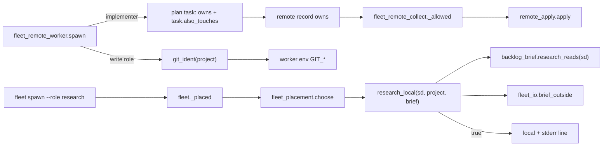
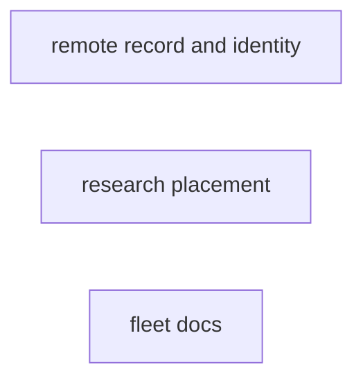

# B325: fleet remote worker fixes (#1109, #1111, #1112)

**Goal:** A remote implementer's edits to its plan task's **Also-touches:** files come home with its snapshot (#1109); a research worker whose brief names a read-only reference path from the lead brief's research line stays on this Mac without `--machine local` (#1111); a remote write worker gets this Mac's git identity, so `commit_task` and `git commit` work on a host without one (#1112).
**Architecture:** `fleet_remote_worker.spawn` records Owns plus Also-touches as the remote record's `owns` (collect's `_allowed` reads it unchanged) and adds the four `GIT_*` identity variables from the new `git_ident(project)` to a write worker's env. `fleet_placement.choose` gains `brief=None` and the new `research_local(sd, project, brief)` rule that keeps such a research worker local with one stderr line.
**Tech stack:** Python 3 stdlib, pytest via `sl run_tests`.
**Spec:** issues #1109, #1111, #1112.
**Detail:** contracts
**Wave0:** none
**Coverage:** off

## Global constraints

- `fleet_remote_worker.git_ident(project) -> dict[str, str]`: runs `git -C <project> config user.name` and `git -C <project> config user.email` (`subprocess.run`, `capture_output=True, text=True, timeout=GIT_TIMEOUT_S`); when both exit 0 with a non-empty stripped value it returns `{"GIT_AUTHOR_NAME": name, "GIT_AUTHOR_EMAIL": email, "GIT_COMMITTER_NAME": name, "GIT_COMMITTER_EMAIL": email}`; otherwise (either unset or empty, non-zero exit, `OSError`, `subprocess.SubprocessError`) it returns `dict(ra._IDENT)` (`superlite` / `superlite@localhost`).
- `fleet_remote_worker.spawn`: inside the existing `if write:` block, `env.update(git_ident(project))`; read-only roles (research, final-reviewer) get no `GIT_*` key.
- `fleet_remote_worker.spawn`, implementer branch: load the plan task once (`t = pt.Plan.load(str(plan)).by_id[task]`), `owns = list(t.owns)`, `also = taskmod.also_touches(t)` (`import task as taskmod`, as fleet_io.py does); the start commit keeps `trees.own_changes(str(project), base, owns)` (Owns only); the record's `remote["owns"]` becomes `[*owns, *also, "tests/regression/**"]` (None stays None for other roles). `fleet_remote_collect.py` stays unchanged: `_allowed` already applies every entry of `remote["owns"]`.
- `fleet_placement.research_local(sd, project, brief=None) -> bool`: `reads` = `backlog_brief.research_reads(sd)` (lazy import; a missing function or any error means `[]`), each `Path(x).resolve()`. No reads: False. `brief` None: True (fleet.py does not pass the brief yet). Else read the brief (`OSError`: True), `named = fleet_io.brief_outside(text, project, sd)` (lazy import, role left empty, so every existing outside path the brief names), and return True when any `Path(fleet_io.local_path(t, project)).resolve()` equals a read or has one among its `.parents`; else False.
- `fleet_placement.choose(sd, role, project, now=None, brief=None)`: right after the `excluded` error check, `if role == "research" and research_local(sd, project, brief):` print exactly `placement: research worker stays local: its brief may name a read-only reference path from the lead brief's research line, which only this machine has (#1111)` to stderr and return None. Every other role and the rest of `choose` are unchanged.
- Every code line in the three scripts ends with its `# O(...)` complexity comment like its neighbours.
- Files this batch may touch: skills/subagent-driven-development/scripts/fleet_placement.py, fleet_remote_collect.py, fleet_remote_worker.py, docs/fleet.md, the test files each task owns and this plan. fleet.py, fleet_io.py, backlog_brief.py, state.py, findings.py, run_tests.py, pt_review.py, the backlog*.py files and docs/tools.md belong to other batches: never edit them. An existing test that breaks: name it in the report, do not edit it without the lead's word.
- Builds: the verdict is `sl run_tests` (the project's test command; a project with `.maxapp` runs `maxapp test`, which a build pool may place on another Mac, and a full run whose tree a green maxapp test stamp covers returns that result without a run); task trees build in <tree>/.build/DerivedData and any build of your own goes under .build/ of the worktree, never -derivedDataPath outside the worktree (your session scratchpad included; backlog cleanup removes scratchpad build folders when the worktree goes); a product, simulator or device build stays on this machine and runs only when an issue's acceptance asks for a running-app check; copy this sentence into every worker brief.
- Simulators: append the UDID of each simulator you or a worker creates (`xcrun simctl create` or `clone`; a checker's `Simulators:` line marks its created ones) as one line to /Users/max/github/superlite/.claude/worktrees/superlite-b325-fleet-remote-worker-fixes/.superlite/simulators.txt; never list one you did not create; ship cleanup shuts down and deletes each listed one; copy this sentence into every worker brief.

Ruling: #1109 is fixed where the remote record is written (fleet_remote_worker.spawn), not in fleet_remote_collect._allowed: the record's `owns` is collect's only input, and `task.also_touches` is the helper commit_task's reading matches (lead's ruling).
Ruling: #1112 is still current: commit_task's checkpoint (`autocommit.record`, git commit-tree) and the brief-only worker's `git commit` run in the host tree with only the host's git config; the fix is the env path, not a commit after the local apply (lead's ruling).
Ruling: the identity is this project's `git config user.name` / `user.email` (local, global or system, as git reads it); either one unset falls back to remote_apply's `superlite` / `superlite@localhost` for all four variables; only write roles get it (lead's ruling).
Ruling: [scope] #1111 needs the brief at placement, but fleet.py (B323's file) does not pass it to `choose`: until it does, a research worker of a lead whose brief has the research line always stays local; with the brief, only one whose brief names such a path does. A Follow-up asks fleet.py to pass `brief=a.brief` (lead's ruling).

## Main diagram

## File structure

- skills/subagent-driven-development/scripts/fleet_remote_worker.py: `git_ident`; spawn's Also-touches record and write-role identity env.
- skills/subagent-driven-development/scripts/fleet_placement.py: `research_local`; `choose(..., brief=None)` rule; docstring line.
- docs/fleet.md: three bullets in "Remote machines".
- tests/scripts/test_fleet_remote_worker_1109_1112.py, tests/scripts/test_fleet_placement_research_1111.py: new.

## Task graph

```mermaid
%% schedule
gantt
  title Predicted schedule (mm:ss)
  dateFormat X
  axisFormat %M:%S
  section lane 1
  T1 remote record carries Also-touches an :t1, 0, 735s
  section lane 2
  T2 research worker with a read-only refe :t2, 0, 734s
  section lane 3
  T3 fleet docs name the three remote fixe :t3, 0, 724s
```

critical path: T1 (12.2 min) · peak width 3 · predicted build 12.2 min · predicted total ≈ 32.7 min

## Remote worker

### T1 remote record carries Also-touches and git identity · Complexity 3 (O-1) · Est. context 45k
**Owns:** skills/subagent-driven-development/scripts/fleet_remote_worker.py, tests/scripts/test_fleet_remote_worker_1109_1112.py
**Components:** 1
**LOC owned:** 110
**Tests:** fast
**Model:** sonnet
**Kind:** design
**Produces:** fleet_remote_worker.git_ident(project) -> dict[str, str]
e.g. git_ident(Path("/p")) with user.name "Ada" and user.email "ada@example.com" -> {"GIT_AUTHOR_NAME": "Ada", "GIT_AUTHOR_EMAIL": "ada@example.com", "GIT_COMMITTER_NAME": "Ada", "GIT_COMMITTER_EMAIL": "ada@example.com"}
e.g. git_ident(Path("/p")) with no user.email -> {"GIT_AUTHOR_NAME": "superlite", "GIT_AUTHOR_EMAIL": "superlite@localhost", "GIT_COMMITTER_NAME": "superlite", "GIT_COMMITTER_EMAIL": "superlite@localhost"}
**Review Focus:** state: the record's `owns` for an implementer with and without Also-touches; protocol: collect applies an Also-touches edit and still skips an unlisted file; env: identity only for write roles, fallback on unset config and on git failure.
**Test code (contracts):** new file tests/scripts/test_fleet_remote_worker_1109_1112.py; reuse `world`, `plan_for`, `record`, `start_files` from test_fleet_remote_worker and `env`, `worker`, `host_snapshot`, `git` from test_fleet_remote_collect (import them; give the two `env`/`world` fixtures distinct names if both are imported).
- `test_record_owns_also_touches`: `plan_for(world)`, then add the line `**Also-touches:** docs/n.md` right after the T3 block's `**Owns:** src/a.py` line; `rw.spawn(world.sd, "implementer", "sonnet", world.proj, "box", task="T3", plan=str(plan))` -> `record(world)["remote"]["owns"] == ["src/a.py", "docs/n.md", "tests/regression/**"]`; with `docs/n.md` edited on disk (committed first as "old", then written "new") the start commit's `docs/n.md` still shows the committed text (start stays Owns-only).
- `test_record_owns_without_also_touches_unchanged`: plain `plan_for(world)` -> `["src/a.py", "tests/regression/**"]`.
- `test_collect_applies_also_touches_edit`: collect fixtures, `worker(env, owns=("src/*.py", "docs/n.md", "tests/regression/**"))` and a host snapshot changing `src/a.py`, `docs/n.md` and `other.txt` -> `docs/n.md` and `src/a.py` hold the new text, `other.txt` is skipped with the concern `remote changes outside the task not applied: ['other.txt']` (match the exact concern text of `test_collect_applies`).
- `test_write_worker_env_has_local_identity`: `git -C world.proj config user.name "Ada Lead"` and `user.email "ada@example.com"`; spawn a fixer with a brief -> the pane env has the four `GIT_*` keys with those values; then spawn research -> no `GIT_AUTHOR_NAME` / `GIT_COMMITTER_EMAIL` in its env.
- `test_git_ident_falls_back_without_config`: monkeypatch `GIT_CONFIG_GLOBAL` to a missing file, `GIT_CONFIG_NOSYSTEM=1`, and a fresh `git init` folder without `user.*` -> `rw.git_ident(folder) == {"GIT_AUTHOR_NAME": "superlite", "GIT_AUTHOR_EMAIL": "superlite@localhost", "GIT_COMMITTER_NAME": "superlite", "GIT_COMMITTER_EMAIL": "superlite@localhost"}`; same with only `user.name` set.
- `test_git_ident_falls_back_on_git_error`: monkeypatch `rw.subprocess.run` to raise `OSError` -> the fallback dict; to raise `subprocess.TimeoutExpired(["git"], 1)` -> the fallback dict.
**Steps:** 1 write the tests, 2 run: FAIL, 3 implement per Global constraints, 4 run: PASS (also the existing tests/scripts/test_fleet_remote_worker.py and test_fleet_remote_collect.py).

## Placement

### T2 research worker with a read-only reference path stays local · Complexity 3 (O-1) · Est. context 42k
**Owns:** skills/subagent-driven-development/scripts/fleet_placement.py, tests/scripts/test_fleet_placement_research_1111.py
**Components:** 1
**LOC owned:** 100
**Tests:** fast
**Model:** sonnet
**Kind:** design
**Produces:** fleet_placement.research_local(sd, project, brief=None) -> bool
e.g. research_local(sd, proj, "/p/.superlite/briefs/R1.md") with lead.md listing /ref and the brief naming /ref/notes.md -> True
e.g. research_local(sd, proj, "/p/.superlite/briefs/R2.md") with the brief naming only src/a.py -> False
e.g. research_local(sd, proj, None) with no research line in lead.md -> False
**Review Focus:** state: research only, implementer unaffected; numeric: at-or-below path match (a sibling `/ref2` does not match `/ref`); errors: unreadable brief or a failing reader means local, never a raise out of `choose`.
**Test code (contracts):** new file tests/scripts/test_fleet_placement_research_1111.py; reuse `env` and `workers` from test_fleet_placement (as test_fleet_placement_exclude_1096.py does). Setup per test: `ref = tmp_path / "ref"` with `ref/notes.md`; `env.sd / "briefs" / "lead.md"` holds one line `backlog_brief.REF_READ.format(items=str(ref))`; `workers(env, None, None, None)`; a brief file under `env.sd / "briefs"`.
- `test_research_brief_naming_read_path_stays_local`: brief text `f"Read {ref}/notes.md and answer."` -> `fp.choose(env.sd, "research", env.proj, now=1.0, brief=b) is None` and stderr holds the exact #1111 line from Global constraints.
- `test_research_brief_naming_read_folder_stays_local`: brief names `str(ref)` itself -> None.
- `test_research_brief_without_read_path_is_placed`: brief text `"Read src/a.py."` -> `"box"` and no `#1111` on stderr.
- `test_sibling_path_is_no_match`: a second folder `tmp_path / "ref2"` with `x.md`, brief naming `ref2/x.md` -> `"box"`.
- `test_research_without_brief_stays_local_when_reads_exist`: `brief=None` -> None.
- `test_no_research_line_places_research`: no lead.md -> `choose(env.sd, "research", env.proj, now=1.0) == "box"` and `fp.research_local(env.sd, env.proj, None) is False`.
- `test_implementer_ignores_research_line`: lead.md with the line, `choose(env.sd, "implementer", env.proj, now=1.0, brief=b)` with the naming brief -> `"box"`.
- `test_unreadable_brief_stays_local`: brief path that does not exist -> `research_local(...) is True`.
**Steps:** 1 write the tests, 2 run: FAIL, 3 implement per Global constraints; add to the module docstring: "A research worker whose brief names a path from the lead brief's research line (`backlog_brief.research_reads`) stays local; without the brief, every research worker of such a lead does (#1111).", 4 run: PASS (also the existing tests/scripts/test_fleet_placement*.py).

## Docs

### T3 fleet docs name the three remote fixes · Complexity 1 (O-1) · Est. context 22k
**Owns:** docs/fleet.md
**Components:** 1
**LOC owned:** 4
**Tests:** fast cmd=grep -q "#1109" docs/fleet.md && grep -q "#1111" docs/fleet.md && grep -q "#1112" docs/fleet.md
**Model:** haiku
**Kind:** mechanical
**Steps:** 1 in docs/fleet.md "## Remote machines", after the bullet that starts ``- `--machine <label>` on `fleet spawn` forces that machine``, add the bullet: "- A research worker whose brief names a path the lead brief's research line lists (`Standing note: a research worker may read ...`) stays here without `--machine local`; stderr says `placement: research worker stays local: ... (#1111)`. Until `fleet spawn` hands placement the brief, every research worker of such a lead stays here." 2 in the same section, after the paragraph that starts "How work comes back:", add two lines, each its own paragraph: "A remote implementer's snapshot applies its task's Owns and its **Also-touches:** files (as `commit_task` commits them) and `tests/regression/`; other paths stay out with the concern `remote changes outside the task not applied: [...]` (#1109)." and "A remote write worker gets this Mac's git identity (`git config user.name` and `user.email` of the project; unset: `superlite` / `superlite@localhost`) as `GIT_AUTHOR_*` and `GIT_COMMITTER_*` in its env, so `commit_task` and `git commit` work on a host without one (#1112)." 3 run the Tests command: exit 0. Change nothing else.

## Review Focus

- fleet_remote_worker.py (CLI-internal library, no runnable entry): state, protocol, env cases in T1.
- fleet_placement.py (library): state, numeric, errors cases in T2.
**Probe entry:** none (library modules; their tests drive them).

## Self-review

Coverage: #1109 T1, #1111 T2, #1112 T1, docs T3. No placeholders. No shared files between the three parallel tasks. Consumes: none across tasks.
