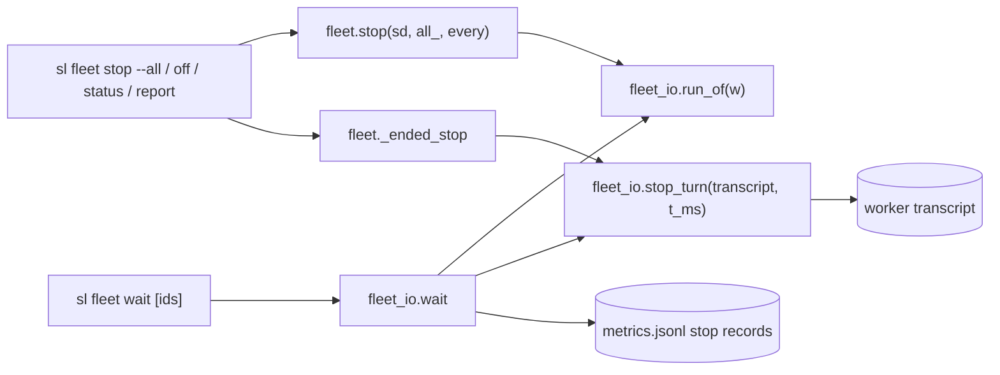
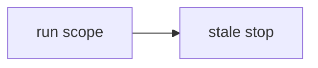

# Superlite: fleet stop --all and wait stay in their run; wait skips a stop record from before the send (#1164, #1165)

**Goal:** `fleet stop --all --plan P` and a `fleet wait` without worker ids act only on the workers of run P, though the session's fleet file serves several runs (#1164); `fleet wait` never takes a stop record that ended a turn which began before the latest send as the answer to that send (#1165).
**Architecture:** two helpers in `fleet_io.py`: `run_of(w)` names the run a worker record belongs to, and `stop_turn(transcript, t_ms)` names the kind of turn a stop record ended. `fleet.stop(all_=True)` and `fleet_io.wait`'s default worker list filter by `run_of`; `fleet off` still stops every worker. `fleet_io.wait` and `fleet._ended_stop` skip a stop record whose transcript holds a sender turn that began after it, and hold one that ended a task-notification turn for `NOTE_MS`.
**Tech stack:** Python 3.10+ stdlib, pytest (through `sl run_tests`).
**Spec:** this file, section Design; issues #1164, #1165.
**Detail:** tests
**Target-min:** 11
**Wave0:** none
**Coverage:** off

Global constraints:
- Every new or changed code line in `skills/subagent-driven-development/scripts/*.py` keeps the trailing `# O(...)` complexity comment the existing lines carry.
- Existing tests stay green; an existing test file changes only when the task Owns it. Run `sl` as an executable; verify with `sl run_tests --fast <own test files> --task Tn`. No version edits.
- Builds: the verdict is `sl run_tests` (the project's test command; a project with `.maxapp` runs `maxapp test`, which a build pool may place on another Mac, and a full run whose tree a green maxapp test stamp covers returns that result without a run); task trees build in <tree>/.build/DerivedData and any build of your own goes under .build/ of the worktree, never -derivedDataPath outside the worktree (your session scratchpad included; backlog cleanup removes scratchpad build folders when the worktree goes); a product, simulator or device build stays on this machine and runs only when an issue's acceptance asks for a running-app check.
- Simulators: append the UDID of each simulator you or a worker creates (`xcrun simctl create` or `clone`; a checker's `Simulators:` line marks its created ones) as one line to /Users/max/github/superlite/.claude/worktrees/superlite-b343-fleet-stop-wait-plan-scope/.superlite/simulators.txt; never list one you did not create; ship cleanup shuts down and deletes each listed one.

Ruling: a worker record's run is, in this order, a remote record's `state_dir` `<run>/remote/<wid>` read as `<run>`, `launch.env.SUPERLITE_FLEET_PARENT_DIR` (a lead: the run that spawned it), `launch.env.SUPERLITE_STATE_DIR`, `state_dir`; a record with none of them belongs to every run (because local records carry no top-level `state_dir` today, field fleet `9966362c`: W1-W3 quanty-widget, W4-W53 atlas-bridge, W54 a quanty-widget worktree, W55-W56 piX, all in one file; a lead's `SUPERLITE_STATE_DIR` is its own worktree's run, not the parent's) - cost if wrong: a record of an unforeseen shape is stopped or waited on as before.
Ruling: `fleet off` keeps stopping every live worker of the fleet file (because it turns the shared fleet off and closes its workspace, which would kill the other runs' panes under records still marked busy); only `stop --all` and the wait default are scoped - cost if wrong: one flag.
Ruling: a `fleet wait` or `fleet stop` with explicit worker ids is unchanged (because ids are unique in the shared file and naming one is deliberate; #986's wait from run A on a worker of run B stays possible) - cost if wrong: none.
Ruling: #1165's stale stop is told apart by transcript order on the worker's own clock: a sender turn whose timestamp is after the stop record's `t` means the stop ended an earlier turn (field: W31's notification turn ended at 19:33:16.86, the queued send landed at 19:33:16.878, `sent` was 19:33:16.125); the issue's "repeats the previous report unchanged" test is not used (because a worker may answer a send with the same BLOCKED text, and the coordinator's `sent` clock differs from a remote worker's) - cost if wrong: a stale stop with no later sender turn in its transcript is taken as today.
Ruling: a stop that ended a task-notification turn is taken only after `NOTE_MS = 3000` with no later sender turn (because the queued send reaches the transcript milliseconds after such a stop, and a poll that reads in between would otherwise return the previous report again) - cost if wrong: such a report arrives up to one poll later.
Ruling: `fleet._ended_stop` (`fleet status` `reported`, `fleet report`) applies the same stale rule (adjacent fix, same file and cause) - cost if wrong: none.
Ruling: docs unchanged: SDD `fleet.md` and `docs/fleet.md` already say one wait covers one run's state dir - cost if wrong: one line later.
Ruling: accept predicted 21 min - T1 and T2 edit the same two scripts, so they run in order - cost: about 10 min of wall time.
Ruling: no probe entry: library functions behind the CLI; the cases are named tests - cost if wrong: none.
LAYERS: unit

## Design

### #1164
The session's fleet file (in the session's folder under the superlite home) serves every run the session touches (#786: each run's `.superlite/fleet.json` is a link to it). `fleet.stop(all_=True)` takes every live record (`fleet.py:1143-1144`) and `fleet_io.wait` with no ids takes every busy record (`fleet_io.py:1242-1243`), so run A's `stop --all` closed run B's busy worker, and run B's `wait --wave` probed run A's gone worker and returned early with `DEAD`. Fix: both filter by `run_of(w)` against the resolved `sd`.

### #1165
Field (maxOS b107, W31, T13): 19:31:45 W31 reports BLOCKED (collected); 19:33:12.9 a `<task-notification>` opens a turn; 19:33:16.125 the coordinator's `send --text` (`sent`); 19:33:16.76 the reply repeats `Status: BLOCKED`; 19:33:16.86 its stop record (`t >= sent`, so `latest_stop` takes it); 19:33:16.878 the queued send lands in the transcript as a sender message. `report_text` reads from that newest sender turn, finds no assistant text, `_lags` holds the stop for `READ_MS`, then `wait` returns `UNKNOWN (transcript unread)` while the worker works on the send. Fix: `stop_turn` says `after` (a sender turn began after the stop): wait skips that stop record and goes on as if it had none, so a newer stop record or the herdr branches end the wait.

## File structure
- `skills/subagent-driven-development/scripts/fleet_io.py`: `run_of`, `of_run`, the wait default (T1); `stop_turn`, `NOTE_MS`, the wait skip and hold (T2).
- `skills/subagent-driven-development/scripts/fleet.py`: `stop(..., every=False)`, `off` passes `every=True` (T1); `_ended_stop` skip (T2).
- `tests/scripts/test_fleet.py`: stop and off cases (T1).
- `tests/scripts/test_fleet_wait_wave_683.py`: the wait default case (T1).
- `tests/scripts/test_fleet_wait_stale_stop_1165.py`: new, #1165 cases (T2).

## Task graph

```mermaid
%% schedule
gantt
  title Predicted schedule (mm:ss)
  dateFormat X
  axisFormat %M:%S
  section lane 1
  T1 run scope :t1, 0, 314s
  T2 stale stop :t2, 314, 321s
```

critical path: T1 → T2 (10.6 min) · peak width 1 · predicted build 10.6 min · predicted total ≈ 21.1 min (target ✗ 11.0)

## Package: fleet run scope and stop records
App type: CLI library (fleet state, herdr calls, transcript reading). Categories: state (shared fleet file, per-run filter, worker states), protocol (stop record vs transcript turn order, clocks), file (missing or unreadable transcript).
Specific risks: a lead or remote record filtered out of its own run; `fleet off` leaving panes of busy records; a stale-stop rule that hangs a wait whose answer has no later sender turn; the lag window (B18) changed for a real lagging transcript.
**Probe entry:** none (Ruling above).

### T1 run scope · Complexity 3 · Est. context 34k
**Owns:** skills/subagent-driven-development/scripts/fleet.py, skills/subagent-driven-development/scripts/fleet_io.py, tests/scripts/test_fleet.py, tests/scripts/test_fleet_wait_wave_683.py
**Components:** 2
**LOC owned:** 90
**Tests:** fast
**Model:** sonnet
**Kind:** design
**Est. time:** 2.5 min (2 components, about 90 LOC, fast tests)
**Covers:** "#1164"
**Consumes:** none
**Produces:** fleet_io.run_of(w: dict) -> Path | None · fleet_io.of_run(sd: Path, w: dict) -> bool · fleet.stop(sd, ids=None, all_=False, keep_workspace=False, every=False) -> list[str]
e.g. run_of({"launch": {"env": {"SUPERLITE_STATE_DIR": "/r/b/.superlite"}}}) -> Path("/r/b/.superlite")
e.g. run_of({"role": "lead", "launch": {"env": {"SUPERLITE_STATE_DIR": "/wt/.superlite", "SUPERLITE_FLEET_PARENT_DIR": "/m/.superlite"}}}) -> Path("/m/.superlite")
e.g. run_of({"machine": "m1", "state_dir": "/r/a/.superlite/remote/W9", "launch": {"env": {"SUPERLITE_STATE_DIR": "/trees/W9/.superlite"}}}) -> Path("/r/a/.superlite"); run_of({}) -> None; of_run(Path("/r/a/.superlite"), {}) -> True
**Review Focus:** state: `test_run_of_examples` (the three e.g. lines, plus `{"state_dir": "/r/a/.superlite"}` -> that path); `test_of_run_compares_resolved_paths` (a symlinked sd and its target count as one run); `test_stop_all_keeps_other_runs_workers` (shared fleet.json: W1 of this run and W2 whose `launch.env.SUPERLITE_STATE_DIR` is another folder, both busy: `stop(sd, all_=True) == ["W1"]`, W2 stays busy, no `exit_agent` or `close_pane` call names W2's agent or pane, the workspace stays open while W2 is live); `test_stop_all_takes_lead_of_this_run` (a lead record whose `SUPERLITE_STATE_DIR` is its worktree and `SUPERLITE_FLEET_PARENT_DIR` is sd is stopped); `test_off_stops_every_run` (`fleet.main(["off"])` stops W1 and W2); `test_stop_ids_ignores_run` (`stop(sd, ["W2"])` stops the other run's W2); in test_fleet_wait_wave_683.py `test_wave_waits_only_this_runs_workers` (W1 of this run reports DONE; W2 of another run is busy and herdr has no agent for it: `wait(sd, [], ..., wave=True)` returns only W1, prints no `W2` line and no `DEAD`, W2 stays busy) and `test_wait_ids_takes_other_runs_worker` (`wait(sd, ["W2"], ...)` still waits on W2).
**Steps:** 1 failing tests, 2 run: FAIL, 3 implement, 4 run: PASS
**Notes:** `of_run(sd, w)`: `run_of(w)` is None, or `run_of(w).resolve() == Path(sd).resolve()`. In `stop`, `all_` targets live records with `of_run(sd, w)`; `every=True` targets every live record (today's `all_`); the `fleet off` branch calls `stop(sd, all_=True, every=True, keep_workspace=True)`. The lead branch inside `stop` (`stop(Path(lead_sd), all_=True)`) and `backlog_undo`'s call keep `all_=True`: their workers belong to that lead's run. `wait`'s default list is the busy records with `of_run(sd, w)`; explicit ids are taken as given.

### T2 stale stop · Complexity 4 · Est. context 40k
**Owns:** skills/subagent-driven-development/scripts/fleet.py, skills/subagent-driven-development/scripts/fleet_io.py, tests/scripts/test_fleet_wait_stale_stop_1165.py
**Components:** 2
**LOC owned:** 160
**Tests:** fast
**Model:** sonnet
**Kind:** design
**Est. time:** 3.5 min (2 components, about 160 LOC, fast tests)
**Covers:** "#1165"
**Consumes:** none
**Produces:** fleet_io.stop_turn(transcript, t_ms: int) -> str · fleet_io.NOTE_MS = 3000
e.g. stop_turn(p, 21200) -> "after" for records: user sender "# Task T13" at 10.000 s, assistant "Status: BLOCKED" at 11.0, user "<task-notification>..." at 20.0, assistant "Status: BLOCKED (notification)" at 21.0, user sender "Ruling for T13 ..." at 21.218 (timestamps as ISO strings, seconds since the epoch shown)
e.g. stop_turn(p, 21200) -> "note" for the same records without the last one; stop_turn(p, 11500) -> "answer" for user sender at 10.0 and assistant "Status: DONE" at 11.0
e.g. stop_turn("/missing.jsonl", 5) -> "answer"; stop_turn(p, 5) -> "answer" for records without a `timestamp`
**Review Focus:** protocol: `test_stop_turn_examples` (the e.g. lines); `test_wait_skips_stop_before_queued_send` (field shape: worker busy, `sent` = S, stop record at S+700 whose transcript ends with the notification turn and then a sender message at S+753, herdr `working`: `wait(sd, ["W1"], timeout_ms=...)` with a fake clock ends `TIMEOUT W1`, writes no report, sends no ASK, W1 stays busy; then the transcript gains assistant `Status: DONE` plus a json report and a stop record at S+60000: the next wait returns `W1 T13 DONE`); `test_wait_holds_note_stop_then_takes_it` (send turn answered `Status: DONE` with a json report, then a notification turn and its stop, no later sender message: a wait poll before `NOTE_MS` returns nothing; after it, `W1 T13 DONE` from the send turn's report); `test_wait_takes_repeated_blocked_answer` (the send turn itself answers `Status: BLOCKED` again: returned BLOCKED on the first poll, no hold); `test_lag_window_unchanged` (stop after a sender turn with no assistant text yet: UNKNOWN `(transcript unread)` after `READ_MS`, as B18); `test_ended_stop_skips_stale` (`fleet._ended_stop` returns None for the field shape, the record for the answered shape).
**Steps:** 1 failing tests, 2 run: FAIL, 3 implement, 4 run: PASS
**Notes:** `stop_turn` reads the transcript once (`_records`), timestamps via `mx._ts` (seconds): `after` when the newest record for which `_starts_turn` holds has a timestamp above `t_ms / 1000`; else `note` when the newest turn opener with a timestamp at or below `t_ms / 1000` is a task-notification (a `user` record, not `isMeta`, no tool_result, whose `origin.kind` is `task-notification` or whose text starts with `<task-notification>`), an opener being that or a `_starts_turn` record; else `answer`; an unreadable transcript or a record without a timestamp never makes `after` or `note`. In `wait`, per worker with a stop record `rec` that has a transcript: `after` -> treat this poll as if `rec` were None (no `seen` entry, no READ_MS window, no ask, no finish), remembering `rec["t"]` so that stop is not read again; `note` -> skip this poll until `now - first seen >= NOTE_MS`, re-reading the transcript each poll (it may turn `after`); then the existing path. Copy the transcript and stop helpers from tests/scripts/test_fleet_io_transcript_lag.py and test_fleet_io_ask_470.py (do not edit those files). The field order the first wait test copies is in section Design, #1165. Also in `fleet_io.run_of` (T1's): map a machine record's `state_dir` to its grandparent only when its parent folder is named `remote` (as `report_dir` does); otherwise the record falls through to the local order; test `run_of({"machine": "m1", "state_dir": "/r/a/.superlite"}) == Path("/r/a/.superlite")`.

## Self-review
- Coverage: #1164 stop and wait in T1; #1165 wait and status in T2.
- T1 and T2 share fleet.py and fleet_io.py, hence the edge.
- No placeholders; fields filled; lint and schedule below.
