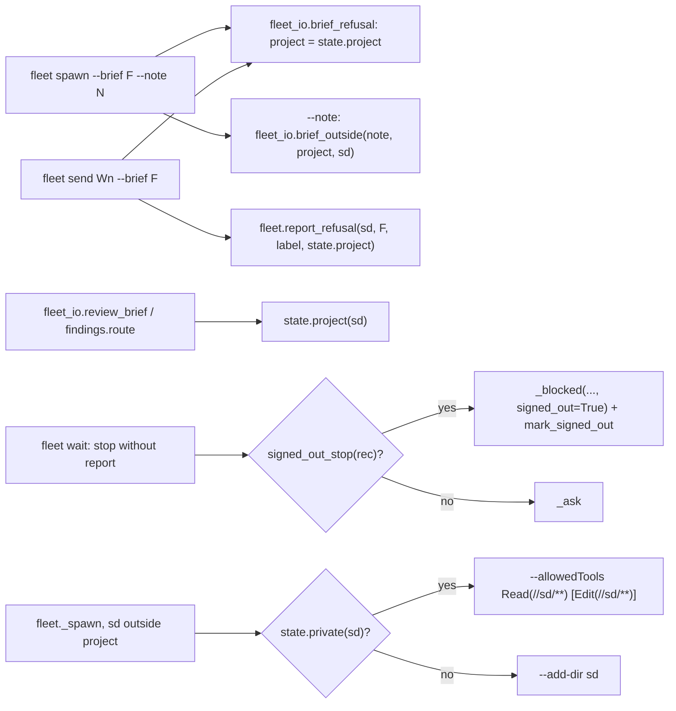
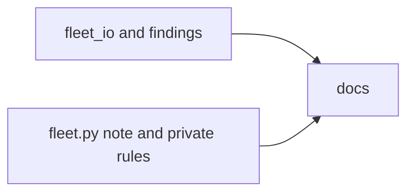

# B323: brief checks share one project and text rule; a signed-out local stop is BLOCKED; a private state folder starts without a trust prompt (#1107, #1108, #1117)

**Goal:** `fleet spawn`, `fleet send` and spawn's `--note` check apply the same project (`state.project`) and text rules (#1107); `fleet wait` reports a local worker whose turn ended on a sign-in error as BLOCKED-UI with the signed-out suffix and marks its account, never ASKED (#1108); a worker of a session's private state folder starts without Claude Code's "Adding a new directory" trust dialog (#1117).
**Architecture:** fleet_io.py and findings.py take the project from `state.project(sd)`; `fleet_io.main` send --brief adds `fleet.report_refusal`; fleet.py's --note check calls `fleet_io.brief_outside`. fleet_io's wait ended branch checks `fleet_remote_account.signed_out_stop(rec)` before `_ask`. fleet._spawn gives a private state folder outside the project `Read(//<sd>/**)` (and `Edit(//<sd>/**)` for writing roles) in its one --allowedTools list instead of `--add-dir`.
**Tech stack:** Python 3 stdlib, pytest via `sl run_tests`.
**Spec:** issues #1107, #1108, #1117.
**Detail:** contracts
**Wave0:** none
**Coverage:** off

## Global constraints

- `state.project(sd)` is the only project rule: a private folder (`state.private(sd)`) takes the launch folder's git root, any other folder `git_root(sd) or sd.parent` (B315). Never write `state.git_root(sd) or sd.parent` again in the files below.
- `fleet_io.brief_outside(text, project, sd, role="")` is the one text rule of the #1015 check: fenced blocks, the standing-note block, a finding's ` quote:` span and paths missing on this machine are text (#1089). `fleet.outside_paths` itself stays unchanged.
- `fleet.report_refusal(sd, brief, label, project) -> str | None` exists (B315); reuse it, never copy it.
- `fleet_remote_account.signed_out_stop(rec) -> bool` exists (B314); reuse it.
- Every code line in fleet.py, fleet_io.py and findings.py ends with its `# O(...)` complexity comment like its neighbours.
- Files this batch may touch: skills/subagent-driven-development/scripts/fleet.py, skills/subagent-driven-development/scripts/fleet_io.py, skills/subagent-driven-development/scripts/findings.py, docs/fleet.md, the test files each task owns and this plan. Every other file (state.py, fleet_roles.py, fleet_remote_*.py, fleet_placement.py, docs/tools.md, ...) belongs to other batches: never edit it. An existing test that breaks: name it in the report, do not edit it without the lead's word.
- Builds: the verdict is `sl run_tests` (the project's test command; a project with `.maxapp` runs `maxapp test`, which a build pool may place on another Mac, and a full run whose tree a green maxapp test stamp covers returns that result without a run); task trees build in <tree>/.build/DerivedData and any build of your own goes under .build/ of the worktree, never -derivedDataPath outside the worktree (your session scratchpad included; backlog cleanup removes scratchpad build folders when the worktree goes); a product, simulator or device build stays on this machine and runs only when an issue's acceptance asks for a running-app check; copy this sentence into every worker brief.
- Simulators: append the UDID of each simulator you or a worker creates (`xcrun simctl create` or `clone`; a checker's `Simulators:` line marks its created ones) as one line to /Users/max/github/superlite/.claude/worktrees/superlite-b323-fleet-spawn-send-brief-rules/.superlite/simulators.txt; never list one you did not create; ship cleanup shuts down and deletes each listed one; copy this sentence into every worker brief.

Ruling: #1117 is fixed by permission rules, not by writing `hasTrustDialogAccepted` into an account's `.claude.json`: Claude Code rewrites that file from live sessions, so a read-modify-write from the fleet could lose its or our change; without `--add-dir` there is no add-dir dialog, and B272 already grants the skills folder by a `Read(//...)` rule (lead's ruling).
Ruling: only a private state folder (`state.private(sd)`) switches to rules; a worktree run's state folder outside the project keeps `--add-dir`, which shows no dialog today (its main checkout is trusted), so that launch stays byte for byte (lead's ruling).
Ruling: the writer gets no `Edit` rule on the state folder (it may write only its Output file, #604) and research gets none (read-only, Edit disallowed); every other role gets `Read` and `Edit`, as `--add-dir` gave it (lead's ruling).
Ruling: a signed-out stop of a remote worker keeps B314's path (fleet_remote_worker records the pair); the new ended-branch check marks the account only for a local worker (no `machine` in its record) (lead's ruling).

## Main diagram

## File structure

- skills/subagent-driven-development/scripts/fleet_io.py: `review_brief` and `brief_refusal` project; send --brief report refusal; `_blocked(..., signed_out=False)`; wait's ended branch; module docstring lines.
- skills/subagent-driven-development/scripts/findings.py: `route` project.
- skills/subagent-driven-development/scripts/fleet.py: --note check; `_spawn` private-folder rules; docstring lines.
- docs/fleet.md: one line per issue.
- tests/scripts/test_brief_checks_private_1107.py, tests/scripts/test_fleet_wait_signed_out_1108.py, tests/scripts/test_fleet_note_rules_1107.py, tests/scripts/test_fleet_private_rules_1117.py: new.

## Task graph

```mermaid
%% schedule
gantt
  title Predicted schedule (mm:ss)
  dateFormat X
  axisFormat %M:%S
  section lane 1
  T1 send review and wait rules in fleet_i :t1, 0, 499s
  T3 fleet docs for the three rules :t3, 499, 455s
  section lane 2
  T2 spawn's note check and a private fold :t2, 0, 496s
```

critical path: T1 → T3 (15.9 min) · peak width 2 · predicted build 15.9 min · predicted total ≈ 30.4 min

## Fleet IO

### T1 send, review and wait rules in fleet_io · Complexity 3 (O-1) · Est. context 45k
**Owns:** skills/subagent-driven-development/scripts/fleet_io.py, skills/subagent-driven-development/scripts/findings.py, tests/scripts/test_brief_checks_private_1107.py, tests/scripts/test_fleet_wait_signed_out_1108.py
**Components:** 2
**LOC owned:** 140
**Tests:** fast
**Model:** sonnet
**Kind:** design
**Est. time:** 4 min
**Produces:** fleet_io._blocked(sd, wid, w, screen=None, signed_out=False) -> dict
e.g. _blocked(sd, "W1", {"account": "claude2", "task": "T3"}, screen="x\n", signed_out=True) prints `W1 T3 BLOCKED-UI <sd>/fleet/screens/W1.txt (signed out: account claude2 shows the Claude Code sign-in screen; sign in there, then respawn)`
**Review Focus:** `test_send_refuses_brief_naming_own_report`; `test_signed_out_stop_is_blocked_not_asked`
**Steps:**
1. Write the tests below; run: FAIL.
2. fleet_io.py: in `review_brief` (~line 369) and `brief_refusal` (~line 1156) the project becomes `state.project(sd)`; findings.py `route` (~line 427): `root = Path(state.project(sd))` (keep the comment's sense: "the project root, as fleet.py takes it").
3. fleet_io.main, send --brief branch (~line 1414): after the `brief_refusal` check and only for a role other than `lead`, `why = _fleet().report_refusal(sd, a.brief, a.label or Path(a.brief).stem, state.project(sd))`; a refusal prints `why` to stderr and returns 2 before any prompt, as spawn does (fleet.py ~1763).
4. `_blocked` gains `signed_out=False`: the ` (signed out: account ... respawn)` suffix prints when `signed_out or accounts.sign_in_screen(screen)`; nothing else changes.
5. wait's ended branch (~line 1278, `if ended and _ask(...)`): before `_ask`, when `fleet_remote_account.signed_out_stop(rec)`: for a local worker (`not w.get("machine")`) call `_fleet().mark_signed_out(sd, w.get("account") or "")`; then append `_blocked(sd, wid, w, signed_out=True)` to the results, remove wid from pending and continue, exactly as the branch's other blocked results do. `_ask` is never called for such a stop. Import `fleet_remote_account` at module level (it imports only accounts).
6. Module docstring: extend the send --brief sentence with "and a brief naming the worker's own report file (#1094, #1107)"; extend the ASKED sentence with "; a stop whose last line is a sign-in error (`fleet_remote_account.signed_out_stop`) is BLOCKED-UI with the signed-out suffix and marks a local worker's account, never asked (#1108)".
7. Run: PASS.
**Test code (named, contracts):**
- test_brief_checks_private_1107.py, with B315's `priv` fixture shape (tests/scripts/test_fleet_private_project_1088.py: SUPERLITE_HOME=tmp/home, psd=home/sessions/s1.d/.superlite, a git project with src/a.py, cwd proj/src):
  - `test_brief_refusal_passes_a_project_brief_for_a_private_folder`: a brief file at `<proj>/notes/b.md` naming `<proj>/src/a.py` gives `fleet_io.brief_refusal(psd, brief, "research") is None` (today it refuses: the file is outside `psd.parent`).
  - `test_brief_refusal_still_refuses_outside_paths_for_a_private_folder`: a brief under `psd/briefs/` naming an existing `<tmp>/other/x.md` returns a line starting `error: brief` and naming `other/x.md`.
  - `test_review_brief_root_is_the_launch_project`: monkeypatch `state.project` to a sentinel path and assert `review_brief`'s text holds `Root: <sentinel>` (build its inputs as tests/scripts/test_fleet_io*.py do for review_brief, or call through the smallest existing helper; name the test it copies).
  - `test_findings_route_takes_state_project`: a source pin: `"state.git_root(sd) or sd.parent" not in` findings.py and fleet_io.py text, and `state.project(sd)` in both.
  - `test_send_refuses_brief_naming_own_report`: with the world and `setw` helpers of tests/scripts/test_fleet_send_brief_outside_1024.py, a brief `R1.md` under `<sd>/briefs/` whose text names `<sd>/fleet/reports/R1.md`: `fleet_io.main(["send", "W1", "--brief", str(b), "--plan", str(sd)])` returns 2, stderr holds `(#1094)` and `fleet wait saves the worker's reply`, and no prompt was sent.
  - `test_send_allows_full_report_name`: the same brief naming `<sd>/fleet/reports/R1-full.md` sends.
- test_fleet_wait_signed_out_1108.py, with the `world` fixture and `stop_at` of tests/scripts/test_fleet_io.py (pattern of `test_wait_unreported_stop_on_idle_is_unknown_with_pane_tail`), `LOGIN = "Login reached its time limit · Please run /login"`:
  - `test_signed_out_stop_is_blocked_not_asked`: send, stop_at with `last=LOGIN`, pane idle, wait: the output holds `BLOCKED-UI` and `(signed out: account <the worker's account>`, never `ASKED`; no second `prompt` call; `fleet.signed_out_accounts(sd)` holds that account; the worker's fleet.json state is `blocked`.
  - `test_plain_unreported_stop_is_still_asked`: the same with `last="done thinking"` prints `ASKED` (today's path unchanged).
  - `test_remote_signed_out_stop_marks_no_account`: the worker record has `machine: "m1"` (or skip with a reason if the world fixture cannot fake a remote worker's ended branch): BLOCKED-UI printed, `fleet.signed_out_accounts(sd)` unchanged.

## Fleet spawn

### T2 spawn's note check and a private folder's rules · Complexity 3 (O-1) · Est. context 42k
**Owns:** skills/subagent-driven-development/scripts/fleet.py, tests/scripts/test_fleet_note_rules_1107.py, tests/scripts/test_fleet_private_rules_1117.py
**Components:** 2
**LOC owned:** 110
**Tests:** fast
**Model:** sonnet
**Kind:** design
**Est. time:** 4 min
**Produces:** fleet.state_rules(argv: list[str], sd: Path, role: str) -> list[str]
e.g. state_rules(["--agent", "a", "--disallowedTools", "AskUserQuestion"], Path("/h/sessions/s1.d/.superlite"), "implementer") -> ["--agent", "a", "--allowedTools", "Read(//h/sessions/s1.d/.superlite/**)", "Edit(//h/sessions/s1.d/.superlite/**)", "--disallowedTools", "AskUserQuestion"]
e.g. state_rules(["--permission-mode", "default", "--allowedTools", "Edit(//p/out.md)", "--disallowedTools", "Bash"], Path("/h/s"), "writer") -> ["--permission-mode", "default", "--allowedTools", "Edit(//p/out.md)", "Read(//h/s/**)", "--disallowedTools", "Bash"]
**Review Focus:** `test_private_state_folder_gets_rules_not_add_dir`; `test_note_copying_standing_note_passes`
**Steps:**
1. Write the tests below; run: FAIL.
2. `state_rules`: rules `Read(/<sd posix>/**)` plus, for every role but `writer` and `research`, `Edit(/<sd posix>/**)` (sd absolute, so the rule starts `//`); each rule not already in argv is inserted at the end of the one `--allowedTools` list (the list ends at the next argument that starts with `--`); without such a list, `--allowedTools <rules>` goes right before `--disallowedTools`, else at the end, the same placement as `fleet_roles.skills_read`.
3. `_spawn` (~line 674): when `sd.resolve()` lies outside the project: `argv = state_rules(argv, sd.resolve(), role)` if `state.private(sd)`, else `argv += ["--add-dir", str(sd.resolve())]` as today.
4. `main`, spawn's `--note` check (~line 1734): `bad = importlib.import_module("fleet_io").brief_outside(note, state.project(sd), sd)`; the `outside_error("note", ...)` line and exit 2 stay.
5. Module docstring: after the #1015 line add "The brief and note checks read quoted text as text (fenced blocks, the standing-note block, a finding's quote) and skip paths missing on this machine (`fleet_io.brief_outside`, #1089, #1107)."; after the #1088 line add "A private state folder outside the project gets `Read(//<sd>/**)` (and `Edit(//<sd>/**)` for every role but writer and research) in the worker's one --allowedTools list instead of `--add-dir`, so Claude Code shows no trust dialog for it (#1117)."
6. Run: PASS.
**Test code (named, contracts):**
- test_fleet_private_rules_1117.py (world fixture and `_start` as in tests/scripts/test_fleet_roles_spawn.py; private via `monkeypatch.setattr(fleet.state, "private", lambda sd: True)` or B315's `priv` fixture):
  - `test_state_rules_examples`: the two `e.g.` lines above, exactly.
  - `test_state_rules_is_idempotent`: `state_rules(state_rules(a, sd, "fixer"), sd, "fixer") == state_rules(a, sd, "fixer")`.
  - `test_private_state_folder_gets_rules_not_add_dir`: spawn role `implementer` with the project elsewhere and a private sd: `"--add-dir" not in argv`, `f"Read(/{sd.resolve().as_posix()}/**)"` and the matching `Edit(...)` sit between `--allowedTools` and the next `--` argument.
  - `test_private_research_and_writer_get_read_only`: role `research` and role `writer` (writer with a brief whose `Output:` names a project file): the Read rule present, no `Edit(/<sd>/**)` rule, no `--add-dir`.
  - `test_worktree_state_folder_keeps_add_dir`: not private, project elsewhere: argv holds `--add-dir <sd>` and no `Read(/<sd>/**)` rule (today's behaviour, as `test_state_dir_outside_the_project_is_added`).
- test_fleet_note_rules_1107.py (helpers of tests/scripts/test_fleet_brief_outside_1015.py, model `test_review_note_naming_outside_path_is_refused`):
  - `test_note_copying_standing_note_passes`: a `--for-review T1 --note N` spawn whose note holds an outside existing path only inside a fenced block and inside a ` quote:` span is not refused (no `error:` line, a pane opens or the call gets past the note check).
  - `test_note_naming_missing_path_passes`: a note naming `/nonexistent-host/srv/app` (missing on this machine) is not refused.
  - `test_note_naming_existing_outside_path_still_refused`: an existing `<tmp>/other/x.md` in prose exits 2 with the `note` error line.
  - `test_note_check_calls_brief_outside`: a source pin: fleet.py's note check calls `brief_outside(` and no longer `outside_paths(note`.

## Docs

### T3 fleet docs for the three rules · Complexity 1 (O-1) · Est. context 25k
**Owns:** docs/fleet.md
**Components:** 1
**LOC owned:** 8
**Tests:** fast cmd=grep -q '#1107' docs/fleet.md && grep -q '#1108' docs/fleet.md && grep -q '#1117' docs/fleet.md
**Model:** haiku
**Kind:** mechanical
**Est. time:** 1 min
**Steps:**
1. At the line naming #1094 (~line 79): spawn and `fleet send Wn --brief` both refuse a brief naming the worker's own report file, and spawn's `--note` check uses the #1089 text rules (#1107).
2. At the ASKED line (~line 75): a turn whose stop is a sign-in error is BLOCKED-UI `(signed out: account A ...)`, the local worker's account is skipped 15 min, never ASKED (#1108).
3. At the #1088 bullet: a private state folder outside the project is granted by `Read`/`Edit` rules instead of `--add-dir`, so no trust dialog blocks the start (#1117).
4. Run the cmd check: PASS. Keep every existing #1093 and #1094 sentence's words (pin tests read them).

## Review Focus

- fleet_io, findings (T1): categories state, protocol. App type: CLI library, no runnable entry beyond `sl fleet`; **Probe entry:** none (pytest over fakes).
- fleet.py (T2): categories protocol, security (permission rules widen a worker's reach only to its own state folder). **Probe entry:** none.

## Self-review

Every issue point maps to a task: #1107 (a) T1 steps 2, (b) T1 step 3, (c) T2 step 4; #1108 T1 steps 4-5; #1117 T2 steps 2-3. T1 and T2 share no file; T3 waits for both.
