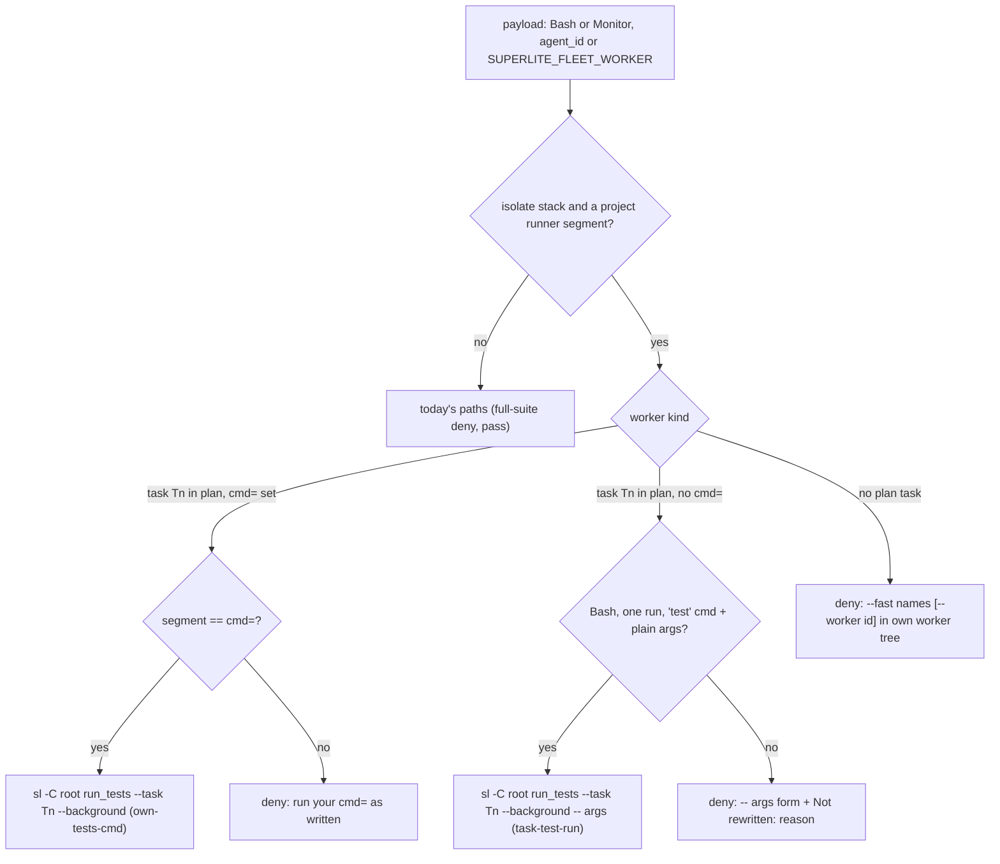
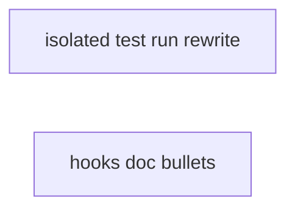

# B307: an isolate-stack worker's raw test run is rewritten to its task's isolated run (#1071)

**Goal:** on an isolate stack (a shared Swift build tree) a worker's raw `maxapp test --only X` is rewritten to `sl run_tests --task Tn --background -- --only X` when the hook can name the worker's plan task, instead of being denied and repeated (27 blocks in one worktree); every run the hook still denies names the form that applies to that worker, also to one with no task (a reviewer or fixer).
**Architecture:** one bash PreToolUse hook, `hooks/rewrite-test-runs`, its subagent and fleet-worker block: a task check against the plan, one new rewrite (rule `task-test-run`), the B254 own-cmd rewrite target fixed, and a three-way deny message. Docs: two `docs/hooks.md` bullets.
**Tech stack:** bash builtins only (the hook's existing rule); pytest via `sl run_tests`.
**Spec:** issue #1071 (body: "the hook rewrites `<test cmd> --only X` to the isolated run when it can name the task (as it already does for the task's own `**Tests:** cmd=`) ... and the block text says which form applies to a worker that has no task (a reviewer or fixer)"); B254 ruling #779 in /Users/max/github/superlite/.superlite/backlog/B254.md.
**Detail:** tests
**Wave0:** none
**Coverage:** off

## Global constraints

- Files this batch may touch: hooks/rewrite-test-runs, tests/scripts/test_rewrite_task_run_1071.py (new), tests/scripts/test_rewrite_own_tests_779.py, tests/scripts/test_rewrite_isolate.py, docs/hooks.md and this plan. An existing test outside these files that breaks: name it in the report, do not edit it.
- The hook stays bash builtins only (no new external process), fails open (exit 0) except a denial (exit 2), and never changes the coordinator path (no `agent_id`, no `SUPERLITE_FLEET_WORKER`).
- Builds: the verdict is `sl run_tests` (the project's test command; a project with `.maxapp` runs `maxapp test`, which a build pool may place on another Mac, and a full run whose tree a green maxapp test stamp covers returns that result without a run); task trees build in <tree>/.build/DerivedData and any build of your own goes under .build/ of the worktree, never -derivedDataPath outside the worktree (your session scratchpad included; backlog cleanup removes scratchpad build folders when the worktree goes); a product, simulator or device build stays on this machine and runs only when an issue's acceptance asks for a running-app check; copy this sentence into every worker brief.
- Simulators: append the UDID of each simulator you or a worker creates (`xcrun simctl create` or `clone`; a checker's `Simulators:` line marks its created ones) as one line to /Users/max/github/superlite/.claude/worktrees/superlite-b307-isolate-test-rewrite/.superlite/simulators.txt; never list one you did not create; ship cleanup shuts down and deletes each listed one; copy this sentence into every worker brief.

Ruling: the hook rewrite is the route (#1071's first option); briefs carrying the isolated form up front (its "or") would edit fleet.py and prime files other batches own, and the rewrite makes it unneeded (lead's ruling).
Ruling: adjacent fix: B254's own-cmd rewrite emits `sl run_tests --fast --task Tn --background` with no path, which run_tests' argparse refuses (`--fast` is nargs="+"; checked live: `error: argument --fast: expected at least one argument`, exit 2); both rewrites now emit `--task Tn` without `--fast`, which runs Tn's `cmd=` or the project command in Tn's tree (lead's ruling).
Ruling: the new rewrite passes the raw arguments through `-- <args>` (run_tests appends them to the test-cmd.json "test" command), so it fires only when the raw segment is that exact "test" command plus plain arguments; a test_file runner that differs, or a "test" command with a placeholder or shell operator, stays denied (lead's ruling).
Ruling: a task with a `**Tests:** cmd=` gets no `-- <args>` rewrite of another run, because run_tests appends pass-through args to that cmd=; its message says to run the cmd= as written (lead's ruling).
Ruling: the rewritten sl call carries `-C <run root>`, so a run from a subfolder or from a task tree under `.superlite/trees/` reaches the run's own `.superlite` (run_tests' project_root would stop at the tree) (lead's ruling).
Ruling: a pool task the readable plan lacks (a fixer's FR id, a stale pool) counts as no task; a pool task with no readable plan keeps today's `--task Tn` line and is not rewritten (lead's ruling).
Ruling: adjacent fix: a project-runner segment with a `--help` word is no test run and passes (2 of the 25 blocks since 1.5.277 were `maxapp test --help`); `-h` is not matched, since a runner may take it as an option (lead's ruling).
Ruling: one rewrite per command: a command with two raw runs (`maxapp test --only A; maxapp test --only B`, also inside `( )`) stays denied, since two background runs share one tree and one summary (lead's ruling).

## Main diagram



## File structure

- hooks/rewrite-test-runs: the subagent and fleet-worker block (about lines 424-498) and its header comment.
- tests/scripts/test_rewrite_task_run_1071.py: new; field forms, deny reasons, the three message kinds, an argparse check of every rewrite.
- tests/scripts/test_rewrite_own_tests_779.py: the own-cmd rewrite asserts `--task Tn --background` without `--fast`.
- tests/scripts/test_rewrite_isolate.py: no-task cases assert the no-task message.
- docs/hooks.md: the two `rewrite-test-runs` bullets.

## Task graph

```mermaid
%% schedule
gantt
  title Predicted schedule (mm:ss)
  dateFormat X
  axisFormat %M:%S
  section lane 1
  T1 isolated test run rewrite :t1, 0, 687s
  section lane 2
  T2 hooks doc bullets :t2, 0, 637s
```





critical path: T1 (11.4 min) · peak width 2 · predicted build 11.4 min · predicted total ≈ 29.9 min

## Test layers

**Probe entry:** none (a bash hook read through subprocess; its cases are the named tests in T1)

### T1 isolated test run rewrite · Complexity 5 (O-1) · Est. context 60k
**Owns:** hooks/rewrite-test-runs, tests/scripts/test_rewrite_task_run_1071.py, tests/scripts/test_rewrite_own_tests_779.py, tests/scripts/test_rewrite_isolate.py
**Components:** 2
**LOC owned:** 210
**Tests:** fast
**Kind:** design
**Model:** sonnet
**Review Focus:** protocol (hook stdin and the JSON it prints), state (the task check, one rewrite per command), encoding (quotes, redirects, `$(`); `test_field_forms_rewritten` (each rewrite passes run_tests' argparse), `test_not_rewritten_denied` (`(maxapp test --only A; maxapp test --only B)` stays denied, never half-rewritten), `test_own_cmd_rewritten_without_fast`.
**Behaviour (hooks/rewrite-test-runs, subagent and fleet-worker block only):**
1. Task: `iso_task` from pool.json as today. `task_tests_cmd` also sets `task_in_plan`: `1` when the plan has the `### Tn` heading, `0` when the plan is readable and lacks it, empty when no plan is readable. Worker kind: `task` when `iso_task` is set and `task_in_plan` is not `0`, else `none`. The own `cmd=` is looked up for Bash and Monitor (Monitor still never rewrites).
2. `sl_run` = `bash "<plugin root>/skills/subagent-driven-development/scripts/sl" -C "<root_n>" run_tests` when `root_n` holds none of `"` `$` backtick backslash, else `$sl_base`. Both rewrites use it.
3. Own cmd= (B254): the matching segment becomes ` $sl_run --task Tn --background ` plus its separator (no `--fast`). Context: `your task's own Tests cmd= rewritten to a background sl run_tests --task Tn; wait for it with `sl run_tests --wait``.
4. New rewrite, rule `task-test-run`: only for Bash, an isolate stack, kind `task` with `task_in_plan` = 1, no own `cmd=`, and `tc` (test-cmd.json `"test"`, trimmed) holding at least one word and none of `{ } " ' $` backtick backslash `| ; & < >`. A segment inside the plan root whose text (leading blanks dropped) is `tc` or starts with `tc` plus a blank is the candidate; its argument words come from `read -r -a` (no globbing) of the rest. Unsafe: a word with an odd count of `'` or of `"`, or holding a backtick, `$(`, `<(` or `>(`. Then redirect words drop as in `files_from_seg` (an operator and its target; a glued redirect; the `2>&1` and `&>` placeholders). `runs` = segments inside the plan root where `project_hit SEG loop` holds and no word is `--help`. Rewrite only when `runs` is 1 and the candidate is safe with at least one word left: the segment becomes ` $sl_run --task Tn --background -- <words joined by one space> ` plus its separator; every other segment stays as written. Row and output as B254's (`rule-rewrite`, target `<orig> -> <short>`, `tel_gate rewrite task-test-run`); context: `your raw test run rewritten to a background sl run_tests --task Tn -- <args> in your task's tree; wait for it with `sl run_tests --wait``.
5. A segment matching `project_hit SEG seg` with a word `--help` passes: not denied, not counted.
6. Otherwise a project-runner segment (`project_hit SEG seg`, today's trigger) inside the plan root denies (exit 2, the `isolated-test-run` row as today) after the whole command was read. `reason` (kind `task` only), first that applies: `a Monitor call is never rewritten; make it a Bash call`; `no readable plan names Tn`; `more than one test run in one command`; for the first runner segment: `not the test-cmd.json "test" command (<tc, at most 80 chars>) with plain arguments`, `an argument holds a quoted space, $(, <(, >( or a backtick`, `no runner arguments (a bare run is the whole suite)`.
7. Deny message: line 1 unchanged (`Blocked: this project's tests build one shared tree, ...`). Then, kind `task` without own cmd=: `Run it in your task's tree: $sl_base --task Tn --background -- <args> (runner arguments after `--`), then `sl run_tests --wait`; named test files or Suite names: $sl_base --fast <test files> --task Tn --background.` plus `Not rewritten: <reason>.` Kind `task` with own cmd=: `Run your task's own **Tests:** cmd= as written (exactly: <cmd>): it is rewritten to $sl_base --task Tn --background; with --task, run_tests runs only that command. Then `sl run_tests --wait`.` Kind `none`: `You have no plan task (a reviewer or fixer): run $sl_base --fast <test files or Suite names><wk> --background in your own worker tree (runner arguments after `--`: `-- <args>`), then `sl run_tests --wait`.` where `<wk>` is ` --worker <agent_id>` for a subagent whose agent_id matches `^[A-Za-z0-9_-]{1,64}$`, ` --worker <name>` for another subagent, empty for a fleet worker.
8. The header comment (lines 5-10) says what 1-7 do, in at most six lines.
**Test code (verbatim):** tests/scripts/test_rewrite_task_run_1071.py:
```python
"""hooks/rewrite-test-runs (#1071): on an isolate stack a worker's raw run of the test-cmd.json "test" command with
plain arguments is rewritten to `sl -C <root> run_tests --task Tn --background -- <args>` when its pool task is a plan
task without a **Tests:** cmd=; every other raw run stays denied, the message naming the form for that worker."""
import json
import os
import shlex
import subprocess

import pytest
from test_rewrite_isolate import BASH, HOOK, HOST, SL, run, setup

MAXAPP = {"language": "swift", "test": "maxapp test", "test_file": "maxapp test {only_testing}"}
OWN = "maxapp test --only AppTests/OwnTests"
PLAN = "### T3 x\n**Owns:** a.swift\n**Tests:** fast\n\n### T5 y\n**Owns:** b.swift\n**Tests:** fast cmd=" + OWN + "\n"


@pytest.fixture
def proj(tmp_path):
    setup(tmp_path, MAXAPP)
    (tmp_path / ".superlite" / "plan.md").write_text(PLAN)
    return tmp_path


def out(r):
    assert r.returncode == 0, r.stderr
    return json.loads(r.stdout)["hookSpecificOutput"]


def rows(proj):
    return [json.loads(ln) for ln in (proj / ".superlite" / "incidents.jsonl").read_text().splitlines()]


def sl_words(cmd, proj):
    seg = next(s for s in cmd.replace("&&", ";").replace("|", ";").split(";") if "run_tests" in s)
    words = shlex.split(seg)
    assert words[0] == "bash" and words[1] == SL and words[2] == "-C"
    assert os.path.realpath(words[3]) == os.path.realpath(proj) and words[4] == "run_tests"
    return words[1:]


def parses(cmd, proj):
    """run_tests' argparse takes the rewritten arguments: --help before the pass-through exits 0."""
    words = sl_words(cmd, proj)
    i = words.index("--") if "--" in words else len(words)
    return subprocess.run([BASH, *words[:i], "--help"], capture_output=True, text=True).returncode == 0


def run_monitor(proj, command, agent_id):
    data = {"tool_name": "Monitor", "tool_input": {"command": command}, "agent_id": agent_id}
    env = {k: v for k, v in os.environ.items() if k not in HOST}
    env.update({"CLAUDE_PROJECT_DIR": str(proj), "SUPERLITE_HOME": str(proj / "_home")})
    return subprocess.run([BASH, str(HOOK)], input=json.dumps(data), capture_output=True, text=True, env=env)


FIELD = [
    ("maxapp test --only AreaTests/PlanTests --only ArchitectureTests 2>&1 | tail -15",
     "-- --only AreaTests/PlanTests --only ArchitectureTests", ["| tail -15"]),
    ("sleep 120; maxapp test --only AreaTests/PlanMoveTests 2>&1 | tail -12",
     "-- --only AreaTests/PlanMoveTests", ["sleep 120;", "| tail -12"]),
    ("maxapp test --ios-only --only ScreenSnapshotTests > .build/t.log 2>&1; echo exit $?; tail -5 .build/t.log",
     "-- --ios-only --only ScreenSnapshotTests", ["echo exit $?", "tail -5 .build/t.log"]),
    ("maxapp test '-only-testing:AppTests/RetryTests/aRetry()' >/tmp/repro.log 2>&1; echo ex $?",
     "-- '-only-testing:AppTests/RetryTests/aRetry()'", ["echo ex $?"]),
    ("git diff --stat | cat; cd . && maxapp test --ios --only HealthTests 2>&1 | tail -25",
     "-- --ios --only HealthTests", ["git diff --stat", "cd . &&", "| tail -25"]),
]


@pytest.mark.parametrize("raw,args,kept", FIELD)
def test_field_forms_rewritten(proj, raw, args, kept):
    h = out(run(proj, raw, agent_id="a1"))
    cmd = h["updatedInput"]["command"]
    assert h["permissionDecision"] == "allow"
    assert "run_tests --task T3 --background " + args in cmd
    assert "maxapp test" not in cmd and "--fast" not in cmd and "2>&1" not in cmd and "repro.log" not in cmd
    assert all(k in cmd for k in kept)
    assert parses(cmd, proj)
    assert "--task T3" in h["additionalContext"] and "sl run_tests --wait" in h["additionalContext"]
    last = rows(proj)[-1]
    assert (last["kind"], last["rule"], last["agent"]) == ("rule-rewrite", "task-test-run", "subagent")
    assert "maxapp test" in last["command"]
    assert last["rewritten"].count("sl -C ") == 1 and "-> sl -C " in last["target"]


def test_fleet_worker_rewritten(proj):
    (proj / ".superlite" / "pool.json").write_text(json.dumps({"agents": [{"id": "W4", "busy": True, "current": "T3"}]}))
    r = run(proj, "maxapp test --only AreaTests 2>&1 | tail -5", env={"SUPERLITE_FLEET_WORKER": "W4"})
    cmd = out(r)["updatedInput"]["command"]
    assert "run_tests --task T3 --background -- --only AreaTests" in cmd and parses(cmd, proj)


def test_help_passes(proj):
    r = run(proj, "maxapp test --help 2>&1 | head -30", agent_id="a1")
    assert (r.returncode, r.stdout, r.stderr) == (0, "", "")


@pytest.mark.parametrize("raw,why", [
    ("maxapp test 2>&1 | tail -5", "no runner arguments"),
    ('maxapp test --only "Area Tests/PlanTests"', "quoted space"),
    ("maxapp test --only $(cat list.txt)", "$("),
    ("maxapp test --only A 2>&1 | tail -4; maxapp test --only B 2>&1 | tail -4", "more than one test run"),
    ("(maxapp test --only A; maxapp test --only B)", "more than one test run"),
])
def test_not_rewritten_denied(proj, raw, why):
    r = run(proj, raw, agent_id="a1")
    assert r.returncode == 2 and r.stdout == ""
    assert "--task T3 --background -- <args>" in r.stderr and "Not rewritten: " in r.stderr and why in r.stderr
    assert rows(proj)[-1]["rule"] == "isolated-test-run"


def test_monitor_never_rewritten(proj):
    r = run_monitor(proj, "maxapp test --only AreaTests 2>&1 | tail -5", "a1")
    assert r.returncode == 2 and r.stdout == "" and "Monitor call is never rewritten" in r.stderr


def test_own_cmd_rewritten_without_fast(proj):
    h = out(run(proj, OWN + " 2>&1 | tail -5", env={"SUPERLITE_FLEET_WORKER": "W2"}))
    cmd = h["updatedInput"]["command"]
    assert "run_tests --task T5 --background" in cmd and "--fast" not in cmd and " -- " not in cmd
    assert parses(cmd, proj) and rows(proj)[-1]["rule"] == "own-tests-cmd"


def test_cmd_task_other_run_denied(proj):
    r = run(proj, "maxapp test --only AppTests/OtherTests", env={"SUPERLITE_FLEET_WORKER": "W2"})
    assert r.returncode == 2 and r.stdout == ""
    assert "exactly: " + OWN in r.stderr and "run_tests --task T5 --background" in r.stderr
    assert "-- <args>" not in r.stderr


def test_no_task_subagent_names_worker_tree(proj):
    r = run(proj, "maxapp test --only AreaTests", agent_id="b9")
    assert r.returncode == 2 and r.stdout == "" and "no plan task" in r.stderr
    assert "run_tests --fast <test files or Suite names> --worker b9 --background" in r.stderr
    assert "--task" not in r.stderr


def test_no_task_fleet_worker(proj):
    r = run(proj, "maxapp test --only AreaTests", env={"SUPERLITE_FLEET_WORKER": "W7"})
    assert r.returncode == 2 and "no plan task" in r.stderr
    assert "run_tests --fast <test files or Suite names> --background" in r.stderr
    assert "--worker" not in r.stderr and "--task" not in r.stderr


def test_pool_task_missing_from_plan_is_no_task(proj):
    (proj / ".superlite" / "pool.json").write_text(json.dumps({"agents": [{"id": "a1", "busy": True, "current": "FR1"}]}))
    r = run(proj, "maxapp test --only AreaTests", agent_id="a1")
    assert r.returncode == 2 and "no plan task" in r.stderr and "--task" not in r.stderr


def test_unreadable_plan_keeps_task_line(proj):
    (proj / ".superlite" / "plan.md").unlink()
    r = run(proj, "maxapp test --only AreaTests", agent_id="a1")
    assert r.returncode == 2 and r.stdout == ""
    assert "--task T3 --background -- <args>" in r.stderr and "no readable plan names T3" in r.stderr


def test_test_file_runner_not_test_command_denied(proj):
    cfg = {"language": "swift", "test": "xcodebuild test -scheme X {only_testing}",
           "test_file": "Scripts/test.sh -only-testing:{file}"}
    (proj / ".superlite" / "test-cmd.json").write_text(json.dumps(cfg))
    r = run(proj, "Scripts/test.sh -only-testing:AppTests/BarTests", agent_id="a1")
    assert r.returncode == 2 and r.stdout == "" and 'not the test-cmd.json "test" command' in r.stderr


def test_outside_plan_root_untouched(proj, tmp_path_factory):
    other = tmp_path_factory.mktemp("other")
    r = run(proj, f"cd {other} && maxapp test --only AreaTests", agent_id="a1")
    assert (r.returncode, r.stdout) == (0, "")
```
Edits to existing tests: in tests/scripts/test_rewrite_own_tests_779.py replace each `run_tests --fast --task T3 --background` and `run_tests --fast --task T5 --background` with `run_tests --task T3 --background` / `run_tests --task T5 --background` (lines 32, 42, 49, 58, 66) and add `assert "--fast" not in cmd` to `test_own_cmd_rewritten`; in `test_other_command_still_denied` replace `and "-- <args>" in r.stderr` with `and "-- <args>" not in r.stderr`; fix the module docstring to `sl run_tests --task Tn`. In tests/scripts/test_rewrite_isolate.py replace `"--task <Tn>" in r.stderr` (lines 111, 148, 152) with `"no plan task" in r.stderr` (line 111 keeps `"run_tests --fast" in r.stderr`).
**Steps:** 1 write the new test file and the edits, 2 run: FAIL (`<abs sl> run_tests --fast tests/scripts/test_rewrite_task_run_1071.py tests/scripts/test_rewrite_own_tests_779.py tests/scripts/test_rewrite_isolate.py --task T1 --background`, then its `wait:` line; record the summary line as `Red run:`), 3 implement Behaviour 1-8, 4 run the same: PASS, 5 run `<abs sl> run_tests --fast tests/scripts/test_rewrite_collect_only.py tests/scripts/test_rewrite_own_tests_779.py --task T1 --background` plus every other tests/scripts/test_rewrite*.py file: PASS.
**Notes:** the coordinator path below the block (line 501 on) is untouched. Keep the existing loop's odd-quote exit and `dir_step` walk; the deny moves after the loop because the rewrite needs the whole command (`runs`). A test you find wrong against Behaviour: report it as a concern, do not weaken it.

### T2 hooks doc bullets · Complexity 1 (O-1) · Est. context 22k
**Owns:** docs/hooks.md
**Components:** 1
**LOC owned:** 4
**Tests:** fast cmd=grep -q 'rule .task-test-run.' docs/hooks.md && grep -q 'no plan task' docs/hooks.md && ! grep -q 'run_tests --fast --task Tn' docs/hooks.md
**Kind:** mechanical
**Model:** haiku
**Review Focus:** the `Tests:` cmd= check passes; no other line of docs/hooks.md changes.
**Code (verbatim):**
1. In the bullet that starts ``- `rewrite-test-runs`: during a run, rewrites``, replace the text
`and a subagent's or fleet worker's run of the configured test command on an isolate stack (the message gives `sl run_tests --fast ... --task Tn --background`).`
with
`and a subagent's or fleet worker's run of the configured test command on an isolate stack that the next bullet does not rewrite (the message names the form for that worker).`
2. Replace the whole bullet that starts ``- `rewrite-test-runs`, own Tests cmd= (#779):`` with this one line:
``- `rewrite-test-runs`, isolated runs (#779, #1071): for a worker on an isolate stack, a Bash segment equal to its current task Tn's `**Tests:** cmd=` in the plan is rewritten to `sl -C <run root> run_tests --task Tn --background` (rule `own-tests-cmd`). When Tn is a plan task with no `cmd=`, a Bash run of the test-cmd.json `"test"` command with plain arguments, one run per command, is rewritten to `sl -C <run root> run_tests --task Tn --background -- <args>` (rule `task-test-run`). Redirects on the rewritten segment drop, the other segments stay, the context says to collect the run with `sl run_tests --wait`, and a `rule-rewrite` incident row is written. Every other run stays denied: a task worker's message gives the `-- <args>` form and a `Not rewritten:` reason (no arguments, a quoted space, `$(`, `<(`, `>(` or a backtick, more than one run, not the `"test"` command, no readable plan, a Monitor call); a task with its own `cmd=` is told to run it as written (with `--task`, run_tests runs only that command); a worker with no plan task (a reviewer or fixer, or a pool task the readable plan lacks) is told `sl run_tests --fast <test files or Suite names> --background` in its own worker tree (a subagent adds `--worker <agent id>`). A runner segment with a `--help` word is no test run and passes. A Monitor call is never rewritten.``
**Steps:** 1 run the Tests cmd: FAIL, 2 make both edits, 3 run it: PASS.

## Review Focus

Package hook: app type CLI (a PreToolUse hook: stdin JSON in, JSON or exit 2 out); categories protocol, encoding, state. Specific risks: a half-rewritten command that lets a second raw run through; a rewrite run_tests refuses (argparse); quoting of `-only-testing:...()` arguments; a fixer's pool id read as a plan task.

## Self-review

#1071's rewrite and no-task text map to T1, its docs to T2; no placeholders; no Consumes or Produces; T1 and T2 share no file and T2's text is given whole, so no edge; measurable fields filled.
