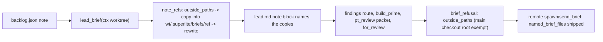
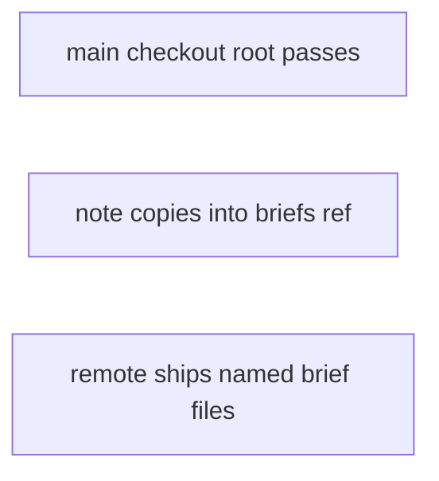

# B304: a standing note naming outside paths reaches workers through copies (#1067)

**Goal:** one rule both sides follow (#1067): when a lead brief is written, every path outside the project that main's standing note names is copied into the lead worktree's `.superlite/briefs/ref/` and the note in the brief names the copies, so every brief that copies the note (worker primes, `findings route` fix briefs, the review packet, `fleet spawn --for-review`) passes the #1015 check; the project root never counts as outside; a remote worker gets the `.superlite/briefs/` files its brief, prime or plan names.
**Architecture:** `fleet.main_checkout` + one exemption in `fleet.outside_paths` (T1); `backlog_brief.note_refs` called by `lead_brief` when its ctx names the worktree (T2); `fleet_remote_worker.named_brief_files` feeding `spawn`'s start-commit blobs and `send_brief`'s push list (T3).
**Tech stack:** Python 3.10+ stdlib; pytest via `sl run_tests`.
**Spec:** issue #1067 (body: standing note copy rule vs the #1015 brief check; related: the project root refused, remote workers lacking `.superlite/briefs/ref/`); main's ruling in the lead brief: copy into briefs/ref and rewrite.
**Detail:** tests
**Wave0:** none
**Coverage:** off

## Global constraints

- Files this batch may touch: skills/subagent-driven-development/scripts/fleet.py, skills/subagent-driven-development/scripts/backlog_brief.py, skills/subagent-driven-development/scripts/fleet_remote_worker.py, the new test files named in the tasks, skills/subagent-driven-development/backlog.md, docs/fleet.md and this plan. Never edit backlog_run.py, backlog.py, run_tests.py, guard_*.py, pt_review.py, commit_task.py, _pyrun.py or fleet_roles.py (other batches own them). An existing test outside your files that breaks: name it in the report, do not edit it.
- Builds: the verdict is `sl run_tests` (the project's test command; a project with `.maxapp` runs `maxapp test`, which a build pool may place on another Mac, and a full run whose tree a green maxapp test stamp covers returns that result without a run); task trees build in <tree>/.build/DerivedData and any build of your own goes under .build/ of the worktree, never -derivedDataPath outside the worktree (your session scratchpad included; backlog cleanup removes scratchpad build folders when the worktree goes); a product, simulator or device build stays on this machine and runs only when an issue's acceptance asks for a running-app check; copy this sentence into every worker brief.
- Simulators: append the UDID of each simulator you or a worker creates (`xcrun simctl create` or `clone`; a checker's `Simulators:` line marks its created ones) as one line to /Users/max/github/superlite/.claude/worktrees/superlite-b304-outside-paths-in-notes/.superlite/simulators.txt; never list one you did not create; ship cleanup shuts down and deletes each listed one; copy this sentence into every worker brief.
- Every new or changed code line keeps the repo's trailing `# O(...)` complexity comment style.

Ruling: the copy runs in `backlog_brief.lead_brief` (it already gets `ctx["worktree"]`, which exists on disk when `backlog_run._write_brief` calls it), not in `backlog_run.cmd_start`, because backlog_run.py belongs to B309 (lead's ruling).
Ruling: copies mirror the source path: below `$HOME` as `ref/<path relative to $HOME>` (`$HOME/github/dashmax/docs` -> `ref/github/dashmax/docs`), elsewhere as `ref/<absolute path without its leading slash>`; a rerun overwrites (lead's ruling).
Ruling: a folder inside a git work tree copies `git ls-files --cached --others --exclude-standard` (ignored files and `.git` stay out); a folder git lists nothing for is walked, skipping `.git`, `node_modules`, `.build`, `DerivedData`, `.venv`, `venv`, `__pycache__`; symlinks inside a folder are skipped (lead's ruling).
Ruling: copy cap per note 50 MB and 5000 files (`REF_CAP`); a path over it, a missing one, one holding the worktree and an unreadable one stay as written and are named on one `Standing note: not copied` line after the note block, never inside it (lead's ruling).
Ruling: "the project root never counts as outside" means the scan's project (already passing) plus, in a linked worktree run, the main checkout's root path itself; a path below the main checkout still counts as outside, because a worker in the worktree cannot read it and reads its own tree's copy (lead's ruling).
Ruling: a remote worker gets every file under `<run folder>/briefs/` that its brief, prime or plan names (a named folder: each regular file in it), unmapped bytes at the same relative path; `send_brief` ships them only when the run folder lies inside the project (lead's ruling).
Ruling: the #1015 error text stays byte-identical (docs tests pin it) (lead's ruling).

## Main diagram



## File structure

- skills/subagent-driven-development/scripts/fleet.py: `main_checkout(project)`; `outside_paths` skips the main checkout root itself.
- skills/subagent-driven-development/scripts/backlog_brief.py: `REF_CAP`, `REF_SKIP`, `REF_COPIED`, `REF_SKIPPED`, `note_refs(note, wt)`; `lead_brief` uses it.
- skills/subagent-driven-development/backlog.md: one bullet on the copy rule.
- skills/subagent-driven-development/scripts/fleet_remote_worker.py: `named_brief_files(sd, project, texts)`; `spawn` and `send_brief` ship them.
- docs/fleet.md: one bullet after the #1015 bullet.
- tests/scripts/test_outside_root_1067.py, tests/scripts/test_backlog_note_refs_1067.py, tests/scripts/test_fleet_remote_briefs_1067.py: new.

## Task graph

```mermaid
%% schedule
gantt
  title Predicted schedule (mm:ss)
  dateFormat X
  axisFormat %M:%S
  section lane 1
  T2 note copies into briefs ref :t2, 0, 596s
  section lane 2
  T3 remote ships named brief files :t3, 0, 587s
  section lane 3
  T1 main checkout root passes :t1, 0, 549s
```





critical path: T2 (9.9 min) · peak width 3 · predicted build 9.9 min · predicted total ≈ 26.4 min

## Test layers

**Probe entry:** none (file copies, git and remote pushes; the named tests cover each case)

### T1 main checkout root passes · Complexity 2 (O-1) · Est. context 30k
**Owns:** skills/subagent-driven-development/scripts/fleet.py, tests/scripts/test_outside_root_1067.py
**Components:** 1
**LOC owned:** 70
**Tests:** fast
**Kind:** mechanical
**Model:** haiku
**Produces:** fleet.main_checkout(project: Path) -> Path | None
**Review Focus:** `test_main_checkout_root_itself_is_not_outside`, `test_paths_below_the_main_checkout_stay_outside`, `test_brief_naming_the_main_checkout_root_is_accepted` (file).
**Test code (verbatim):** new file tests/scripts/test_outside_root_1067.py:
```python
"""The project root never counts as outside: a linked worktree's main checkout root itself passes the #1015 scan (#1067)."""
import os, subprocess, sys
import pytest
from test_plan_tools import SCRIPTS
sys.path.insert(0, str(SCRIPTS))
import fleet  # noqa: E402
import fleet_io  # noqa: E402
import fleet_roles  # noqa: E402

GENV = {k: v for k, v in os.environ.items() if k not in ("GIT_DIR", "GIT_INDEX_FILE", "GIT_WORK_TREE")}


def git(cwd, *a):
    return subprocess.run(["git", "-C", str(cwd), *a], capture_output=True, text=True, check=True, env=GENV).stdout.strip()


@pytest.fixture
def repo(tmp_path, monkeypatch):
    main = tmp_path / "main"; main.mkdir()
    git(main, "init", "-q"); (main / "a.md").write_text("a\n")
    git(main, "add", "a.md"); git(main, "-c", "user.name=t", "-c", "user.email=t@t", "commit", "-qm", "base")
    wt = main / ".claude" / "worktrees" / "b1"
    git(main, "worktree", "add", "-q", "-b", "b1", str(wt))
    (wt / ".superlite").mkdir()
    monkeypatch.setattr(fleet_roles, "SKILLS", tmp_path / "plug" / "skills")
    return main.resolve(), wt.resolve()


def test_main_checkout_of_a_worktree(repo):
    main, wt = repo
    assert fleet.main_checkout(wt) == main
    assert fleet.main_checkout(main) is None


def test_main_checkout_without_a_gitdir_line_is_none(tmp_path):
    assert fleet.main_checkout(tmp_path) is None
    (tmp_path / ".git").write_text("not a gitdir line\n")
    assert fleet.main_checkout(tmp_path) is None


def test_main_checkout_root_itself_is_not_outside(repo):
    main, wt = repo
    text = f"Read code here, not in {main}. Also not in {main}/ and `{main}`.\n"
    assert fleet.outside_paths(text, wt, wt / ".superlite") == []


def test_paths_below_the_main_checkout_stay_outside(repo):
    main, wt = repo
    assert fleet.outside_paths(f"Read {main}/a.md\n", wt, wt / ".superlite") == [f"{main}/a.md"]


def test_project_root_itself_passes_in_a_main_run(repo):
    main, _ = repo
    (main / ".superlite").mkdir()
    assert fleet.outside_paths(f"Project: {main} and {main}/ and {main}/a.md\n", main, main / ".superlite") == []


def test_brief_naming_the_main_checkout_root_is_accepted(repo):
    main, wt = repo
    b = wt / ".superlite" / "briefs" / "r.md"; b.parent.mkdir(parents=True)
    b.write_text(f"Read code in {wt}, not in {main}.\n")
    assert fleet_io.brief_refusal(wt / ".superlite", b, "research") is None
    b.write_text(f"Read {main}/a.md\n")
    assert "names paths outside the project" in fleet_io.brief_refusal(wt / ".superlite", b, "research")
```
**Code:** in fleet.py, right above `def outside_paths`, add `main_checkout(project)`: return None unless `<project>/.git` is a file whose stripped text matches `gitdir:\s*(\S.*)`; `gitdir = (Path(project) / <match>).resolve()` (an absolute match stays absolute); `common = (gitdir / <stripped text of gitdir/commondir>).resolve()` when that file exists, else `gitdir.parent.parent`; return `common.parent` when `common.name == ".git"` and `common.is_dir()`, else None; any OSError returns None. No git process. In `outside_paths`, compute `root = main_checkout(project)` once next to `bases`, and right after `real = Path(p).resolve()` add `if root is not None and real == root: continue` (the main checkout root itself passes; paths below it do not).
**Steps:** 1 write the test file, 2 run: FAIL, 3 implement, 4 run: PASS, also tests/scripts/test_fleet_brief_outside_1015.py
**Notes:** change nothing else in fleet.py.

### T2 note copies into briefs ref · Complexity 5 (O-1) · Est. context 45k
**Owns:** skills/subagent-driven-development/scripts/backlog_brief.py, skills/subagent-driven-development/backlog.md, tests/scripts/test_backlog_note_refs_1067.py
**Components:** 2
**LOC owned:** 210
**Tests:** fast
**Model:** sonnet
**Produces:** backlog_brief.note_refs(note: str, wt: Path) -> tuple[str, list[str]]
**Review Focus:** file: a folder holding the worktree is never copied (no recursion), `..` and `~` tokens resolve as `fleet.outside_paths` does, symlinks inside a folder are skipped; state: a rerun overwrites; encoding: the rewrite keeps a token's trailing `.`/`/` and a `file://` prefix; the rewritten note passes `fleet.outside_paths` except the named not-copied paths.
**Test code (verbatim):** new file tests/scripts/test_backlog_note_refs_1067.py:
```python
"""A standing note's outside paths are copied into the lead worktree's .superlite/briefs/ref/ and the note names the copies (#1067)."""
import os, subprocess, sys
import pytest
from test_plan_tools import SCRIPTS
sys.path.insert(0, str(SCRIPTS))
import backlog_brief as bb  # noqa: E402
import findings  # noqa: E402
import fleet  # noqa: E402
import fleet_roles  # noqa: E402

B = {"id": "B1", "topic": "t", "issues": [7], "files": ["a.py"], "answers": {}}
CTX = {"sl": "/x/sl", "backlog_md": "/x/backlog.md", "repo": "o/r", "approved": None, "titles": {"7": "Seven"}, "summaries": []}
GENV = {k: v for k, v in os.environ.items() if k not in ("GIT_DIR", "GIT_INDEX_FILE", "GIT_WORK_TREE")}


@pytest.fixture
def w(tmp_path, monkeypatch):
    tmp = tmp_path.resolve(); home = tmp / "home"; home.mkdir()
    monkeypatch.setenv("HOME", str(home))
    monkeypatch.setattr(fleet_roles, "SKILLS", tmp / "plug" / "skills")
    wt = tmp / "wt"; (wt / ".superlite").mkdir(parents=True)
    other = home / "github" / "other"; (other / "docs").mkdir(parents=True)
    (other / "docs" / "spec.md").write_text("spec\n"); (other / "README.md").write_text("readme\n")
    return type("W", (), {"home": home, "wt": wt, "other": other, "ref": wt / ".superlite" / "briefs" / "ref", "tmp": tmp})


def test_file_is_copied_and_the_note_names_the_copy(w):
    note, lines = bb.note_refs(f"Read {w.other}/docs/spec.md first.", w.wt)
    copy = w.ref / "github" / "other" / "docs" / "spec.md"
    assert copy.read_text() == "spec\n" and note == f"Read {copy} first."
    assert lines == [bb.REF_COPIED.format(n=1, ref=w.ref)]


def test_tilde_folder_is_copied_with_its_files(w):
    note, lines = bb.note_refs("Reference repo: ~/github/other (read-only).", w.wt)
    dest = w.ref / "github" / "other"
    assert (dest / "docs" / "spec.md").read_text() == "spec\n" and (dest / "README.md").read_text() == "readme\n"
    assert note == f"Reference repo: {dest} (read-only)." and lines == [bb.REF_COPIED.format(n=1, ref=w.ref)]


def test_git_folder_copies_listed_files_only(w):
    def git(*a): subprocess.run(["git", "-C", str(w.other), *a], check=True, capture_output=True, env=GENV)
    git("init", "-q"); (w.other / ".gitignore").write_text("build/\n")
    (w.other / "build").mkdir(); (w.other / "build" / "big.bin").write_text("x")
    git("add", ".gitignore", "README.md"); git("-c", "user.name=t", "-c", "user.email=t@t", "commit", "-qm", "b")
    bb.note_refs(f"See {w.other}.", w.wt)
    dest = w.ref / "github" / "other"
    assert (dest / "README.md").is_file() and (dest / "docs" / "spec.md").is_file() and (dest / ".gitignore").is_file()
    assert not (dest / "build").exists() and not (dest / ".git").exists()


def test_walk_skips_generated_folders_and_symlinks(w):
    (w.other / "node_modules").mkdir(); (w.other / "node_modules" / "m.js").write_text("m")
    os.symlink(w.home, w.other / "link")
    bb.note_refs(f"See {w.other}.", w.wt)
    dest = w.ref / "github" / "other"
    assert (dest / "README.md").is_file() and not (dest / "node_modules").exists() and not (dest / "link").exists()


def test_path_outside_home_mirrors_its_absolute_path(w):
    f = w.tmp / "elsewhere" / "x.md"; f.parent.mkdir(); f.write_text("x")
    note, _ = bb.note_refs(f"Read [x](file://{f}).", w.wt)
    copy = w.ref / str(f).lstrip("/")
    assert copy.read_text() == "x" and note == f"Read [x](file://{copy})."


def test_missing_capped_and_enclosing_paths_are_named_not_copied(w, monkeypatch):
    monkeypatch.setattr(bb, "REF_CAP", (10, 5000))
    text = f"Write {w.other}/new.md; read {w.other}/docs/spec.md and {w.other}/README.md; all of {w.tmp}."
    note, lines = bb.note_refs(text, w.wt)
    assert note == f"Write {w.other}/new.md; read {w.ref}/github/other/docs/spec.md and {w.other}/README.md; all of {w.tmp}."
    items = f"{w.other}/new.md (missing); {w.other}/README.md (over the copy cap); {w.tmp} (holds the worktree)"
    assert lines == [bb.REF_COPIED.format(n=1, ref=w.ref), bb.REF_SKIPPED.format(items=items)]
    assert not (w.ref / "github" / "other" / "README.md").exists()


def test_rewritten_note_passes_the_spawn_scan(w):
    text = f"Read ~/github/other/docs/spec.md, {w.other}/README.md and {w.other}/gone.md; code in {w.wt}/src."
    note, _ = bb.note_refs(text, w.wt)
    assert fleet.outside_paths(note, w.wt, w.wt / ".superlite") == [f"{w.other}/gone.md"]


def test_inside_paths_and_a_missing_worktree_leave_the_note_alone(w):
    text = f"Code in {w.wt}/src and docs/x.md."
    assert bb.note_refs(text, w.wt) == (text, [])
    out = f"Read {w.other}/README.md"
    assert bb.note_refs(out, w.tmp / "nowhere") == (out, []) and not (w.tmp / "nowhere").exists()


def test_rerun_overwrites_the_copy(w):
    bb.note_refs(f"Read {w.other}/docs/spec.md", w.wt)
    (w.other / "docs" / "spec.md").write_text("v2\n")
    bb.note_refs(f"Read {w.other}/docs/spec.md", w.wt)
    assert (w.ref / "github" / "other" / "docs" / "spec.md").read_text() == "v2\n"


def test_lead_brief_copies_and_standing_note_reads_the_copies(w):
    t = bb.lead_brief(B, {**CTX, "note": f"Reference: {w.other}/docs/spec.md", "worktree": str(w.wt)})
    rows = t.splitlines(); i = rows.index(bb.NOTE_HEAD)
    assert rows[i + 1] == f"    Reference: {w.ref}/github/other/docs/spec.md"
    assert rows[i + 2] == bb.REF_COPIED.format(n=1, ref=w.ref)
    (w.wt / ".superlite" / "briefs" / "lead.md").write_text(t)
    lines = findings.standing_note(w.wt / ".superlite")
    assert lines == [bb.NOTE_HEAD, f"    Reference: {w.ref}/github/other/docs/spec.md"]
    assert fleet.outside_paths("\n".join(lines), w.wt, w.wt / ".superlite") == []


def test_lead_brief_without_worktree_keeps_the_note(w):
    t = bb.lead_brief(B, {**CTX, "note": f"Reference: {w.other}/docs/spec.md"})
    assert f"    Reference: {w.other}/docs/spec.md" in t.splitlines() and not w.ref.exists()


def test_backlog_md_names_the_copy_rule():
    text = (SCRIPTS.parent / "backlog.md").read_text(encoding="utf-8")
    assert "copied into `.superlite/briefs/ref/`" in text and "`Standing note: not copied`" in text and "(#1067)" in text
```
**Code:** in backlog_brief.py add, below `NOTE_HEAD`:
- `REF_CAP = (50 * 1024 * 1024, 5000)` (bytes, files per note), `REF_SKIP = {".git", "node_modules", ".build", "DerivedData", ".venv", "venv", "__pycache__"}`
- `REF_COPIED = "Standing note: {n} outside path(s) copied into {ref}/; the note above names the copies, read-only references (#1067)."`
- `REF_SKIPPED = "Standing note: not copied, so a worker cannot read them; keep them out of worker briefs: {items} (#1067)."`
- `note_refs(note, wt)`: `wt = Path(wt)`; not a directory: `return note, []`. `sd = wt / ".superlite"`, `ref = sd / "briefs" / "ref"`. `toks = fleet.outside_paths(note, wt, sd)` (import fleet lazily inside the function). Per token, in order: resolve it as outside_paths does (`os.path.expanduser`, a `../` token joined to `wt`, `os.path.normpath`, a leading `//` collapsed); `dest = ref / <p relative to os.path.normpath(os.path.expanduser("~"))>` when p lies below home, else `ref / p.lstrip("/")`. Then: a token whose path lies at or below an already copied token's path maps to its dest without a copy; a missing path -> `(tok, "missing")`; a path that equals or encloses `wt` -> `(tok, "holds the worktree")`; else list its files (a file: itself; a folder: `git -C <folder> ls-files -z --cached --others --exclude-standard` with env without GIT_DIR, GIT_INDEX_FILE, GIT_WORK_TREE and a 30 s timeout, regular non-symlink files only; a failed or empty listing: `os.walk(followlinks=False)` pruning `REF_SKIP` dirs and skipping symlinks); when the note's running byte or file total would pass `REF_CAP` -> `(tok, "over the copy cap")`; else copy each file to its dest (`mkdir(parents=True, exist_ok=True)`, `shutil.copyfile`, overwriting); an OSError -> `(tok, f"unreadable: {e.strerror or e}")`. Rewrite with `fleet.OUT_TOKEN.sub`: a match whose `group(1).rstrip("./")` is a mapped token keeps the text before group 1 (`file://`, the lead char) and after the token, with the token replaced by `str(dest)`. Return the rewritten note and the lines: `REF_COPIED.format(n=<mapped tokens>, ref=ref)` when any, then `REF_SKIPPED.format(items="; ".join(f"{tok} ({why})"))` when any.
- `lead_brief`: in the `if ctx.get("note"):` block, `note, extra = note_refs(str(ctx["note"]), ctx["worktree"]) if ctx.get("worktree") else (str(ctx["note"]), [])`; the four-space note lines come from `note`, then `out += extra` right after them.
- skills/subagent-driven-development/backlog.md: a new bullet right after the bullet that ends "goes into every brief and task message you give a worker.", leaving that bullet unchanged: `- A path outside the project that the standing note names is copied into `.superlite/briefs/ref/` when your lead brief is written, and the note in your brief names the copy, so briefs that copy the note pass the #1015 check; a path that could not be copied (missing, over the 50 MB / 5000-file cap, holding the worktree, unreadable) is named on the brief's `Standing note: not copied` line: keep it out of worker briefs (#1067).`
**Steps:** 1 write the test file, 2 run: FAIL, 3 implement, 4 run: PASS, then every tests/scripts/test_backlog_brief*.py, test_backlog_docs_b89.py and test_backlog_rules_split_684.py
**Notes:** the note lines keep their `CTRL.sub` cleaning; `note_refs` never writes outside `ref`.

### T3 remote ships named brief files · Complexity 4 (O-1) · Est. context 45k
**Owns:** skills/subagent-driven-development/scripts/fleet_remote_worker.py, docs/fleet.md, tests/scripts/test_fleet_remote_briefs_1067.py
**Components:** 2
**LOC owned:** 110
**Tests:** fast
**Model:** sonnet
**Produces:** fleet_remote_worker.named_brief_files(sd: Path, project: Path, texts: list[str]) -> list[str]
**Review Focus:** file: a `..` that leaves `<sd>/briefs` is ignored, symlinks are not followed; state: the brief itself and an already shipped blob are not shipped twice; protocol: `send_brief`'s prompt and mapped copy still name only remote paths.
**Test code (verbatim):** new file tests/scripts/test_fleet_remote_briefs_1067.py:
```python
"""A remote worker gets the files under .superlite/briefs/ its brief, prime or plan names, at the same path in its tree (#1067)."""
import sys
from test_fleet_remote_worker import world, start_files, show, plan_for  # noqa: F401
from test_plan_tools import SCRIPTS
sys.path.insert(0, str(SCRIPTS))
import fleet_remote as fr  # noqa: E402
import fleet_remote_worker as rw  # noqa: E402


def refs(world):
    ref = world.sd / "briefs" / "ref" / "github" / "other"; (ref / "docs").mkdir(parents=True)
    (ref / "docs" / "spec.md").write_text("spec"); (ref / "README.md").write_text("readme")
    (world.sd / "briefs" / "notes.md").write_text("n"); (world.sd / "briefs" / "unnamed.md").write_text("u")
    return ref


def test_named_brief_files_lists_files_and_folder_contents(world):
    ref = refs(world)
    text = f"Read {ref}/docs/spec.md, the repo `{ref}` and .superlite/briefs/notes.md."
    assert rw.named_brief_files(world.sd, world.proj, [text]) == ["notes.md", "ref/github/other/README.md", "ref/github/other/docs/spec.md"]


def test_named_brief_files_ignores_escapes_and_missing(world):
    refs(world)
    text = f"{world.sd}/briefs/../fleet.json {world.sd}/briefs/gone.md {world.proj}/.superlite/briefs/notes.md"
    assert rw.named_brief_files(world.sd, world.proj, [text]) == ["notes.md"]


def test_spawn_ships_the_named_ref_files(world):
    ref = refs(world)
    b = world.sd / "briefs" / "r.md"; b.write_text(f"Answer from {ref}/docs/spec.md and {ref}/README.md.")
    rw.spawn(world.sd, "research", None, world.proj, "box", brief=str(b))
    names, start = start_files(world)
    assert {".superlite/briefs/ref/github/other/docs/spec.md", ".superlite/briefs/ref/github/other/README.md", ".superlite/briefs/r.md"} <= set(names)
    assert ".superlite/briefs/unnamed.md" not in names and ".superlite/briefs/notes.md" not in names
    assert show(world, start, ".superlite/briefs/ref/github/other/docs/spec.md") == "spec"


def test_implementer_ships_ref_files_its_prime_names(world):
    ref = refs(world)
    plan = plan_for(world)
    prime = world.sd / "prime.md"; prime.write_text(prime.read_text() + f"## Standing note\n    Reference: {ref}/README.md\n")
    rw.spawn(world.sd, "implementer", "sonnet", world.proj, "box", task="T3", plan=str(plan))
    names, _ = start_files(world)
    assert ".superlite/briefs/ref/github/other/README.md" in names and ".superlite/briefs/ref/github/other/docs/spec.md" not in names


def test_send_brief_ships_the_named_ref_files(world):
    ref = refs(world)
    rw.spawn(world.sd, "research", None, world.proj, "box")
    b = world.sd / "briefs" / "q.md"; b.write_text(f"Read the repo at {ref}.")
    rw.send_brief(world.sd, "W1", str(b), "Q1")
    tree = world.trees / fr.tree_name(world.sd, "W1")
    assert (tree / ".superlite/briefs/ref/github/other/docs/spec.md").read_text() == "spec"
    assert (tree / ".superlite/remote/W1/briefs/q.md").read_text() == f"Read the repo at {tree}/.superlite/briefs/ref/github/other."
    assert not (tree / ".superlite/briefs/unnamed.md").exists()


def test_docs_name_the_rule():
    text = (SCRIPTS.parents[2] / "docs" / "fleet.md").read_text(encoding="utf-8")
    assert "(#1067)" in text and "`.superlite/briefs/ref/`" in text and "at the same path in its tree" in text
```
**Code:** in fleet_remote_worker.py add `named_brief_files(sd, project, texts)`: `base = Path(sd).resolve() / "briefs"`; find in each text every run of non-space characters after one of these prefixes: `str(sd)`, `str(Path(sd).resolve())` and `str(Path(project).resolve())` + `"/.superlite"`, `str(project)` + `"/.superlite"`, each followed by `/briefs/`, or a bare `.superlite/briefs/` not preceded by a word char, `/` or `.`; cut each match at the first of `` `'"()[]{}<>,; `` and whitespace, then strip trailing `.` and `:`. Resolve `base / rest`; skip it unless it lies below `base` and exists; a file adds its path relative to `base`; a folder adds each regular non-symlink file below it (`os.walk(followlinks=False)`). Return the sorted unique posix strings. In `spawn`, after the `if brief:` block: for each name of `named_brief_files(sd, project, [<brief text if brief>, <prime text if launch["prime"]>, <plan text if plan>])` whose key `f".superlite/briefs/{name}"` is not in `blobs` and not the brief's own key, set `blobs[key] = (sd / "briefs" / name).read_bytes()` (unmapped). In `send_brief`, when `Path(sd).resolve()` lies inside `project`, add the relative paths of `named_brief_files(sd, project, [path.read_text(encoding="utf-8", errors="surrogateescape")])` (minus the brief itself) to the `fr.push` file list; the mapped copy and the prompt stay as they are.
docs/fleet.md: a new bullet right after the bullet that ends "nothing sent (#1024).", leaving that bullet unchanged: `- The project root never counts as outside: in a linked worktree run the main checkout's root path itself passes too; a path below it still counts, since a worker reads its own tree's copy. A standing note's outside paths are copied into the lead worktree's `.superlite/briefs/ref/` when its lead brief is written, and the note names the copies, so the briefs that copy the note pass; a path that could not be copied is named on the brief's `Standing note: not copied` line. A remote worker gets every file under `.superlite/briefs/` that its brief, prime or plan names (a named folder: each regular file in it) at the same path in its tree (#1067).`
**Steps:** 1 write the test file, 2 run: FAIL, 3 implement, 4 run: PASS, then tests/scripts/test_fleet_remote_worker.py and tests/scripts/test_docs_b285_fleet.py
**Notes:** the brief's own blob stays mapped as today; ref files ship raw.

## Review Focus

Package fleet/backlog scripts: app type file I/O + CLI helper; categories file, encoding, state. Specific risks: copying a folder that holds the worktree (recursion), a whole reference repo over the cap, `..` escapes from `.superlite/briefs`, generated briefs (findings route, build_prime, pt_review packet, for_review) still naming outside paths, tests that call `lead_brief` with a `worktree` and an outside note.

## Self-review

Every #1067 point maps to a task: the copy rule (T2), the project root (T1), remote placement (T3); generated briefs follow from T2 (they copy the rewritten note block of lead.md). No placeholders; T1-T3 own disjoint files and have no edges (T2 uses the existing `fleet.outside_paths`, T3 the existing `fr.mapper`).
