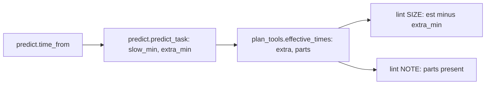

# B319: plan lint SIZE leaves out slow-test minutes (#1121)

**Goal:** lint `SIZE:` judges a `Tests: slow` task like its fast twin: the minutes its slow tests add join `extra_min`, as the suite and review minutes do since #787, so splitting is never asked for a cost splitting cannot shrink.
**Architecture:** `predict.predict_task` computes `slow_min` (the slow task's minutes beyond the same task with `Tests: fast` and no suite term), adds it to `extra_min` and the per-task JSON; `plan_tools.effective_times` also hands lint the names of the parts present, and the lint NOTE names only those.
**Tech stack:** Python 3 stdlib, pytest (`sl run_tests`).
**Spec:** GitHub issue #1121 (no spec file).
**Detail:** tests
**Wave0:** none
**Coverage:** off
**Target-min:** 11

## Global constraints

- Files this batch may touch: skills/subagent-driven-development/scripts/plan_tools.py, skills/subagent-driven-development/scripts/predict.py, plus the test files the task owns. Never edit docs/tools.md (batch B326 owns it), run_tests.py, pt_review.py, state.py, findings.py, fleet*.py, backlog*.py.
- Keep each file's style: every code line ends with its `# O(...)` complexity comment, as the lines around it do.
- `est_time_min` and `cost` of every task stay exactly as today; only `extra_min`, the new `slow_min` key and the lint NOTE wording change.
- Builds: the verdict is `sl run_tests` (the project's test command; a project with `.maxapp` runs `maxapp test`, which a build pool may place on another Mac, and a full run whose tree a green maxapp test stamp covers returns that result without a run); task trees build in <tree>/.build/DerivedData and any build of your own goes under .build/ of the worktree, never -derivedDataPath outside the worktree (your session scratchpad included; backlog cleanup removes scratchpad build folders when the worktree goes); a product, simulator or device build stays on this machine and runs only when an issue's acceptance asks for a running-app check; copy this sentence into every worker brief.
- Simulators: append the UDID of each simulator you or a worker creates (`xcrun simctl create` or `clone`; a checker's `Simulators:` line marks its created ones) as one line to /Users/max/github/superlite/.claude/worktrees/superlite-b319-plan-lint-size-slow-minutes/.superlite/simulators.txt; never list one you did not create; ship cleanup shuts down and deletes each listed one; copy this sentence into every worker brief.

## Rulings

- Ruling: slow-test minutes = `time_from(feats without suite_run_min)` minus `time_from` of the same features with `tests: "fast"`, clamped at 0 and rounded to 3 places (because the band then judges a slow task exactly like its fast twin, with or without live inputs; the plain `slow_tests_min x language_scale` term would leave the live run minutes a slow task already folds into `slow_tests_min` double-excused).
- Ruling: the per-task JSON names it as `slow_min` (only when above 0), next to `suite` and `review`; `extra_min` now sums suite, review and slow minutes.
- Ruling: the NOTE's parenthesis names only the parts present, in the order slow tests, existing tests, review rounds (because a slow-only task saying "existing tests, review rounds" misleads); docs/tools.md (B326) is a follow-up.

## Main diagram



## File structure

- skills/subagent-driven-development/scripts/predict.py: `predict_task` adds `slow_min` and folds it into `extra_min`; module docstring names it.
- skills/subagent-driven-development/scripts/plan_tools.py: `EXTRA_PARTS`, `extra_parts`, `effective_times(..., parts=)`, the SIZE NOTE wording.
- tests/scripts/test_size_slow_band_1121.py: new tests.
- tests/scripts/test_plan_tools_size_extra_787.py: the review-only NOTE now reads `(review rounds)`.
- tests/scripts/test_docs_b268_tools.py: its plan_tools.py code pin follows the new NOTE source.

## Task graph

```mermaid
%% schedule
gantt
  title Predicted schedule (mm:ss)
  dateFormat X
  axisFormat %M:%S
  section lane 1
  T1 slow minutes outside the size band :t1, 0, 406s
```




critical path: T1 (6.8 min) · peak width 1 · predicted build 6.8 min · predicted total ≈ 19.3 min (target ✗ 11.0)

## Predicted schedule

## Forecast and lint

### T1 slow minutes outside the size band · Complexity 4 (O-1) · Est. context 45k
**Owns:** skills/subagent-driven-development/scripts/predict.py, skills/subagent-driven-development/scripts/plan_tools.py, tests/scripts/test_size_slow_band_1121.py, tests/scripts/test_plan_tools_size_extra_787.py, tests/scripts/test_docs_b268_tools.py
**Components:** 2
**LOC owned:** 110
**Tests:** fast
**Model:** sonnet
**Produces:** predict.predict_task(task, models: dict, coef: dict, plan=None) -> dict · plan_tools.extra_parts(p: dict) -> list[str] · plan_tools.effective_times(plan: Plan, graph: dict[str, list[str]], args, extra: dict | None = None, parts: dict | None = None) -> tuple[dict[str, float], dict[str, str]]
  e.g. predict_task(1 component, 25 LOC, Tests: slow, sonnet; coef = shipped predictor.json with time.slow_tests_min 7.0, no live) -> {"est_time_min": 8.541, "slow_min": 7.0, "extra_min": 7.0, ...}
  e.g. plan_tools.extra_parts({"slow_min": 1.0, "suite": {"cases": 9}, "review": {"min": 5.0}}) -> ["slow tests", "existing tests", "review rounds"]
  e.g. plan_tools.extra_parts({"est_time_min": 2.0}) -> []
**Review Focus:** numeric: `test_live_slow_task_band_equals_fast_twin` (live fast_min 1.0, factor 1.0, slow_tests_min 7.0: slow_min 5.5, est minus extra equals the fast twin); state: `test_live_shipped_prior_slow_task_has_no_slow_min` (no `slow_min` or `extra_min` key when the live runs already hold the slow minutes)

**predict.py:** in `predict_task`, compute `no_suite` (feats without `suite_run_min`) before the suite block and reuse it there. When `feats["tests"] == "slow"`: `slow_min = round(max(0.0, time_from(no_suite, model, models, coef) - time_from(dict(no_suite, tests="fast"), model, models, coef)), 3)`; add it to `extra`. In `out`: `"slow_min"` only when `slow_min > 0`, after `test_min` and before `suite`; `extra_min` is written when `suite or review or slow_min > 0`. `minutes`, `est_time_min` and cost do not change. Add to the module docstring, after the suite and review paragraph: "Slow tests (#1121): a `Tests: slow` task's minutes beyond its fast twin (the same features with `Tests: fast`, no suite term) are `slow_min`; they join `extra_min`, since splitting does not shrink them."

**plan_tools.py:** above `effective_times` add
```python
EXTRA_PARTS = (("slow_min", "slow tests"), ("suite", "existing tests"), ("review", "review rounds"))  # #1121: extra_min's parts, in NOTE order | O(1)


def extra_parts(p: dict) -> list[str]:  # O(1)
    """The names of the parts of a prediction's extra_min that are present (slow tests, existing tests, review rounds)."""
    return [name for key, name in EXTRA_PARTS if p.get(key)]  # O(1)
```
`effective_times` gains `parts: dict | None = None`; given, `parts[tid] = extra_parts(p)` next to `extra[tid]`; its docstring names the slow-test minutes (#1121) and `parts`. In lint's size-band block create `why: dict[str, list[str]] = {}` next to `ex`, pass `parts=why`, change the comment to `suite, review and slow-test minutes do not shrink by splitting (#787, #1121)`, and write the NOTE as
`warnings.append(f"NOTE: {t} predicted {times[t]:.1f} min, {ex[t]:.1f} of it outside the size band ({', '.join(why.get(t, []))}); splitting does not shrink it")`.

**Other tests:** test_plan_tools_size_extra_787.py: `NOTE = "NOTE: T1 predicted 6.7 min, 5.0 of it outside the size band (review rounds); splitting does not shrink it"`. test_docs_b268_tools.py CODE list: replace the entry `("plan_tools.py", "of it outside the size band (existing tests, review rounds); splitting does not shrink it")` with `("plan_tools.py", 'EXTRA_PARTS = (("slow_min", "slow tests"), ("suite", "existing tests"), ("review", "review rounds"))')` and `("plan_tools.py", "of it outside the size band ({', '.join(why.get(t, []))}); splitting does not shrink it")`; leave its NAMED list (docs/tools.md) as is.

**Test code (verbatim):** tests/scripts/test_size_slow_band_1121.py
```python
"""#1121: a Tests: slow task's slow-test minutes join extra_min, so lint SIZE judges it like its fast twin."""
from __future__ import annotations

import argparse
import json
import sys

import pytest

from test_plan_tools import SCRIPTS, make_plan, pt

sys.path.insert(0, str(SCRIPTS))
import plan_tools  # noqa: E402
import predict  # noqa: E402

SHIPPED = predict.CONFIG_DIR / "predictor.json"
TASK = {"id": "T1", "owns": "Sources/App/A.swift, Tests/AppTests/ATests.swift", "components": 1, "loc": 25, "tests": "slow", "model": "sonnet"}


def coef_file(tmp_path, slow=7.0):
    coef = json.loads(SHIPPED.read_text(encoding="utf-8"))
    coef["time"]["slow_tests_min"] = slow
    path = tmp_path / "predictor.json"
    path.write_text(json.dumps(coef), encoding="utf-8")
    return path


def task_of(tmp_path, **kw):
    plan = plan_tools.Plan.load(str(make_plan(tmp_path, [dict(TASK, **kw)])))
    return plan.by_id["T1"]


def live(tmp_path, coef):
    return predict.apply_live(coef, {"tests": {"fast_min": 1.0, "case_s": 0.2, "case_source": "prior"},
                                     "contention": {"factor": 1.0}, "root": str(tmp_path)})


def run(tmp_path, coef, **kw):
    return predict.predict_task(task_of(tmp_path, **kw), predict.load_models(), coef)


def test_slow_minutes_join_extra_min_without_live(tmp_path):
    coef = predict.load_coef(str(coef_file(tmp_path)))
    got, twin = run(tmp_path, coef), run(tmp_path, coef, tests="fast")
    assert got["slow_min"] == 7.0
    assert got["extra_min"] == 7.0
    assert got["est_time_min"] == pytest.approx(8.541, abs=0.001)
    assert got["est_time_min"] - got["extra_min"] == pytest.approx(twin["est_time_min"], abs=0.002)
    assert "slow_min" not in twin and "extra_min" not in twin


def test_shipped_prior_counts_its_slow_minutes(tmp_path):
    got = run(tmp_path, predict.load_coef(str(SHIPPED)))
    assert got["slow_min"] == pytest.approx(0.607, abs=0.001)
    assert got["extra_min"] == got["slow_min"]


def test_live_slow_task_band_equals_fast_twin(tmp_path):
    coef = live(tmp_path, predict.load_coef(str(coef_file(tmp_path))))
    got, twin = run(tmp_path, coef), run(tmp_path, coef, tests="fast")
    assert got["slow_min"] == 5.5
    assert got["test_min"] == 0.0
    assert got["est_time_min"] - got["extra_min"] == pytest.approx(twin["est_time_min"], abs=0.002)


def test_live_shipped_prior_slow_task_has_no_slow_min(tmp_path):
    got = run(tmp_path, live(tmp_path, predict.load_coef(str(SHIPPED))))
    assert "slow_min" not in got and "extra_min" not in got


@pytest.mark.parametrize("mode", ["fast", "build"])
def test_fast_and_build_tasks_get_no_slow_min(tmp_path, mode):
    got = run(tmp_path, predict.load_coef(str(coef_file(tmp_path))), tests=mode)
    assert "slow_min" not in got and "extra_min" not in got


def test_lint_size_leaves_slow_minutes_out(tmp_path):
    cp = pt("lint", "--plan", make_plan(tmp_path, [TASK]), "--coef", coef_file(tmp_path))
    assert "SIZE: T1" not in cp.out, cp.both
    assert "NOTE: T1 predicted 8.5 min, 7.0 of it outside the size band (slow tests); splitting does not shrink it" in cp.out, cp.both


def test_lint_size_still_fires_for_big_slow_work(tmp_path):
    cp = pt("lint", "--plan", make_plan(tmp_path, [dict(TASK, loc=2500)]), "--coef", coef_file(tmp_path))
    assert "SIZE: T1 predicted 6.9 min > 6 max" in cp.out, cp.both


def test_effective_times_fills_parts(tmp_path):
    plan = plan_tools.Plan.load(str(make_plan(tmp_path, [TASK])))
    graph = plan_tools.parse_taskgraph(plan)
    args = argparse.Namespace(coef=str(coef_file(tmp_path)))
    ex: dict = {}
    why: dict = {}
    plan_tools.effective_times(plan, graph, args, extra=ex, parts=why)
    assert ex == {"T1": 7.0}
    assert why == {"T1": ["slow tests"]}


def test_extra_parts_order_and_empty():
    assert plan_tools.extra_parts({"review": {"min": 5.0}, "suite": {"cases": 9}, "slow_min": 1.0}) == ["slow tests", "existing tests", "review rounds"]
    assert plan_tools.extra_parts({"est_time_min": 2.0}) == []
```
**Steps:** 1 write the new test file, 2 run: FAIL, 3 implement predict.py then plan_tools.py and update the two pinned tests, 4 run: PASS, also tests/scripts/test_predict_suite_review_787.py, test_predict_forecast_605.py, test_stable_split.py and test_plan_tools.py.
**Notes:** if a value in the verbatim tests is off by rounding only (the third decimal), keep the assertion's intent and report the change. `make_plan` writes `plan.md`, `coef_file` writes `predictor.json` in the same tmp folder.

**Probe entry:** none (predict_task takes a Task object and lint a plan file; no one-text-argument entry)

## Review Focus

- predict / plan_tools (library and CLI): numeric (rounding of `slow_min`, clamping at 0, the band equality with the fast twin, live and no-live), state (the keys present per mode: `slow_min`, `extra_min` absent for fast and build), protocol (the NOTE text and the parts order).

## Self-review

Coverage: #1121's expectation (SIZE excludes slow-test minutes) is T1's `test_lint_size_leaves_slow_minutes_out`. Placeholders: none. Types: `effective_times`' new `parts` keyword is optional, so its other callers stay unchanged. Graph: one task, no edges. Measurable fields: all set.
