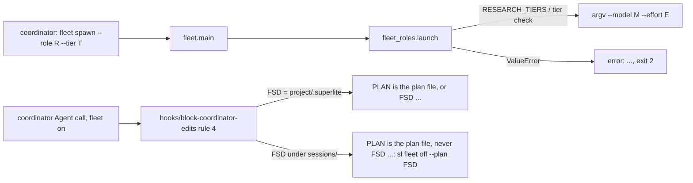
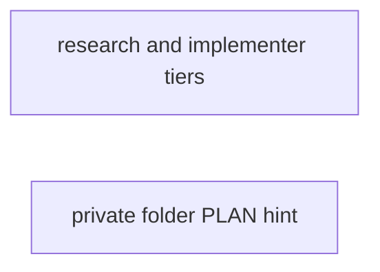

# B308: research --tier maps fixing.md's tiers; the Agent-block hook never names a private state folder as PLAN (#1072)

**Goal:** `sl fleet spawn --role research --tier 3` starts the researcher on opus, never `claude --model 3`; an unknown research (or implementer) tier exits 2 naming the valid tiers before any pane starts. With fleet on and the session's state folder its private one (`<superlite home>/sessions/<sid>.d/.superlite`), the Agent-block message of hooks/block-coordinator-edits no longer tells the coordinator to pass that folder as PLAN (a worker spawned with it starts in `sessions/<sid>.d`, cannot read the project, and the #1015 brief check refuses project paths); it names the working path instead.
**Architecture:** `fleet_roles.launch` gets a `RESEARCH_TIERS` table (tier -> model, effort override) like `FIXER_AGENTS`, and the implementer branch validates its tier against the routing tiers plus the model names. `fleet.main`'s existing `except ValueError` turns both refusals into `error: ...`, exit 2. In the hook's rule-4 block, one sentence per message (the `PLAN is the plan file, or $FSD ...` sentence) is chosen by whether `$FSD` lies under the sessions folder.
**Tech stack:** Python 3 stdlib, bash builtins (hook), pytest via `sl run_tests`.
**Spec:** issue #1072.
**Detail:** tests
**Wave0:** none
**Coverage:** off

## Global constraints

- Research tiers (lead's ruling): `1` and `sonnet` -> model sonnet at the agent file's effort (low); `2` and `sonnet-high` -> sonnet at effort `high`; `3` and `opus` -> opus at the agent file's effort; `haiku` -> haiku at the agent file's effort; `None` (no `--tier`) and `""` -> sonnet, as today. Anything else raises `ValueError("research tier must be 1, 2, 3, sonnet, sonnet-high, opus or haiku")`.
- Implementer tiers (lead's ruling, adjacent fix): a tier that is neither a key of `cfg["tiers"]` nor one of `sonnet`, `haiku`, `opus` raises `ValueError("implementer tier must be " + <sorted names joined as "a, b or c">)`; with the shipped routing.json that text is `implementer tier must be haiku, opus or sonnet`. `None` and `""` stay the default (sonnet).
- The hook's private-folder test: `$FSD` (after the moved_to loop) normalised with the hook's `norm` lies under `norm "${SUPERLITE_HOME:-$HOME/.superlite}/sessions"` followed by `/`. A `<project>/.superlite` FSD keeps today's text byte for byte (six tests pin it: test_guard_fleet_research_hint.py, test_guard_fleet_run_state_495.py, test_guard_fleet_moved_580.py).
- Every code line in fleet_roles.py ends with its `# O(...)` complexity comment like its neighbours. The hook stays bash builtins only (no new process).
- Files this batch may touch: skills/subagent-driven-development/scripts/fleet_roles.py, hooks/block-coordinator-edits, docs/fleet.md, the new test files below and this plan. fleet.py is another batch's file: never edit it. An existing test that breaks: name it in the report, do not edit it without the lead's word.
- Builds: the verdict is `sl run_tests` (the project's test command; a project with `.maxapp` runs `maxapp test`, which a build pool may place on another Mac, and a full run whose tree a green maxapp test stamp covers returns that result without a run); task trees build in <tree>/.build/DerivedData and any build of your own goes under .build/ of the worktree, never -derivedDataPath outside the worktree (your session scratchpad included; backlog cleanup removes scratchpad build folders when the worktree goes); a product, simulator or device build stays on this machine and runs only when an issue's acceptance asks for a running-app check; copy this sentence into every worker brief.
- Simulators: append the UDID of each simulator you or a worker creates (`xcrun simctl create` or `clone`; a checker's `Simulators:` line marks its created ones) as one line to /Users/max/github/superlite/.claude/worktrees/superlite-b308-research-tier-pin/.superlite/simulators.txt; never list one you did not create; ship cleanup shuts down and deletes each listed one; copy this sentence into every worker brief.

Ruling: research tiers are aliases as for fixers (1 = sonnet, 2 = sonnet-high, 3 = opus); a model name keeps B54's meaning (that model at the agent file's effort), and tier 2 is the only one that changes the effort, since fixing.md's tier 2 is sonnet at high effort (lead's ruling).
Ruling: [scope] the worker cwd and the brief check of a private state folder come from fleet.py (`state.git_root(sd) or sd.parent`), owned by B303 and B304: that fix is a follow-up; this batch changes the hook text only. hooks/capture-agent-launch (listed in the brief) only records launches and stays untouched; the Agent-block hook is hooks/block-coordinator-edits, which no open batch lists (lead's ruling).
Ruling: the private-folder message names `sl fleet off --plan $FSD` and a repeated Agent call as the working path before a plan exists, since every PLAN form a private folder allows starts the worker outside the project (lead's ruling).

## Main diagram



## File structure

- skills/subagent-driven-development/scripts/fleet_roles.py: `RESEARCH_TIERS`, the research and implementer tier checks in `launch`.
- tests/scripts/test_fleet_research_tier_1072.py: research and implementer tier tests, one CLI exit-2 test.
- docs/fleet.md: the research row (line 21) names the tiers; line 27's "An unknown role or tier exits 2" stays true.
- hooks/block-coordinator-edits: the private-folder PLAN sentence in the three rule-4 messages; header comment line for it.
- tests/scripts/test_guard_fleet_private_plan_1072.py: hook tests on the Env fixture shape of test_guard_fleet_run_state_495.py.

## Task graph

```mermaid
%% schedule
gantt
  title Predicted schedule (mm:ss)
  dateFormat X
  axisFormat %M:%S
  section lane 1
  T1 research and implementer tiers :t1, 0, 464s
  section lane 2
  T2 private folder PLAN hint :t2, 0, 464s
```





critical path: T1 (7.7 min) · peak width 2 · predicted build 7.7 min · predicted total ≈ 22.2 min

## Fleet roles

**Probe entry:** none (library; the named tests call `fleet_roles.launch` and `fleet.main`)

### T1 research and implementer tiers · Complexity 3 (O-1) · Est. context 40k
**Owns:** skills/subagent-driven-development/scripts/fleet_roles.py, tests/scripts/test_fleet_research_tier_1072.py, docs/fleet.md
**Components:** 1
**LOC owned:** 90
**Tests:** fast
**Model:** sonnet
**Produces:** fleet_roles.RESEARCH_TIERS: dict[str, tuple[str, str | None]] (tier -> (model, effort or None for the agent file's))
e.g. RESEARCH_TIERS["2"] == ("sonnet", "high") · RESEARCH_TIERS["3"] == ("opus", None)
**Review Focus:** input: `test_research_tier_maps_to_a_model`, `test_research_unknown_tier_is_refused_naming_the_valid_tiers`, `test_implementer_unknown_tier_is_refused`, `test_implementer_known_tiers_still_launch`, `test_spawn_research_bad_tier_exits_2_before_any_pane`; test_fleet_roles.py, test_fleet_roles_final_b.py, test_fleet_roles_writer_604.py, test_fleet_roles_checker_600.py, test_fleet_research_bash_809.py and test_fleet_research_docs_b43.py stay green.
**Test code (verbatim):**
```python
# tests/scripts/test_fleet_research_tier_1072.py: research --tier maps fixing.md's tiers; an unknown tier is refused (#1072)
import sys
from pathlib import Path

import pytest

SCRIPTS = Path(__file__).resolve().parents[2] / "skills" / "subagent-driven-development" / "scripts"
sys.path.insert(0, str(SCRIPTS))
import fleet_roles as fr  # noqa: E402
import routing  # noqa: E402

CFG = routing.load_cfg()
ROOT = Path(__file__).resolve().parents[2]


@pytest.mark.parametrize("tier,model,effort", [
    (None, "sonnet", "low"), ("", "sonnet", "low"), ("1", "sonnet", "low"), ("sonnet", "sonnet", "low"),
    ("2", "sonnet", "high"), ("sonnet-high", "sonnet", "high"),
    ("3", "opus", "low"), ("opus", "opus", "low"), ("haiku", "haiku", "low")])
def test_research_tier_maps_to_a_model(tier, model, effort):
    r = fr.launch("research", tier, CFG)
    assert (r["agent"], r["model"], r["effort"]) == ("superlite:researcher", model, effort)
    assert r["argv"] == ["--agent", "superlite:researcher", "--model", model, "--effort", effort] + fr.RESEARCH_TAIL
    assert r["one_turn"] and not r["prime"] and not r["pool"]


@pytest.mark.parametrize("tier", ["4", "0", "fast", "Opus", "claude-opus-5-5"])
def test_research_unknown_tier_is_refused_naming_the_valid_tiers(tier):
    with pytest.raises(ValueError, match=r"^research tier must be 1, 2, 3, sonnet, sonnet-high, opus or haiku$"):
        fr.launch("research", tier, CFG)


@pytest.mark.parametrize("tier", ["1", "3", "fast", "sonnet-high"])
def test_implementer_unknown_tier_is_refused(tier):
    with pytest.raises(ValueError, match=r"^implementer tier must be haiku, opus or sonnet$"):
        fr.launch("implementer", tier, CFG)


@pytest.mark.parametrize("tier,agent,model", [(None, "superlite:implementer", "sonnet"), ("sonnet", "superlite:implementer", "sonnet"),
                                              ("haiku", "superlite:implementer-haiku", "haiku"), ("opus", "superlite:implementer", "opus")])
def test_implementer_known_tiers_still_launch(tier, agent, model):
    r = fr.launch("implementer", tier, CFG)
    assert (r["agent"], r["model"]) == (agent, model) and r["argv"][2:4] == ["--model", model]


def test_fleet_md_research_row_names_the_tiers():
    row = next(x for x in (ROOT / "docs" / "fleet.md").read_text(encoding="utf-8").splitlines() if x.startswith("| `research` |"))
    for part in ("`--tier 1|sonnet`", "`2|sonnet-high`", "`3|opus`", "`haiku`", "exits 2"):
        assert part.replace("|", "\\|") in row, part
```
Plus `test_spawn_research_bad_tier_exits_2_before_any_pane` (write it on an existing fleet-on spawn fixture with a fake Herdr, e.g. the one tests/scripts/test_fleet.py or test_fleet_roles_checker_600.py uses): with fleet on, `fleet.main(["spawn", "--role", "research", "--tier", "3x", "--plan", <run>])` returns 2, stderr is exactly `error: research tier must be 1, 2, 3, sonnet, sonnet-high, opus or haiku\n`, and fleet.json gains no worker and the fake Herdr starts no pane.
**Steps:** 1 write the tests, 2 run: FAIL (`--model 3`, no refusal), 3 implement `RESEARCH_TIERS` and both checks in `launch`, 4 docs/fleet.md research row: replace `sonnet, low (\`--tier haiku\|opus\` pins another model; ...)` with `sonnet, low (\`--tier 1\|sonnet\` the default, \`2\|sonnet-high\` sonnet at high effort, \`3\|opus\` opus, \`haiku\` haiku; any other tier exits 2; ...)` keeping the rest of the cell, 5 run: PASS.
**Notes:** the effort override goes into both the argv `--effort` and the returned `effort`; `model` is the pinned model. Keep the writer's and fixer's branches unchanged.

## Agent-block hook

**Probe entry:** none (hook; the named tests run hooks/block-coordinator-edits through test_fleet_hooks.run_hook)

### T2 private folder PLAN hint · Complexity 3 (O-1) · Est. context 42k
**Owns:** hooks/block-coordinator-edits, tests/scripts/test_guard_fleet_private_plan_1072.py
**Components:** 1
**LOC owned:** 80
**Tests:** fast
**Model:** sonnet
**Produces:** the rule-4 block messages: for a private FSD the sentence `PLAN is the plan file, never <FSD>: that is this session's private state folder, so a worker spawned with it starts in <FSD parent>, outside the project, where it cannot read the project and the brief check refuses project paths (#1072); before a plan exists run sl fleet off --plan <FSD> and repeat the Agent call.` replaces `PLAN is the plan file, or <FSD> before a plan exists.` (researcher) and `PLAN is the plan file, or <FSD> for a build without a plan.` (writer and the other roles)
**Review Focus:** input: `test_private_folder_never_named_as_plan` (researcher, writer, final-reviewer); `test_project_folder_text_unchanged`; test_guard_fleet_research_hint.py, test_guard_fleet_run_state_495.py (test_private_folder_kept too), test_guard_fleet_moved_580.py and test_guard_fleet_agents.py stay green.
**Test code (verbatim):**
```python
# tests/scripts/test_guard_fleet_private_plan_1072.py: rule 4 never names a session's private state folder as PLAN (#1072)
import json

import pytest
from test_guard_fleet_run_state_495 import Env

AGENTS = ["superlite:researcher", "superlite:writer", "superlite:final-reviewer"]


@pytest.fixture
def e(tmp_path):
    return Env(tmp_path)


def _private(e):
    p = e.home / "sessions" / "s1.d" / ".superlite"
    p.mkdir(parents=True)
    e.bind("s1", f"{p}\n123\n{e.main}\n")
    e.on(p)
    return p


@pytest.mark.parametrize("agent", AGENTS)
def test_private_folder_never_named_as_plan(e, agent):
    p = _private(e)
    r = e.call(e.main, agent=agent)
    assert r.returncode == 2
    assert (f"PLAN is the plan file, never {p}: that is this session's private state folder, so a worker spawned with it "
            f"starts in {p.parent}, outside the project, where it cannot read the project and the brief check refuses "
            f"project paths (#1072); before a plan exists run sl fleet off --plan {p} and repeat the Agent call.") in r.stderr
    assert f"or {p} before a plan exists" not in r.stderr and f"or {p} for a build without a plan" not in r.stderr
    rows = (p / "incidents.jsonl").read_text().splitlines()
    assert json.loads(rows[-1])["rule"] == "fleet"


@pytest.mark.parametrize("agent,tail", [("superlite:researcher", "before a plan exists."),
                                        ("superlite:writer", "for a build without a plan."),
                                        ("superlite:final-reviewer", "for a build without a plan.")])
def test_project_folder_text_unchanged(e, agent, tail):
    e.on(e.msd)
    r = e.call(e.main, agent=agent)
    assert r.returncode == 2
    assert f"PLAN is the plan file, or {e.msd} {tail}" in r.stderr and "never " not in r.stderr
```
**Steps:** 1 write the tests, 2 run: FAIL, 3 in the rule-4 block compute the private test once (norm FSD, norm the sessions folder) and pick the sentence per message; update header comment line 23 (`The message names the state folder as PLAN ...`) to say a private folder is never named, 4 run: PASS, also the pinned hook tests listed above.
**Notes:** `<FSD parent>` is `${FSD%/*}`; keep `$fread` and the rest of each message unchanged.

## Review Focus

- fleet_roles: input validation (tier values, the exact refusal texts), no change to fixer, writer, checker or reviewer launches.
- hook: the private test matches only a folder under the sessions folder (a project named `sessions` elsewhere is not private); text for `<project>/.superlite` unchanged.

## Self-review

Coverage: #1072 part 1 -> T1, part 2 -> T2 (hook text) plus the fleet.py follow-up. No placeholders; T1 and T2 share no file and have no edge.
