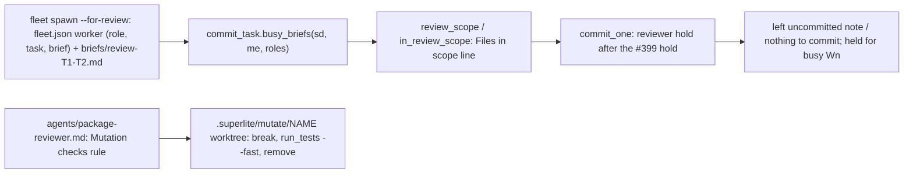
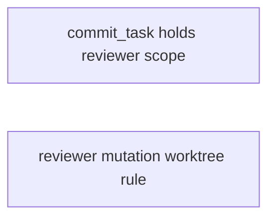

# B318: package-reviewer mutation checks leave the shared tree (#1097)

**Goal:** a package-reviewer's mutation check (break or revert code to watch a test fail) runs in a throwaway worktree under `.superlite/`, never in the shared tree; and `commit_task` holds every changed file that a busy package-reviewer's `Files in scope:` line covers, so a checkpoint never captures a file mid-mutation.
**Architecture:** `commit_task.busy_briefs` gains a `roles` filter and finds a brief by the worker's stored `brief` path (then `briefs/<label>.md`, then the label with commas as dashes, the name `fleet.for_review` writes). Two new pure helpers parse the scope: `review_scope(text)` reads the `Files in scope:` line, `in_review_scope(f, text)` matches a file against its entries with `nt.owns_match` (directories and globs), falling back to `brief_names` over the whole brief when it has no such line. `commit_one` adds one hold after the #399 running-sibling hold: files of `mine` in a busy package-reviewer's scope that differ from the newest checkpoint are left uncommitted with one note and join `busy_held`, so a task left with nothing fails `nothing to commit; held for busy Wn: F`. `agents/package-reviewer.md` gets a `Mutation checks:` rule after the shared safe-edit block and its red-run proof points to it.
**Tech stack:** Python 3 stdlib, pytest via `sl run_tests`; Markdown agent prompt.
**Spec:** issue #1097 (expected: mutation checks in an isolated tree or temporary copy; `commit_task` refuses a file a reviewer holds mid-mutation); feedback 92d589a6a2a9 041b71757c7a.
**Detail:** tests
**Wave0:** none
**Coverage:** off

## Global constraints

- Evidence (lead, read on f1019a4e): `fleet.for_review` (fleet.py:1043-1066) labels a reviewer `review-T1,T2` (or `review-<package slug>`), writes `briefs/review-T1-T2.md` (commas as dashes) and records role `package-reviewer`, `task` = label, `brief` = the absolute brief path (fleet_io.py:766). `fleet_io.review_brief` (fleet_io.py:388) writes one line `Files in scope: a, b` holding each task's Owns entries as the plan writes them (exact paths, directories ending `/`, or globs), joined with `, `. `commit_task.busy_briefs` (commit_task.py:729) reads `briefs/<task>.md` only, so a multi-task reviewer is skipped today; `run_tests.busy_held` (run_tests.py:2964) calls `ct.busy_briefs(sd, None)` and must keep working unchanged.
- Every new or changed code line in `skills/subagent-driven-development/scripts/commit_task.py` ends with its `# O(...)` complexity comment like its neighbours; the module docstring gains note (11) for the new hold.
- Files this batch may touch: agents/package-reviewer.md, skills/subagent-driven-development/scripts/commit_task.py, the two new test files below and this plan. docs/tools.md, fleet_io.py and plan_tools.py belong to other batches: never edit them. An existing test that breaks and is not in your Owns: name it in the report, do not edit it.
- Builds: the verdict is `sl run_tests` (the project's test command; a project with `.maxapp` runs `maxapp test`, which a build pool may place on another Mac, and a full run whose tree a green maxapp test stamp covers returns that result without a run); task trees build in <tree>/.build/DerivedData and any build of your own goes under .build/ of the worktree, never -derivedDataPath outside the worktree (your session scratchpad included; backlog cleanup removes scratchpad build folders when the worktree goes); a product, simulator or device build stays on this machine and runs only when an issue's acceptance asks for a running-app check; copy this sentence into every worker brief.
- Simulators: append the UDID of each simulator you or a worker creates (`xcrun simctl create` or `clone`; a checker's `Simulators:` line marks its created ones) as one line to /Users/max/github/superlite/.claude/worktrees/superlite-b318-reviewer-mutation-checks-isolated/.superlite/simulators.txt; never list one you did not create; ship cleanup shuts down and deletes each listed one; copy this sentence into every worker brief.

Ruling: (main's ruling, B318 decision) commit_task holds any changed file a busy package-reviewer's scope lists, not only shared tests; the prompt moves the mutation itself into a throwaway worktree either way.
Ruling: the scope is the brief's `Files in scope:` line, matched with `nt.owns_match` (a directory or glob entry covers the files under it); a brief without that line (hand-written) falls back to `brief_names` over its whole text; files named only in other sections (Commits, hotspots, coordinator notes) are never held (lead's ruling) - cost if wrong: a file the reviewer edits outside its scope line commits mid-review, which its out-of-scope rule already forbids.
Ruling: the reviewer hold applies only to role `package-reviewer` in state `busy`, never to the calling worker, and only while the file differs from the newest checkpoint; it also holds `--also` files, ruled files and the Wave 0 task's files, since a mutation is never meant to be committed (lead's ruling) - cost if wrong: one `commit_task` rerun after the reviewer reports.
Ruling: adjacent fix: `busy_briefs` finds a brief by the worker's stored `brief` path, then `briefs/<label>.md`, then the label with commas as dashes; multi-task reviewers were invisible to the #484 shared-test hold and to run_tests' worker overlay (lead's ruling).
Ruling: the mutation worktree lives under `.superlite/mutate/NAME`, not `.build/`: `.superlite/` is excluded and never staged in every project, while an untracked `.build/` worktree would show in `git status` and block `commit_task` as out of scope; measured on f1019a4e: `git worktree add --detach .superlite/mutate/probe HEAD`, then `sl run_tests --fast tests/scripts/test_commit_task_b94.py --worker probe` inside it ran 15 passed with its own `.superlite/` and left the shared tree's `git status` clean (lead's ruling).
Ruling: fixers keep their rules: #1097 names the package-reviewer, and a fixer writes its test before its fix, so it has no mutation step (lead's ruling).
LAYERS: unit, headless, evals

## Main diagram



## File structure

- skills/subagent-driven-development/scripts/commit_task.py: `busy_briefs` roles filter and brief lookup, `review_scope`, `in_review_scope`, the reviewer hold in `commit_one`, docstring note (11) (T1).
- tests/scripts/test_commit_reviewer_hold_1097.py: #1097 commit_task tests (T1).
- agents/package-reviewer.md: `Mutation checks:` rule, red-run proof wording (T2).
- tests/scripts/test_docs_reviewer_mutation_1097.py: pins the new rule (T2).

## Task graph

```mermaid
%% schedule
gantt
  title Predicted schedule (mm:ss)
  dateFormat X
  axisFormat %M:%S
  section lane 1
  T1 commit_task holds reviewer scope :t1, 0, 562s
  section lane 2
  T2 reviewer mutation worktree rule :t2, 0, 547s
```





critical path: T1 (9.4 min) · peak width 2 · predicted build 9.4 min · predicted total ≈ 25.9 min

## commit_task reviewer hold

**Probe entry:** none (a gate inside `sl commit_task`; the cases are the named tests below)

### T1 commit_task holds reviewer scope · Complexity 4 · Est. context 45k
**Owns:** skills/subagent-driven-development/scripts/commit_task.py, tests/scripts/test_commit_reviewer_hold_1097.py
**Components:** 1
**LOC owned:** 190
**Tests:** fast
**Model:** sonnet
**Kind:** design
**Produces:** commit_task.busy_briefs(sd, me, roles=None) -> dict
e.g. busy_briefs(sd, None) -> {"W3": ("fix-F-1", "<brief text>"), "W7": ("review-T1,T2", "<text of briefs/review-T1-T2.md>")}
e.g. busy_briefs(sd, None, roles=("package-reviewer",)) -> {"W7": ("review-T1,T2", "<text of briefs/review-T1-T2.md>")}
**Produces:** commit_task.review_scope(text: str) -> list | None
e.g. review_scope("# R\nFiles in scope: src/a.py, `lib/`, src/c.py\n") -> ["src/a.py", "lib/", "src/c.py"]
e.g. review_scope("# R\nno scope\n") -> None
**Produces:** commit_task.in_review_scope(path: str, text: str) -> bool
e.g. in_review_scope("lib/d.py", "Files in scope: src/a.py, lib/\n") -> True
e.g. in_review_scope("src/b.py", "Files in scope: src/a.py\nHotspots: src/b.py\n") -> False
**Review Focus:** state: `test_scope_file_held_rest_commits`, `test_file_equal_to_checkpoint_not_held`, `test_idle_reviewer_or_the_caller_holds_nothing`; deep: `test_shared_test_under_scope_dir_held_without_shared_line`, `test_multi_task_label_found_without_stored_path`; tests/scripts/test_commit_task_b94.py, test_commit_shared_hold_399.py, test_commit_foreign_edit_907.py and test_run_tests*.py stay green.
**Test code (verbatim):**
```python
"""#1097: commit_task holds a changed file in a busy package-reviewer's `Files in scope:` until the reviewer is done."""
import json
import sys

import pytest

from test_run_scripts import SCRIPTS, git, make_repo, write

sys.path.insert(0, str(SCRIPTS))
import commit_task  # noqa: E402

PLAN = """# P

## 9. Implementation plan

### T1 · one · Complexity 2 · Est. context 10k · Est. time 1 min

**Owns:** `src/a.py`, `src/b.py`

### T2 · two · Complexity 2 · Est. context 10k · Est. time 1 min

**Owns:** `src/c.py`, `lib/`
"""
SHARED = "tests/registry/test_x.py"
NOTE = "left uncommitted (in the review scope of busy W7 (review-T1,T2); commit_task T1 again once it is done): "


@pytest.fixture
def run(tmp_path, monkeypatch):
    repo = make_repo(tmp_path)
    write(repo, "docs/plans/p.md", PLAN)
    for f in ("src/a.py", "src/b.py", "src/c.py", "lib/d.py"):
        write(repo, f, "X = 0\n")
    write(repo, SHARED, "def test_x():\n    assert 1\n")
    git(repo, "add", "-A")
    git(repo, "commit", "-q", "-m", "plan")
    monkeypatch.chdir(repo)
    monkeypatch.setenv("SUPERLITE_AUTOCOMMIT", "0")
    monkeypatch.delenv("SUPERLITE_FLEET_WORKER", raising=False)
    monkeypatch.setattr(commit_task, "spawn_background", lambda cmd: None)
    sd = repo / ".superlite"
    sd.mkdir(exist_ok=True)
    return repo, sd, str(repo / "docs/plans/p.md")


def add_worker(sd, wid, rec):
    p = sd / "fleet.json"
    data = json.loads(p.read_text(encoding="utf-8")) if p.exists() else {"on": True, "workers": {}}
    data["workers"][wid] = rec
    p.write_text(json.dumps(data), encoding="utf-8")


def reviewer(sd, scope, label="review-T1,T2", wid="W7", state="busy", stored=True):
    """A package-reviewer as fleet.for_review records it; its brief file name has commas as dashes."""
    brief = sd / "briefs" / (label.replace(",", "-") + ".md")
    brief.parent.mkdir(parents=True, exist_ok=True)
    brief.write_text(f"# Review: {label}\n\nCommits:\n- commit T1 abc1234\n"
                     + (f"Files in scope: {scope}\n" if scope is not None else "") + "\nIncident hotspots: none\n",
                     encoding="utf-8")
    add_worker(sd, wid, {"state": state, "role": "package-reviewer", "task": label,
                         **({"brief": str(brief)} if stored else {})})


def checkpoint_files(sd):
    return json.loads((sd / "checkpoints.json").read_text(encoding="utf-8"))["entries"][-1]["files"]


def test_review_scope_parses_the_line():
    assert commit_task.review_scope("# R\nFiles in scope: src/a.py, `lib/`, src/c.py\n") == ["src/a.py", "lib/", "src/c.py"]
    assert commit_task.review_scope("# R\nno scope here\n") is None
    assert commit_task.review_scope("Files in scope: \n") == []


def test_in_review_scope_matches_entries_or_names():
    t = "Files in scope: src/a.py, lib/\n"
    assert commit_task.in_review_scope("lib/d.py", t)
    assert commit_task.in_review_scope("src/a.py", t)
    assert not commit_task.in_review_scope("src/b.py", t + "Hotspots: src/b.py\n")
    assert commit_task.in_review_scope("src/b.py", "# hand-written brief naming src/b.py\n")
    assert not commit_task.in_review_scope("src/b.py", "Files in scope: \nsrc/b.py\n")


def test_busy_briefs_reads_stored_path_comma_label_and_roles(run):
    repo, sd, plan = run
    reviewer(sd, "src/a.py", stored=False)
    custom = sd / "briefs" / "custom.md"
    custom.write_text("Files in scope: src/b.py\n", encoding="utf-8")
    add_worker(sd, "W8", {"state": "busy", "role": "package-reviewer", "task": "review-x", "brief": str(custom)})
    (sd / "briefs" / "fix-F-1.md").write_text("- F-1 src/a.py:1\n", encoding="utf-8")
    add_worker(sd, "W3", {"state": "busy", "role": "fixer", "task": "fix-F-1"})
    got = commit_task.busy_briefs(str(sd), None, roles=("package-reviewer",))
    assert sorted(got) == ["W7", "W8"]
    assert got["W7"][0] == "review-T1,T2" and "Files in scope: src/a.py" in got["W7"][1]
    assert got["W8"] == ("review-x", "Files in scope: src/b.py\n")
    assert sorted(commit_task.busy_briefs(str(sd), None)) == ["W3", "W7", "W8"]


def test_scope_file_held_rest_commits(run, capsys):
    repo, sd, plan = run
    reviewer(sd, "src/a.py, src/c.py")
    write(repo, "src/a.py", "X = 1\n")
    write(repo, "src/b.py", "X = 2\n")
    assert commit_task.main(["T1", "--plan", plan]) == 0
    assert NOTE + "src/a.py" in capsys.readouterr().err
    assert checkpoint_files(sd) == ["src/b.py"]


def test_only_scope_files_fail(run, capsys):
    repo, sd, plan = run
    reviewer(sd, "src/a.py, src/c.py")
    write(repo, "src/a.py", "X = 1\n")
    assert commit_task.main(["T1", "--plan", plan]) == 1
    assert "T1 FAILED: nothing to commit; held for busy W7: src/a.py" in capsys.readouterr().out


def test_directory_scope_entry_holds_file_under_it(run, capsys):
    repo, sd, plan = run
    reviewer(sd, "src/c.py, lib/", label="review-T2")
    write(repo, "lib/d.py", "X = 1\n")
    write(repo, "src/c.py", "X = 1\n")
    assert commit_task.main(["T2", "--plan", plan]) == 1
    assert "T2 FAILED: nothing to commit; held for busy W7: lib/d.py, src/c.py" in capsys.readouterr().out


def test_multi_task_label_found_without_stored_path(run, capsys):
    repo, sd, plan = run
    reviewer(sd, "src/a.py", stored=False)
    write(repo, "src/a.py", "X = 1\n")
    write(repo, "src/b.py", "X = 2\n")
    assert commit_task.main(["T1", "--plan", plan]) == 0
    assert NOTE + "src/a.py" in capsys.readouterr().err
    assert checkpoint_files(sd) == ["src/b.py"]


def test_file_equal_to_checkpoint_not_held(run, capsys):
    repo, sd, plan = run
    write(repo, "src/a.py", "X = 1\n")
    assert commit_task.main(["T1", "--plan", plan]) == 0
    reviewer(sd, "src/a.py")
    write(repo, "src/b.py", "X = 2\n")
    capsys.readouterr()
    assert commit_task.main(["T1", "--plan", plan]) == 0
    assert "review scope" not in capsys.readouterr().err
    assert "src/b.py" in checkpoint_files(sd)


@pytest.mark.parametrize("state, me", [("idle", None), ("stopped", None), ("busy", "W7")])
def test_idle_reviewer_or_the_caller_holds_nothing(run, monkeypatch, capsys, state, me):
    repo, sd, plan = run
    reviewer(sd, "src/a.py", state=state)
    if me:
        monkeypatch.setenv("SUPERLITE_FLEET_WORKER", me)
    write(repo, "src/a.py", "X = 1\n")
    assert commit_task.main(["T1", "--plan", plan]) == 0
    assert "review scope" not in capsys.readouterr().err
    assert checkpoint_files(sd) == ["src/a.py"]


def test_fixer_scope_line_does_not_hold_a_source_file(run, capsys):
    repo, sd, plan = run
    (sd / "briefs").mkdir(exist_ok=True)
    (sd / "briefs" / "fix-F-1.md").write_text("Files in scope: src/a.py\n", encoding="utf-8")
    add_worker(sd, "W3", {"state": "busy", "role": "fixer", "task": "fix-F-1"})
    write(repo, "src/a.py", "X = 1\n")
    assert commit_task.main(["T1", "--plan", plan]) == 0
    assert checkpoint_files(sd) == ["src/a.py"]


def test_also_file_in_scope_is_held(run, capsys):
    repo, sd, plan = run
    reviewer(sd, "src/c.py")
    write(repo, "src/a.py", "X = 1\n")
    write(repo, "src/c.py", "X = 1\n")
    assert commit_task.main(["T1", "--also", "src/c.py", "--ruling", "r", "--plan", plan]) == 0
    assert NOTE + "src/c.py" in capsys.readouterr().err
    assert checkpoint_files(sd) == ["src/a.py"]


def test_two_reviewers_named(run, capsys):
    repo, sd, plan = run
    reviewer(sd, "src/a.py", label="review-T1", wid="W7")
    reviewer(sd, "src/a.py", label="review-pkg", wid="W8")
    write(repo, "src/a.py", "X = 1\n")
    write(repo, "src/b.py", "X = 2\n")
    assert commit_task.main(["T1", "--plan", plan]) == 0
    assert ("left uncommitted (in the review scope of busy W7 (review-T1), W8 (review-pkg); "
            "commit_task T1 again once they are done): src/a.py") in capsys.readouterr().err
    assert checkpoint_files(sd) == ["src/b.py"]


def test_shared_test_under_scope_dir_held_without_shared_line(run, capsys):
    repo, sd, plan = run
    reviewer(sd, "src/a.py, tests/")
    write(repo, SHARED, "def test_x():\n    assert 2\n")
    write(repo, "src/b.py", "X = 2\n")
    assert commit_task.main(["T1", "--plan", plan]) == 0
    err = capsys.readouterr().err
    assert NOTE + SHARED in err
    assert "shared-test" not in err
    assert checkpoint_files(sd) == ["src/b.py"]
```
**Steps:** 1 write the test file, 2 run it: FAIL, 3 implement, 4 run it plus test_commit_task_b94.py, test_commit_shared_hold_399.py and test_commit_foreign_edit_907.py: PASS
**Notes:** `busy_briefs(sd, me, roles=None)`: unchanged filter (busy, not `me`, role set and not implementer or lead, label set), plus `role in roles` when `roles` is given; the brief is the first existing file of: the worker's `brief` value when it is a non-empty str, `briefs/<label>.md`, `briefs/<label with "," replaced by "-">.md`; none existing skips the worker. `review_scope`: the first line matching `^\s*Files in scope:(.*)$` (re.M), split on `,`, each entry stripped of spaces and backticks, empty entries dropped; no such line -> None. `in_review_scope(path, text)`: entries = review_scope(text); None -> `brief_names(text, path)`; else `nt.owns_match(path, entries)`. In `commit_one`, right after the `if held:` block of the #399 hold and before `if not mine or ((held or busy_held) ...`: when `mine` and `a.sd` are set, `revs = busy_briefs(sd_, os.environ.get("SUPERLITE_FLEET_WORKER"), roles=("package-reviewer",))`; per file of `mine` the matching reviewers `[(wid, label)]` in worker-id order; keep the files `changed_vs_parent` still lists; drop those from `mine` and from `shared`, print per file one `note_once` line: one reviewer `left uncommitted (in the review scope of busy W7 (review-T1,T2); commit_task T1 again once it is done): F`, several `... busy W7 (review-T1), W8 (review-pkg); commit_task T1 again once they are done): F`; then `busy_held.update(...)` so the existing `held for busy` failure covers them. `busy_held` is first bound before the `if cand:` block: keep that. Docstring note (11): `A changed file a busy package-reviewer's brief scope covers (its `Files in scope:` line through nt.owns_match, else any mention in a brief without that line; not the caller's own) is left uncommitted while it differs from the newest checkpoint, --also and Wave 0 files too (#1097): `left uncommitted (in the review scope of busy W7 (review-T1,T2); commit_task Tn again once it is done): F`; a task left with nothing fails `nothing to commit; held for busy W7: F`. busy_briefs finds a brief by the worker's stored `brief` path, then briefs/<label>.md, then the label with commas as dashes.`

## package-reviewer prompt

**Probe entry:** none (an agent prompt; the pin test is the check)

### T2 reviewer mutation worktree rule · Complexity 1 · Est. context 22k
**Owns:** agents/package-reviewer.md, tests/scripts/test_docs_reviewer_mutation_1097.py
**Components:** 1
**LOC owned:** 40
**Tests:** fast
**Model:** haiku
**Kind:** mechanical
**Review Focus:** `test_mutation_rule_once_after_experiments`, `test_red_run_proof_points_to_the_mutation_rule`; tests/scripts/test_fleet_roles_docs.py, test_docs_review_red_606.py, test_docs_b251.py and test_reviewer_scope_b59.py stay green.
**Test code (verbatim):**
```python
"""#1097: package-reviewer.md runs mutation checks in a throwaway worktree under .superlite/, never in the shared tree."""
from pathlib import Path

ROOT = Path(__file__).resolve().parents[2]
MUTATION = "- Mutation checks: never break, revert or take out code in the shared tree to watch a test fail (a red-run proof, a fix's test run against the code before the fix): other tasks' `commit_task` calls and the coordinator's full run read those files while you work, and `commit_task` holds every changed file of your `Files in scope:` line until you report. Make a throwaway worktree of the reviewed checkpoint under `.superlite/` (never staged, never in `git status`): `git worktree add --detach .superlite/mutate/NAME <sha>` (NAME as for `--worker`; `<sha>` the newest one under your brief's `Commits:`, or its `Reviewed version:`), copy in the test files it lacks, break the code there, `cd` into it and run `<abs sl> run_tests --fast PATHS --worker NAME` to see the failure, then `cd` back to `Root:` and `git worktree remove --force .superlite/mutate/NAME`. The shared tree only ever holds your fix and its test."
RED = "- A `Red runs (task reports):` section in your brief names tasks whose report shows no red run. Prove each new test of those tasks can fail before you accept it: break the code it tests in a mutation worktree (the `Mutation checks:` rule), see the test fail there for the right reason, and see it pass in the shared tree, where that code stays untouched. List each such test under tests added with that red run's summary line. A test that stays green is a finding: make it fail on the defect it guards, with its own red run."


def lines():
    return (ROOT / "agents/package-reviewer.md").read_text(encoding="utf-8").splitlines()


def test_mutation_rule_once_after_experiments():
    ls = lines()
    assert ls.count(MUTATION) == 1
    i = next(n for n, line in enumerate(ls) if line.startswith("- Experiments:"))
    assert ls[i + 1] == MUTATION


def test_red_run_proof_points_to_the_mutation_rule():
    ls = lines()
    assert ls.count(RED) == 1
    assert ls.index(RED) == ls.index(MUTATION) + 1
    assert not any("put the code back" in line for line in ls)
```
**Steps:** 1 write the test file, 2 run it: FAIL, 3 in agents/package-reviewer.md insert the MUTATION line right after the `- Experiments:` line and replace the `- A \`Red runs (task reports):\`` line with RED (both texts exactly as in the test), 4 run it plus test_fleet_roles_docs.py, test_docs_review_red_606.py, test_docs_b251.py and test_reviewer_scope_b59.py: PASS
**Notes:** change no other line of agents/package-reviewer.md; the four safe-edit lines after `- Format only the files you changed` stay byte-identical (test_fleet_roles_docs.py pins them).

## Review Focus

- T1: a changed file a busy package-reviewer's `Files in scope:` covers (exact, directory or glob entry; multi-task label briefs too) is never staged while that reviewer is busy; a file equal to the newest checkpoint, an idle or stopped reviewer, the calling worker and other roles hold nothing; run_tests' worker overlay keeps working through `busy_briefs(sd, None)`.
- T2: the reviewer prompt never asks for an edit of the shared tree to see a test fail.

## Self-review

- Coverage: #1097 expected 1 (mutation checks in an isolated tree) -> T2 `test_mutation_rule_once_after_experiments`, `test_red_run_proof_points_to_the_mutation_rule`; expected 2 (commit_task refuses a file a reviewer holds mid-mutation) -> T1 `test_scope_file_held_rest_commits`, `test_only_scope_files_fail`, `test_directory_scope_entry_holds_file_under_it`, `test_multi_task_label_found_without_stored_path`.
- No placeholders; Produces lines match the names in the tests; two tasks, no shared file, no edges.
