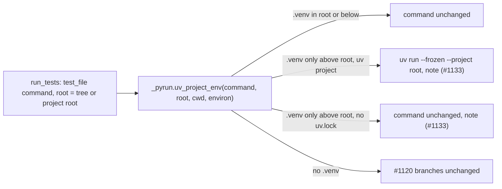
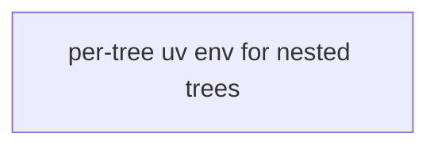

# B328: run_tests --fast in a worktree nested in the main checkout imports the worktree's package (#1133)

**Goal:** a `uv run --no-project` test command run from a tree or worktree nested in another checkout (`<main>/.claude/worktrees/<wt>`, `<wt>/.superlite/trees/<key>`) no longer runs in the enclosing checkout's `.venv` (whose editable install puts that checkout's `src` on `sys.path`); a uv project runs in its own `uv run --frozen --project <root>` environment instead.
**Architecture:** one more branch in `_pyrun.uv_project_env` (#1120's rewrite): the first `.venv` uv would find from the cwd up lies above the run root (compared resolved) means it belongs to another checkout; a uv project root (uv.lock + pyproject.toml) gets `--no-project` replaced by `--frozen --project <root>` with a #1133 note, any other root keeps the command and gets a #1133 note. Both run_tests call sites already pass the tree or project root as `root`, so run_tests.py changes only in its docstring.
**Tech stack:** Python 3 stdlib, pytest via `sl run_tests`.
**Spec:** issue #1133 (follow-up of B320, #1120); main's ruling: per-tree uv --project environment.
**Detail:** full
**Wave0:** none
**Coverage:** off

## Global constraints

- Files this batch may touch: skills/subagent-driven-development/scripts/_pyrun.py, skills/subagent-driven-development/scripts/run_tests.py (module docstring only), tests/scripts/test_run_tests_fast_tree_import_1133.py, tests/scripts/test_pyrun_uv_env_1120.py and this plan. An existing test that breaks and is not in your Owns: name it in the report, do not edit it.
- Keep every #1120 note and behaviour unchanged when no `.venv` is found from the cwd up (tests/scripts/test_pyrun_uv_env_1120.py, tests/scripts/test_run_tests_fast_filter_remote_1119_1120.py stay green, except the one test T1 rewrites).
- Builds: the verdict is `sl run_tests` (the project's test command; a project with `.maxapp` runs `maxapp test`, which a build pool may place on another Mac, and a full run whose tree a green maxapp test stamp covers returns that result without a run); task trees build in <tree>/.build/DerivedData and any build of your own goes under .build/ of the worktree, never -derivedDataPath outside the worktree (your session scratchpad included; backlog cleanup removes scratchpad build folders when the worktree goes); a product, simulator or device build stays on this machine and runs only when an issue's acceptance asks for a running-app check.
- Simulators: append the UDID of each simulator you or a worker creates (`xcrun simctl create` or `clone`; a checker's `Simulators:` line marks its created ones) as one line to /Users/max/github/superlite/.claude/worktrees/superlite-b328-run-tests-fast-tree-env/.superlite/simulators.txt; never list one you did not create; ship cleanup shuts down and deletes each listed one.

Ruling: the trigger is the first `.venv` (holding an interpreter) from the cwd up lying outside the run root, compared resolved; a `.venv` in the root or in a run folder below it is the root's own and leaves the command alone (main's ruling picked the per-tree uv --project environment; this trigger is the lead's ruling).
Ruling: a root without uv.lock and pyproject.toml keeps the command and prints a #1133 note; no PYTHONPATH rewrite, since main ruled the uv --project environment (lead's ruling).
Ruling: an exported VIRTUAL_ENV still wins, as in #1120: it is an explicit choice (lead's ruling).
Ruling: no .gitignore or info/exclude guard for the tree's new `.venv`: uv writes `.venv/.gitignore` (`*`) itself; researcher R1 found trees are git worktrees refreshed with `checkout --force` (untracked files kept, so each tree syncs once) and no overlay, drift or staging code lists untracked tree files (lead's ruling).
Ruling: the end-to-end regression test uses a stand-in `uv` that picks its environment by uv's rules (`--project P`: P/.venv; `--no-project`: the first .venv from the cwd up); a real uv would need a build backend from the network to install the package editable (lead's ruling).
LAYERS: unit

## Main diagram



## File structure

- skills/subagent-driven-development/scripts/_pyrun.py: `found_env`, `inside`, the #1133 branch in `uv_project_env`, docstring (T1).
- skills/subagent-driven-development/scripts/run_tests.py: module docstring sentence only (T1).
- tests/scripts/test_run_tests_fast_tree_import_1133.py: unit cases and the nested-worktree run_tests --fast regression (T1).
- tests/scripts/test_pyrun_uv_env_1120.py: `test_parent_venv_leaves_command` becomes `test_parent_venv_runs_project_env` (T1).

## Task graph




critical path: T1 (6.3 min) · peak width 1 · predicted build 6.3 min · predicted total ≈ 18.8 min

## Python helpers

### T1 per-tree uv env for nested trees · Complexity 2 (O-1) · Est. context 45k
**Owns:** skills/subagent-driven-development/scripts/_pyrun.py, skills/subagent-driven-development/scripts/run_tests.py, tests/scripts/test_run_tests_fast_tree_import_1133.py, tests/scripts/test_pyrun_uv_env_1120.py
**Components:** 1
**LOC owned:** 150
**Tests:** fast
**Kind:** design
**Model:** sonnet
**Est. time:** 4 min (1 component, about 150 LOC, fast tests)
**Consumes:** none
**Produces:** _pyrun.found_env(cwd) -> Path | None · _pyrun.inside(folder, root) -> bool · _pyrun.uv_project_env(command, root, cwd, environ) -> (str, dict, str) with the #1133 branch
**Review Focus:** `test_fast_in_nested_worktree_imports_the_worktree_package`: red before the change (the stand-in uv picks main's .venv, `WHERE == 'main'`), green after, and the second run uses the tree's synced .venv with no note; `test_symlinked_cwd_compares_resolved`: a cwd reached through a symlink into the root is inside it; every #1120 test in test_pyrun_uv_env_1120.py and test_run_tests_fast_filter_remote_1119_1120.py still passes.
**Steps:** 1 write tests/scripts/test_run_tests_fast_tree_import_1133.py verbatim and replace `test_parent_venv_leaves_command` in tests/scripts/test_pyrun_uv_env_1120.py with the verbatim block below; 2 run both files with `sl run_tests --fast ... --task T1`: FAIL (record the summary line); 3 make the _pyrun.py and run_tests.py edits below; 4 run both files plus tests/scripts/test_run_tests_fast_filter_remote_1119_1120.py, tests/scripts/test_project_python_1068.py, tests/scripts/test_run_scripts.py: PASS.
**Notes:** keep the repo's per-line `# O(...)` complexity comments on every new code line (see the existing lines of _pyrun.py). `found_env` walks `Path(os.path.abspath(cwd))` and its parents unresolved, so the printed `.venv` path keeps the caller's spelling; only `inside` resolves.

_pyrun.py edits:

1. Add after `project_cmd` (before `NO_PROJECT`):
```python
def found_env(cwd):  # O(d) stat calls up the cwd parents; never runs uv
    """The first folder from cwd up whose .venv holds an interpreter (the one `uv run --no-project` uses), else None."""  # O(1)
    here = Path(os.path.abspath(cwd))  # O(d) absolute, unresolved: notes keep the caller's spelling
    return next((folder for folder in (here, *here.parents) if venv_python(folder / ".venv")), None)  # O(d)


def inside(folder, root):  # O(d) two resolves
    """True when folder is root or lies below it, both resolved (a symlinked spelling of the root counts)."""  # O(1)
    top, here = Path(root).resolve(), Path(folder).resolve()  # O(d)
    return here == top or top in here.parents  # O(d)
```
2. Replace the body of `uv_project_env` after its first `if` (keep the `if not _no_project_uv(command) or environ.get("VIRTUAL_ENV"): return command, {}, ""` lines) with:
```python
    uv_project = (Path(root) / "uv.lock").is_file() and (Path(root) / "pyproject.toml").is_file()  # O(1) two stats
    flags = f"--frozen --project {shlex.quote(str(root))}"  # O(1)
    folder = found_env(cwd)  # O(d) the environment uv would use
    if folder is not None:  # O(1)
        if inside(folder, root):  # the root's or its run folder's own environment | O(d)
            return command, {}, ""  # O(1)
        base = f"uv run --no-project would use {folder / '.venv'}, which lies outside {root}"  # another checkout's: a nested worktree or tree (#1133) | O(1)
        if uv_project:  # O(1)
            return NO_PROJECT.sub(flags, command, count=1), {}, f"{base}; running in {root}'s own environment: uv run {flags} (#1133)"  # O(c)
        return command, {}, f"{base}, and {root} has no uv.lock for an environment of its own; the tests may import that folder's package, not {root}'s (#1133)"  # O(1)
    base = f"uv run --no-project finds no environment from {cwd}"  # O(1)
    if uv_project:  # O(1)
        return NO_PROJECT.sub(flags, command, count=1), {}, f"{base}; running in the project's environment: uv run {flags} (#1120)"  # O(c)
```
   then keep the existing `py = found_python(root)` tail (VIRTUAL_ENV export, then the no-uv.lock note) unchanged.
3. Module docstring: after the `uv_project_env(...)` paragraph's last sentence (`... else the main checkout's venv is exported (#1120).`) add: `A .venv it finds only above root (a worktree nested in the main checkout, a task tree) is another checkout's: a uv project root runs --frozen --project root too, any other root keeps the command with a note (#1133).` Also update the `uv_project_env` docstring line to name #1133.

run_tests.py edit: in the module docstring line 4, replace `runs in the project's (#1120).` with `runs in the project's (#1120); one whose only environment is a .venv above the tree or project root (a worktree nested in the main checkout) runs in that root's own `uv run --frozen --project` environment (#1133).`

**Test code (verbatim):** tests/scripts/test_pyrun_uv_env_1120.py, replacing `test_parent_venv_leaves_command`:
```python
def test_parent_venv_runs_project_env(tmp_path):
    touch(tmp_path / "m", ".venv/bin/python")
    wt = tmp_path / "m" / "wt"
    uv_project(wt)
    cmd, env, note = _pyrun.uv_project_env(CMD, wt, wt, {})
    assert cmd == f"uv run --frozen --project {wt} --with pytest python -m pytest a.py -q"
    assert env == {}
    assert note.endswith("(#1133)")
```

**Test code (verbatim):** tests/scripts/test_run_tests_fast_tree_import_1133.py
```python
"""#1133: run_tests --fast in a worktree nested in the main checkout imports the worktree's package, not main's: a `uv run --no-project` command whose only environment is a .venv above the run root runs in the root's own `uv run --frozen --project` environment."""
import json
import os
import subprocess
import sys
from pathlib import Path

import pytest

SCRIPTS = Path(__file__).resolve().parents[2] / "skills" / "subagent-driven-development" / "scripts"
sys.path.insert(0, str(SCRIPTS))
import _pyrun  # noqa: E402

RUN_TESTS = SCRIPTS / "run_tests.py"
CMD = "uv run --no-project --with pytest python -m pytest a.py -q"


@pytest.fixture(autouse=True)
def _no_virtual_env(monkeypatch):
    monkeypatch.delenv("VIRTUAL_ENV", raising=False)


def touch(base, rel, text=""):
    p = base / rel
    p.parent.mkdir(parents=True, exist_ok=True)
    p.write_text(text)
    return p


def uv_project(root):
    touch(root, "uv.lock")
    touch(root, "pyproject.toml", "[project]\nname = 'where1133'\n")


def nested(tmp_path):
    """A main checkout with a .venv and a worktree nested in it, as .claude/worktrees/wt."""
    main = tmp_path.resolve() / "main"
    touch(main, ".venv/bin/python")
    return main, main / ".claude" / "worktrees" / "wt"


def test_parent_venv_above_uv_root_runs_root_env(tmp_path):
    main, wt = nested(tmp_path)
    uv_project(wt)
    assert _pyrun.uv_project_env(CMD, wt, wt, {}) == (
        f"uv run --frozen --project {wt} --with pytest python -m pytest a.py -q",
        {},
        f"uv run --no-project would use {main / '.venv'}, which lies outside {wt}; running in {wt}'s own environment: uv run --frozen --project {wt} (#1133)",
    )


def test_task_tree_below_worktree_venv_runs_tree_env(tmp_path):
    main, wt = nested(tmp_path)
    touch(wt, ".venv/bin/python")
    tree = wt / ".superlite" / "trees" / "T1"
    uv_project(tree)
    cmd, env, note = _pyrun.uv_project_env(CMD, tree, tree, {})
    assert cmd == f"uv run --frozen --project {tree} --with pytest python -m pytest a.py -q"
    assert env == {}
    assert note.startswith(f"uv run --no-project would use {wt / '.venv'}, which lies outside {tree};")


def test_venv_in_root_untouched(tmp_path):
    main, wt = nested(tmp_path)
    uv_project(wt)
    touch(wt, ".venv/bin/python")
    assert _pyrun.uv_project_env(CMD, wt, wt, {}) == (CMD, {}, "")


@pytest.mark.parametrize("venv_at", [".", "packages/x"])
def test_run_folder_below_root_untouched(tmp_path, venv_at):
    main, wt = nested(tmp_path)
    uv_project(wt)
    touch(wt / venv_at, ".venv/bin/python")
    assert _pyrun.uv_project_env(CMD, wt, wt / "packages" / "x", {}) == (CMD, {}, "")


@pytest.mark.skipif(os.name == "nt", reason="symlink")
def test_symlinked_cwd_compares_resolved(tmp_path):
    real = tmp_path.resolve() / "real"
    uv_project(real)
    touch(real, ".venv/bin/python")
    link = tmp_path.resolve() / "link"
    link.symlink_to(real)
    assert _pyrun.uv_project_env(CMD, real, link, {}) == (CMD, {}, "")


def test_parent_venv_without_lock_notes_only(tmp_path):
    main, wt = nested(tmp_path)
    wt.mkdir(parents=True)
    assert _pyrun.uv_project_env(CMD, wt, wt, {}) == (
        CMD,
        {},
        f"uv run --no-project would use {main / '.venv'}, which lies outside {wt}, and {wt} has no uv.lock for an environment of its own; the tests may import that folder's package, not {wt}'s (#1133)",
    )


def test_virtual_env_wins_over_parent_venv(tmp_path):
    main, wt = nested(tmp_path)
    uv_project(wt)
    assert _pyrun.uv_project_env(CMD, wt, wt, {"VIRTUAL_ENV": str(main / ".venv")}) == (CMD, {}, "")


# A stand-in for uv. `run --project P` syncs P/.venv, whose editable install puts P/src on sys.path;
# `run --no-project` uses the first .venv from the cwd up, as uv does. site.txt names the folder an
# environment's editable install puts on sys.path (main's .venv names main's src: the .pth seen in #1133).
FAKE_UV = r'''
import os
import sys
from pathlib import Path

args = sys.argv[2:]
env_dir, i = None, 0
while i < len(args) and args[i].startswith("-"):
    if args[i] == "--project":
        project = Path(args[i + 1])
        env_dir = project / ".venv"
        (env_dir / "bin").mkdir(parents=True, exist_ok=True)
        (env_dir / "bin" / "python").write_text("")
        (env_dir / "site.txt").write_text(str(project / "src"))
    i += 2 if args[i] in ("--project", "--with", "--python", "--group") else 1
if env_dir is None:
    here = Path.cwd()
    env_dir = next((f / ".venv" for f in (here, *here.parents) if (f / ".venv" / "site.txt").is_file()), None)
src = (env_dir / "site.txt").read_text() if env_dir else ""
os.execve(sys.executable, [sys.executable, *args[i + 1:]], {**os.environ, "PYTHONPATH": src})
'''
CFG = {"language": "python", "test": "true",
       "test_file": "uv run --no-project --with pytest python -m pytest {files} -q -p no:cacheprovider"}


def checkout(tmp_path):
    main, wt = nested(tmp_path)
    touch(main, ".venv/site.txt", str(main / "src"))
    touch(main, "src/where1133/__init__.py", "WHERE = 'main'\n")
    uv_project(wt)
    touch(wt, "src/where1133/__init__.py", "WHERE = 'tree'\n")
    touch(wt, "tests/test_where.py", "import where1133\n\n\ndef test_imports_the_tree():\n    assert where1133.WHERE == 'tree'\n")
    touch(wt, ".superlite/test-cmd.json", json.dumps(CFG))
    return main, wt


def run_fast(wt, tmp_path):
    bindir = tmp_path / "fakebin"
    bindir.mkdir(exist_ok=True)
    (bindir / "fake_uv.py").write_text(FAKE_UV)
    uv = bindir / "uv"
    uv.write_text(f'#!/bin/sh\nexec "{sys.executable}" "{bindir / "fake_uv.py"}" "$@"\n')
    uv.chmod(0o755)
    env = {k: v for k, v in os.environ.items()
           if k != "VIRTUAL_ENV" and not k.startswith(("SUPERLITE_FLEET_", "SUPERLITE_STATE_DIR"))}
    env["PATH"] = f"{bindir}{os.pathsep}{os.environ['PATH']}"
    return subprocess.run([sys.executable, str(RUN_TESTS), "--fast", "tests/test_where.py"], cwd=wt, env=env,
                          capture_output=True, text=True, timeout=120)


@pytest.mark.skipif(os.name == "nt", reason="posix sh script")
def test_fast_in_nested_worktree_imports_the_worktree_package(tmp_path):
    main, wt = checkout(tmp_path)
    r = run_fast(wt, tmp_path)
    assert r.returncode == 0, r.stdout + r.stderr
    assert f"running in {wt}'s own environment: uv run --frozen --project {wt} (#1133)" in r.stderr
    again = run_fast(wt, tmp_path)
    assert again.returncode == 0, again.stdout + again.stderr
    assert "(#1133)" not in again.stderr
```

## Review Focus

Python helpers package: app type CLI (run_tests); categories: environment selection (nested worktree, task tree, run folder, symlinked spelling), compatibility with #1120's branches. **Probe entry:** `test_fast_in_nested_worktree_imports_the_worktree_package` runs `run_tests.py --fast` from a worktree nested in a checkout whose `.venv` names main's `src`.

## Self-review

Coverage: #1133's expected result (per-tree `uv run --frozen --project` environment, regression test proving `--fast` imports the tree's code) maps to T1. No placeholders. One task, no edges; the plan's only rewritten old test is named in Owns.
