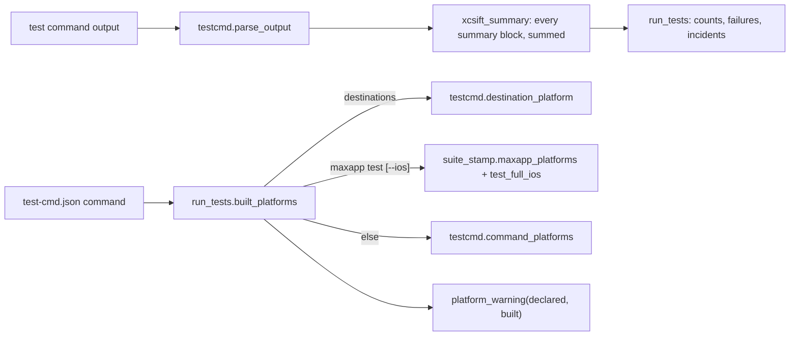
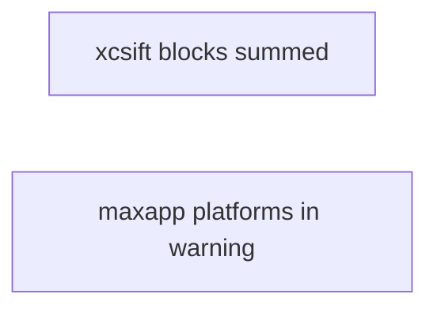

# B310: run_tests sums every xcsift summary block and reads maxapp test platforms (#1076)

**Goal:** a `run_tests` run whose output holds several xcsift JSON summary blocks (`maxapp test` prints one for macOS, then one for iOS) reports the sum of all blocks, not the last one; the full-run platform warning reads the platforms a `maxapp test` command builds instead of saying `built for no declared platform` (#1076).
**Architecture:** `testcmd.xcsift_summary` scans the output forward and reads every top-level summary block, summing counts and merging failed tests; a block that counted tests keeps only errors that name a line (see `## Rulings after dispatch`). `run_tests.built_platforms` gives the platforms a full run builds: destinations as today, else `suite_stamp.maxapp_platforms` (plain `maxapp test` plus iOS when `.maxapp` `test_full` names it), else `testcmd.command_platforms`.
**Tech stack:** Python 3 stdlib, pytest via `sl run_tests`.
**Spec:** issue #1076; feedback e0a784b2767e, e29dfff3c6f7.
**Detail:** tests
**Wave0:** none
**Coverage:** off

## Global constraints

- Root cause (lead, read on 626d1c83): `testcmd.xcsift_summary` scans candidates in reverse and stops at the first summary (`# the last summary wins`), so a maxapp two-platform run reports only the iOS block (maxOS log: 8335 + 33 passed reported as 33). `run_tests` line about 2201 computes `built` with `testcmd.command_platforms`, which knows only xcodebuild `-destination` and `swift test`, so `maxapp test` and `maxapp test --ios` give `[]`.
- Measured (lead, 40 maxOS, feel and pix-app run logs): 6 maxOS two-block runs exited 0 with the macOS block `"status" : "failed"`, 0 failed tests and one `errors[]` entry whose file is a runtime log line (`... xctest[69467:414404970] [error] CoreData`); single-block runs like that (maxOS B70, pix-app) were reported red with `build error: ... CoreData`.
- Every new or changed code line in `skills/subagent-driven-development/scripts/*.py` ends with its `# O(...)` complexity comment like its neighbours; the changed module's docstring names #1076 in one clause.
- Files this batch may touch: skills/subagent-driven-development/scripts/run_tests.py, skills/subagent-driven-development/scripts/testcmd.py, docs/tools.md, tests/scripts/test_xcsift_blocks_1076.py, tests/scripts/test_run_tests_maxapp_platforms_1076.py, tests/scripts/test_testcmd_counts_481.py and this plan. suite_stamp.py stays unchanged. An existing test that breaks and is not in your Owns: name it in the report, do not edit it.
- Builds: the verdict is `sl run_tests` (the project's test command; a project with `.maxapp` runs `maxapp test`, which a build pool may place on another Mac, and a full run whose tree a green maxapp test stamp covers returns that result without a run); task trees build in <tree>/.build/DerivedData and any build of your own goes under .build/ of the worktree, never -derivedDataPath outside the worktree (your session scratchpad included; backlog cleanup removes scratchpad build folders when the worktree goes); a product, simulator or device build stays on this machine and runs only when an issue's acceptance asks for a running-app check; copy this sentence into every worker brief.
- Simulators: append the UDID of each simulator you or a worker creates (`xcrun simctl create` or `clone`; a checker's `Simulators:` line marks its created ones) as one line to /Users/max/github/superlite/.claude/worktrees/superlite-b310-run-tests-multi-xcresult/.superlite/simulators.txt; never list one you did not create; ship cleanup shuts down and deletes each listed one; copy this sentence into every worker brief.

Ruling (superseded for errors with a line by `## Rulings after dispatch`): a summary block that counted tests (its passed, failed or skipped above 0) built, so its `errors[]` and its `status: failed` alone add no failure; only its failed tests or a non-zero exit make the run red. A block that counted none keeps today's rule (its errors lead, `status: failed` is one failure). Because xcsift reads runtime log lines such as `[error] CoreData` as errors: summing the 6 measured maxOS runs under today's rule would turn green runs red, and the same rule makes a single such block green too (lead's ruling) - cost if wrong: a wrapper that swallows the exit code and whose failing block still counted tests with 0 failed tests passes green.
Ruling: `built_platforms` lives in run_tests.py and reuses `suite_stamp.maxapp_platforms` and `suite_stamp.test_full_ios`; `green_base` keeps its own test_full step because it also needs the iOS suite list (lead's ruling) - cost if wrong: four similar lines.
Ruling: the summary gets no per-block key; the summed counts are what #1076 expects, naming each half is its alternative (lead's ruling) - cost if wrong: one key later.
Ruling: test-cmd.json gets no platform override (feedback e29dfff3c6f7's second option): the command's platforms are now read (lead's ruling) - cost if wrong: one config key later.
LAYERS: unit

## Main diagram



## File structure

- skills/subagent-driven-development/scripts/testcmd.py: `xcsift_summary` reads and sums every summary block (T1).
- tests/scripts/test_xcsift_blocks_1076.py: block summing tests (T1).
- tests/scripts/test_testcmd_counts_481.py: `test_xcsift_last_object_wins` becomes `test_xcsift_blocks_are_summed` (T1).
- skills/subagent-driven-development/scripts/run_tests.py: `built_platforms`, used by the full-run platform warning (T2).
- tests/scripts/test_run_tests_maxapp_platforms_1076.py: platform tests and the docs check (T2).
- docs/tools.md: the `run_tests` row names both rules (T2).

## Task graph

```mermaid
%% schedule
gantt
  title Predicted schedule (mm:ss)
  dateFormat X
  axisFormat %M:%S
  section lane 1
  T2 maxapp platforms in warning :t2, 0, 857s
  section lane 2
  T1 xcsift blocks summed :t1, 0, 831s
```





critical path: T2 (14.3 min) · peak width 2 · predicted build 14.3 min · predicted total ≈ 36.8 min

## run_tests parsing

**Probe entry:** none (library functions inside run_tests; the cases are the named tests below)

### T1 xcsift blocks summed · Complexity 4 · Est. context 40k
**Owns:** skills/subagent-driven-development/scripts/testcmd.py, tests/scripts/test_xcsift_blocks_1076.py, tests/scripts/test_testcmd_counts_481.py
**Components:** 1
**LOC owned:** 170
**Tests:** fast
**Model:** sonnet
**Kind:** design
**Produces:** testcmd.xcsift_summary(lines: list[str], rc: int) -> dict | None
e.g. xcsift_summary(macOS block passed 8284 + iOS block passed 33, 0) -> passed 8317, failed 0, errors []
e.g. xcsift_summary(macOS block status failed, passed 8335, errors [CoreData log line] + iOS block passed 33, 0) -> passed 8368, failed 0, errors [], error ""
e.g. xcsift_summary(macOS block passed 8284 + iOS block status failed, no counts, errors [Foo.swift:10], 0) -> passed 8284, failed 1, errors ["/src/App/Foo.swift:10: cannot find 'bar' in scope"]
**Review Focus:** deep: `test_failed_entries_are_not_blocks` (a block's `failed_tests[]` `{` lines are never read as blocks); numeric: `test_same_failure_on_both_platforms` (counts 2, one name); state: `test_counted_block_with_status_failed_stays_green`, `test_block_that_counted_nothing_keeps_its_build_error`; performance: `test_many_blocks_all_count` (300 blocks under 2 s); test_testcmd_counts_481.py, test_run_tests_build_error_912.py and test_run_tests_fast_mapping_597.py stay green.
**Test code (verbatim):**
```python
"""#1076: every xcsift summary block of a run counts (`maxapp test` prints one for macOS, then one for iOS)."""
from __future__ import annotations

import json
import os
import subprocess
import sys
import time

from _fixtures import DISK_FREE
from test_plan_tools import SCRIPTS

sys.path.insert(0, str(SCRIPTS))
import testcmd  # noqa: E402

MAC = {"summary": {"linker_errors": 0, "failed_tests": 0, "passed_tests": 8284, "test_time": "84.1s", "errors": 0, "warnings": 50}, "status": "success"}
IOS = {"summary": {"failed_tests": 0, "errors": 0, "linker_errors": 0, "warnings": 0, "passed_tests": 33, "test_time": "35.1s"}, "status": "success"}
NOISY_MAC = {"summary": {"linker_errors": 0, "failed_tests": 0, "passed_tests": 8335, "errors": 1, "warnings": 50},
             "errors": [{"file": "2026-11-23 13:49:54.993021+0100 xctest[69467:414404970] [error] CoreData",
                         "message": "Unable to create token NSXPCConnection."}],
             "status": "failed"}
IOS_RED = {"status": "failed", "summary": {"failed_tests": 1, "passed_tests": 32, "errors": 0, "warnings": 0, "linker_errors": 0},
           "failed_tests": [{"test": "SnapshotTests testHome", "message": "snapshot differs", "file": "/src/Tests/SnapshotTests.swift", "line": 12}]}
IOS_BUILD = {"status": "failed", "summary": {"failed_tests": 0, "errors": 1, "warnings": 0, "linker_errors": 0},
             "errors": [{"file": "/src/App/Foo.swift", "message": "cannot find 'bar' in scope", "line": 10}]}
BUILD_ERR = "/src/App/Foo.swift:10: cannot find 'bar' in scope"


def dump(obj):
    return json.dumps(obj, indent=2, separators=(",", " : "))


def out(*objs):
    lines = ["command: maxapp test"]
    for o in objs:
        lines += dump(o).splitlines() + ["maxapp: next platform"]
    return lines


def triple(r):
    return (r["passed"], r["failed"], r["skipped"])


def test_two_green_blocks_are_summed():
    r = testcmd.xcsift_summary(out(MAC, IOS), 0)
    assert triple(r) == (8317, 0, 0)
    assert r["counted"] is True and r["empty"] == "" and r["errors"] == [] and r["error"] == "" and r["names"] == []


def test_counted_block_with_status_failed_stays_green():
    r = testcmd.xcsift_summary(out(NOISY_MAC, IOS), 0)
    assert triple(r) == (8368, 0, 0)
    assert r["errors"] == [] and r["error"] == ""


def test_single_counted_block_with_status_failed_stays_green():
    r = testcmd.xcsift_summary(dump(NOISY_MAC).splitlines(), 0)
    assert triple(r) == (8335, 0, 0) and r["errors"] == []


def test_red_ios_block_after_noisy_mac_block():
    r = testcmd.xcsift_summary(out(NOISY_MAC, IOS_RED), 1)
    assert triple(r) == (8367, 1, 0)
    assert r["names"] == ["SnapshotTests testHome"]
    assert r["reasons"] == {"SnapshotTests testHome": ("snapshot differs", 12)}
    assert r["sites"] == [("/src/Tests/SnapshotTests.swift", 12, "SnapshotTests testHome: snapshot differs")]
    assert r["errors"] == []


def test_block_that_counted_nothing_keeps_its_build_error():
    r = testcmd.xcsift_summary(out(MAC, IOS_BUILD), 0)
    assert triple(r) == (8284, 1, 0)
    assert r["errors"] == [BUILD_ERR] and r["error"] == BUILD_ERR


def test_red_exit_without_failed_tests_is_one_failure():
    r = testcmd.xcsift_summary(out(MAC, IOS), 65)
    assert triple(r) == (8317, 1, 0)


def test_same_failure_on_both_platforms():
    r = testcmd.xcsift_summary(out(IOS_RED, IOS_RED), 1)
    assert triple(r) == (64, 2, 0)
    assert r["names"] == ["SnapshotTests testHome"] and len(r["sites"]) == 1


def test_failed_entries_are_not_blocks():
    r = testcmd.xcsift_summary(dump(IOS_RED).splitlines(), 1)
    assert triple(r) == (32, 1, 0)


def test_many_blocks_all_count():
    t0 = time.monotonic()
    r = testcmd.xcsift_summary(out(*[IOS] * 300), 0)
    assert r["passed"] == 9900
    assert time.monotonic() - t0 < 2.0


def test_parse_output_sums_blocks():
    r = testcmd.parse_output("\n".join(out(MAC, IOS)), 0)
    assert triple(r) == (8317, 0, 0) and r["format"] == "xcsift"


def test_run_tests_full_sums_blocks(tmp_path):
    (tmp_path / ".superlite").mkdir()
    (tmp_path / ".superlite" / "test-cmd.json").write_text(json.dumps({"language": "bash", "test": "cat out.txt"}), encoding="utf-8")
    (tmp_path / "out.txt").write_text("\n".join(out(NOISY_MAC, IOS)) + "\n", encoding="utf-8")
    env = {k: v for k, v in os.environ.items() if not k.startswith("SUPERLITE_") or k == "SUPERLITE_HOME"}
    env.update(DISK_FREE)
    cp = subprocess.run([sys.executable, str(SCRIPTS / "run_tests.py"), "--full"], cwd=tmp_path, capture_output=True, text=True, env=env, timeout=120)
    assert cp.returncode == 0, cp.stdout + cp.stderr
    s = json.loads((tmp_path / ".superlite" / "test-summary.json").read_text(encoding="utf-8"))
    assert (s["passed"], s["failed"], s["failures"]) == (8368, 0, [])
```
In tests/scripts/test_testcmd_counts_481.py replace `test_xcsift_last_object_wins` with:
```python
def test_xcsift_blocks_are_summed():
    r = testcmd.xcsift_summary((GREEN + "\n" + RED).splitlines(), 1)
    assert triple(r) == (3, 1, 0) and r["names"] == [RED_NAME]
```
**Steps:** 1 add the tests, 2 run: FAIL (on 626d1c83 `test_two_green_blocks_are_summed` gives 33 passed), 3 implement, 4 run: PASS
**Notes:** Blocks: join `lines` once with `"\n"` and keep each line's start offset; a candidate is a line whose text after leading whitespace starts with `{`; decode with `json.JSONDecoder().raw_decode(text, offset_of_that_brace)`. A decoded dict whose `summary` is a dict holding an int (not bool) `passed_tests` or `failed_tests` is a block: take it and resume at the first line after its end (map the end offset to its line with `bisect`), so its own `failed_tests[]` `{` lines are never candidates. Any other candidate (a decode error or another value) is passed over and the scan goes on at the next line. No candidate cap. Per block: `passed`, `failed`, `skipped` from the summary ints (missing = 0); block failed = max(summary `failed_tests`, the block's `failed_tests[]` dict entries with a non-empty `test`); block counted = any of the three above 0. Totals are sums over blocks. Names, reasons and sites: entries of every block in output order, first 50 distinct names overall, each entry formatted as today. Status: total failed 0 and (rc non-zero, or a block with `status == "failed"` that counted nothing) gives failed 1. Errors: `errors[]` entries and the `errors`/`linker_errors` summary ints of blocks that counted nothing only, first 5 entries overall, formatted as today; `error`, `empty`, `marker`, `tail`, `format`, `skipped_names` keep today's rules over these values. The module docstring's `xcsift_summary` clause adds: summed over every summary block in the output, a block that counted tests adds no errors (#1076).

## Platform warning

**Probe entry:** none (one helper inside run_tests; the cases are the named tests below)

### T2 maxapp platforms in warning · Complexity 3 · Est. context 36k
**Owns:** skills/subagent-driven-development/scripts/run_tests.py, tests/scripts/test_run_tests_maxapp_platforms_1076.py, docs/tools.md
**Components:** 2
**LOC owned:** 110
**Tests:** fast
**Model:** sonnet
**Kind:** design
**Produces:** run_tests.built_platforms(root, command: str, dests: list[str]) -> list[str]
e.g. built_platforms(root, "maxapp test --ios", []) -> ["macOS", "iOS"]
e.g. built_platforms(root_whose_maxapp_has_test_full_macOS_iOS, "maxapp test", []) -> ["macOS", "iOS"]
e.g. built_platforms(root, "xcodebuild test -scheme A", ["platform=iOS Simulator,name=iPhone 16"]) -> ["iOS"]
**Review Focus:** protocol: `test_plain_maxapp_follows_test_full`, `test_malformed_test_full_counts_macos`; file: `test_built_platforms_unit` (no git repository gives macOS for plain maxapp test); test_run_tests_destinations_598.py and test_run_tests_stamp_639.py stay green.
**Test code (verbatim):**
```python
"""#1076: the full-run platform warning reads the platforms a `maxapp test` command builds."""
from __future__ import annotations

import json
import os
import subprocess
import sys

from test_plan_tools import SCRIPTS

sys.path.insert(0, str(SCRIPTS))
import run_tests  # noqa: E402

RUN_TESTS = SCRIPTS / "run_tests.py"
PKG = 'let package = Package(name: "P", platforms: [.iOS(.v17), .macOS(.v14)], targets: [])\n'
ENV_DROP = ("SUPERLITE_STATE_DIR", "SUPERLITE_FLEET_ROLE", "SUPERLITE_FLEET_PARENT_DIR")


def project(tmp_path, command, maxapp=None):
    proj = tmp_path / "proj"
    (proj / ".superlite").mkdir(parents=True)
    (proj / ".superlite" / "test-cmd.json").write_text(json.dumps({"language": "swift", "test": command}), encoding="utf-8")
    (proj / "Package.swift").write_text(PKG, encoding="utf-8")
    if maxapp is not None:
        (proj / ".maxapp").write_text(maxapp, encoding="utf-8")
    subprocess.run(["git", "init", "-q"], cwd=proj, check=True)
    (tmp_path / "bin").mkdir()
    fake = tmp_path / "bin" / "maxapp"
    fake.write_text("#!/bin/sh\necho 'Executed 3 tests, with 0 failures (0 unexpected) in 0.1 (0.1) seconds'\n", encoding="utf-8")
    fake.chmod(0o755)
    return proj


def rt(tmp_path, proj):
    env = {**{k: v for k, v in os.environ.items() if k not in ENV_DROP},
           "PATH": f"{tmp_path / 'bin'}{os.pathsep}{os.environ['PATH']}", "SUPERLITE_HOME": str(tmp_path / "home"),
           "SUPERLITE_DISK_FLOOR_GB": "0", "SUPERLITE_DISK_WARN_GB": "0"}
    cp = subprocess.run([sys.executable, str(RUN_TESTS), "--full"], cwd=proj, env=env, capture_output=True, text=True, timeout=120)
    cp.both = cp.stdout + cp.stderr
    return cp


def summary(proj):
    return json.loads((proj / ".superlite" / "test-summary.json").read_text(encoding="utf-8"))


def test_maxapp_ios_builds_both(tmp_path):
    proj = project(tmp_path, "maxapp test --ios")
    cp = rt(tmp_path, proj)
    assert cp.returncode == 0, cp.both
    assert "Package.swift declares" not in cp.stderr and "warning" not in summary(proj)


def test_plain_maxapp_follows_test_full(tmp_path):
    proj = project(tmp_path, "maxapp test", maxapp="test_full=macOS iOS\n")
    cp = rt(tmp_path, proj)
    assert cp.returncode == 0, cp.both
    assert "Package.swift declares" not in cp.stderr and "warning" not in summary(proj)


def test_plain_maxapp_without_ios_warns_ios(tmp_path):
    proj = project(tmp_path, "maxapp test")
    cp = rt(tmp_path, proj)
    assert "WARNING: Package.swift declares iOS, macOS; this full run built for macOS only" in cp.stderr, cp.both
    assert "built for macOS only" in summary(proj)["warning"]


def test_malformed_test_full_counts_macos(tmp_path):
    proj = project(tmp_path, "maxapp test", maxapp="test_full=iOS\n")
    cp = rt(tmp_path, proj)
    assert "this full run built for macOS only" in cp.stderr, cp.both


def test_built_platforms_unit(tmp_path):
    assert run_tests.built_platforms(tmp_path, "maxapp test --ios", []) == ["macOS", "iOS"]
    assert run_tests.built_platforms(tmp_path, "maxapp test", []) == ["macOS"]
    assert run_tests.built_platforms(tmp_path, "maxapp test --only A/B", []) == []
    assert run_tests.built_platforms(tmp_path, "swift test", []) == ["macOS"]
    assert run_tests.built_platforms(tmp_path, "xcodebuild test -scheme A", ["platform=iOS Simulator,name=iPhone 16", "platform=macOS"]) == ["iOS", "macOS"]


def test_docs_name_both_rules():
    tools = (SCRIPTS.parents[2] / "docs" / "tools.md").read_text(encoding="utf-8")
    assert "every summary block counts: a run that prints several" in tools
    assert "without destinations `maxapp test --ios` counts as built for macOS and iOS" in tools
```
**Steps:** 1 add the tests, 2 run: FAIL (on 626d1c83 `test_maxapp_ios_builds_both` warns `built for no declared platform`), 3 implement, 4 run: PASS
**Notes:** `built_platforms`: destinations given: today's expression (`dict.fromkeys(testcmd.destination_platform(d) ...)`); else `suite_stamp.maxapp_platforms(command)`; None: `testcmd.command_platforms(command)`; `["macOS"]` (plain `maxapp test`): `["macOS", "iOS"]` when `suite_stamp.test_full_ios(root)` is not None, catching `subprocess.CalledProcessError`, `OSError` and `ValueError` as `green_base` does (then `["macOS"]`). The full-run block (`if label == "full":`, about line 2199) calls it with `root`, `spec["command"]`, `dests`. The module docstring gains one clause naming #1076 next to the #598 warning text. docs/tools.md `run_tests` row, two edits on line 27: (a) right after `and each failure is placed at its file when that file is under the run folder; ` insert `every summary block counts: a run that prints several (`maxapp test` prints one for macOS, then one for iOS) sums their counts and failed tests, and a block that counted tests adds no build error and makes the run red only by its failed tests or a non-zero exit (#1076); `; (b) replace `which `--wait` prints as `warning: ...`)` with `which `--wait` prints as `warning: ...`; without destinations `maxapp test --ios` counts as built for macOS and iOS, and a plain `maxapp test` as macOS, plus iOS when the `.maxapp` `test_full` names iOS (#1076))`. Keep the text `test_docs_b158_tools.py` pins byte-identical.

## Review Focus

- library (run_tests parsing): deep (nested `{` lines, a non-summary JSON object before a block), numeric (sums, a failure counted once per platform), state (status and errors of a counted block versus one that counted nothing, exit code).
- CLI helper (platform warning): protocol (`maxapp test`, `maxapp test --ios`, `--only` forms, destinations win), file (`.maxapp` missing, malformed `test_full`, no git repository).

## Rulings after dispatch

Ruling: amends the first ruling, after T1's report (`test_run_tests_fast_mapping_597.py::test_xcsift_build_error_red_run_lists_it_once` holds a counted block with a compiler error at line 10): a block that counted tests keeps its `errors[]` entries whose `line` is above 0 (compiler errors and test-site runtime errors such as a `try!` crash at file:line: 3 of 55 counted-block entries in the measured logs) and drops entries without a line (runtime log lines such as `[error] CoreData`: 52 of 55); a block's `status: failed` alone is one failure when that block counted nothing or kept an error; the `errors`/`linker_errors` summary ints still come only from blocks that counted nothing (lead's ruling) - cost if wrong: a real error without a line in a counted block is not shown.
