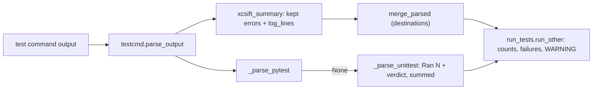
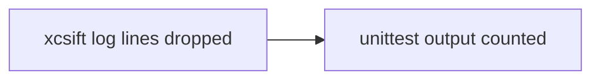

# B311: run_tests drops xcsift console log lines and reads unittest output (#1091, #1092)

**Goal:** a `maxapp test` run that exits 0 with no failed test is green even when xcsift lists xctest console lines under `errors[]`, and those lines surface as one summary warning (#1091); a `python -m unittest` run (alone or chained with `&&`) reports its `Ran N tests` counts and its failing test ids instead of stopping with `no test count` (#1092).
**Architecture:** `testcmd.xcsift_summary` classifies each `errors[]` entry as kept or a console log line and reports the dropped ones as `log_lines` / `log_line`; `merge_parsed` carries them; `run_tests.run_other` turns them into a `WARNING` note. A new `testcmd._parse_unittest` reads every `Ran N tests in Xs` line and the verdict below it; `parse_output` tries it when `_parse_pytest` finds no summary.
**Tech stack:** Python 3 stdlib, pytest via `sl run_tests`.
**Spec:** issues #1091, #1092; feedback 9d843a96d4db fffe05b5f85b d4da582000f8 aae9b2fa5a48 f9b70a594dc6 a661a42fa7a7 5f32d24a83e8 067c77dd7869 a26682cc610b.
**Detail:** tests
**Wave0:** none
**Coverage:** off

## Global constraints

- Evidence (lead, read on f17a795e): real pix-app logs (`.superlite/briefs/ref/pix-green-coredata-1.log`, `-2.log`, `pix-red-coredata.log`) hold `errors[]` entries `{"message": "Unable to create token NSXPCConnection. ...", "file": "<two U+200B>2026-11-20 15:04:16.527985+0100 xctest[86859:29490527] [error] CoreData"}` with no `line` key. B310's rule (a block that counted tests keeps only entries with a line above 0) already parses both green logs as failed 0; this batch closes the rest: a timestamp `file` with a line, a block that counted nothing in a quiet run, and the missing warning.
- Evidence (lead, Python 3.15): `python3 -m unittest discover` prints to stderr, e.g. `ERROR: test_err (test_a.A.test_err)` / `FAIL: test_bad (test_a.A.test_bad)` / `UNEXPECTED SUCCESS: test_xp (test_a.A.test_xp)` headers, then `Ran 6 tests in 0.002s`, a blank line, `FAILED (failures=1, errors=1, skipped=1, expected failures=1, unexpected successes=1)`; zero tests print `Ran 0 tests in 0.000s`, blank, `NO TESTS RAN` with exit 5. Python 3.10 and older print `FAIL: test_bad (pkg.mod.Case)`.
- Every new or changed code line in `skills/subagent-driven-development/scripts/*.py` ends with its `# O(...)` complexity comment like its neighbours; run_tests.py's module docstring gets one clause naming the issue the task builds (#1091 or #1092).
- Files this batch may touch: skills/subagent-driven-development/scripts/run_tests.py, skills/subagent-driven-development/scripts/testcmd.py, tests/scripts/test_xcsift_log_lines_1091.py, tests/scripts/test_testcmd_unittest_1092.py and this plan. docs/tools.md belongs to another batch: never edit it. An existing test that breaks and is not in your Owns: name it in the report, do not edit it.
- Builds: the verdict is `sl run_tests` (the project's test command; a project with `.maxapp` runs `maxapp test`, which a build pool may place on another Mac, and a full run whose tree a green maxapp test stamp covers returns that result without a run); task trees build in <tree>/.build/DerivedData and any build of your own goes under .build/ of the worktree, never -derivedDataPath outside the worktree (your session scratchpad included; backlog cleanup removes scratchpad build folders when the worktree goes); a product, simulator or device build stays on this machine and runs only when an issue's acceptance asks for a running-app check; copy this sentence into every worker brief.
- Simulators: append the UDID of each simulator you or a worker creates (`xcrun simctl create` or `clone`; a checker's `Simulators:` line marks its created ones) as one line to /Users/max/github/superlite/.claude/worktrees/superlite-b311-run-tests-parsers/.superlite/simulators.txt; never list one you did not create; ship cleanup shuts down and deletes each listed one; copy this sentence into every worker brief.

Ruling: an `errors[]` entry whose `file` (zero-width spaces and whitespace stripped) starts with a `YYYY-MM-DD HH:MM:SS` timestamp is a console log line in every block and on every exit, even with a line above 0: no source path starts with a log timestamp (lead's ruling) - cost if wrong: one real error hidden behind a timestamped path, never seen in 40+ logs.
Ruling: a quiet run (exit 0 and no block counted a failed test, summary `failed_tests` or named `failed_tests[]`) also drops line-less entries from blocks that counted nothing, and such a block's `status: failed` alone adds no failure when all its entries were dropped; a red exit keeps B310's rule for blocks that counted nothing, so a line-less linker or destination error still leads (lead's ruling, the issue's expected) - cost if wrong: a quiet zero-count run stops as no-result instead of red, which still blocks the ship.
Ruling: dropped entries become one warning `xcsift listed N console log line(s) under errors[], not counted as failures: <first>` through run_tests' existing `WARNING` (summary `warning`, stderr `run_tests: WARNING:`), because the issue asks for "a warning, not a failure"; the parse result carries `log_lines` and `log_line` only when N > 0, so exact-shape callers stay valid (lead's ruling) - cost if wrong: one line of noise per pix-app run.
Ruling: unittest expected failures count as skipped and unexpected successes as failed, like pytest's xfailed and like unittest's own exit code; `passed` = N - failures - errors - skipped - expected failures - unexpected successes, floored at 0 (lead's ruling) - cost if wrong: a count shifted between columns.
Ruling: a pytest summary line wins over unittest lines in the same output (parse_output tries `_parse_pytest` first); a unittest verdict is the first non-blank line after `Ran N tests in Xs`, else that Ran line does not count (lead's ruling) - cost if wrong: a pytest-and-unittest chain counts only pytest's half.
Ruling: docs/tools.md's `run_tests` row is owned by B317 (append-only): the doc change is a follow-up in notes.md (lead's ruling).
LAYERS: unit

## Main diagram



## File structure

- skills/subagent-driven-development/scripts/testcmd.py: `xcsift_summary` log-line rule and `log_lines` keys, `merge_parsed` carries them (T1); `_parse_unittest` and its call in `parse_output` (T2).
- skills/subagent-driven-development/scripts/run_tests.py: the `log_lines` warning in `run_other` and a docstring clause (T1); a docstring clause (T2).
- tests/scripts/test_xcsift_log_lines_1091.py: #1091 tests (T1).
- tests/scripts/test_testcmd_unittest_1092.py: #1092 tests (T2).

## Task graph

```mermaid
%% schedule
gantt
  title Predicted schedule (mm:ss)
  dateFormat X
  axisFormat %M:%S
  section lane 1
  T1 xcsift log lines dropped :t1, 0, 680s
  T2 unittest output counted :t2, 680, 651s
```





critical path: T1 → T2 (22.2 min) · peak width 1 · predicted build 22.2 min · predicted total ≈ 40.7 min

T1 --> T2 exists only because both edit testcmd.py and run_tests.py: two tasks that share a file never run at once.

## run_tests parsing

**Probe entry:** none (library functions inside run_tests; the cases are the named tests below)

### T1 xcsift log lines dropped · Complexity 4 · Est. context 40k
**Owns:** tests/scripts/test_xcsift_log_lines_1091.py
**Also-touches:** skills/subagent-driven-development/scripts/testcmd.py, skills/subagent-driven-development/scripts/run_tests.py
**Components:** 2
**LOC owned:** 150
**Tests:** fast
**Model:** sonnet
**Kind:** design
**Produces:** testcmd.xcsift_summary(lines: list[str], rc: int) -> dict | None
e.g. xcsift_summary(one block passed 7590, errors [timestamp-file CoreData entry, no line], 0) -> failed 0, errors [], log_lines 1, log_line "2026-11-20 15:04:16.527985+0100 xctest[86859:29490527] [error] CoreData: Unable to create token ..."
e.g. xcsift_summary(one block counted nothing, status failed, errors [timestamp-file entry with line 4, Foo.swift:10], 1) -> failed 1, errors ["/src/App/Foo.swift:10: cannot find 'bar' in scope"], log_lines 1
e.g. xcsift_summary(one block passed 5, no errors, 0) -> no `log_lines` key
**Produces:** testcmd.merge_parsed(parts: list[tuple[str, dict]]) -> dict
e.g. merge_parsed([("a", {log_lines 2, log_line "x"}), ("b", {log_lines 1, log_line "y"})]) -> log_lines 3, log_line "x"
**Review Focus:** state: `test_quiet_run_drops_lineless_error_of_uncounted_block`, `test_red_exit_keeps_lineless_error_of_uncounted_block`, `test_failed_tests_end_the_quiet_rule`; numeric: `test_quiet_only_log_lines_is_no_result` (summary errors count minus dropped entries); deep: `test_green_maxapp_run_is_green_with_warning` (end to end through run_tests); test_xcsift_blocks_1076.py, test_run_tests_build_error_912.py and test_testcmd_counts_481.py stay green.
**Test code (verbatim):**
```python
"""#1091: xcsift errors[] entries that are console log lines never fail a run that exited 0 with no failed test."""
from __future__ import annotations

import json
import os
import subprocess
import sys

from _fixtures import DISK_FREE
from test_plan_tools import SCRIPTS

sys.path.insert(0, str(SCRIPTS))
import testcmd  # noqa: E402

ZW = "\u200b"
STAMP = "2026-11-20 15:04:16.527985+0100 xctest[86859:29490527] [error] CoreData"
TOKEN = "Unable to create token NSXPCConnection.  NSXPCStoreServerEndpointFactory 0x756e894c20 -newEndpointWithError returned error"
LOG = {"message": TOKEN, "file": f"{ZW}{ZW}{STAMP}"}
PLAIN = {"message": "[error] CoreData: Unable to create token"}
BUILD = {"file": "/src/App/Foo.swift", "message": "cannot find 'bar' in scope", "line": 10}
BUILD_ERR = "/src/App/Foo.swift:10: cannot find 'bar' in scope"
FAILED_TEST = {"test": "ChatTests testSync", "message": "Expectation failed", "file": "/src/Tests/ChatTests.swift", "line": 3}


def block(passed=0, failed=0, errors=(), status=None, failed_tests=()):
    obj = {"summary": {"failed_tests": failed, "passed_tests": passed, "errors": len(errors), "warnings": 0, "linker_errors": 0}}
    if errors:
        obj["errors"] = list(errors)
    if failed_tests:
        obj["failed_tests"] = list(failed_tests)
    obj["status"] = status or ("failed" if failed or errors else "success")
    return obj


def out(*objs):
    lines = ["command: maxapp test", "exit: 0", ""]
    for o in objs:
        lines += json.dumps(o, indent=2, separators=(",", " : ")).splitlines()
    return lines


def triple(r):
    return (r["passed"], r["failed"], r["skipped"])


def _run(tmp_path, objs, rc):
    (tmp_path / ".superlite").mkdir(exist_ok=True)
    (tmp_path / ".superlite" / "test-cmd.json").write_text(json.dumps({"language": "bash", "test": f"cat out.json; exit {rc}"}), encoding="utf-8")
    (tmp_path / "out.json").write_text("\n".join(out(*objs)) + "\n", encoding="utf-8")
    env = {k: v for k, v in os.environ.items() if not k.startswith("SUPERLITE_") or k == "SUPERLITE_HOME"}
    env.update(DISK_FREE)
    cp = subprocess.run([sys.executable, str(SCRIPTS / "run_tests.py"), "--full"], cwd=tmp_path, capture_output=True, text=True, env=env)
    return cp, json.loads((tmp_path / ".superlite" / "test-summary.json").read_text(encoding="utf-8"))


def test_real_pix_block_is_green_and_reports_the_log_line():
    r = testcmd.xcsift_summary(out(block(7590, errors=[LOG])), 0)
    assert triple(r) == (7590, 0, 0) and r["errors"] == [] and r["error"] == ""
    assert r["log_lines"] == 1 and r["log_line"].startswith(f"{STAMP}: Unable to create token")


def test_timestamp_file_with_a_line_is_a_log_line():
    r = testcmd.xcsift_summary(out(block(7590, errors=[{**LOG, "line": 4}])), 0)
    assert r["failed"] == 0 and r["errors"] == [] and r["log_lines"] == 1


def test_timestamp_file_is_dropped_on_a_red_exit_too():
    r = testcmd.xcsift_summary(out(block(0, errors=[{**LOG, "line": 4}, BUILD], status="failed")), 1)
    assert r["failed"] == 1 and r["errors"] == [BUILD_ERR] and r["error"] == BUILD_ERR and r["log_lines"] == 1


def test_quiet_run_drops_lineless_error_of_uncounted_block():
    r = testcmd.xcsift_summary(out(block(7590), block(0, errors=[PLAIN], status="failed")), 0)
    assert triple(r) == (7590, 0, 0) and r["errors"] == [] and r["error"] == "" and r["empty"] == ""
    assert r["log_lines"] == 1 and r["log_line"] == PLAIN["message"]


def test_red_exit_keeps_lineless_error_of_uncounted_block():
    r = testcmd.xcsift_summary(out(block(0, errors=[PLAIN], status="failed")), 1)
    assert r["failed"] == 1 and r["errors"] == [PLAIN["message"]] and "log_lines" not in r


def test_failed_tests_end_the_quiet_rule():
    r = testcmd.xcsift_summary(out(block(10, 1, failed_tests=[FAILED_TEST]), block(0, errors=[PLAIN], status="failed")), 0)
    assert r["failed"] >= 1 and r["errors"] == [PLAIN["message"]] and r["names"] == ["ChatTests testSync"]


def test_quiet_only_log_lines_is_no_result():
    r = testcmd.xcsift_summary(out(block(0, errors=[LOG], status="failed")), 0)
    assert triple(r) == (0, 0, 0) and r["counted"] is False and r["errors"] == [] and r["error"] == ""
    assert r["empty"] == "xcsift summary: 0 passed, 0 failed tests" and r["log_lines"] == 1


def test_no_log_lines_key_when_nothing_dropped():
    r = testcmd.xcsift_summary(out(block(5)), 0)
    assert "log_lines" not in r and "log_line" not in r


def test_merge_parsed_sums_log_lines():
    a = {"passed": 1, "failed": 0, "skipped": 0, "names": [], "tail": [], "counted": True, "log_lines": 2, "log_line": "x"}
    b = {"passed": 1, "failed": 0, "skipped": 0, "names": [], "tail": [], "counted": True, "log_lines": 1, "log_line": "y"}
    m = testcmd.merge_parsed([("a", a), ("b", b)])
    assert m["log_lines"] == 3 and m["log_line"] == "x"
    plain = {k: v for k, v in a.items() if not k.startswith("log_")}
    assert "log_lines" not in testcmd.merge_parsed([("a", plain), ("b", dict(plain))])


def test_green_maxapp_run_is_green_with_warning(tmp_path):
    cp, s = _run(tmp_path, [block(7590, errors=[LOG, LOG])], 0)
    assert cp.returncode == 0, cp.stdout + cp.stderr
    assert s["passed"] == 7590 and s["failed"] == 0 and not any("build error" in f for f in s["failures"])
    assert s["warning"].startswith("xcsift listed 2 console log line(s) under errors[], not counted as failures: ")
    assert "run_tests: WARNING: xcsift listed 2 console log line(s)" in cp.stderr


def test_red_run_lists_no_log_line_failure(tmp_path):
    cp, s = _run(tmp_path, [block(10, 1, errors=[LOG], failed_tests=[FAILED_TEST])], 1)
    assert cp.returncode == 1
    assert s["failed"] == 1 and not any("CoreData" in f or "build error" in f for f in s["failures"])
```
**Steps:** 1 write the test file, 2 run it: FAIL, 3 implement, 4 run it and the three Review Focus files: PASS
**Notes:** in `xcsift_summary` sum each block's failed count (`max(summary failed_tests, named failed_tests[] entries)`) over all blocks before reading any `errors[]`, so `quiet = not rc and total_failed == 0` is known for every block. An entry is dropped (counted in `log_lines`) when its `file` is a log timestamp (any block, any exit), or it has no line above 0 and (its block counted tests, or quiet). A block that counted nothing adds `max(summary errors - its dropped entries, 0)` to `n_err`; its `status: failed` sets `bare_failed` when it kept an entry, or when it dropped none (B310's rule), never when quiet and every entry was dropped. `log_line` is the first dropped entry as `<file>: <message>` (file stripped of U+200B and whitespace; the message alone without a file), cut at 160. In `run_other`, right after `p` is built (single or merged), a `p.get("log_lines")` adds `note = f"xcsift listed {n} console log line(s) under errors[], not counted as failures: {p['log_line'][:120]}"` to `WARNING` and prints `run_tests: WARNING: {note}` to stderr, the same form as the result-bundle note.

### T2 unittest output counted · Complexity 4 · Est. context 40k
**Owns:** skills/subagent-driven-development/scripts/testcmd.py, skills/subagent-driven-development/scripts/run_tests.py, tests/scripts/test_testcmd_unittest_1092.py
**Components:** 1
**LOC owned:** 170
**Tests:** fast
**Model:** sonnet
**Kind:** design
**Produces:** testcmd._parse_unittest(lines: list[str], rc: int) -> tuple[int, int, int, list[str], dict] | None
e.g. _parse_unittest(["Ran 64 tests in 0.512s", "", "OK"], 0) -> (64, 0, 0, [], {})
e.g. _parse_unittest(["FAIL: test_bad (test_a.A.test_bad)", ..., "Ran 6 tests in 0.002s", "", "FAILED (failures=1, errors=1, skipped=1, expected failures=1, unexpected successes=1)"], 1) -> (1, 3, 2, [... "test_a.A.test_bad" ...], {"test_a.A.test_bad": ("AssertionError: 1 != 2", 0), ...})
e.g. _parse_unittest(["Ran 0 tests in 0.000s", "", "NO TESTS RAN"], 5) -> None
**Produces:** testcmd.parse_output(text: str, rc: int) -> dict
e.g. parse_output("Ran 64 tests in 0.512s\n\nOK\nRan 5 tests in 0.1s\n\nOK (skipped=1)\n", 0) -> passed 68, failed 0, skipped 1, counted True
**Review Focus:** numeric: `test_mixed_verdict_columns`, `test_chained_runs_are_summed`; state: `test_no_tests_ran_is_empty`, `test_ran_line_without_verdict_does_not_count`, `test_pytest_summary_wins`; deep: `test_real_unittest_chain_through_run_tests`, `test_real_unittest_failure_through_run_tests`; test_testcmd_counts_481.py and test_testcmd_names_800_790.py stay green.
**Test code (verbatim):**
```python
"""#1092: run_tests reads python -m unittest's `Ran N tests` and its OK / FAILED verdict, summed over chained runs."""
from __future__ import annotations

import json
import os
import shlex
import subprocess
import sys

from _fixtures import DISK_FREE
from test_plan_tools import SCRIPTS

sys.path.insert(0, str(SCRIPTS))
import testcmd  # noqa: E402

EQ, SEP = "=" * 70, "-" * 70
GREEN = f"......\n{SEP}\nRan 64 tests in 0.512s\n\nOK\n"
MIXED = "\n".join([
    "FE.sxu", EQ, "ERROR: test_err (test_a.A.test_err)", SEP, "Traceback (most recent call last):",
    '  File "/p/t/test_a.py", line 5, in test_err', '    raise ValueError("x")', "ValueError: x", "",
    EQ, "FAIL: test_bad (test_a.A.test_bad)", SEP, "Traceback (most recent call last):",
    '  File "/p/t/test_a.py", line 4, in test_bad', "    self.assertEqual(1, 2)", "AssertionError: 1 != 2", "",
    EQ, "UNEXPECTED SUCCESS: test_xp (test_a.A.test_xp)", SEP, "Ran 6 tests in 0.002s", "",
    "FAILED (failures=1, errors=1, skipped=1, expected failures=1, unexpected successes=1)", ""])


def triple(r):
    return (r["passed"], r["failed"], r["skipped"])


def test_green_run_counts():
    r = testcmd.parse_output(GREEN, 0)
    assert triple(r) == (64, 0, 0) and r["counted"] is True and r["names"] == [] and r["empty"] == ""


def test_ok_with_skips_and_expected_failures():
    r = testcmd.parse_output("Ran 10 tests in 0.100s\n\nOK (skipped=2, expected failures=1)\n", 0)
    assert triple(r) == (7, 0, 3)


def test_mixed_verdict_columns():
    r = testcmd.parse_output(MIXED, 1)
    assert triple(r) == (1, 3, 2)
    assert r["names"] == ["test_a.A.test_err", "test_a.A.test_bad", "test_a.A.test_xp"]
    assert r["reasons"]["test_a.A.test_err"] == ("ValueError: x", 0)
    assert r["reasons"]["test_a.A.test_bad"] == ("AssertionError: 1 != 2", 0)
    assert r["reasons"]["test_a.A.test_xp"] == ("unexpected success", 0)


def test_errors_only():
    r = testcmd.parse_output("Ran 3 tests in 0.010s\n\nFAILED (errors=1)\n", 1)
    assert triple(r) == (2, 1, 0)


def test_chained_runs_are_summed():
    r = testcmd.parse_output(GREEN + "Ran 5 tests in 0.100s\n\nOK (skipped=1)\n", 0)
    assert triple(r) == (68, 0, 1)


def test_chained_red_second_run():
    r = testcmd.parse_output(GREEN + "Ran 4 tests in 0.100s\n\nFAILED (failures=2)\n", 1)
    assert triple(r) == (66, 2, 0)


def test_python_310_ids_get_the_method():
    text = "\n".join([EQ, "FAIL: test_bad (pkg.mod.Case)", SEP, "AssertionError: no", "", SEP, "Ran 1 test in 0.001s", "", "FAILED (failures=1)", ""])
    r = testcmd.parse_output(text, 1)
    assert triple(r) == (0, 1, 0) and r["names"] == ["pkg.mod.Case.test_bad"]


def test_names_only_on_a_red_exit():
    text = "\n".join([EQ, "FAIL: test_bad (pkg.mod.Case.test_bad)", SEP, "AssertionError: no", "", SEP, "Ran 2 tests in 0.001s", "", "OK", ""])
    r = testcmd.parse_output(text, 0)
    assert triple(r) == (2, 0, 0) and r["names"] == []


def test_no_tests_ran_is_empty():
    r = testcmd.parse_output(f"\n{SEP}\nRan 0 tests in 0.000s\n\nNO TESTS RAN\n", 5)
    assert r["counted"] is False and r["passed"] == 0 and r["empty"] == "Ran 0 tests in 0.000s"
    old = testcmd.parse_output(f"\n{SEP}\nRan 0 tests in 0.000s\n\nOK\n", 0)
    assert old["counted"] is False and old["empty"] == "Ran 0 tests in 0.000s"


def test_ran_line_without_verdict_does_not_count():
    r = testcmd.parse_output("Ran 5 tests in 0.200s\nsomething else\n", 0)
    assert r["counted"] is False and r["passed"] == 0


def test_pytest_summary_wins():
    r = testcmd.parse_output("Ran 9 tests in 0.100s\n\nOK\n============ 3 passed in 0.12s ============\n", 0)
    assert triple(r) == (3, 0, 0)


def _project(tmp_path, dirs, command):
    for name, body in dirs.items():
        (tmp_path / name).mkdir()
        (tmp_path / name / f"test_{name}.py").write_text(body, encoding="utf-8")
    (tmp_path / ".superlite").mkdir()
    (tmp_path / ".superlite" / "test-cmd.json").write_text(json.dumps({"language": "python", "test": command}), encoding="utf-8")
    env = {k: v for k, v in os.environ.items() if not k.startswith("SUPERLITE_") or k == "SUPERLITE_HOME"}
    env.update(DISK_FREE)
    cp = subprocess.run([sys.executable, str(SCRIPTS / "run_tests.py"), "--full"], cwd=tmp_path, capture_output=True, text=True, env=env)
    return cp, json.loads((tmp_path / ".superlite" / "test-summary.json").read_text(encoding="utf-8"))


OK2 = "import unittest\nclass A(unittest.TestCase):\n    def test_a(self): pass\n    def test_b(self): pass\n"
SKIP = "import unittest\nclass B(unittest.TestCase):\n    def test_c(self): pass\n    @unittest.skip('later')\n    def test_d(self): pass\n"
BAD = "import unittest\nclass C(unittest.TestCase):\n    def test_bad(self): self.assertEqual(1, 2)\n"


def test_real_unittest_chain_through_run_tests(tmp_path):
    py = shlex.quote(sys.executable)
    cp, s = _project(tmp_path, {"one": OK2, "two": SKIP}, f"{py} -m unittest discover -s one && {py} -m unittest discover -s two")
    assert cp.returncode == 0, cp.stdout + cp.stderr
    assert (s["passed"], s["failed"], s["skipped"]) == (3, 0, 1) and "error" not in s


def test_real_unittest_failure_through_run_tests(tmp_path):
    py = shlex.quote(sys.executable)
    cp, s = _project(tmp_path, {"three": BAD}, f"{py} -m unittest discover -s three")
    assert cp.returncode == 1
    assert s["failed"] == 1 and s["failures"] == ["-::test_three.C.test_bad: AssertionError: 1 != 2"]
```
**Steps:** 1 write the test file, 2 run it: FAIL, 3 implement, 4 run it and the two Review Focus files: PASS
**Notes:** `_parse_unittest` reads every line matching `^Ran (\d+) tests? in \d+(?:\.\d+)?s$`; its verdict is the first non-blank line after it: `OK`, `OK (<k>=<v>, ...)`, `FAILED (<k>=<v>, ...)` (keys `failures`, `errors`, `skipped`, `expected failures`, `unexpected successes`); a Ran line with another next line, and `NO TESTS RAN`, does not count. It returns None when no Ran line counts or every counted run ran 0 tests. Names and reasons only when `rc` is non-zero: each `^(FAIL|ERROR|UNEXPECTED SUCCESS): (\S+) \(([^)]+)\)$` header gives the id `<paren>` when the paren ends with `.<name>`, else `<paren>.<name>` (unique, at most 50, each cut at 120); its reason is the last non-blank line before the next `=`*70 or `-`*70 separator line after the header's own `-` line, or `unexpected success` for an UNEXPECTED SUCCESS header (cut at 160, line 0). In `parse_output`, `py = _parse_pytest(lines, rc)` then, when it is None, `py = _parse_unittest(lines, rc)`, so the pytest branch below handles both; the `empty` regex also matches `^Ran 0 tests? in ` so a pre-3.12 zero run names its runner line.

## Review Focus

- T1: a run that exits 0 with no failed test never fails on an `errors[]` entry without a line or with a log-timestamp file; a red exit keeps compiler and line-less build errors leading; the dropped entries reach the summary `warning`.
- T2: unittest counts are summed over chained runs, a zero-test run stays a no-result stop, pytest output keeps its own parse.

## Self-review

- Coverage: #1091 -> T1 (log-timestamp file, quiet uncounted block, warning); #1092 -> T2 (Ran N + OK / FAILED, chained `&&`, failure ids).
- No placeholders; Produces lines match the code names; T1 --> T2 serializes the shared files.
