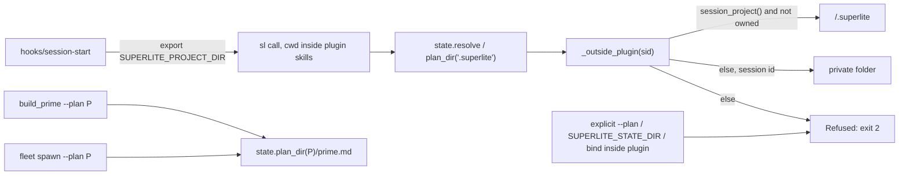
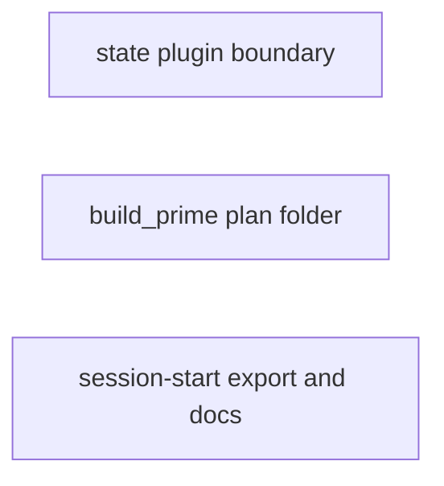

# B322: sl state never lands inside the plugin; build_prime writes the plan's run folder (#1116)

**Goal:** an `sl` call whose cwd lies inside the plugin's skills folder (`cd <plugin>/skills/subagent-driven-development/scripts && ./sl orchestrator set ai`) puts its state in the session's project, never in `<scripts>/.superlite`; `build_prime --plan <abs plan>` writes `prime.md` into the plan's run folder (the folder `fleet spawn --plan` reads), whatever the cwd; `sl` refuses (exit 2) any state folder inside the plugin's skills folder.
**Architecture:** state.py gains `PLUGIN_SKILLS`, `in_plugin(sd)`, `session_project()`, `Refused` and `_outside_plugin(sid)`; `resolve()`'s cwd fallback and `plan_dir(".superlite")` redirect a plugin cwd to `<session project>/.superlite` (else the private folder, else exit 2); explicit values inside the plugin are refused; `bound()` ignores a binding into the plugin and `bind()` refuses one. build_prime's default `--out` becomes `state.plan_dir(<--plan>)/prime.md`. hooks/session-start exports the launch folder as `SUPERLITE_PROJECT_DIR`, since Bash has no `CLAUDE_PROJECT_DIR`.
**Tech stack:** Python 3 stdlib, bash; pytest via `sl run_tests`.
**Spec:** issue #1116.
**Detail:** contracts
**Wave0:** none
**Coverage:** off

## Global constraints

- `PLUGIN_SKILLS = Path(__file__).resolve().parents[2]` in state.py is the plugin's skills folder (state.py → scripts → subagent-driven-development → skills). A state folder at or below it (compared logical, then resolved) is never created. The plugin root itself and everything outside `skills/` (superlite's own `.superlite`, worktrees under `.claude/worktrees/`) stay allowed.
- `session_project()` reads `$CLAUDE_PROJECT_DIR`, else `$SUPERLITE_PROJECT_DIR` (exported by hooks/session-start); a value that is empty, not absolute, or whose `.superlite` lies in the plugin is skipped. `launch_dir()` stays unchanged: the new variable feeds only the plugin redirect.
- Refusal line, exact: `superlite: <abs sd> lies inside the superlite plugin (<PLUGIN_SKILLS>); no run state is created there. Run sl from your project folder, or pass --plan <project>/.superlite` on stderr, then `raise Refused(sd)` (a `SystemExit(2)`, like `Foreign`).
- Every code line in state.py, build_prime.py and hooks/session-start ends with its `# O(...)` complexity comment like its neighbours.
- Files this batch may touch: skills/subagent-driven-development/scripts/state.py, skills/subagent-driven-development/scripts/build_prime.py, hooks/session-start, docs/hooks.md, tests/scripts/test_session_state.py (one env line, T3), the new test files each task owns and this plan. Every other file (plan_tools.py, predict.py, run_tests.py, pt_review.py, findings.py, fleet.py, fleet_io.py, backlog*.py, fleet_placement.py, fleet_remote_*.py, docs/tools.md, orchestrator.py, hooks/superlite-state.sh) is not this batch's: never edit it. An existing test that breaks: name it in the report, do not edit it without the lead's word.
- Builds: the verdict is `sl run_tests` (the project's test command; a project with `.maxapp` runs `maxapp test`, which a build pool may place on another Mac, and a full run whose tree a green maxapp test stamp covers returns that result without a run); task trees build in <tree>/.build/DerivedData and any build of your own goes under .build/ of the worktree, never -derivedDataPath outside the worktree (your session scratchpad included; backlog cleanup removes scratchpad build folders when the worktree goes); a product, simulator or device build stays on this machine and runs only when an issue's acceptance asks for a running-app check; copy this sentence into every worker brief.
- Simulators: append the UDID of each simulator you or a worker creates (`xcrun simctl create` or `clone`; a checker's `Simulators:` line marks its created ones) as one line to /Users/max/github/superlite/.claude/worktrees/superlite-b322-sl-state-folder-resolution/.superlite/simulators.txt; never list one you did not create; ship cleanup shuts down and deletes each listed one; copy this sentence into every worker brief.

Ruling: the boundary is the plugin's whole skills folder, not only the scripts folder, so `cd <skill dir> && scripts/sl ...` is covered too; the plugin root stays a normal project (superlite develops itself there) (lead's ruling).
Ruling: [scope] a cwd inside the plugin resolves to the session's launch folder (`<CLAUDE_PROJECT_DIR or SUPERLITE_PROJECT_DIR>/.superlite`, the folder the hooks' legacy step names), not that folder's git toplevel; the two coincide for a session launched at its repo root, and the hooks and sl then agree (lead's ruling).
Ruling: no launch folder known, or another live session owns it: the session's private folder; no session id either: exit 2 (lead's ruling).
Ruling: explicit values inside the plugin (`--plan`, `SUPERLITE_STATE_DIR`, a `bind` target) are refused with exit 2, never redirected; only the implicit cwd fallback and the bare `--plan .superlite` redirect (lead's ruling).
Ruling: #707's bare `.superlite` walk is skipped for a cwd inside the plugin (it would reach the plugin checkout's own run); it goes to `_outside_plugin` instead (lead's ruling).
Ruling: a binding an older sl left inside the plugin is ignored by `bound()`; the session's next `bind` moves that folder's pending gate and fleet out. hooks/superlite-state.sh keeps following such a binding until then (lead's ruling).
Ruling: build_prime's default `--out` is `state.plan_dir(<--plan value>)`, the folder `fleet spawn --plan` reads (fleet._sd); an explicit `--out` keeps its old meaning (lead's ruling).

## Main diagram



## File structure

- skills/subagent-driven-development/scripts/state.py: plugin boundary, redirect, refusals, `where` wording, docstring.
- skills/subagent-driven-development/scripts/build_prime.py: default `--out` from the plan's run folder.
- hooks/session-start: `SUPERLITE_PROJECT_DIR` export.
- docs/hooks.md: one sentence on the export and the plugin refusal.
- tests/scripts/test_state_plugin_folder_1116.py, tests/scripts/test_build_prime_plan_folder_1116.py, tests/scripts/test_session_start_project_dir_1116.py: new.

## Task graph

```mermaid
%% schedule
gantt
  title Predicted schedule (mm:ss)
  dateFormat X
  axisFormat %M:%S
  section lane 1
  T1 state never resolves into the plugin :t1, 0, 742s
  section lane 2
  T2 build_prime writes the plan's run fol :t2, 0, 735s
  section lane 3
  T3 session-start exports the launch fold :t3, 0, 728s
```





critical path: T1 (12.4 min) · peak width 3 · predicted build 12.4 min · predicted total ≈ 32.9 min

## State

### T1 state never resolves into the plugin · Complexity 4 (O-1) · Est. context 48k
**Owns:** skills/subagent-driven-development/scripts/state.py, tests/scripts/test_state_plugin_folder_1116.py
**Components:** 1
**LOC owned:** 190
**Tests:** fast
**Model:** sonnet
**Kind:** design
**Produces:** state.in_plugin(sd) -> bool
e.g. in_plugin(PLUGIN_SKILLS / "subagent-driven-development" / "scripts" / ".superlite") is True; in_plugin(PLUGIN_SKILLS.parent / ".superlite") is False
**Produces:** state.session_project() -> Path | None
e.g. with CLAUDE_PROJECT_DIR unset and SUPERLITE_PROJECT_DIR="/w/proj": Path("/w/proj")
**Produces:** state.Refused(sd)
**Review Focus:** `test_resolve_from_plugin_goes_to_session_project`; `test_bind_refuses_a_plugin_folder`; `test_orchestrator_set_from_the_real_scripts_folder`
**Steps:**
1. Write the tests below; run: FAIL.
2. Add `PLUGIN_SKILLS`, `class Refused(SystemExit)` (`__init__(self, sd)`: `super().__init__(2)`, `self.line` = the Global constraints line), `in_plugin(sd)` (True when `_abs(sd)` or `_abs(sd).resolve()` equals PLUGIN_SKILLS or has it among its parents), `_refuse(sd)` (prints `Refused(sd).line` to stderr, raises it), `session_project()` and `_outside_plugin(sid)`: `proj = session_project()`; when proj: `cand = proj / ".superlite"`, `other = live_owner(cand, sid) if sid else None`; return cand when `not other or _hands_over(cand, other)`; then `private_dir(sid)` when sid; else `_refuse(_abs(".superlite"))`.
3. `plan_dir`: a bare `.superlite` (the existing `bare` test) whose `_abs` is `in_plugin` returns `_outside_plugin(session_id())` before the walk; any other result that is `in_plugin` goes to `_refuse(result)`. Keep the existing body as `_plan_dir` or wrap it; behaviour outside the plugin is byte-identical.
4. `resolve`: a `SUPERLITE_STATE_DIR` that is `in_plugin` → `_refuse`; the last fallback: when `in_plugin(_abs(".superlite"))` return `_outside_plugin(sid)` before the `live_owner(".superlite", ...)` check.
5. `bound`: a target that is `in_plugin` gives None. `bind`: an `sd` that is `in_plugin` → `_refuse(sd)` before any mkdir or write; its previous folder (`old`, gate move and fleet follow) comes from the raw binding (`_target` with the existing exists and owner checks, without the plugin filter), so a stray folder's `orchestrator.json` and fleet move to the new folder.
6. `main` (`where`): in the else branch, when not bound and `in_plugin(_abs(".superlite"))`, `how` is `cwd inside the plugin; session project` or `cwd inside the plugin; private folder` (`private(sd)`), instead of `current directory`.
7. Module docstring: one paragraph after step 4: "A cwd inside the plugin's skills folder never yields `./.superlite` there (#1116): step 4 and a bare `--plan .superlite` use `<$CLAUDE_PROJECT_DIR or $SUPERLITE_PROJECT_DIR>/.superlite` (session-start exports the latter), else the private folder, else exit 2; an explicit plan, $SUPERLITE_STATE_DIR or bind target inside it exits 2 (`Refused`), and a binding into it is ignored." Add `in_plugin, session_project, Refused, PLUGIN_SKILLS` to the Library list.
8. Run: PASS, and tests/scripts/test_session_state.py, tests/scripts/test_state_foreign_worktree.py, tests/regression/test_state_hook_order.py stay green.
**Test code (named, contracts):** tests/scripts/test_state_plugin_folder_1116.py. Fixture `plug(tmp_path, monkeypatch)`: monkeypatch `state.PLUGIN_SKILLS` to `tmp/plugin/skills` (with `tmp/plugin/.git` a folder and `skills/subagent-driven-development/scripts` created); `proj = tmp/proj` with a `.git` folder; delenv SUPERLITE_STATE_DIR, CLAUDE_PROJECT_DIR, SUPERLITE_PROJECT_DIR; setenv SUPERLITE_SESSION_ID=`"a1"`; chdir into the scripts folder and setenv PWD to it (the conftest autouse fixture already isolates SUPERLITE_HOME).
- `test_resolve_from_plugin_goes_to_session_project`: SUPERLITE_PROJECT_DIR=proj → `state.resolve() == proj / ".superlite"`; `scripts/.superlite` does not exist afterwards.
- `test_claude_project_dir_wins`: CLAUDE_PROJECT_DIR=proj, SUPERLITE_PROJECT_DIR=tmp/other → `proj / ".superlite"`.
- `test_resolve_from_plugin_without_project_uses_private_folder`: no project variable → `state.resolve() == state.private_dir("a1")`.
- `test_resolve_from_plugin_without_project_or_session_refuses`: also delenv SUPERLITE_SESSION_ID and CLAUDE_CODE_SESSION_ID → `pytest.raises(state.Refused)` with `.code == 2`; stderr holds `lies inside the superlite plugin`.
- `test_owned_project_folder_goes_private`: `state.bind(proj / ".superlite", sid="b2")` with CLAUDE_PROJECT_DIR=tmp/elsewhere set only for that call; then SUPERLITE_PROJECT_DIR=proj → `state.resolve() == state.private_dir("a1")`.
- `test_bare_plan_from_plugin_skips_the_walk`: `tmp/plugin/.superlite/fleet.json` exists (run state at the plugin's top), SUPERLITE_PROJECT_DIR=proj → `state.plan_dir(".superlite") == proj / ".superlite"`.
- `test_explicit_plan_inside_plugin_refused`: `state.plan_dir(str(scripts / ".superlite"))` and `state.plan_dir(str(scripts))` each raise Refused.
- `test_state_dir_env_inside_plugin_refused`: SUPERLITE_STATE_DIR=`scripts/.superlite` → `state.resolve()` raises Refused.
- `test_bound_ignores_a_binding_into_the_plugin`: `<home>/sessions/a1` holds `<scripts>/.superlite\n\n<scripts>\n` and that folder exists → `state.bound() is None`; chdir proj (PWD too) → `state.resolve() == Path(".superlite")`.
- `test_bind_refuses_a_plugin_folder`: `state.bind(scripts / ".superlite", sid="a1")` raises Refused; `scripts/.superlite` and `<home>/sessions/a1` do not exist.
- `test_bind_moves_a_stray_gate_out_of_the_plugin`: the stray binding of the test above plus `scripts/.superlite/orchestrator.json` `{"mode": "ai"}` and `session` = `a1`; `state.bind(proj / ".superlite", sid="a1")` → `proj/.superlite/orchestrator.json` exists, the stray one is gone, line 1 of `<home>/sessions/a1` is `proj/.superlite`.
- `test_for_plan_unstarted_plan_stays_out_of_the_plugin`: SUPERLITE_PROJECT_DIR=proj, plan `proj/docs/plans/p.md` exists → `state.for_plan(str(plan)) == proj / ".superlite"`.
- `test_where_names_the_plugin_redirect`: SUPERLITE_PROJECT_DIR=proj → `state.main(["where"]) == 0`, stdout is `<proj>/.superlite (cwd inside the plugin; session project)\n`.
- `test_orchestrator_set_from_the_real_scripts_folder`: subprocess `[sys.executable, SCRIPTS / "orchestrator.py", "set", "ai"]` with cwd=SCRIPTS (the real folder of state.py), env = os.environ minus SUPERLITE_STATE_DIR, CLAUDE_PROJECT_DIR, SUPERLITE_FLEET_*, plus SUPERLITE_HOME=tmp/home, SUPERLITE_SESSION_ID=`"a1"`, SUPERLITE_PROJECT_DIR=proj, PWD=SCRIPTS → returncode 0, `proj/.superlite/orchestrator.json` exists, `SCRIPTS/.superlite` does not exist (a fixture removes `SCRIPTS/.superlite` after the test only when it was absent before it).

## Prime

### T2 build_prime writes the plan's run folder · Complexity 2 (O-1) · Est. context 40k
**Owns:** skills/subagent-driven-development/scripts/build_prime.py, tests/scripts/test_build_prime_plan_folder_1116.py
**Components:** 1
**LOC owned:** 110
**Tests:** fast
**Model:** sonnet
**Kind:** design
**Review Focus:** `test_default_out_is_the_plan_folder_not_the_cwd`; `test_explicit_out_still_wins`
**Steps:**
1. Write the tests below; run: FAIL.
2. `--out` default becomes None. Keep the `--plan` value as given (`given = a.plan`) before the run-folder branch rewrites `a.plan`; `base = Path(a.out).parent if a.out else state.plan_dir(given)` (import state at the top of main beside orchestrator). `experiment.claim(a.plan, base)`. `out = Path(MINI_OUT if mini and a.out == DEFAULT_OUT else a.out) if a.out else base / ("prime-haiku.md" if mini else "prime.md")`. Every other use of the output folder (`sd = out.parent`, the haiku prime of a both-tiers build) follows `out` as today.
3. Usage line (docstring line 4): `[--out <plan's .superlite>/prime.md]`; add one sentence: "Without --out the prime goes to the plan's run folder (`state.plan_dir` of --plan, the folder `fleet spawn --plan` reads), never to the cwd (#1116)." grep the repo for other users of `build_prime.DEFAULT_OUT` and keep them working.
4. Run: PASS, and every tests/scripts/test_build_prime*.py stays green.
**Test code (named, contracts):** tests/scripts/test_build_prime_plan_folder_1116.py; build the smallest plan build_prime accepts as tests/scripts/test_build_prime_run_folder_508.py does (name the test it copies), in a project `proj` with a `.git` folder and the plan at `proj/docs/plans/p.md`; cwd is `tmp/elsewhere` (monkeypatch.chdir); call `build_prime.main([...])` in-process.
- `test_default_out_is_the_plan_folder_not_the_cwd`: `main(["--plan", str(plan)])` → 0; `proj/.superlite/prime.md` is a file; `tmp/elsewhere/.superlite` does not exist.
- `test_explicit_out_still_wins`: `main(["--plan", str(plan), "--out", str(tmp / "x" / "prime.md")])` → that file exists; `proj/.superlite/prime.md` does not.
- `test_haiku_default_goes_to_the_plan_folder`: `--tier haiku` → `proj/.superlite/prime-haiku.md` is a file; nothing under `tmp/elsewhere/.superlite`.
- `test_run_folder_plan_writes_into_that_folder`: `--plan str(proj / ".superlite")` where that folder names the plan (as the 508 test sets it up) → `proj/.superlite/prime.md` is a file.

## Hook

### T3 session-start exports the launch folder · Complexity 1 (O-1) · Est. context 30k
**Owns:** hooks/session-start, docs/hooks.md, tests/scripts/test_session_start_project_dir_1116.py, tests/scripts/test_session_state.py
**Components:** 1
**LOC owned:** 70
**Tests:** fast
**Model:** haiku
**Kind:** mechanical
**Review Focus:** `test_exports_claude_project_dir_with_a_space`
**Steps:**
1. Write the tests below; run: FAIL.
2. hooks/session-start, right after the `SUPERLITE_SESSION_ID` export's `fi`, insert exactly:
```bash
# The launch folder goes to Bash as SUPERLITE_PROJECT_DIR (Bash has no CLAUDE_PROJECT_DIR): an `sl` call whose cwd lies
# inside the plugin's skills folder puts its state there, never in the plugin (#1116).
proj="${CLAUDE_PROJECT_DIR:-}"  # O(1)
re_proj_cwd='"cwd"[[:space:]]*:[[:space:]]*"([^"\\]+)"'  # O(1)
if [ -z "$proj" ] && [[ $input =~ $re_proj_cwd ]]; then proj="${BASH_REMATCH[1]}"; fi  # O(input)
if [ -n "${CLAUDE_ENV_FILE:-}" ] && [ -n "$proj" ]; then  # O(1)
  printf 'export SUPERLITE_PROJECT_DIR=%q\n' "$proj" >> "$CLAUDE_ENV_FILE" 2>/dev/null || true  # O(1)
fi  # O(1)
```
3. tests/scripts/test_session_state.py `test_session_start_exports_the_hook_session_id`: build `env` without `CLAUDE_PROJECT_DIR` (`env.pop("CLAUDE_PROJECT_DIR", None)`); nothing else in that file changes.
4. docs/hooks.md, line 5 paragraph, after the sentence ending "so `sl` binds under the id the hooks read;": insert "it also exports the launch folder (`CLAUDE_PROJECT_DIR`, else the input `cwd`) as `SUPERLITE_PROJECT_DIR`, so an `sl` call whose cwd lies inside the plugin's skills folder keeps its state in `<SUPERLITE_PROJECT_DIR>/.superlite` (else the session's private folder); `sl` never creates a state folder inside the plugin's skills folder (exit 2, #1116);".
5. Run: PASS.
**Test code (named, exact):** tests/scripts/test_session_start_project_dir_1116.py, each running `[BASH, ROOT / "hooks" / "session-start"]` as test_session_state.py's `test_session_start_exports_the_hook_session_id` does (`CLAUDE_ENV_FILE=tmp/env.sh`, `CLAUDE_PLUGIN_ROOT=ROOT`, input `{"session_id": "a1", "source": "clear"}` plus the fields named), env without CLAUDE_PROJECT_DIR unless set below; then read the value with `subprocess.run([BASH, "-c", '. "$1"; printf %s "${SUPERLITE_PROJECT_DIR-unset}"', "x", env_file])`.
- `test_exports_claude_project_dir_with_a_space`: CLAUDE_PROJECT_DIR=`/tmp/my proj` → returncode 0, value `/tmp/my proj`.
- `test_falls_back_to_the_input_cwd`: no CLAUDE_PROJECT_DIR, input adds `"cwd": "/w/proj"` → value `/w/proj`.
- `test_no_launch_folder_no_export`: neither → value `unset`, and the file's text holds `export SUPERLITE_SESSION_ID=a1`.

## Review Focus

- state.py (T1): app type library / CLI; categories state (session binding, ownership), file (paths: symlinks, relative vs absolute). Risks: the redirect must not change resolution for any cwd outside the plugin; a refusal must never leave a created folder. **Probe entry:** none (pytest over tmp folders; the functions read env and the filesystem).
- build_prime.py (T2): app type CLI; categories file. Risk: a relative `--plan` resolves against the cwd exactly as `fleet spawn --plan` does. **Probe entry:** none.
- hooks/session-start (T3): categories encoding (quoting of a path with spaces). **Probe entry:** none.

## Self-review

Coverage: form (a) is T1 (resolve, bind, bound) plus T3 (the launch folder in Bash); form (b) is T2; the refusal is T1. No edges: T2 and T3 run without T1's code (T3's doc sentence is fixed here). No placeholders; no shared files.
