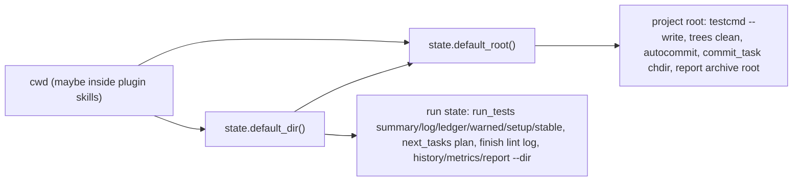
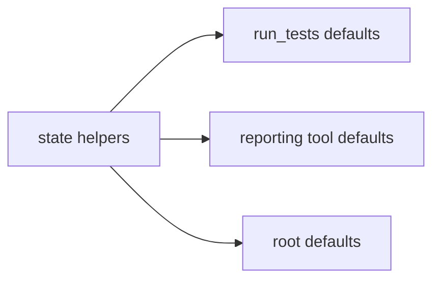

# B330: the remaining cwd-relative .superlite defaults go through state.resolve (#1131)

**Goal:** no tool writes state inside the plugin's skills folder when run with a cwd there: every run-state default that is a bare cwd-relative `.superlite/<file>` and every project-root default `.` goes through `state.resolve`.
**Architecture:** state.py gains two helpers. `default_dir()` is the state folder a default names: `resolve(strict=False)`, or the cwd's own `plan_dir(".superlite")` where `resolve()` would raise Foreign (the #224 rule `for_plan` already uses). `default_root()` is the project root a `.` default names: `.` unless `./.superlite` lies in the plugin, then the folder holding `default_dir()`. Run-state defaults (run_tests, next_tasks, finish, history, metrics, report) read `default_dir()` at call time. Project-root defaults (testcmd, trees, autocommit, commit_task, report's archive root) read `default_root()`. Outside the plugin, every root default stays `.`, and a run-state default moves only where the session's resolved folder differs from `./.superlite`, so commit_task, finish and incident already agree with it.
**Tech stack:** Python 3 stdlib, pytest via `sl run_tests`.
**Spec:** issue #1131 (body: "each default goes through `state.resolve`, so no tool writes state inside the plugin's scripts folder"); research R1/R2 in .superlite/fleet/reports/.
**Detail:** contracts
**Wave0:** none

## Global constraints

- Files this batch may touch: skills/subagent-driven-development/scripts/{state,run_tests,next_tasks,finish,incident,history,metrics,report,testcmd,trees,autocommit,commit_task}.py, the three new test files the tasks own, and the existing tests that pin an old default (name each one you change in your report). Never edit backlog.py, pyroots.py, fleet.py, backlog_brief.py, docs/*.md or skills/subagent-driven-development/backlog.md.
- Tests never touch the real plugin folder: use the `plug` fixture pattern of tests/scripts/test_state_plugin_folder_1116.py (monkeypatch `state.PLUGIN_SKILLS` to `tmp/plugin/skills`, chdir into `tmp/plugin/skills/subagent-driven-development/scripts`, set `PWD`, clear SUPERLITE_STATE_DIR, CLAUDE_PROJECT_DIR and SUPERLITE_PROJECT_DIR, then set `SUPERLITE_PROJECT_DIR` to a `tmp/proj` that holds `.git`). Tools `import state` from the scripts folder, so the patch reaches them in-process. Each plugin-cwd test asserts `not any((tmp/"plugin"/"skills").rglob(".superlite"))`.
- Module constants other modules or tests import stay defined with their value (commit_task.DEFAULT_LEDGER and DEFAULT_LOG, next_tasks.DEFAULT_PLAN, run_tests.DEFAULT_SUMMARY, trees.TREES and STATE, testcmd.CONFIG, autocommit.CONFIG and STATE). Only no default path may use them bare.
- An argparse default that becomes call-time gets `default=None` and is filled right after `parse_args`; its `help` text names `<state folder>/<file>` instead of `%(default)s`.
- Builds: the verdict is `sl run_tests` (the project's test command; a project with `.maxapp` runs `maxapp test`, which a build pool may place on another Mac, and a full run whose tree a green maxapp test stamp covers returns that result without a run); task trees build in <tree>/.build/DerivedData and any build of your own goes under .build/ of the worktree, never -derivedDataPath outside the worktree (your session scratchpad included; backlog cleanup removes scratchpad build folders when the worktree goes); a product, simulator or device build stays on this machine and runs only when an issue's acceptance asks for a running-app check; copy this sentence into every worker brief.
- Simulators: append the UDID of each simulator you or a worker creates (`xcrun simctl create` or `clone`; a checker's `Simulators:` line marks its created ones) as one line to /Users/max/github/superlite/.claude/worktrees/superlite-b330-state-resolve-defaults/.superlite/simulators.txt; never list one you did not create; ship cleanup shuts down and deletes each listed one; copy this sentence into every worker brief.

Ruling: run-state defaults use `default_dir()`, not `resolve()`. It names the same folder as `resolve()`, the one commit_task, finish and incident already default to, but it never raises Foreign: a hook-rewritten `sl run_tests` in a linked worktree with no run, under a session bound elsewhere, keeps its cwd's folder as today instead of exiting 2 (lead's ruling, the `for_plan` #224 rule).
Ruling: project-root defaults keep `.` outside the plugin. Moving them to the git root or the session's project would break a monorepo app folder's own `.superlite/test-cmd.json` (lead's ruling).
Ruling: `default_root()` refuses (state.Refused, exit 2) from a plugin cwd whose state folder is the session's private one: no project is known, and the plugin checkout is no project (lead's ruling).
Ruling: from a plugin cwd, commit_task without --plan and autocommit without --plan change into `default_root()`, as B58 does for `--plan`. Their cwd-relative reads (checkpoints.json, pyroots' `Path(".")`, autocommit.json) then name the session's project, and git works there instead of in the plugin's checkout (lead's ruling).
Ruling: run_tests' task-tree machinery (`trees.prepare(".")`, `reap(".")`, the `Path.cwd()/.superlite` link) stays rooted at the cwd. A tree is a worktree of the cwd's checkout, and from a plugin cwd that checkout is the plugin's own (Python), which builds no tree. Only `stopped_workers(Path(".superlite"))` moves to `default_dir()` (lead's ruling).
Ruling: backlog.py `TEST_CMD` and pyroots.py `CONFIG` stay as they are: every use joins an explicit root (R1, R2) (lead's ruling).
Ruling: state.py, this plan and the new test files tests/scripts/test_run_state_defaults_1131.py, tests/scripts/test_run_state_defaults_reports_1131.py and tests/scripts/test_root_defaults_1131.py lie outside the brief's list. No open batch lists them, so B330 edits them and names them in notes.md (lead's ruling).
LAYERS: unit

## Coverage

| Category | State | Basis |
|---|---|---|
| Scope and success criteria | settled | #1131: every listed tool's default goes through state.resolve; success = no `.superlite` below the plugin's skills folder after any tool runs from a cwd there |
| Domain and data model | n/a | no new data; same file names in another folder |
| Persistence and migration | ruled | no migration: a stray `<plugin>/skills/.../scripts/.superlite` is never read again; nothing deletes it |
| Interfaces and contracts | ruled | CLI flags and constants unchanged; explicit `--log/--ledger/--summary/--dir/--root/--plan` keep their meaning; new `state.default_dir()`, `state.default_root()` |
| UI states | n/a | CLI tools, no UI |
| Concurrency and state ownership | settled | state.resolve owns folder choice (#707, #1116); live-owner and private-folder rules apply unchanged |
| Error handling and recovery | ruled | plugin cwd with no project: state.Refused exit 2 with its existing line; never Foreign from a default |
| Security and privacy | n/a | no new input surface; paths come from env and cwd as before |
| Performance and limits | ruled | one resolve per default, at call time (O(d) stats), as ledger_path |
| Observability | n/a | existing Refused stderr line names the folder |
| Testing strategy | ruled | in-process tests per tool with the `plug` fixture plus one outside-plugin unchanged case each |
| Compatibility | ruled | outside the plugin with no session the defaults name `./.superlite` as before; tests pinning the relative value keep passing |
| Rollout | n/a | ships in the next version; no flag |
| Research unknowns | settled | inventory done by R1 and R2 |

## Main diagram

## File structure

- state.py: `default_dir()`, `default_root()` (T1).
- run_tests.py: run-state defaults through `default_dir()` (T2).
- next_tasks.py, finish.py, incident.py, history.py, metrics.py, report.py: run-state defaults and report's archive root (T3).
- testcmd.py, trees.py, autocommit.py, commit_task.py: root defaults and the plugin-cwd chdir (T4).

## Task graph

```mermaid
%% schedule
gantt
  title Predicted schedule (mm:ss)
  dateFormat X
  axisFormat %M:%S
  section lane 1
  T1 state helpers :t1, 0, 195s
  T3 reporting tool defaults :t3, 195, 230s
  section lane 2
  T4 root defaults :t4, 195, 229s
  section lane 3
  T2 run_tests defaults :t2, 195, 198s
```

critical path: T1 → T3 (7.1 min) · peak width 3 · predicted build 7.1 min · predicted total ≈ 15.6 min

## state

**Probe entry:** none (both helpers take no argument; the CLI defaults are covered by named tests)

### T1 state helpers · Complexity 2 (O-1) · Est. context 30k
**Owns:** skills/subagent-driven-development/scripts/state.py, tests/scripts/test_state_resolve_defaults_1131.py
**Components:** 1
**LOC owned:** 110
**Tests:** fast
**Kind:** design
**Model:** sonnet
**Produces:** state.default_dir() -> Path · state.default_root() -> Path
  e.g. cwd /w (no session, no env, not a linked worktree): default_dir() -> Path(".superlite"); default_root() -> Path(".")
  e.g. cwd <plugin>/skills/sdd/scripts, SUPERLITE_PROJECT_DIR=/p: default_dir() -> Path("/p/.superlite"); default_root() -> Path("/p")
  e.g. SUPERLITE_STATE_DIR=/s/.superlite, cwd /w: default_dir() -> Path("/s/.superlite"); default_root() -> Path(".")
**Review Focus:** state, file
**Test code (contracts):**
- `test_default_dir_outside_plugin_is_cwd_folder`: tmp cwd, no session or env -> `state.default_dir() == Path(".superlite")`.
- `test_default_dir_env_wins`: SUPERLITE_STATE_DIR=tmp/s/.superlite -> `default_dir() == tmp/s/.superlite`.
- `test_default_dir_from_plugin_goes_to_session_project`: plug fixture, SUPERLITE_PROJECT_DIR=proj -> `default_dir() == proj/.superlite`; no `.superlite` below the plugin skills folder.
- `test_default_dir_foreign_binding_keeps_cwd_folder`: cwd in a linked worktree (`.git` file `gitdir: <common>/worktrees/x`) with no run marker, session bound (as tests/scripts/test_session_state.py binds) to a folder outside it -> `default_dir() == plan_dir(".superlite")` (the worktree's), no exception, and stderr has no `session binding names` line.
- `test_default_root_outside_plugin_is_dot`: -> `Path(".")`, also with a session bound elsewhere.
- `test_default_root_from_plugin_is_session_project`: plug fixture, SUPERLITE_PROJECT_DIR=proj -> `default_root() == proj`.
- `test_default_root_from_plugin_private_folder_refuses`: plug fixture, a session id, no project vars -> `pytest.raises(state.Refused)`, code 2, stderr names `lies inside the superlite plugin`.
- `test_default_root_from_plugin_no_session_refuses`: plug fixture, no session id, no project vars -> state.Refused, code 2.
**Steps:** 1 failing tests, 2 run: FAIL, 3 implement, 4 run: PASS
**Notes:** `default_dir()`: `r = resolve(strict=False)`; when SUPERLITE_STATE_DIR is unset and `foreign_worktree(r) is not None`, return `plan_dir(".superlite")`, else `r`. `default_root()`: when `in_plugin(_abs(".superlite"))` is false, return `Path(".")`. Otherwise `sd = default_dir()`; when `private(sd)`, call `_refuse(_abs(".superlite"))`; else return `_abs(sd).parent`. Put them after `for_plan`, with one-line docstrings naming #1131 and the repo's `# O(d)` complexity comments.

## run_tests

**Probe entry:** none (run_tests runs the project's test command; covered by named tests)

### T2 run_tests defaults · Complexity 3 (O-1) · Est. context 55k
**Owns:** skills/subagent-driven-development/scripts/run_tests.py, tests/scripts/test_run_state_defaults_1131.py
**Components:** 1
**LOC owned:** 140
**Tests:** fast
**Kind:** design
**Model:** sonnet
**Consumes:** state.default_dir() -> Path (T1)
**Review Focus:** file, state
**Test code (contracts):**
- `test_record_from_plugin_writes_summary_in_session_project`: plug fixture, SUPERLITE_PROJECT_DIR=proj -> `run_tests.main(["--record", "--passed", "1", "--command", "true"])` writes `proj/.superlite/test-summary.json`; no `.superlite` below the plugin skills folder.
- `test_defaults_follow_state_dir`: SUPERLITE_STATE_DIR=tmp/s/.superlite, cwd tmp/w -> the parsed defaults are `--log` tmp/s/.superlite/incidents.jsonl, `--ledger` .../progress.md, `--summary` .../test-summary.json. Use the existing parse path, or a `--record` run and its summary location.
- `test_defaults_outside_plugin_unchanged`: tmp cwd, no session or env -> summary default `.superlite/test-summary.json` (relative), log `.superlite/incidents.jsonl`.
- `test_stable_plan_reads_state_dir`: SUPERLITE_STATE_DIR=tmp/s/.superlite holding stable.json `{"plan": "docs/p.md"}`, cwd tmp/w -> `run_tests.stable_plan() == "docs/p.md"`.
- `test_warned_file_in_state_dir`: the derived-data warning (`warn_once`) writes `derived-data-warned.json` into `default_dir()`, not `./.superlite`.
**Steps:** 1 failing tests, 2 run: FAIL, 3 implement, 4 run: PASS
**Notes:** Sites (R1): `--log`/`--ledger`/`--summary` argparse defaults (~1618-1620) -> None, then `default_dir()/incidents.jsonl`, `progress.md`, `test-summary.json` (no-result logs follow the summary's folder). `WARNED` use in `warn_once` (~1450, ~1490). The `Path(".superlite") / "setup.done"` fallback (~2262). `stable_plan()`'s `.superlite/stable.json` (~2613). `trees.stopped_workers(Path(".superlite"))` in `free_disk` (~1526). Keep `trees.reap(".")`, `trees.prepare(".")` and the `Path.cwd()/.superlite` link (ruling). A `--wait`/`--background` pointer path that derives from `a.summary` needs no own change. Existing tests that pin `DEFAULT_SUMMARY` or `ct.DEFAULT_LOG` as a relative path under a tmp cwd keep passing; fix one that breaks only when it pinned the old cwd-only behaviour, and name it.

## reporting tools

**Probe entry:** none (CLI defaults; covered by named tests)

### T3 reporting tool defaults · Complexity 3 (O-1) · Est. context 50k
**Owns:** skills/subagent-driven-development/scripts/next_tasks.py, skills/subagent-driven-development/scripts/finish.py, skills/subagent-driven-development/scripts/incident.py, skills/subagent-driven-development/scripts/history.py, skills/subagent-driven-development/scripts/metrics.py, skills/subagent-driven-development/scripts/report.py, tests/scripts/test_run_state_defaults_reports_1131.py
**Components:** 2
**LOC owned:** 150
**Tests:** fast
**Kind:** design
**Model:** sonnet
**Consumes:** state.default_dir() -> Path (T1) · state.default_root() -> Path (T1)
**Review Focus:** file, state
**Test code (contracts):**
- `test_next_tasks_default_plan_from_plugin`: plug fixture, SUPERLITE_PROJECT_DIR=proj, no run -> `next_tasks.default_plan() == str(proj/".superlite"/"plan.md")`; outside the plugin with no run it stays `".superlite/plan.md"` (tests/scripts/test_plan_folder_668.py keeps passing).
- `test_history_write_from_plugin_lands_in_project`: plug fixture -> `history.main(["write", ...])` without `--dir` writes its per-project files under `proj/.superlite`; nothing below the plugin skills folder. Pass the plan the CLI needs.
- `test_report_dir_default_from_plugin`: plug fixture -> `report.main([...])` without `--dir` writes `report.md` and `report.json` into `proj/.superlite`, or reads from there in a read-only mode; nothing below the plugin.
- `test_metrics_dir_default_from_plugin`: plug fixture with `proj/.superlite/metrics.jsonl` empty -> `metrics.main([])` reads `proj/.superlite`; nothing below the plugin.
- `test_finish_summary_lint_log_default`: `finish.summary(...)` called without `lint_log`, SUPERLITE_STATE_DIR=tmp/s/.superlite -> it reads `tmp/s/.superlite/lint-log.jsonl`.
- `test_incident_has_no_cwd_default`: `not hasattr(incident, "DEFAULT_LOG")`, or the constant is unused by any default path (grep test).
**Steps:** 1 failing tests, 2 run: FAIL, 3 implement, 4 run: PASS
**Notes:** next_tasks `default_plan()` fallback -> `str(state.default_dir() / "plan.md")`. finish `summary(lint_log=DEFAULT_LINT_LOG)` -> `lint_log=None`, filled with `default_dir()/lint-log.jsonl`. incident: drop the unused `DEFAULT_LOG` when nothing imports it (grep scripts/, hooks/, tests/), else leave it. history `run_rows`/`record_run` `sl_dir=".superlite"` -> `None`, filled with `default_dir()`; `write --dir` -> None. metrics and report `--dir` -> None, filled with `default_dir()`. report `--root` fallback `Path.cwd()` (~575), `main_root(Path.cwd())` (~571) and `plans_dir(Path("."))` (~562) -> `state.default_root()` (`.resolve()` where the old call was `Path.cwd()`). tests/scripts/test_history_dedupe_840.py monkeypatches `record_run` with `sl_dir=".superlite"`; keep it passing.

## root defaults

**Probe entry:** none (CLI root defaults; covered by named tests)

### T4 root defaults · Complexity 3 (O-1) · Est. context 50k
**Owns:** skills/subagent-driven-development/scripts/testcmd.py, skills/subagent-driven-development/scripts/trees.py, skills/subagent-driven-development/scripts/autocommit.py, skills/subagent-driven-development/scripts/commit_task.py, tests/scripts/test_root_defaults_1131.py
**Components:** 2
**LOC owned:** 140
**Tests:** fast
**Kind:** design
**Model:** sonnet
**Consumes:** state.default_root() -> Path (T1)
**Review Focus:** file, state
**Test code (contracts):**
- `test_testcmd_write_from_plugin_writes_project_config`: plug fixture -> `testcmd.main(["--write", "--test", "pytest -q", "--test-file", "pytest {files}", "--language", "python"])` without `--root`/`--plan` writes `proj/.superlite/test-cmd.json`; nothing below the plugin.
- `test_testcmd_write_outside_plugin_unchanged`: tmp cwd w -> it writes `w/.superlite/test-cmd.json`.
- `test_trees_clean_from_plugin_works_in_project`: plug fixture -> `trees.main(["clean"])` exits 0 and creates nothing below the plugin.
- `test_autocommit_on_from_plugin_writes_project_config`: plug fixture (proj a `git init` repo) -> `autocommit.main(["on"])` writes `proj/.superlite/autocommit.json`; nothing below the plugin.
- `test_commit_task_from_plugin_works_in_project`: plug fixture, proj a `git init` repo with no plan -> after `commit_task.main(["T9"])` (any exit), `Path.cwd().resolve() == proj.resolve()` and nothing below the plugin.
- `test_commit_task_outside_plugin_keeps_cwd`: tmp git repo cwd, no --plan -> cwd unchanged after the call.
**Steps:** 1 failing tests, 2 run: FAIL, 3 implement, 4 run: PASS
**Notes:** testcmd `main` `root = Path(".")` fallback (~1911) -> `state.default_root()`. If a CLI path calls `resolve(root=".")` or `only_testing(root=".")` without a root, pass that root. trees `main` `else "."` (~836) -> `else state.default_root()`. autocommit `main`: with no `--plan`, `root = state.default_root()`; when `root != Path(".")`, `os.chdir(root)`. commit_task `main` (~1190): with no `--plan`, take `root = state.default_root()` when it is not `Path(".")`; the existing B58 block then makes plan, ledger, log and pool absolute and changes into it.

## Review Focus

Package types: library (state) and CLI (tools). Categories: state (which folder a default names, binding and env precedence), file (nothing created below the plugin skills folder, no relative-path regressions outside it). Specific risks: a default resolved at import time instead of call time; Foreign raised from a default; an explicit flag overridden; a tool that chdirs before turning its relative args absolute.

## Self-review

Every tool #1131 names maps to a task: commit_task, autocommit, testcmd and trees to T4; pyroots via commit_task's chdir (T4); finish, incident, next_tasks, history, metrics and report to T3; run_tests to T2; backlog's TEST_CMD needs no change (ruling). No two parallel tasks share a file.
