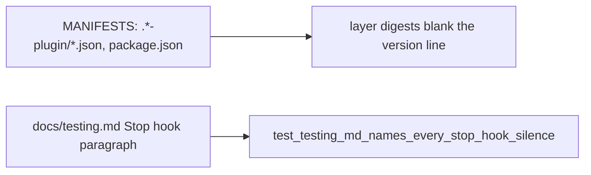

# B300: test_layers drops gemini-extension.json; docs/testing.md names every Stop hook silence (#1058, #1060)

**Goal:** `scripts/test_layers.py` no longer treats the removed `gemini-extension.json` as a version manifest (#1058), and the "Stop hook" paragraph of `docs/testing.md` says that the hook stays silent when no file of a stale layer changed since the session started (#1060, B298's #914 rule) and in a fleet worker (#919).
**Architecture:** one constant tuple in scripts/test_layers.py loses one entry; its manifest fixture and test in tests/scripts/test_test_layers.py follow; one docs paragraph gains two sentences, pinned by one new doc test in the same test file.
**Tech stack:** Python 3.10+ stdlib; pytest via `sl run_tests`.
**Spec:** issues #1058 and #1060 (bodies quoted in the task); B298's rulings in /Users/max/github/superlite/.superlite/backlog/B298.md.
**Detail:** full
**Wave0:** none
**Coverage:** off

## Global constraints

- Files this batch may touch: docs/testing.md, scripts/test_layers.py, tests/scripts/test_test_layers.py and this plan. An existing test outside these files that breaks: name it in the report, do not edit it.
- Builds: the verdict is `sl run_tests` (the project's test command; a project with `.maxapp` runs `maxapp test`, which a build pool may place on another Mac, and a full run whose tree a green maxapp test stamp covers returns that result without a run); task trees build in <tree>/.build/DerivedData and any build of your own goes under .build/ of the worktree, never -derivedDataPath outside the worktree (your session scratchpad included; backlog cleanup removes scratchpad build folders when the worktree goes); a product, simulator or device build stays on this machine and runs only when an issue's acceptance asks for a running-app check; copy this sentence into every worker brief.
- Simulators: append the UDID of each simulator you or a worker creates (`xcrun simctl create` or `clone`; a checker's `Simulators:` line marks its created ones) as one line to /Users/max/github/superlite/.claude/worktrees/superlite-b300-test-layers-docs-and-gemini-manifes/.superlite/simulators.txt; never list one you did not create; ship cleanup shuts down and deletes each listed one; copy this sentence into every worker brief.

Ruling: one task, because both issues edit tests/scripts/test_test_layers.py and the whole change is about 25 lines (lead's ruling).
Ruling: adjacent fix: the Stop hook paragraph also names the fleet-worker silence (`SUPERLITE_FLEET_WORKER`, #919), which `hook_check` already has and the paragraph misses (lead's ruling).
Ruling: `is_manifest("gemini-extension.json")` is now False and the manifest test asserts it, so the removal stays pinned (lead's ruling).

## Main diagram



## File structure

- scripts/test_layers.py: `MANIFESTS` without `"gemini-extension.json"`.
- tests/scripts/test_test_layers.py: `write_manifests` no longer writes gemini-extension.json; `test_version_only_change_keeps_hashes` lists it as no manifest; new `test_testing_md_names_every_stop_hook_silence`.
- docs/testing.md: the "Stop hook" paragraph names the fleet-worker and no-edit silences.

## Task graph

```mermaid
%% schedule
gantt
  title Predicted schedule (mm:ss)
  dateFormat X
  axisFormat %M:%S
  section lane 1
  T1 gemini manifest and Stop hook docs :t1, 0, 220s
```




critical path: T1 (3.7 min) · peak width 1 · predicted build 3.7 min · predicted total ≈ 10.2 min

## Test layers

**Probe entry:** none (a constant tuple and a docs paragraph; the named tests cover both)

### T1 gemini manifest and Stop hook docs · Complexity 1 (O-1) · Est. context 24k
**Owns:** scripts/test_layers.py, tests/scripts/test_test_layers.py, docs/testing.md
**Components:** 2
**LOC owned:** 25
**Tests:** fast
**Kind:** mechanical
**Model:** haiku
**Review Focus:** `test_version_only_change_keeps_hashes`: `tl.is_manifest("gemini-extension.json")` is False; `test_testing_md_names_every_stop_hook_silence`: the paragraph under `## Stop hook` holds each pinned phrase.
**Test code (verbatim):** in tests/scripts/test_test_layers.py:

1. In `write_manifests`, replace the line
`             "package.json": plugin, "gemini-extension.json": plugin}`
with
`             "package.json": plugin}`
2. In `test_version_only_change_keeps_hashes`, replace the two lines
```python
    assert all(tl.is_manifest(p) for p in (".claude-plugin/plugin.json", ".codex-plugin/plugin.json", "package.json",
                                           "gemini-extension.json"))
    assert not any(tl.is_manifest(p) for p in ("sub/package.json", ".claude-plugin/sub/x.json", "hooks/hooks.json"))
```
with
```python
    assert all(tl.is_manifest(p) for p in (".claude-plugin/plugin.json", ".codex-plugin/plugin.json", "package.json"))
    assert not any(tl.is_manifest(p) for p in ("sub/package.json", ".claude-plugin/sub/x.json", "hooks/hooks.json",
                                               "gemini-extension.json"))  # removed by B297 (#1058)
```
3. Append at the end of the file:
```python
def test_testing_md_names_every_stop_hook_silence():
    """#1060, #919: the Stop hook paragraph of docs/testing.md names each case in which the hook stays silent."""
    text = (SCRIPT.parents[1] / "docs" / "testing.md").read_text(encoding="utf-8")
    para = text.split("\n## Stop hook\n", 1)[1].split("\n## ", 1)[0]
    for phrase in ("`stop_hook_active: true`", "during an active superlite run", "`SUPERLITE_FLEET_WORKER`",
                   "no file of a stale layer changed since the session started",
                   "the first `timestamp` line of the Stop input's `transcript_path`",
                   "mtime or ctime", "An unknown start keeps the gate"):
        assert phrase in para, phrase
    assert "gemini-extension.json" not in text
```
**Code (verbatim):**

1. scripts/test_layers.py: replace
`MANIFESTS = (".*-plugin/*.json", "package.json", "gemini-extension.json")  # O(1)  a version bump alone must not move a layer`
with
`MANIFESTS = (".*-plugin/*.json", "package.json")  # O(1)  a version bump alone must not move a layer`
2. docs/testing.md, the paragraph right under `## Stop hook`: replace its last sentence
`It stays silent when the Stop input carries `stop_hook_active: true` (so it blocks once per turn only) and during an active superlite run.`
with
`It stays silent when the Stop input carries `stop_hook_active: true` (so it blocks once per turn only), during an active superlite run, in a fleet worker (`SUPERLITE_FLEET_WORKER` set; its coordinator runs the layers) and when no file of a stale layer changed since the session started, so a session that edited nothing, such as a reviewer, is not gated on earlier changes. The session start is the first `timestamp` line of the Stop input's `transcript_path`; a change is read from the stale files' mtime or ctime (a removed file: its nearest existing folder). An unknown start (no transcript, no timestamp in it, a stat error) keeps the gate.`
**Steps:** 1 make the test edits, 2 run: FAIL (the new doc test and the manifest test), 3 make the code and docs edits, 4 run: PASS
**Notes:** change nothing else in these files; the other `docs/testing.md` paragraphs stay as they are.

## Review Focus

Package test layers: app type library (a constant table) and docs; categories: none beyond the two named tests (no parser, state or protocol changes).

## Self-review

Both issues map to T1; no placeholders; no Consumes or Produces; one task, so no shared files or edges; measurable fields filled.
