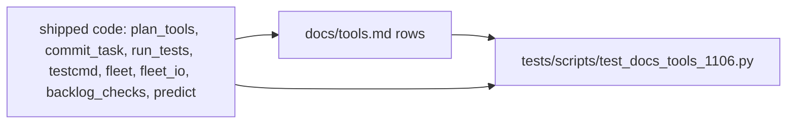
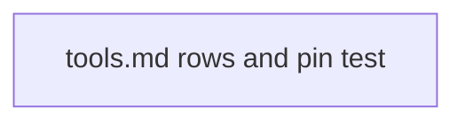

# B326: docs/tools.md rows name the behaviour shipped in #1086, #1089, #1091, #1092, #1095, #1097 (#1106)

**Goal:** docs/tools.md states, with each message verbatim, what B311-B323 shipped and could not write into tools.md while B317 held it: run_tests' xcsift console log lines and unittest counting, Jira main_steps, lint OUTSIDE, the brief text rules and own-report refusal, the commit_task reviewer hold, wait's signed-out line and predict's slow_min.
**Architecture:** docs only. New behaviour goes into sub-rows placed right after their anchor row (B317's #1087 pattern: `| \`tool\` topic (#N) |`), two short in-place clauses fix the stale plan_tools NOTE and predict extra_min facts, and the `Main steps (#674):` paragraph gains one closing sentence. One new test pins each row and checks each quoted message against the script that prints it.
**Tech stack:** Markdown, Python 3 pytest via `sl run_tests`.
**Spec:** issue #1106; follow-ups in .superlite/backlog/B319.md and B323.md of the main checkout (copied into Global constraints below).
**Detail:** full
**Wave0:** none
**Coverage:** off

## Global constraints

- Files this batch may touch: docs/tools.md, tests/scripts/test_docs_tools_1106.py and this plan. Never edit a script. An existing test that breaks and is not in your Owns: name it in the report, do not edit it.
- Every row of docs/tools.md stays one table line: ends with ` |`, holds exactly one ` | ` (tests/scripts/test_docs_b32_tools.py::test_rows_stay_one_table_line); never write a bare `|` in row text. Anchor rows (`| \`plan_tools\` |`, `| \`commit_task\` |`, `| \`run_tests\` |`, `| \`fleet\` |`, `| \`fleet_io\` |`, `| \`predict\` |`) stay exactly one each.
- Keep these pinned texts exactly once in their rows (tests/scripts/test_docs_b268_tools.py): `` `NOTE: Tn predicted X min, Y of it outside the size band (existing tests, review rounds); splitting does not shrink it` `` in plan_tools, `` `extra_min` (their minutes together) `` in predict.
- Builds: the verdict is `sl run_tests` (the project's test command; a project with `.maxapp` runs `maxapp test`, which a build pool may place on another Mac, and a full run whose tree a green maxapp test stamp covers returns that result without a run); task trees build in <tree>/.build/DerivedData and any build of your own goes under .build/ of the worktree, never -derivedDataPath outside the worktree (your session scratchpad included; backlog cleanup removes scratchpad build folders when the worktree goes); a product, simulator or device build stays on this machine and runs only when an issue's acceptance asks for a running-app check; copy this sentence into every worker brief.
- Simulators: append the UDID of each simulator you or a worker creates (`xcrun simctl create` or `clone`; a checker's `Simulators:` line marks its created ones) as one line to /Users/max/github/superlite/.claude/worktrees/superlite-b326-docs-tools-md-rows-miss-the-behavio/.superlite/simulators.txt; never list one you did not create; ship cleanup shuts down and deletes each listed one; copy this sentence into every worker brief.

Ruling: new facts go into sub-rows right after their anchor row, so anchor rows stay one each and every existing pin holds; the stale NOTE and extra_min facts are in-place clauses; Main steps gets one closing sentence (lead's ruling, B317's #1087 pattern).
Ruling: [scope] B326 also writes the docs/tools.md follow-ups B319 (#1121: NOTE parts, slow_min) and B323 (#1094, #1107, #1108) addressed to B326, plus B314's remote sign-in (#1093) beside #1108: same file, no decision needed (lead's ruling).
Ruling: the old NOTE example `(existing tests, review rounds)` stays (still a valid output, pinned by test_docs_b268_tools.py); a clause says the parenthesis names only the parts present (lead's ruling).
Ruling: every quoted message was read in the scripts by the lead and researchers R1-R4 on ee77ff0c; the new test pins each against its script so a later rewording turns it red (lead's ruling).
LAYERS: unit

## Main diagram



## File structure

- docs/tools.md: five new sub-rows, two in-place clauses, one Main steps sentence (T1).
- tests/scripts/test_docs_tools_1106.py: pins rows and quoted texts against scripts (T1).

## Task graph

```mermaid
%% schedule
gantt
  title Predicted schedule (mm:ss)
  dateFormat X
  axisFormat %M:%S
  section lane 1
  T1 tools.md rows and pin test :t1, 0, 464s
```





critical path: T1 (7.7 min) · peak width 1 · predicted build 7.7 min · predicted total ≈ 22.2 min

## Docs

### T1 tools.md rows and pin test · Complexity 2 (O-1) · Est. context 40k
**Owns:** docs/tools.md, tests/scripts/test_docs_tools_1106.py
**Components:** 1
**LOC owned:** 110
**Tests:** fast
**Kind:** design
**Model:** sonnet
**Est. time:** 4 min (1 component, about 110 LOC, fast tests)
**Consumes:** none
**Produces:** docs/tools.md rows `| \`plan_tools lint\` OUTSIDE (#1086) |`, `| \`commit_task\` reviewer hold (#1097) |`, `| \`run_tests\` xcsift log lines and unittest (#1091, #1092) |`, `| \`fleet\` brief checks (#1089, #1094, #1107) |`, `| \`fleet wait\` signed out (#1093, #1108) |`
**Review Focus:** `test_rows_name_the_shipped_text`: each quoted message is in its row once; `test_quoted_text_is_in_the_scripts`: each literal is in its script; read each new sentence against the code it names (commit_task.py ~1060-1082, testcmd.py ~1745-1800, fleet.py ~239-252, fleet_io.py ~1100-1115 and ~1275-1284, plan_tools.py ~2872-2882, backlog_checks.py ~36-56, predict.py ~500-553) and fix a sentence the code contradicts.
**Steps:** 1 write the test file below verbatim; 2 run it: FAIL (the rows are missing); 3 make the docs edits below exactly (insert each new row as its own line); 4 run it and tests/scripts/test_docs_b32_tools.py, test_docs_b268_tools.py, test_docs_tools_1087.py, test_backlog_docs_674.py: PASS.
**Notes:** Insert rows: OUTSIDE right after the `| \`plan_tools\` |` line; reviewer hold right after the `| \`commit_task\` import check (#1068) |` line; xcsift right after the `| coordinator guard capture hint (#1069) |` line; brief checks right after the `| \`fleet\` |` line; signed out right after the `| \`fleet_io\` |` line.

Docs edits (verbatim):

1. New row after `| \`plan_tools\` |`:
```
| `plan_tools lint` OUTSIDE (#1086) | Lint reads each plan line outside a fenced block with the #1015 check (`fleet_io.brief_outside`, so the text rules of the `fleet` brief checks row hold) and warns once per path that exists on this machine outside the project: `WARNING: OUTSIDE: line N names a path outside the project: P; plan text reaches worker briefs (Global constraints, the review packet) and the #1015 check refuses it there: copy the file into <root>/.superlite/briefs/ and name the copy, or drop the path (#1086)`. A warning only: lint's exit code is unchanged; a plan read from text, with no path, is not checked. |
```
2. In the `| \`plan_tools\` |` row replace `(warning only) (#787). Every` with `(warning only) (#787); its parenthesis names only the parts present, in the order slow tests, existing tests, review rounds (`plan_tools.EXTRA_PARTS`, #1121). Every`.
3. In the `| \`predict\` |` row replace `each only when it applies (#787) |` with `each only when it applies (#787); a `Tests: slow` task adds `slow_min` to `extra_min`: its minutes beyond its `Tests: fast` twin (`time_from` of its features without the suite term minus the same with `Tests: fast`, at least 0, rounded to 3, written only above 0), so lint SIZE and the under-band NOTE judge it like that twin while `est_time_min` and cost stay (#1121) |`.
4. New row after `| \`commit_task\` import check (#1068) |`:
```
| `commit_task` reviewer hold (#1097) | While a package-reviewer worker is busy, each of this task's files that its brief's `Files in scope:` line covers (`owns_match`: directory and glob entries too; a brief without the line: any mention) and that differs from the newest checkpoint is left out, `--also` and Wave 0 files too: `left uncommitted (in the review scope of busy Wn (label); commit_task Tn again once it is done): F` (`once they are done` for several reviewers); with nothing left it fails `nothing to commit; held for busy Wn: F`. `busy_briefs` (also behind the #484 shared-test hold) finds a busy worker's brief by its stored fleet.json `brief` path, then `briefs/<label>.md`, then the label with commas as dashes (`review-T1,T2`), and reads only fixer, package-reviewer and writer briefs (`BRIEF_ROLES`), so research and final-reviewer briefs hold nothing. |
```
5. New row after `| coordinator guard capture hint (#1069) |`:
```
| `run_tests` xcsift log lines and unittest (#1091, #1092) | An xcsift `errors[]` entry whose file starts with a `YYYY-MM-DD HH:MM:SS` timestamp is a console log line in every block and on every exit; so is a line-less entry in a block that counted tests and, in a run that exited 0 with no failed test, in any block. Dropped entries never fail a run: one stderr line `run_tests: WARNING: xcsift listed N console log line(s) under errors[], not counted as failures: <first>` names them, also joined into the summary's `warning` key; a run of only such lines and no test is still a no-result stop (#1091). `python -m unittest` output (alone or chained with `&&`), read when no pytest summary is there, is counted from each `Ran N tests in Xs` line with the `OK` or `FAILED (...)` verdict below it, summed over chained runs: failures, errors and unexpected successes count as failed, skips and expected failures as skipped; a red run's failing ids read `<module>.<Class>.<test>` with the traceback's last line as message (#1092). |
```
6. New row after `| \`fleet\` |`:
```
| `fleet` brief checks (#1089, #1094, #1107) | The #1015 check (`fleet_io.brief_outside`) reads as text, not paths: fenced blocks, the standing-note block (its head line and four-space lines), a finding's `quote:` span and any path missing on this machine; a research brief may also name a path at or below one on the lead brief's `Standing note: a research worker may read these outside paths read-only; ...` line (#1089: spawn that researcher with `--machine local`, since a remote machine lacks the path; spawn does not check it). `spawn --note` (with `--for-review` or `--package`) gets the same text rules, and a session's private state folder is judged against `state.project(sd)` (#1107). After that check, `spawn --brief F` and `send Wn --brief F` (every role but lead; send since #1107) refuse, exit 2, a brief that names the worker's own report file `<run>/fleet/reports/<id>.md` or `.json` (`<id>`: the label, else the brief's file stem; a comma label's first id): `error: brief F names P: fleet wait saves the worker's reply as <rd>/<id>.md and <rd>/<id>.json and would overwrite a report the worker writes there; name another file, such as <rd>/<id>-full.md (#1094)`. |
```
7. New row after `| \`fleet_io\` |`:
```
| `fleet wait` signed out (#1093, #1108) | A worker whose turn ended without a report on a sign-in error (its stop's last line is one line starting `Login reached its time limit`, `Not logged in` or `Invalid API key` and holding `/login`: `fleet_remote_account.signed_out_stop`) is never asked for a report: wait prints `Wn Tn BLOCKED-UI <screen file> (signed out: account <acct> shows the Claude Code sign-in screen; sign in there, then respawn)` and the last five screen lines; for a local worker (no `machine` in its record) it marks the account signed out (`fleet.mark_signed_out`, #1108); a remote worker's state is reported blocked and its machine and account pair recorded by `fleet_remote_worker.states` (#1093). |
```
8. Append to the end of the `Main steps (#674):` line (after `at the start.`), one space first:
```
With a Jira source (#1095) a step's `issues` names the batch's Jira keys: a key in any case, or a bare number matching exactly one batch key's number (its part after the last `-`), is stored as the upper-case key, once each; a number matching no key or two keys, or a key outside the batch, rejects the plan (`BLOCKED: proposal rejected`, exit 3) with a line naming it: `B1 main_steps 1 issues: N matches no Jira key of this batch (K1, K2)`, `B1 main_steps 1 issues: N matches K1 and K2; write the key` or `B1 main_steps 1 issues: KEY is not one of this batch's issues (K1, K2)`.
```

**Test code (verbatim):** tests/scripts/test_docs_tools_1106.py
```python
"""docs/tools.md names what B311-B323 shipped (#1086, #1089, #1091-#1095, #1097, #1107, #1108, #1121); each quoted message is checked against the script printing it (#1106)."""
from __future__ import annotations

from pathlib import Path

ROOT = Path(__file__).resolve().parents[2]
LINES = (ROOT / "docs" / "tools.md").read_text(encoding="utf-8").splitlines()
SCRIPTS = ROOT / "skills" / "subagent-driven-development" / "scripts"

NEW_ROWS = [  # (anchor row prefix, new row prefix)
    ("| `plan_tools` |", "| `plan_tools lint` OUTSIDE (#1086) |"),
    ("| `commit_task` |", "| `commit_task` reviewer hold (#1097) |"),
    ("| `run_tests` |", "| `run_tests` xcsift log lines and unittest (#1091, #1092) |"),
    ("| `fleet` |", "| `fleet` brief checks (#1089, #1094, #1107) |"),
    ("| `fleet_io` |", "| `fleet wait` signed out (#1093, #1108) |"),
]
OUT, HOLD, XC, BRIEF, WAIT = (new for _, new in NEW_ROWS)
NAMED = [  # (row or paragraph prefix, text it holds exactly once)
    (OUT, "`WARNING: OUTSIDE: line N names a path outside the project: P; plan text reaches worker briefs (Global constraints, the review packet) and the #1015 check refuses it there: copy the file into <root>/.superlite/briefs/ and name the copy, or drop the path (#1086)`"),
    (OUT, "lint's exit code is unchanged"),
    ("| `plan_tools` |", "its parenthesis names only the parts present, in the order slow tests, existing tests, review rounds (`plan_tools.EXTRA_PARTS`, #1121)"),
    ("| `predict` |", "a `Tests: slow` task adds `slow_min` to `extra_min`"),
    (HOLD, "`left uncommitted (in the review scope of busy Wn (label); commit_task Tn again once it is done): F`"),
    (HOLD, "`nothing to commit; held for busy Wn: F`"),
    (HOLD, "reads only fixer, package-reviewer and writer briefs"),
    (XC, "`run_tests: WARNING: xcsift listed N console log line(s) under errors[], not counted as failures: <first>`"),
    (XC, "`Ran N tests in Xs`"),
    (BRIEF, "`Standing note: a research worker may read these outside paths read-only; ...`"),
    (BRIEF, "and would overwrite a report the worker writes there; name another file, such as <rd>/<id>-full.md (#1094)`"),
    (WAIT, "(signed out: account <acct> shows the Claude Code sign-in screen; sign in there, then respawn)`"),
    ("Main steps (#674):", "matches no Jira key of this batch (K1, K2)`"),
    ("Main steps (#674):", "matches K1 and K2; write the key`"),
    ("Main steps (#674):", "is not one of this batch's issues (K1, K2)`"),
]
CODE = [  # (script, literal its source holds)
    ("plan_tools.py", "names a path outside the project: {tok}; plan text reaches worker briefs (Global constraints, the review packet) and the #1015 check refuses it there: copy the file into "),
    ("plan_tools.py", "/briefs/ and name the copy, or drop the path (#1086)"),
    ("plan_tools.py", 'EXTRA_PARTS = (("slow_min", "slow tests"), ("suite", "existing tests"), ("review", "review rounds"))'),
    ("predict.py", 'out["slow_min"] = slow_min'),
    ("commit_task.py", 'f"left uncommitted (in the review scope of busy {names}; commit_task {tid} again once it is done): {f}"'),
    ("commit_task.py", 'f"nothing to commit; held for busy {'),
    ("commit_task.py", 'BRIEF_ROLES = ("fixer", "package-reviewer", "writer")'),
    ("run_tests.py", "console log line(s) under errors[], not counted as failures: {"),
    ("run_tests.py", 'print(f"run_tests: WARNING: {note}"'),
    ("testcmd.py", r'r"^Ran (\d+) tests? in \d+(?:\.\d+)?s$"'),
    ("backlog_brief.py", 'REF_READ = "Standing note: a research worker may read these outside paths read-only; '),
    ("fleet.py", "and would overwrite a report the worker writes there; name another file, such as {rd}/{rid}-full.md (#1094)"),
    ("fleet_io.py", " (signed out: account {w.get('account')} shows the Claude Code sign-in screen; sign in there, then respawn)"),
    ("backlog_checks.py", "matches no Jira key of this batch ("),
    ("backlog_checks.py", "; write the key"),
    ("backlog_checks.py", "is not one of this batch's issues ("),
]


def test_new_rows_follow_their_anchor():
    for anchor, new in NEW_ROWS:
        rows = [i for i, ln in enumerate(LINES) if ln.startswith(new)]
        assert len(rows) == 1, new
        first = next(i for i, ln in enumerate(LINES) if ln.startswith(anchor))
        assert rows[0] > first, new


def test_anchor_rows_stay_one_each():
    for anchor in [a for a, _ in NEW_ROWS] + ["| `predict` |"]:
        assert sum(ln.startswith(anchor) for ln in LINES) == 1, anchor


def test_new_rows_stay_one_table_line():
    for _, new in NEW_ROWS:
        line = next(ln for ln in LINES if ln.startswith(new))
        assert line.endswith(" |") and line.count(" | ") == 1, new


def test_rows_name_the_shipped_text():
    bad = []
    for prefix, text in NAMED:
        line = next((ln for ln in LINES if ln.startswith(prefix)), "")
        if line.count(text) != 1:
            bad.append((prefix, text[:60]))
    assert not bad, bad


def test_quoted_text_is_in_the_scripts():
    missing = [(s, t[:60]) for s, t in CODE if t not in (SCRIPTS / s).read_text(encoding="utf-8")]
    assert not missing, missing
```

## Review Focus

Docs package: app type none (no runnable entry); categories: accuracy against code, table shape. **Probe entry:** none (docs only; the pin test is the probe).

## Self-review

Coverage: every #1106 bullet (run_tests, Main steps, lint OUTSIDE, spawn/send brief rules, commit_task hold) and the B319/B323 follow-ups map to T1. No placeholders. One task, no edges.
