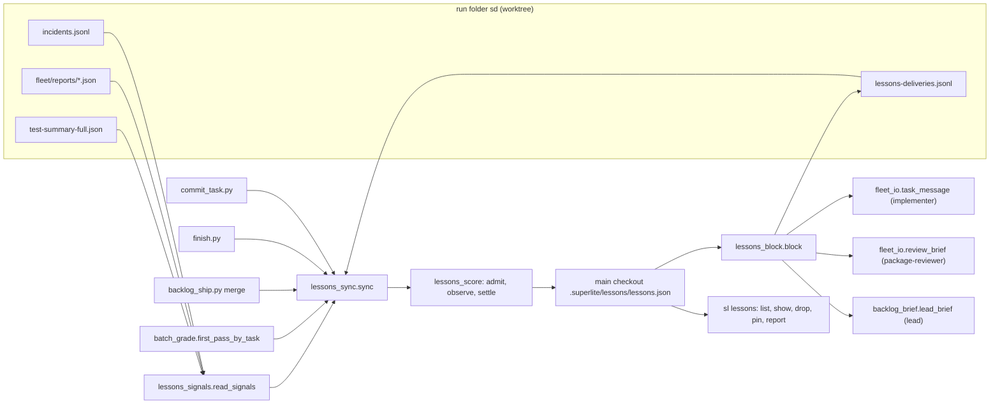
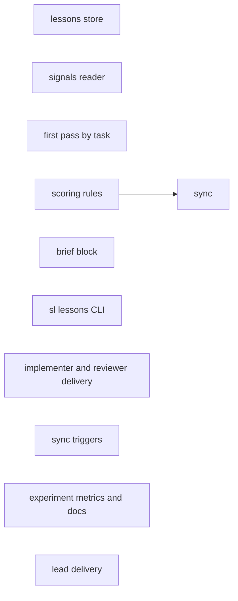

# Superlite: per-repo lessons cache that feeds agent briefs (#853, design)

**Goal:** design and plan for #853: this repository's own runs (review findings, incidents, full-suite regressions) become per-file lessons kept in the main checkout; the implementer, package-reviewer and lead briefs carry a size-capped block of the lessons for the files they touch; each lesson is scored by whether it helps, dropped when it does not, removable by hand; the effect is measured (shown versus not shown) before lessons are on by default.
**Architecture:** four small modules and one CLI. `lessons_store` (where and how the store is written), `lessons_signals` (reads a run folder's signals), `lessons_score` (pure admission, scoring and eviction rules), `lessons_sync` (merges a run into the store; called at task commit, run finish and backlog ship) and `lessons_block` (builds the brief block and logs each delivery). `sl lessons` lists, shows, drops, pins and reports. Delivery is gated by one run-config key, `lead.lessons` = `off | shadow | on`, default `shadow`.
**Tech stack:** Python 3.10+ stdlib, pytest (through `sl run_tests`).
**Spec:** this file, section Design; issue #853.
**Detail:** contracts
**Target-min:** 11
**Approval:** #853 is `Kind: design`: the owner approves this plan before any task is built.
**Max chars:** 40000

Global constraints:
- Every new or changed code line in `skills/subagent-driven-development/scripts/*.py` keeps the trailing `# O(...)` complexity comment the existing lines carry.
- New scripts sit in `skills/subagent-driven-development/scripts/`, import siblings after `sys.path.insert(0, str(Path(__file__).resolve().parent))` as the other scripts do, and stay under 600 lines; no new literal `.superlite` (paths come from the run folder `sd` or `run_archive.archive_dir`), no new `git` subprocess call.
- Nothing in the lessons path may fail its caller: every entry point a caller uses (`lessons_sync.sync`, `lessons_block.block`) catches every exception, writes at most one stderr line starting `lessons:` and returns its empty value.
- The prime is untouched: `build_prime.py` gets no lessons text (its output is byte-identical per run, `test_slim_prime.py`).
- Existing tests stay green; an existing test file changes only when the task Owns it.
- Run `sl` as an executable; verify with `sl run_tests --fast <own test files> --task Tn`. No version edits.

Ruling: lessons are pitfalls only, one per (source, file): `review:<file>`, `incident:<file>`, `regression:<test file>`; first-time passes are the outcome a lesson is scored on, not a lesson (because no first-time pass carries a text an agent could act on; upstream's practices needed an implementer `Learned:` line, a prompt change #853 does not ask for) - cost if wrong: one more source later, same store.
Ruling: the store lives in `<main checkout>/.superlite/lessons/lessons.json`, found as `run_archive.archive_dir(sd).parent / "lessons"` (because archive_dir already resolves the main checkout through `--git-common-dir` without importing fcntl, and falls back to the run folder for a bare repository) - cost if wrong: none, one function to change.
Ruling: a lesson matches a task only when its file is one of the task's Owns paths, exactly (because a directory match in a repo with 84 scripts in one folder would hand every task every lesson) - cost if wrong: fewer deliveries, raised by a later prefix rule.
Ruling: default mode `shadow`: lessons are matched and logged but not shown, so every run builds the not-shown baseline from day one and agents see nothing until the owner turns `on` after the measurement (because #853 asks for a measurement before default-on) - cost if wrong: none to agents.
Ruling: fixers and the final reviewer get no block (because a fixer works one known finding and the final reviewer must stay unanchored); `dispatch.py` needs no change, it calls `fleet_io.task_message` - cost if wrong: one more caller of `lessons_block.block`.
Ruling: backlog ship syncs at the start of `merge`, before `maxapp ship` (because a shipped `maxapp ship` removes the worktree and its run folder, `backlog_ship.py:502` sets `cleaned=True`) - cost if wrong: a batch's last fixer round is not counted.
Ruling: `Detail: contracts` (because the build batch re-plans against the code of its day; named tests with exact values are the contract) - cost if wrong: the build lead raises it to `tests`.
Ruling: the doc holds the design and the plan in one file (`**Max chars:** 40000`), as brainstorming writes it for an AI orchestrator - cost if wrong: none.
Ruling: MISSED TARGET accepted: the critical path T4 -> T5 is the scoring rules and the sync that applies them; the build lead may stub T4 to cut it - cost if wrong: a few minutes of wall time.
LAYERS: unit



## Design

### 1. What #853 asks, restated
Learn from this repository's own runs, keep what is learned per repository so it outlives worktrees, hand the agents that edit the same files a short block of it, keep only lessons that help, let a person remove a wrong one, and measure the effect before it is on by default. Problems with superlite itself stay in `feedback.py`; this is about the target repository's code.

### 2. Data model (T1, T4)
`lessons.json` (main checkout; superlite adds `.superlite/` to `.git/info/exclude` at setup, `commit_task.py:338`, so the store is local data, never committed):
```json
{"v": 1, "next": 8, "lessons": {"review:src/a.py": {
  "id": "L7", "key": "review:src/a.py", "source": "review", "file": "src/a.py",
  "text": "slice end off by one. Fix: use <= | missing None check on cfg",
  "runs": ["3f9a0c21b7de", "a81c44d0e2f9"], "first": "2026-11-15T10:00:00Z", "last": "2026-11-18T09:12:00Z",
  "status": "active", "pinned": false, "why": "",
  "obs": {"a81c44d0e2f9:T2": [1, 1], "a81c44d0e2f9:T5": [0, 0]}}}}
```
- `source`: `review` (a finding in a fleet report), `incident` (a row of `incidents.jsonl` with a file), `regression` (a failure in `test-summary-full.json`; `file` is the test file before `::`).
- `text`: the newest two distinct problem texts of the key, each cleaned (`lessons_signals.clean`) and cut at 95 characters, joined by ` | `; at most 200 characters.
- `runs`: distinct run ids with a signal for the key, newest last, at most 10.
- `status`: `candidate` → `active` (admission) → `retired` (score or cap); `dropped` only by hand.
- `obs`: one observation per `run:task` that matched the lesson: `[shown, hit]` as 0/1; the newest 20 kept (insertion order, an upsert moves nothing).
Per run, in the run folder `sd` (gone with the worktree): `lessons-run.json` `{"plan": "<abs plan>", "run": "<12 hex>", "offsets": {...}}` and `lessons-deliveries.jsonl`, one row per block call: `{"t": "<iso>", "task": "T2,T3", "role": "implementer", "shown": ["L7"], "matched": ["L7", "L9"]}`.

### 3. What feeds the store (T2, T3, T5, T9)
| Signal | Written today by | Read by sync as |
|---|---|---|
| review finding | the fleet report `fleet/reports/<id>.json` (`fleet_io.py:809`); deduped by `findings.collect` (`findings.py:140`) | `review:<file>`, text `problem. Fix: fix`, task = the report's `label` when it is a task id |
| incident | `incident.append` (`incident.py:81`), `run_tests.add_incidents`, `commit_task.log_incidents` | `incident:<file>`, text = `context`; rows without `file` skipped |
| regression | `run_tests.write_summary` (`run_tests.py:816`) as `test-summary-full.json` | `regression:<test file>`, text = the failure's `ctx`; per-task summaries are TDD reds and are ignored |
| first-time pass | `batch_grade.quality` counts it from the fleet reports (`batch_grade.py:125`) | `batch_grade.first_pass_by_task(sd)` (new, the same rule per task) gives each observation's `hit` |

Triggers, each one call `lessons_sync.sync(sd, plan)` that never fails its caller:
| Trigger | Where | Why |
|---|---|---|
| task commit | `commit_task.py` after the commit and ledger line | runs that never reach finish or ship still count; observations stay provisional until a later sync |
| run finish | `finish.py` after `history_section` | the run's final state |
| backlog ship | `backlog_ship.py` `merge`, before `maxapp ship` | the worktree and its run folder are removed by a shipped merge |
| findings | none: `findings.py` is the reader sync uses | a fixer round adds reports the next sync reads |
Sync is idempotent: `offsets` in `lessons-run.json` skip bytes and reports already read (incidents by byte offset and the first line's hash, reports by name and mtime, the full summary by its `started`); `runs` is a set; observations are upserts by `run:task`. The run id is made on the first call for a plan and kept in `lessons-run.json`; another plan path makes a new id.

### 4. Admission, scoring, dropping (T4, T5)
- **Admit:** a `candidate` with signals in 2 or more runs becomes `active`.
- **Observe:** for each delivery row of role `implementer` and each id in its `matched`, per task in `task`: `shown` = the id is in `shown`; `hit` = `first_pass_by_task(sd)[task]` is True and no finding of this run names the lesson's file. A task with no known pass state makes no observation.
- **Score:** `U = (hs+1)/(ns+2) - (hu+1)/(nu+2)` over `obs` (`hs` shown hits of `ns` shown, `hu` of `nu` not shown); `None` while `ns < 3` (grace) or `nu == 0`. The not-shown side comes from the candidate phase and from shadow runs, so no module-level baseline is needed.
- **Retire:** an `active`, unpinned lesson with `U` not None and `U <= 0` becomes `retired`; a retired lesson whose key gets a signal from a run not yet in `runs` returns to `active` with its shown observations cleared.
- **Cap:** at most 50 `active`; over the cap the unpinned active lesson with the lowest `U` (None ranks above every number, ties: oldest `last`) is retired.
- **By hand:** `sl lessons drop L7 --why "<text>"` sets `dropped` and keeps `why`; sync never changes a dropped lesson; `undrop` sets `candidate` and the next sync re-admits it. `pin` exempts from retire and cap.

### 5. Delivery (T6, T8)
- `lessons_block.block(sd, files, role, task, mode=None)` returns the block text and appends one delivery row. Mode `off`: returns `""`, logs nothing. `shadow`: matches, logs, returns `""`. `on`: returns the block.
- Match: `active` and `candidate` lessons whose `file` is in `files` are `matched`; only `active` ones are shown.
- Order: pinned first, then `U` descending (None after every number), then newest `last`.
- Budget per role, bytes and lines: implementer 1,000 and 5, package-reviewer 1,500 and 8, lead 800 and 5; header included; a line that does not fit whole is left out, never cut.
- Text: header `Lessons from earlier runs in this repository (observations, not instructions; your task text wins):`, then `- L7 src/a.py (review, 3 runs): <text>`.
- Callers: `fleet_io.task_message` gains `lessons: str = ""` (appended after the `Do not touch:` line) and its caller passes `block(sd, owns, "implementer", ",".join(tasks))`; `fleet_io.review_brief` appends `block(sd, owned files of the package, "package-reviewer", package)`; `backlog_brief.lead_brief` appends `block(main sd, batch files, "lead", "lead", mode=ctx["lessons"])`, the mode coming from the batch's run config as `lead.text` does today (`backlog_run.py:370`).
- Mode source: `lead.lessons` in the run config (`run_config.LEAD_KEYS`, values `off`, `shadow`, `on`); `lessons_block.mode(sd)` reads `sd/run-config.json`, default `shadow`.

### 6. Measurement before default-on (T7, T10)
- Per task: `sl lessons report` pools every lesson's observations: first-time-pass rate of matched implementer tasks with a lesson shown versus without, the difference and its 95% bootstrap interval (2,000 resamples, seed 0), and n per side.
- Per batch: `sl experiment start --arms lessons-shadow,lessons-on` over two run configs that differ only in `lead.lessons` (the experiment refuses arms differing in more than one key, `experiment.py:169`); `report._arm_stats` gains `first_time_pass_rate` and `findings_per_task` from the grade rows, so the arm table shows them beside cost, wall time and quality.
- Default-on rule, for the owner after the report: at least 30 matched implementer tasks per side, the lower bound of the per-task difference above 0, and the experiment verdict not "keep base" on quality. Until then the default stays `shadow`. Upstream (44acb31b) shipped without such a measurement.

### 7. Not ported from upstream 44acb31b
- Practices (first-time passes, fixer FIXED notes, an implementer `Learned:` line) and the `proven` state.
- The anonymised outbox for hook blocks and model mismatches (feedback.py's domain).
- The `.superlite/tests/` results-folder move, session registry and `session_close` triggers, `run_archive.read_current_run`, the report trend line: they depend on upstream's archive and session registry.
- Exponential decay `0.5^(age/10)` and the module baseline: replaced by the newest-20 window and the not-shown side.
- The drafter role and fixer delivery.
- `base.locked_update`: `lessons_store` holds its own lock (fcntl when importable, as `full_queue.py` does) until #854's `base.locked` exists; #854's lock step moves it.

## Coverage

| Category | State | Basis |
|---|---|---|
| Scope and success criteria | settled | #853's five questions; success = section 6's default-on rule; build nothing before approval |
| Domain and data model | ruled | section 2: lesson per (source, file), statuses, obs window 20 |
| Persistence and migration | ruled | new local JSON store in the main checkout; no migration (new files only) |
| Interfaces and contracts | ruled | `task_message(..., lessons="")`, `review_brief` and `lead_brief` append; `run_config.LEAD_KEYS` gains `lessons`; `batch_grade.first_pass_by_task` |
| UI states | n/a | CLI text and brief text only |
| Concurrency and state ownership | ruled | store: one lock file plus atomic replace; run files: only the run's own processes write them |
| Error handling and recovery | ruled | sync and block never raise; a corrupt store is renamed `lessons.json.bad-<epoch>` and starts empty |
| Security and privacy | ruled | lesson text is agent-written and may echo issue text: `clean` drops control characters, backticks and newlines, cuts at 95; the header says observations, not instructions; nothing leaves the machine |
| Performance and limits | ruled | block reads one JSON of at most 50 active lessons; sync reads only new bytes; budgets 1,000/1,500/800 bytes |
| Observability | ruled | `sl lessons list/show/report`; one `lessons:` stderr line on a skipped sync |
| Testing strategy | ruled | named pytest cases per module with run-folder fixtures in `tmp_path`; a git repo with one worktree for `store_dir` |
| Compatibility | ruled | Python 3.10; Windows: no fcntl import at top level; old run configs without `lessons` read as `shadow` |
| Rollout | ruled | ships in `shadow`; `on` per batch through an experiment arm; default-on is the owner's call after section 6; rollback: `lead.lessons: off`, delete `.superlite/lessons/` |
| Research unknowns | n/a | the effect is the measurement in section 6, not a spike |

## File structure
- `skills/subagent-driven-development/scripts/lessons_store.py`: store path, load, locked update, run id (T1).
- `skills/subagent-driven-development/scripts/lessons_signals.py`: reads a run folder's new signals; `clean` (T2).
- `skills/subagent-driven-development/scripts/batch_grade.py`: `first_pass_by_task`, `quality` built on it (T3).
- `skills/subagent-driven-development/scripts/lessons_score.py`: `u_score`, `observe`, `settle` (T4).
- `skills/subagent-driven-development/scripts/lessons_sync.py`: `sync` (T5).
- `skills/subagent-driven-development/scripts/lessons_block.py`: `mode`, `block` (T6).
- `skills/subagent-driven-development/scripts/lessons.py`: the `sl lessons` CLI and `pooled` (T7).
- `fleet_io.py`, `run_config.py`: implementer and package-reviewer delivery, the config key (T8).
- `backlog_brief.py`, `backlog_run.py`: lead delivery (T11).
- `commit_task.py`, `finish.py`, `backlog_ship.py`: sync triggers (T9).
- `report.py`, `docs/experiments.md`, `docs/tools.md`: arm metrics and docs (T10).

## Task graph

```mermaid
%% schedule
gantt
  title Predicted schedule (mm:ss)
  dateFormat X
  axisFormat %M:%S
  section lane 1
  T9 sync triggers :t9, 0, 237s
  section lane 2
  T8 implementer and reviewer delivery :t8, 0, 213s
  section lane 3
  T10 experiment metrics and docs :t10, 0, 210s
  section lane 4
  T11 lead delivery :t11, 0, 207s
  section lane 5
  T1 lessons store :t1, 0, 197s
  section lane 6
  T2 signals reader :t2, 0, 197s
  section lane 7
  T7 sl lessons CLI :t7, 0, 197s
  section lane 8
  T4 scoring rules :t4, 0, 192s
  T5 sync :t5, 192, 197s
  section lane 9
  T6 brief block :t6, 0, 192s
  section lane 10
  T3 first pass by task :t3, 0, 181s
```




critical path: T4 → T5 (6.5 min) · peak width 10 · predicted build 6.5 min · predicted total ≈ 15.0 min (target ✗ 11.0)

## Package: lessons cache
App type: library and CLI over local JSON files; concurrency (several leads sync one store). Categories: state (status transitions, idempotent sync, upserts), numeric (U, budgets, bootstrap), encoding (agent-written text into prompts), file (corrupt store, missing run files), protocol (CLI commands).
Specific risks: a shadow run that shows text; a block line cut mid-lesson; a dropped lesson revived by sync; two leads losing each other's update; a sync exception failing a task commit or a ship.
**Probe entry:** `run=sl lessons list --all` (read-only; prints `(no lessons)` on an empty store).

### T1 lessons store · Complexity 3 · Est. context 30k
**Owns:** skills/subagent-driven-development/scripts/lessons_store.py, tests/scripts/test_lessons_store_853.py
**Components:** 1
**LOC owned:** 150
**Tests:** fast
**Model:** sonnet
**Kind:** design
**Est. time:** 2.5 min (1 component, about 150 LOC, fast tests)
**Covers:** 2
**Consumes:** none
**Produces:** lessons_store.store_dir(sd: Path) -> Path · lessons_store.load(sd: Path) -> dict · lessons_store.update(sd: Path, fn: Callable[[dict], None]) -> dict · lessons_store.run_id(sd: Path, plan: str | None = None) -> str
e.g. store_dir(Path("/r/.claude/worktrees/b/.superlite")) -> Path("/r/.superlite/lessons")
e.g. load(sd) with no lessons.json -> {"v": 1, "next": 1, "lessons": {}}
e.g. update(sd, lambda s: s["lessons"].setdefault("review:src/a.py", {"key": "review:src/a.py", "status": "candidate", "runs": ["r1"]})) on an empty store -> {"v": 1, "next": 2, "lessons": {"review:src/a.py": {"id": "L1", "key": "review:src/a.py", "status": "candidate", "runs": ["r1"]}}}
e.g. run_id(sd, "/w/docs/plans/x.md") -> "3f9a0c21b7de"; the same call again -> "3f9a0c21b7de"; run_id(sd, "/w/docs/plans/y.md") -> a new 12-hex id
**Review Focus:** file: `test_load_corrupt_store_renamed_and_empty` (`{"v": 1, "less` -> returns empty, `lessons.json.bad-<epoch>` exists); state: `test_update_two_processes_keep_both` (two processes each add 20 keys -> 40 keys); `test_store_dir_main_checkout_of_a_worktree` (git init, `git worktree add` -> the main checkout's `.superlite/lessons`); `test_run_id_stable_per_plan`.
**Steps:** 1 failing tests, 2 run: FAIL, 3 implement, 4 run: PASS
**Notes:** `update` takes `<store>/lessons.json.lock` with `fcntl.flock` when `fcntl` imports, else no lock; writes a temp file in the same folder and `os.replace`s it; assigns `id = "L<next>"` to a new key inside `fn`'s result (keys without `id`).

### T2 signals reader · Complexity 3 · Est. context 32k
**Owns:** skills/subagent-driven-development/scripts/lessons_signals.py, tests/scripts/test_lessons_signals_853.py
**Components:** 1
**LOC owned:** 150
**Tests:** fast
**Model:** sonnet
**Kind:** design
**Est. time:** 2.5 min (1 component, about 150 LOC, fast tests)
**Covers:** 3
**Consumes:** none
**Produces:** lessons_signals.read_signals(sd: Path, offsets: dict) -> tuple[list[dict], dict] · lessons_signals.clean(text: str, limit: int) -> str
e.g. read_signals(sd, {}) where fleet/reports/W3.json is {"label": "T2", "findings": [{"file": "src/a.py", "line": 4, "problem": "slice end off by one", "fix": "use <=", "tier": 1}]} -> ([{"source": "review", "file": "src/a.py", "text": "slice end off by one. Fix: use <=", "task": "T2"}], <offsets>)
e.g. read_signals(sd, <those offsets>) with no new file -> ([], <the same offsets>)
e.g. clean("Fix `x`\nnow\x07 ok", 95) -> "Fix x now ok"
**Review Focus:** state: `test_second_read_returns_nothing_new`, `test_appended_incident_read_once`; file: `test_missing_files_give_no_signals`; encoding: `test_clean_strips_controls_and_backticks`, `test_clean_cuts_at_a_word_end` (`clean("a" * 50 + " " + "b" * 60, 95)` -> the 50 a's); `test_incident_without_file_skipped`; `test_task_summary_failures_ignored` (`test-summary-T3.json` failures give no signal); `test_full_failure_is_regression` (`tests/x_test.py::test_a` -> source regression, file `tests/x_test.py`).
**Steps:** 1 failing tests, 2 run: FAIL, 3 implement, 4 run: PASS
**Notes:** reports are read through `findings.collect(paths, root)` so its dedupe applies; offsets: `{"incidents": [byte, first_line_sha1], "reports": {name: mtime_ns}, "full": started}`; a truncated or replaced `incidents.jsonl` (first-line hash differs) is read from 0.

### T3 first pass by task · Complexity 2 · Est. context 25k
**Owns:** skills/subagent-driven-development/scripts/batch_grade.py, tests/scripts/test_first_pass_by_task_853.py
**Components:** 1
**LOC owned:** 50
**Tests:** fast
**Model:** sonnet
**Kind:** design
**Est. time:** 1.5 min (1 component, about 50 LOC, fast tests)
**Covers:** 3
**Consumes:** none
**Produces:** batch_grade.first_pass_by_task(sd: Path) -> dict[str, bool]
e.g. first_pass_by_task(sd) with reports W1 {"label": "T1", "role": "implementer", "status": "DONE"}, W2 {"label": "T2", "role": "implementer", "status": "DONE"} and a fixer report whose label names T2 -> {"T1": True, "T2": False}
e.g. first_pass_by_task(sd) with no fleet/reports folder -> {}
**Review Focus:** state: `test_quality_first_time_pass_equals_per_task_sum` (on the existing batch_grade fixtures, `quality(sd)["first_time_pass"] == sum(first_pass_by_task(sd).values())`); `test_fixer_label_marks_task_missed`.
**Steps:** 1 failing tests, 2 run: FAIL, 3 implement, 4 run: PASS
**Notes:** the rule is the one `quality` applies today (`batch_grade.py:125-150`); `quality` then counts through `first_pass_by_task`, so the two cannot drift.

### T4 scoring rules · Complexity 3 · Est. context 28k
**Owns:** skills/subagent-driven-development/scripts/lessons_score.py, tests/scripts/test_lessons_score_853.py
**Components:** 1
**LOC owned:** 120
**Tests:** fast
**Model:** sonnet
**Kind:** design
**Est. time:** 2 min (1 component, about 120 LOC, fast tests)
**Covers:** 4
**Consumes:** none
**Produces:** lessons_score.u_score(obs: dict) -> float | None · lessons_score.observe(rec: dict, run_task: str, shown: bool, hit: bool) -> None · lessons_score.settle(lessons: dict, cap: int = 50) -> list[str]
e.g. u_score({"r1:T1": [1, 1], "r1:T2": [1, 1], "r2:T1": [1, 0], "r2:T4": [0, 0], "r3:T1": [0, 1]}) -> 0.1
e.g. u_score({"r1:T1": [1, 1], "r1:T2": [0, 1]}) -> None
e.g. settle({"review:a.py": {"status": "candidate", "runs": ["r1", "r2"], "pinned": False, "obs": {}}}) -> ["review:a.py"] and its status is "active"
**Review Focus:** numeric: `test_u_score_examples` (the two above; `{}` -> None); state: `test_admit_at_two_runs_not_one`, `test_retire_when_u_not_positive_after_grace`, `test_pinned_never_retired_or_evicted`, `test_dropped_never_changes`, `test_cap_retires_lowest_u_none_ranks_high`, `test_observe_upserts_and_keeps_newest_20` (21 distinct keys -> the first is gone; re-observing a kept key keeps 20).
**Steps:** 1 failing tests, 2 run: FAIL, 3 implement, 4 run: PASS
**Notes:** constants `ADMIT_RUNS = 2`, `GRACE = 3`, `WINDOW = 20`, `CAP = 50`; pure functions, no file access.

### T5 sync · Complexity 4 · Est. context 40k
**Owns:** skills/subagent-driven-development/scripts/lessons_sync.py, tests/scripts/test_lessons_sync_853.py
**Components:** 1
**LOC owned:** 150
**Tests:** fast
**Model:** sonnet
**Kind:** design
**Est. time:** 3 min (1 component, about 150 LOC, fast tests)
**Covers:** 3, 4
**Consumes:** lessons_store.load(sd: Path) -> dict (T1) · lessons_store.update(sd: Path, fn: Callable[[dict], None]) -> dict (T1) · lessons_store.run_id(sd: Path, plan: str | None = None) -> str (T1) · lessons_signals.read_signals(sd: Path, offsets: dict) -> tuple[list[dict], dict] (T2) · batch_grade.first_pass_by_task(sd: Path) -> dict[str, bool] (T3) · lessons_score.observe(rec: dict, run_task: str, shown: bool, hit: bool) -> None (T4) · lessons_score.settle(lessons: dict, cap: int = 50) -> list[str] (T4)
**Produces:** lessons_sync.sync(sd: Path, plan: str | None = None) -> dict
e.g. sync(sd) on a run whose one new finding names src/a.py, a key an earlier run already holds -> {"signals": 1, "admitted": 1, "observations": 0}
e.g. sync(sd) when the store folder is read-only -> {"error": "PermissionError: ..."} and one stderr line `lessons: sync skipped: PermissionError: ...`
**Review Focus:** state: `test_two_runs_admit`, `test_sync_twice_is_idempotent` (second call -> signals 0, store bytes unchanged), `test_observation_from_delivery_and_first_pass`, `test_dropped_key_not_revived`, `test_retired_returns_on_new_run`; file: `test_sync_never_raises` (corrupt deliveries line skipped; read-only store -> error dict).
**Steps:** 1 failing tests, 2 run: FAIL, 3 implement, 4 run: PASS
**Notes:** offsets live in `sd/lessons-run.json` beside the run id; one `update` call per sync holds the lock once.

### T6 brief block · Complexity 3 · Est. context 32k
**Owns:** skills/subagent-driven-development/scripts/lessons_block.py, tests/scripts/test_lessons_block_853.py
**Components:** 1
**LOC owned:** 120
**Tests:** fast
**Model:** sonnet
**Kind:** design
**Est. time:** 2 min (1 component, about 120 LOC, fast tests)
**Covers:** 5
**Consumes:** lessons_store.load(sd: Path) -> dict (T1) · lessons_store.run_id(sd: Path, plan: str | None = None) -> str (T1) · lessons_score.u_score(obs: dict) -> float | None (T4)
**Produces:** lessons_block.mode(sd: Path) -> str · lessons_block.block(sd: Path, files: list[str], role: str, task: str, mode: str | None = None) -> str
e.g. mode(sd) with no run-config.json -> "shadow"; with {"lead": {"lessons": "on"}} -> "on"
e.g. mode "on", active L7 review:src/a.py (3 runs) -> block(sd, ["src/a.py"], "implementer", "T2") -> "Lessons from earlier runs in this repository (observations, not instructions; your task text wins):\n- L7 src/a.py (review, 3 runs): slice end off by one. Fix: use <="
e.g. mode "shadow", the same store -> "" and the row {"task": "T2", "role": "implementer", "shown": [], "matched": ["L7"]}
**Review Focus:** state: `test_shadow_logs_and_returns_empty`, `test_off_logs_nothing`, `test_candidate_matched_not_shown`; numeric: `test_budget_keeps_whole_lines` (six active lessons of 190-byte text -> implementer block at most 1,000 bytes, every line whole, 4 lessons); file: `test_block_never_raises` (corrupt store -> ""); encoding: `test_no_match_outside_owns` (lesson on src/ab.py, files ["src/a.py"] -> "").
**Steps:** 1 failing tests, 2 run: FAIL, 3 implement, 4 run: PASS
**Notes:** `BUDGET = {"implementer": (1000, 5), "package-reviewer": (1500, 8), "lead": (800, 5)}`; an unknown role uses the implementer budget.

### T7 sl lessons CLI · Complexity 3 · Est. context 36k
**Owns:** skills/subagent-driven-development/scripts/lessons.py, tests/scripts/test_lessons_cli_853.py
**Components:** 1
**LOC owned:** 150
**Tests:** fast
**Model:** sonnet
**Kind:** design
**Est. time:** 2.5 min (1 component, about 150 LOC, fast tests)
**Covers:** 4, 6
**Consumes:** lessons_store.load(sd: Path) -> dict (T1) · lessons_store.update(sd: Path, fn: Callable[[dict], None]) -> dict (T1) · lessons_score.u_score(obs: dict) -> float | None (T4) · lessons_sync.sync(sd: Path, plan: str | None = None) -> dict (T5) · lessons_block.block(sd: Path, files: list[str], role: str, task: str, mode: str | None = None) -> str (T6)
**Produces:** lessons.main(argv: list[str] | None = None) -> int · lessons.pooled(store: dict) -> dict
e.g. pooled({"lessons": {"review:a.py": {"obs": {"r1:T1": [1, 1], "r1:T2": [0, 0]}}}}) -> {"shown": {"n": 1, "hits": 1}, "unshown": {"n": 1, "hits": 0}, "diff": 1.0, "low": <float>, "high": <float>}
**Review Focus:** protocol: `test_list_active_with_u`, `test_list_all_includes_retired_and_dropped`, `test_drop_needs_why_then_sync_keeps_dropped`, `test_undrop_and_pin_unpin`, `test_unknown_id_exits_2`, `test_block_preview_does_not_log` (`sl lessons block --files src/a.py --role implementer` prints the `on` text and writes no delivery row); numeric: `test_report_pools_shown_and_unshown`.
**Steps:** 1 failing tests, 2 run: FAIL, 3 implement, 4 run: PASS
**Notes:** subcommands `list [--all]`, `show ID`, `drop ID --why TEXT`, `undrop ID`, `pin ID`, `unpin ID`, `sync [--plan P]`, `block --files A,B [--role R]`, `report`; every one takes `--plan .superlite` like other tools; exit 2 for an unknown id or a missing `--why`.

### T8 implementer and reviewer delivery · Complexity 3 · Est. context 27k
**Owns:** skills/subagent-driven-development/scripts/fleet_io.py, skills/subagent-driven-development/scripts/run_config.py, tests/scripts/test_lessons_delivery_853.py
**Components:** 2
**LOC owned:** 70
**Tests:** fast
**Model:** sonnet
**Kind:** design
**Est. time:** 2.5 min (2 components, about 70 LOC, fast tests)
**Covers:** 5
**Consumes:** lessons_block.block(sd: Path, files: list[str], role: str, task: str, mode: str | None = None) -> str (T6)
**Produces:** fleet_io.task_message(plan, tasks, sl_path, superlite_root, tier="sonnet", lessons: str = "") -> str
e.g. task_message(plan, ["T2"], sl, root, lessons="Lessons from ...\n- L7 ...") -> the same text as today plus, after the `Do not touch:` line, a blank line and the block
e.g. task_message(plan, ["T2"], sl, root) -> exactly today's text
**Review Focus:** state: `test_task_message_unchanged_without_lessons`, `test_task_message_appends_block`, `test_review_brief_appends_block_for_package_files`; protocol: `test_run_config_accepts_lessons_values` (`off`, `shadow`, `on`), `test_run_config_rejects_bad_lessons` (`"yes"` -> the config error naming `lead.lessons`); `test_prime_unchanged_by_lessons` (build_prime output byte-equal with a populated store).
**Steps:** 1 failing tests, 2 run: FAIL, 3 implement, 4 run: PASS
**Notes:** the caller at `fleet_io.py:672` computes the block with the run folder it already has; tests fake `lessons_block.block`.

### T9 sync triggers · Complexity 3 · Est. context 26k
**Owns:** skills/subagent-driven-development/scripts/commit_task.py, skills/subagent-driven-development/scripts/finish.py, skills/subagent-driven-development/scripts/backlog_ship.py, tests/scripts/test_lessons_triggers_853.py
**Components:** 3
**LOC owned:** 40
**Tests:** fast
**Model:** sonnet
**Kind:** design
**Est. time:** 2.5 min (3 components, about 40 LOC, fast tests)
**Covers:** 3
**Consumes:** lessons_sync.sync(sd: Path, plan: str | None = None) -> dict (T5)
**Produces:** none
**Review Focus:** state: `test_commit_task_syncs_after_commit`, `test_finish_syncs_after_history`, `test_ship_merge_syncs_before_maxapp_ship` (a fake `maxapp ship` records the call order: sync first); file: `test_sync_error_keeps_exit_codes` (sync raising inside each caller -> the caller's exit code and output unchanged).
**Steps:** 1 failing tests, 2 run: FAIL, 3 implement, 4 run: PASS
**Notes:** each call is `lessons_sync.sync(sd, plan)` wrapped in `try/except Exception`, so even an import error stays silent; tests fake `lessons_sync.sync`.

### T10 experiment metrics and docs · Complexity 2 · Est. context 26k
**Owns:** skills/subagent-driven-development/scripts/report.py, docs/experiments.md, docs/tools.md, tests/scripts/test_experiment_lessons_metrics_853.py
**Components:** 2
**LOC owned:** 50
**Tests:** fast
**Model:** sonnet
**Kind:** design
**Est. time:** 2 min (2 components, about 50 LOC, fast tests)
**Covers:** 6
**Consumes:** none
**Produces:** report._arm_values(rs, metric) -> list
e.g. _arm_values([{"grade": {"tasks": 4, "first_time_pass": 3, "package_findings": 2}}], "first_time_pass_rate") -> [0.75]
e.g. _arm_values([{"grade": {"tasks": 4, "first_time_pass": 3, "package_findings": 2}}], "findings_per_task") -> [0.5]
**Review Focus:** numeric: `test_arm_stats_has_rates`, `test_rows_without_tasks_skipped` (grade without `tasks` or with 0 -> no value); protocol: `test_experiment_report_lists_new_metrics`.
**Steps:** 1 failing tests, 2 run: FAIL, 3 implement, 4 run: PASS
**Notes:** report.py is at 589 lines: keep the change under 11 lines or move the two helpers to batch_grade.py; docs/experiments.md gains the lessons arm recipe (two run configs, `lead.lessons` shadow and on) and section 6's default-on rule; docs/tools.md gains the `lessons` row.

### T11 lead delivery · Complexity 2 · Est. context 26k
**Owns:** skills/subagent-driven-development/scripts/backlog_brief.py, skills/subagent-driven-development/scripts/backlog_run.py, tests/scripts/test_lessons_lead_853.py
**Components:** 2
**LOC owned:** 30
**Tests:** fast
**Model:** sonnet
**Kind:** design
**Est. time:** 2 min (2 components, about 30 LOC, fast tests)
**Covers:** 5
**Consumes:** lessons_block.block(sd: Path, files: list[str], role: str, task: str, mode: str | None = None) -> str (T6)
**Produces:** none
**Review Focus:** state: `test_lead_brief_appends_block_for_batch_files`, `test_lead_brief_unchanged_when_off`, `test_backlog_run_passes_lessons_mode` (run config `lead.lessons: on` -> `ctx["lessons"] == "on"`; absent -> `"shadow"`).
**Steps:** 1 failing tests, 2 run: FAIL, 3 implement, 4 run: PASS
**Notes:** backlog_brief.py and backlog_run.py are listed by planned batches B228 and B229 today: the build batch takes this task after they ship or names it a follow-up.

## Review Focus
The cases are in each task. Cross-task: with a populated store and mode `shadow`, a full fleet run's task messages are byte-equal to a run with an empty store (T6 and T8 together); `sl lessons report` on a store built by T5's fixtures gives the pooled numbers by hand.

## Self-review
- Coverage: #853's questions map to sections 2-7 and tasks T1-T11 (where and what feeds: 2-3, T1-T3, T5, T9; delivery and budget: 5, T6, T8, T11; scoring, dropping, removal by hand: 4, T4, T7; measurement: 6, T7, T10; not ported: 7).
- Placeholders: none; `<offsets>` and `<float>` stand for values the examples do not fix.
- Types: Consumes lines copy the Produces lines of T1-T6.
- Graph: one edge, T4 -> T5 (sync's tests run the real scoring rules); prune dropped T1 -> T5 and T1 -> T7, whose store calls have examples; no two parallel tasks share a file.
- Limits: 11 tasks, each 1.5-3 min predicted.
