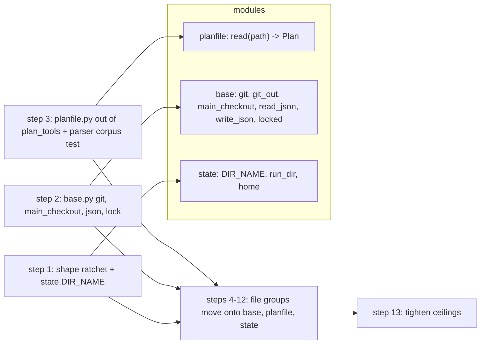
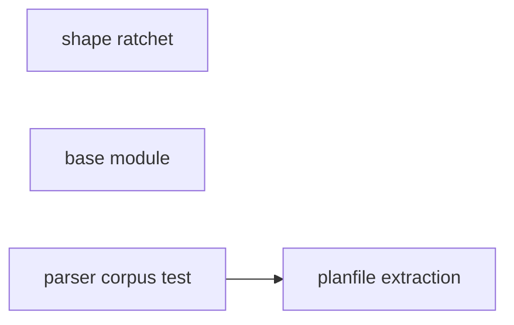

# Superlite: shared base for the scripts, one plan reader and one git helper (#854, design)

**Goal:** design and plan for #854: one plan reader (`planfile.py`), one git, JSON and lock helper (`base.py`) and one module that spells the run folder's name (`state.py`), reached in small steps that each ship alone, green on the full suite, so backlog batches can take them one at a time; a ratchet test first, so the state stops getting worse while the steps run.
**Architecture:** step 1 adds `tests/scripts/shape_ratchet.py` and its test: per-file ceilings for four counts (lines, `.superlite` spellings, plan-parser patterns, git argument lists) in an append-only `tests/scripts/shape_ceilings.txt`. Step 2 adds `base.py` (new file only). Step 3 moves the plan reader out of `plan_tools.py` into `planfile.py`, guarded by a corpus test that runs every plan through every parser. Steps 4-12 each move one group of files onto the new modules; step 13 lowers the ceilings.
**Tech stack:** Python 3.10+ stdlib, pytest (through `sl run_tests`).
**Spec:** this file, section Design; issue #854.
**Detail:** contracts
**Target-min:** 11
**Max chars:** 40000
**Approval:** #854 is `Kind: design`: the owner approves this plan before any step is built.

Global constraints:
- Every new or changed code line in `skills/subagent-driven-development/scripts/*.py` keeps the trailing `# O(...)` complexity comment the existing lines carry.
- No new module imports `fcntl` or `msvcrt` at top level (Windows has no fcntl; B222's ruling on `backlog_state`).
- Names callers use today keep working through the steps: a moved name is re-exported from its old module (`plan_tools.Plan`, `next_tasks.parse_plan`, `backlog_state.main_root`) until its last caller moves.
- Existing tests stay green; an existing test file changes only when the task Owns it. Run `sl` as an executable; verify with `sl run_tests --fast <own test files> --task Tn`. No version edits.

Ruling: the ratchet comes first (step 1) for all four counts, with ceilings in one append-only file where a later line for the same file and count wins (because a shared baseline that batches rewrite would hold every batch that grows any large file behind every other, while appended lines merge through the backlog's `append_only` rule, `backlog_checks.py:436`) - cost if wrong: raises become routine; the owner can then require a plan `Ruling:` for each raise.
Ruling: initial line ceilings are each file's count plus 5%, rounded up to the next 10, so batches running when step 1 ships merge without a raise; the other three counts start at their exact value; step 13 lowers all of them (because B214, B220, B226 and B230 edit large files now) - cost if wrong: about 5% growth slips through until step 13.
Ruling: `planfile.py` is a new module extracted from `plan_tools.py` (lines about 44-550: regexes, `Task`, `Plan`, fences, taskgraph), not a reader kept inside `plan_tools` (because plan_tools is 3,627 lines and imported by 24 scripts and hooks; a small module keeps their import small and moves about 500 lines out of the largest file) - cost if wrong: one more module.
Ruling: the run folder's name stays in the existing `state.py` (`DIR_NAME`), not a new module (because `state.py` already resolves run state and the home folder; upstream's `state.py` name is taken here by a wider module) - cost if wrong: none.
Ruling: steps 4-12 group files by caller, each group moving its git calls, plan parsing and `.superlite` spellings at once (because a file a step touches is held from other batches; touching each hot file once holds it least) - cost if wrong: larger steps; a group can split along the same lines.
Ruling: this doc plans steps 1-3 to task level; steps 4-13 are a step list each later batch plans against the code of its day (because those files change daily under other batches) - cost if wrong: none, each step's batch writes its own plan.
Ruling: `Detail: contracts` - cost if wrong: the build lead raises it to `tests`.
Ruling: MISSED TARGET accepted: S1 -> T3 is forced (the corpus test is the net the move runs under) - cost if wrong: a few minutes of wall time.
Ruling: lint's PYTHONPATH warnings are expected: tests here import scripts through `sys.path.insert`, as every test in tests/scripts does; the build lead adds the `pythonpath` entry to `.superlite/test-cmd.json` only if commit_task's import check fails - cost if wrong: one config line.
LAYERS: unit

## Design

### 1. What #854 asks, restated
Stop each script carrying its own plan parser, git wrapper and `.superlite` spelling; name the target modules and their interfaces, which callers move first, an order of small separately shippable steps that do not block every other batch, whether a ratchet should come first, and what is explicitly not done. Upstream (038aaa35) got structure, not size: code lines fell under 1% and its suite went from about 10 to about 25 minutes. Size is not this design's goal either.

### 2. Today (measured at 4c954b46)
- 84 scripts, 41,823 lines; 14 over 600: plan_tools 3,627, pt_review 3,453, guard_judge 2,472, run_tests 2,317, guard_tools 2,206, testcmd 1,627, backlog_run 1,276, fleet 1,264, backlog 1,171, fleet_io 1,151, commit_task 1,116, finish 759, metrics 717, backlog_ship 674.
- Plan parsers: `next_tasks.parse_plan` (`next_tasks.py:153`, a dict per task, 8 call sites), `pt_review.parse_plan` (`pt_review.py:195`, its own `Plan`, 24 test files), `plan_tools.Plan.load` (`plan_tools.py:362`, used by lint, task, findings, report, history, status), plus header regexes in `start_gate.py:32`, `coverage.py:22-103` and `build_prime.header_lines`. They disagree: heading levels (`###` only; `##`-`####`; `###`-`####`), id suffix (`T1B` only in next_tasks, `T1ab` only in plan_tools), field spelling (`pt_review.LABEL_RE` takes a bullet and a colon outside the bold), Owns splitting (`·` only in pt_review), fence indent (pt_review takes 4+ spaces).
- Git: 13 wrappers in four behaviours: never raise and return `(rc, out, err)` (worktree, backlog_run, plan_tools, render_edit); raise on failure (commit_task, trees, suite_stamp, autocommit); add env and stdin (autocommit's index file, literal pathspecs, editor); scrub `GIT_DIR`/`GIT_WORK_TREE`/`GIT_INDEX_FILE` with a 1 s deadline (guard_judge). Inline git lists besides: backlog_ship 18, backlog_run 11, pt_review 11, orchestrator 7, run_tests 5. Main-checkout lookups: `backlog_state.main_root` (7 callers, imports fcntl at top level), `testcmd._main_checkout_root`, inline `--git-common-dir` in suite_stamp, fleet_mcp, worktree (twice), run_archive.
- `.superlite`: 52 of 84 scripts, 367 occurrences; state.py 37, run_tests 33, backlog_run 24, guard_judge 21, backlog_brief 19, pt_review 16.
- No ratchet, size baseline or allowlist test exists (`test_docs_contract.py:64` caps one skill at 1,500 characters).

### 3. Target modules
**`planfile.py`** (step 3), the only plan reader:
- `TASK_ID`, `HEADING_RE = ^#{3,4}\s+(TASK_ID)\b(.*)$`, `FIELD_RE`, `FENCE_RE` (0-3 spaces), `EG_RE`: plan_tools' current forms, the ones the task template documents.
- `class PlanError(Exception)`, `class FenceBlock`, `class Task` (id, title, line, end, fields, text; `owns`, `written_owns`, `repo`, `field_text(name)` and the other properties plan_tools' Task has), `class Plan` (`load`, `tasks`, `by_id`, the `header_*` readers).
- `scan_fences`, `ref_headings`, `heading_phrase`, `split_top_level`, `expand_braces`, `strip_ticks`, `is_task`, `nkey`, `find_taskgraph_blocks`, `parse_taskgraph`, `hard_edges`.
- `read(path) -> Plan`, the one entry point new code uses.
- Disagreements are settled for plan_tools' forms; a caller moves only when the corpus test (S1) shows its old parser and planfile agree on every plan in `docs/plans/` and the test fixtures, or the difference is listed there with its ruling.

**`base.py`** (step 2), git, the main checkout, JSON and a lock:
- `class GitResult(NamedTuple)`: `rc: int, out: str, err: str`, property `ok`.
- `class GitError(RuntimeError)`: `cmd`, `rc`, `err`; text `git <args>: <last stderr line>`.
- `git(root, *args, timeout=30.0, env=None, input=None, clean_env=False) -> GitResult`: never raises; an OSError gives rc 127, a timeout rc 124; `env` adds variables; `clean_env` drops `GIT_DIR`, `GIT_WORK_TREE`, `GIT_INDEX_FILE` first. Argument lists only, never a shell.
- `git_out(root, *args, **same) -> str`: stdout without its trailing newline; `GitError` when rc is not 0.
- `main_checkout(start) -> Path | None`: parent of `git rev-parse --git-common-dir`; None outside git or in a bare repository.
- `read_json(path, default=None)`: default for a missing or invalid file. `write_json(path, data)`: temp file in the same folder, then `os.replace`. `locked(path)`: a context manager holding an exclusive lock on `path` (fcntl on POSIX, msvcrt on Windows, both imported inside it).
- Behaviour map: the four groups of section 2 are `git`, `git_out`, `git(env=..., input=...)` and `git(clean_env=True, timeout=<deadline>)`; guard_judge keeps its deadline arithmetic.

**`state.py`** (step 1 adds the constant; later steps use it): `DIR_NAME = ".superlite"`, then `run_dir(root) -> Path` and `main_state_dir(start) -> Path | None` (= `base.main_checkout(start) / DIR_NAME`) in step 5. `state.home()` keeps the home folder.

### 4. The ratchet (step 1)
- `tests/scripts/shape_ratchet.py` counts per script in `skills/subagent-driven-development/scripts/*.py`: `lines`; `superlite` = matches of `\.superlite\b`; `parsers` = lines holding `%% taskgraph` or the regex text `[A-Z]{1,3}\d+` (a plan heading or task id pattern); `git` = lines matching `\[\s*["']git["']` (an argument list that starts with git).
- `tests/scripts/shape_ceilings.txt`: lines `<script name> <count> <max>  # <reason>`; blank and `#` lines skipped; a later line for the same script and count wins; a line without a `# ` reason is an error. Defaults without a line: `lines` 600, the other three 0; `state.py` has no `superlite` limit, `planfile.py` no `parsers` limit, `base.py` no `git` limit.
- The test fails on any count over its ceiling, naming script, count, actual, ceiling and the fix: lines: move code into a module of its own, or append a raise with a reason; superlite: use `state.DIR_NAME`; parsers: read plans with `planfile.read` (`plan_tools.Plan` before step 3); git: use `base.git` (a wrapper of the file's own before step 2).
- `python3 tests/scripts/shape_ratchet.py --baseline` prints the step-1 lines (section's Ruling on headroom); `--tighten` prints a lower line for every count below its ceiling, for step 13 or any step that shrank a file.
- The file is append-only: AGENTS.md gains one line saying so; a batch that must raise a ceiling appends one line with `# B<n>: <why>` and names it in its notes; main lists the file as `append_only` for such a batch.
- Answer to #854's question: yes, first, because it costs one fast test (84 files read, under a second) and turns every later regression into a named failure with its fix.

### 5. Step order
Each step is one backlog batch, green on `sl run_tests --full` and the ratchet, appending `--tighten` lines for its own files. Steps 4-12 need only the steps named in their row, so several run at once when their files are free.

| Step | Files | Moves | Needs |
|---|---|---|---|
| 1 | shape_ratchet.py, its test, shape_ceilings.txt, state.py, AGENTS.md | ratchet, `state.DIR_NAME` | - |
| 2 | base.py, its test | new module | - |
| 3 | planfile.py, plan_tools.py, two tests | reader out of plan_tools, re-exported | - |
| 4 | worktree, trees, render_edit, suite_stamp, fleet_mcp, run_archive, finish | git, main checkout | 2 |
| 5 | backlog_state, testcmd, fleet_state, full_queue (lessons_store when #853 shipped) | main_root delegates, locks to `base.locked`, `state.main_state_dir` | 2 |
| 6 | next_tasks, assign, dispatch, start_gate, coverage, build_prime | `parse_plan` becomes a view over `planfile.read`; header regexes | 3 |
| 7 | commit_task, autocommit | git with env and stdin, parse_plan calls | 2, 3 |
| 8 | backlog_run, backlog_ship, backlog_undo, orchestrator | inline git, `.superlite` | 2 |
| 9 | run_tests | git, parse_plan calls, 33 spellings | 2, 3 |
| 10 | pt_review | parser onto planfile (its extra headings and probe entries kept), 11 git calls | 2, 3 |
| 11 | guard_judge | `_git_run`, `_git_rc` onto `git(clean_env=True)`; Opus security review | 2 |
| 12 | the scripts the ratchet still lists with `superlite` above 0, six per batch, most first | spellings | 1 |
| 13 | shape_ceilings.txt | `--tighten`; `parsers` above 0 only in planfile, `git` only in base plus guard_tools' command-parsing literals with a reason | 4-12 |

Callers that move first: the small git users (step 4) and the lookups (step 5), since they touch files few batches hold; `pt_review` (step 10) last of the parsers, since it has the most tests and the most disagreements.

### 6. Not done
- Renaming the `sl` launcher or any skill (upstream's rename left 8, then 2 failures and a leftover task).
- Merging the hooks into one process (upstream's merge opened guard gaps and left the OpenCode plugin without guards).
- A 600-line rule in one step; splitting the large files by job (each split is its own issue and design decision).
- Upstream's `ident.py`, `journal.py`, `kill_tree`, `spawn_background`, `flag`, the `# O(...)` comment removal, `.superlite` spellings in the bash hooks, a Windows CI job.

## Coverage

| Category | State | Basis |
|---|---|---|
| Scope and success criteria | ruled | after step 13: `parsers` above 0 only in planfile.py, `git` only in base.py (plus ruled literals), `superlite` only in state.py; every step green on the full suite; size not a goal |
| Domain and data model | ruled | section 3: `Plan`, `Task`, `GitResult`, `GitError`; ceilings lines `<script> <count> <max>  # <reason>` |
| Persistence and migration | ruled | one append-only text file; no data migration |
| Interfaces and contracts | ruled | re-exports keep `plan_tools.*`, `next_tasks.parse_plan`, `backlog_state.main_root` working until their last caller moves |
| UI states | n/a | no UI |
| Concurrency and state ownership | ruled | ceilings appended, never rewritten; each step holds only its row's files |
| Error handling and recovery | ruled | `git` never raises (rc 127, 124); `git_out` raises `GitError`; ratchet failures name the fix |
| Security and privacy | ruled | argument lists only, no shell; the guard's env scrub kept as `clean_env`; step 11 gets an Opus security review |
| Performance and limits | ruled | ratchet under 1 s; corpus test about 275 plans through 3 parsers, `Tests: fast` while it stays under 5 s; git default timeout 30 s |
| Observability | ruled | ratchet messages; `--tighten` shows progress per step |
| Testing strategy | ruled | named unit tests per module; S1's corpus test as the characterization net; full suite per step |
| Compatibility | ruled | Python 3.10; no top-level fcntl; old names re-exported |
| Rollout | ruled | section 5's order; each step reverts alone |
| Research unknowns | spike | S1: which parser disagreements the real plans hit |

## File structure
- `tests/scripts/shape_ratchet.py`: counts, ceilings reader, `--baseline`, `--tighten` (T1).
- `tests/scripts/test_shape_ratchet_854.py`: the ratchet and its self-tests (T1).
- `tests/scripts/shape_ceilings.txt`: the ceilings (T1, appended later).
- `skills/subagent-driven-development/scripts/state.py`: `DIR_NAME` (T1).
- `AGENTS.md`: the append-only line (T1).
- `skills/subagent-driven-development/scripts/base.py`, `tests/scripts/test_base_854.py` (T2).
- `tests/scripts/test_plan_parsers_agree_854.py`: parser corpus test (S1).
- `skills/subagent-driven-development/scripts/planfile.py`, `plan_tools.py`, `tests/scripts/test_planfile_854.py` (T3).

## Task graph

```mermaid
%% schedule
gantt
  title Predicted schedule (mm:ss)
  dateFormat X
  axisFormat %M:%S
  section lane 1
  T1 shape ratchet :t1, 0, 227s
  section lane 2
  T2 base module :t2, 0, 197s
  section lane 3
  S1 parser corpus test :s1, 0, 192s
  T3 planfile extraction :t3, 192, 225s
```

critical path: S1 → T3 (7.0 min) · peak width 3 · predicted build 7.0 min · predicted total ≈ 15.5 min (target ✗ 11.0)

## Package: shared base
App type: library (git wrapper, JSON, lock) and a test-side checker. Categories: protocol (git exit codes, timeouts, env), state (lock, atomic write), file (missing and invalid JSON, a ceilings file with bad lines), encoding (non-UTF-8 git output).
Specific risks: `clean_env` leaking `GIT_DIR` from the caller's environment; a timeout that leaves a git process behind; a re-export missing a name 24 importers use; the corpus test passing because a parser returned nothing for every plan.
**Probe entry:** none (Ruling: library functions and a test helper; their cases are named tests).

### T1 shape ratchet · Complexity 3 · Est. context 30k
**Owns:** tests/scripts/shape_ratchet.py, tests/scripts/test_shape_ratchet_854.py, tests/scripts/shape_ceilings.txt, skills/subagent-driven-development/scripts/state.py, AGENTS.md
**Components:** 2
**LOC owned:** 160
**Tests:** fast
**Model:** sonnet
**Kind:** design
**Est. time:** 3 min (2 components, about 160 LOC, fast tests)
**Covers:** 4
**Consumes:** none
**Produces:** shape_ratchet.measure(path: Path) -> dict[str, int] · shape_ratchet.read_ceilings(path: Path) -> dict[tuple[str, str], int] · shape_ratchet.violations(scripts: Path, ceilings: dict[tuple[str, str], int]) -> list[str]
e.g. measure(p) for a 3-line file `import re`, `X = ".superlite"`, `r = re.compile(r"[A-Z]{1,3}\d+")` -> {"lines": 3, "superlite": 1, "parsers": 1, "git": 0}
e.g. read_ceilings(p) for `a.py lines 900  # baseline` then `a.py lines 950  # B240: one more reader` -> {("a.py", "lines"): 950}
e.g. violations(dir_with_new_601_line_b_py, {}) -> ["b.py: lines 601 > ceiling 600 (default). Fix: move code into a module of its own, or append `b.py lines <n>  # B<n>: <why>` to tests/scripts/shape_ceilings.txt"]
**Review Focus:** state: `test_repo_within_ceilings` (the real scripts folder and ceilings file); `test_later_line_wins`; file: `test_line_without_reason_is_an_error`, `test_unknown_count_name_is_an_error`; `test_defaults_and_exemptions` (a new 601-line file fails; `.superlite` in state.py passes, in x.py fails; `%% taskgraph` in planfile.py passes); `test_messages_name_the_fix` (one per count); `test_tighten_prints_lower_lines_only`; `test_state_dir_name` (`state.DIR_NAME == ".superlite"`).
**Steps:** 1 failing tests, 2 run: FAIL, 3 implement, 4 run: PASS, 5 write shape_ceilings.txt from `python3 tests/scripts/shape_ratchet.py --baseline`
**Notes:** `--baseline` writes line ceilings at count plus 5% rounded up to the next 10 and the other counts exact, each with `# baseline <date>`, only for counts above their default; AGENTS.md gains under Rules: "`tests/scripts/shape_ceilings.txt` is append-only: add a line with a `# B<n>: <why>` reason, never edit or delete one; the last line for a script and count wins (#854)."

### T2 base module · Complexity 3 · Est. context 32k
**Owns:** skills/subagent-driven-development/scripts/base.py, tests/scripts/test_base_854.py
**Components:** 1
**LOC owned:** 150
**Tests:** fast
**Model:** sonnet
**Kind:** design
**Est. time:** 2.5 min (1 component, about 150 LOC, fast tests)
**Covers:** 3
**Consumes:** none
**Produces:** base.git(root, *args, timeout: float = 30.0, env: dict | None = None, input: str | None = None, clean_env: bool = False) -> GitResult · base.git_out(root, *args, timeout: float = 30.0, env: dict | None = None, input: str | None = None, clean_env: bool = False) -> str · base.main_checkout(start: Path) -> Path | None · base.read_json(path: Path, default=None) · base.write_json(path: Path, data) -> None · base.locked(path: Path) -> ContextManager[None]
e.g. git(repo, "rev-parse", "--is-inside-work-tree") -> GitResult(rc=0, out="true\n", err="")
e.g. git(Path("/no/such/dir"), "status") -> GitResult(rc=127, out="", err="FileNotFoundError: ...")
e.g. git_out(repo, "rev-parse", "--abbrev-ref", "HEAD") -> "main"
e.g. main_checkout(worktree_of_repo) -> repo; main_checkout(Path(tmp_not_git)) -> None
**Review Focus:** protocol: `test_git_never_raises` (missing folder -> 127; `timeout=0.001` on `git log` of a large fake repo or a `sleep` git alias -> 124); `test_git_out_raises_git_error_with_last_line`; `test_clean_env_drops_git_dir` (caller env `GIT_DIR=/nowhere` -> `git(repo, "rev-parse", "--git-dir", clean_env=True).out == ".git\n"`); `test_env_and_input_pass_through` (`git(repo, "hash-object", "--stdin", input="x")` -> the sha of "x"); state: `test_write_json_atomic_no_temp_left`, `test_locked_two_processes_serialise`; file: `test_read_json_missing_and_invalid_give_default`; `test_main_checkout_bare_repo_none`.
**Steps:** 1 failing tests, 2 run: FAIL, 3 implement, 4 run: PASS
**Notes:** decode output as UTF-8 with `errors="replace"`; `GitResult` is a `typing.NamedTuple`; no caller moves in this task.

### S1 parser corpus test · Complexity 3 · Est. context 30k
**Owns:** tests/scripts/test_plan_parsers_agree_854.py
**Components:** 1
**LOC owned:** 120
**Tests:** fast
**Model:** sonnet
**Kind:** design
**Est. time:** 2.5 min (1 component, about 120 LOC, fast tests)
**Covers:** 3
**Consumes:** none
**Produces:** test_plan_parsers_agree_854.KNOWN: dict[tuple[str, str, str], str]
e.g. KNOWN[("docs/plans/2026-10-02-x.md", "next_tasks", "ids")] -> "T1B: next_tasks reads a capital suffix; plan_tools stops at T1 (planfile follows plan_tools)"
**Review Focus:** state: `test_parsers_agree_on_corpus` (for every plan in `docs/plans/*.md` without `build-report` in its name and every `plan*.md` under `tests/scripts/fixtures/`: task ids, titles and owns from `next_tasks.parse_plan`, `pt_review.parse_plan` and `plan_tools.Plan.load`, and edges from `pt_review` against `plan_tools.parse_taskgraph`, agree or the difference is in KNOWN); `test_known_entries_still_occur` (a KNOWN entry that no longer happens fails, so the list only shrinks); `test_corpus_not_empty` (at least 200 plans and at least one task per plan for plan_tools).
**Steps:** 1 write the comparison, 2 run it, 3 record every difference found in KNOWN with its ruling (plan_tools' form wins unless a real plan needs the other), 4 run: PASS
**Notes:** this is the spike for section 3's rulings: if a difference shows that plan_tools' form drops tasks real plans use, the build lead raises a question before T3.

### T3 planfile extraction · Complexity 4 · Est. context 29k
**Owns:** skills/subagent-driven-development/scripts/planfile.py, skills/subagent-driven-development/scripts/plan_tools.py, tests/scripts/test_planfile_854.py
**Components:** 2
**LOC owned:** 150
**Tests:** fast
**Model:** sonnet
**Kind:** design
**Est. time:** 3.5 min (2 components, about 150 LOC, fast tests)
**Covers:** 3
**Consumes:** test_plan_parsers_agree_854.KNOWN: dict[tuple[str, str, str], str] (S1)
**Produces:** planfile.read(path: str | Path) -> Plan · planfile.parse_taskgraph(plan: Plan) -> dict[str, list[str]]
e.g. read("docs/plans/lessons-cache.md").by_id["T5"].owns -> ["skills/subagent-driven-development/scripts/lessons_sync.py", "tests/scripts/test_lessons_sync_853.py"]
e.g. parse_taskgraph(read("docs/plans/shared-base.md")) -> {"T1": [], "T2": [], "S1": [], "T3": ["S1"]} (each task maps to the tasks it waits for)
**Review Focus:** state: `test_plan_tools_reexports_every_moved_name` (each moved name `n`: `plan_tools.n is planfile.n`); `test_planfile_imports_no_plan_tools`; `test_read_matches_plan_load_on_corpus` (planfile added to S1's comparison as a fourth reader with no KNOWN entry of its own).
**Steps:** 1 failing tests, 2 run: FAIL, 3 move, 4 run: PASS, 5 `sl run_tests --full`
**Notes:** about 500 lines move verbatim from `plan_tools.py:44-550` (regexes, `PlanError`, `is_task`, `nkey`, `FenceBlock`, heading helpers, `scan_fences`, `expand_braces`, `split_top_level`, `strip_ticks`, `Task`, `Plan`, taskgraph readers, `hard_edges`); LOC owned counts the new and edited lines. A function those classes call from below line 550 moves too; planfile imports nothing from plan_tools. plan_tools is owned by running batch B230 today: the build batch waits for it to ship.

## Review Focus
The cases are in each task. Cross-task: after T3, `sl plan_tools lint` on this file and on `docs/plans/lessons-cache.md` prints the same output as before the move.

## Self-review
- Coverage: #854's questions map to sections 3 (modules, interfaces), 5 (order, first callers, how batches avoid blocking), 4 (ratchet first) and 6 (not done).
- Placeholders: none; `...` in examples stands for an error text the examples do not fix.
- Types: T3 consumes S1's `KNOWN`; T1 and T2 consume nothing.
- Graph: one edge, S1 -> T3 (T3's test runs S1's comparison); T1, T2 and S1 share no file.
- Limits: 4 tasks, each 2.5-3.5 min predicted; steps 4-13 are planned by the batch that takes each.
