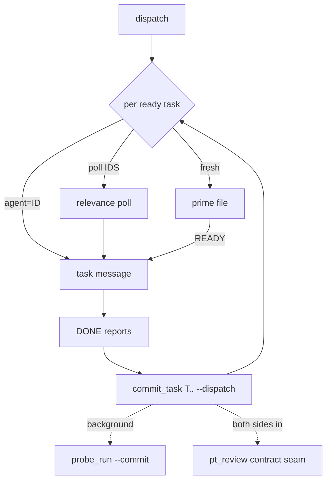
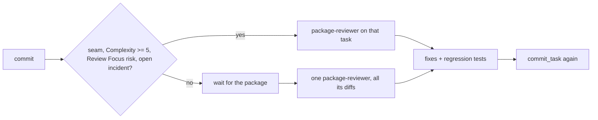
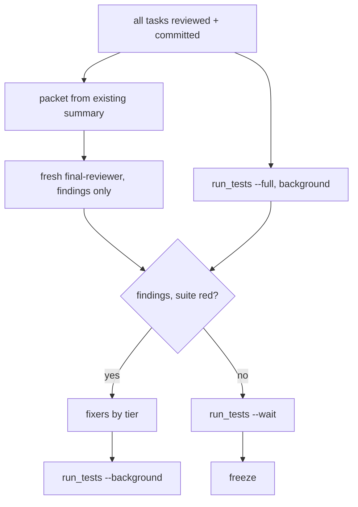

# Subagent-Driven Development

You are the coordinator: you decide, dispatch and rule; scripts do what has a definite answer; agents design, write, review and fix. One narration line per call.

Shorthand: `SUPERLITE` = plugin root, two levels above this skill's "Base directory for this skill: ..." path (`cygpath -u` it first if present). `SL="$SUPERLITE/skills/subagent-driven-development/scripts/sl"`; run it as `"$SL" ...`. `PLAN` = the plan file; pass `--plan $PLAN` everywhere. Exit 3 (no Python): `incident add` it.

**You never edit code or run raw `pytest`; fixes go to fixer agents: tiers, escalation and contract in `fixing.md` (Fixing). Never pass `model`.**

**Rulings, not stalls.** Decide conflicts and plan defects (spec binds); append `Ruling: <decision> - <why> - <cost if wrong>` to `.superlite/progress.md`.

## Setup

- Run root: a worktree (`"$SL" worktree ensure <topic>`; a plan header `**Worktree:** none`: in place, branch `superlite/<topic>` off the default branch). Write the start SHA to `.superlite/progress.md` (`- start <sha>`). `commit_task` excludes `.superlite/` in `.git/info/exclude` itself.
- Wave 0 is not yours: `lint --stable` builds `.superlite/briefs/wave0.md` and prints `START FIRST:` with the Agent line for `superlite:implementer-haiku` (T0; `wave0 --plan $PLAN` reprints). Send it first with the stable set; then `commit_task T0`. `Ruling: skip T0` or `**Wave0:** none` mutes it. Then `"$SL" plan_tools adapter --plan $PLAN`.

Fleet mode (user asks): `"$SL" fleet on` before the first dispatch, then `fleet.md`: every role a worker, never in-process; missing or BLOCKED: report BLOCKED.
- Prime: `"$SL" build_prime --plan $PLAN` prints `hash size`, writes `.superlite/prime.md`: slim for sonnet (rules and interfaces, no plan, no `--spec`). `--prime full --spec SPEC --sections "1,3"` restores the old one. Never paste it.
- Incidents: `.superlite/incidents.jsonl` (`"$SL" incident add`); log BLOCKED and NEEDS_CONTEXT as `--agent coordinator`.
- MCP: agents inherit the session's MCP tools; a project MCP server is approved before dispatch (background agents prompt in the main session).
- Graphify: `"$SL" graphify_gate` prints JSON. `use` false: skip. Installed: `graphify update .`. `needs_install` and `allowed`: `uv tool install graphifyy`, `graphify extract . --code-only`. Only you run it.

## Planning check

Order: plan -> `"$SL" plan_tools prune --plan $PLAN` (drops removable edges) -> `"$SL" plan_tools lint --plan $PLAN --spec SPEC --stable` (lists STABLE and FIX tasks, writes `.superlite/stable.json`; prints `SEND BEFORE ANY PLAN EDIT:`, ends `DISPATCH NOW: T2 T4` or `none`) -> `dispatch` and start every task on that line this turn -> only then patch the FIX tasks -> re-lint -> dispatch the newly stable tasks -> repeat until lint passes. Never patch or re-lint while a `DISPATCH NOW` task is unsent.

Each dispatch round, run the `THEN LOG` line lint prints (appends `unblocked:` to `.superlite/progress.md`). `finish` checks it against `lint-log.jsonl`.

Dispatched tasks are frozen: keep blocks byte-identical, else lint says `FROZEN:` (restore; a real change is a follow-up). `MISSED TARGET:` warns: split or stub those tasks, or `Ruling: accept predicted <N> min - <why sequential> - <cost>`.

## The scheduling loop

Keep `.superlite/pool.json`: `{"agents":[{"id","tasks":[...],"files":[...],"context_k":N,"idle_min":N,"busy":false,"current":"Tn","tier":"haiku|sonnet"}]}` (`tier` = the line's; T0: `haiku`). Sending a task sets `busy: true`, `current: Tn` (or a batch `Tn,Tm`); `commit_task` releases members one by one. Never edit pool.json by hand (zsh: quote loop vars; `status`, `path` reserved): `"$SL" pool` (`add`, `busy`, `free`, `list`, `sync`) and `dispatch` (syncs first: real `context_k`, `idle_min` from transcripts, `busy` cleared by a newer stop record) keep it.

1. `"$SL" dispatch --plan $PLAN --cap 10` prints, per ready task, longest first: `Tn agent=ID tier=T`, `Tn poll ID,ID tier=T` or `Tn fresh tier=T agent=TYPE`; `Tn` may be a batch `Tn,Tm` (same tier, never a critical-path task; `--batch 1` turns it off). No agent is on two lines. Tiers come from `config/routing.json` via lint; never override one; a task goes only to an agent of its tier. Start all.
2. Per line: `agent=ID`: SendMessage the task to that agent. `poll ID,ID`: one SendMessage to each listed agent, "Relevance 0-10 for Tn (files, consumes)? Reply `score: N - reason`"; next turn the highest wins, tie to smallest `context_k`. `fresh tier=T agent=TYPE`: Agent TYPE with the message "Read <abs>/.superlite/prime.md, then reply READY" (haiku: `prime-haiku.md` from `build_prime --tier haiku`), same text per tier all run; never paste the prime; send the task only after its reply `READY`, then register it: `"$SL" pool add ID --tier T --current Tn`. Sending to an idle agent: `"$SL" pool busy ID Tn[,Tm]`; `pool add --current Tn,Tm` for a batch. `evict=ID` (stderr): drop it. `dispatch` never offers a busy agent, or one past 3 tasks, 80k context, 50 idle minutes.
3. Task message (batch: one message, in order): heading, `SUPERLITE=<abs plugin root>`, `PLAN=<abs plan path>`, `ROOT=<abs run root>`, "your task text: `<abs sl> task Tn --plan PLAN`" (not the text), Owns and files not to touch, Review Focus categories for its files, rulings and interface names (a fake returns the producer's `e.g.` examples), the literal absolute `sl` path (agents type it in every command; no `$SL`), verify command (`<abs sl> run_tests --fast PATHS --task Tn --background`, then the printed `wait:` line), and for haiku the full task block instead of `task` (mini prime cuts lines), and "reply in at most 200 words: status DONE / DONE_WITH_CONCERNS / NEEDS_CONTEXT / BLOCKED, files, test result, open questions".
4. Record all DONE tasks in one call (hidden checkpoints; `sl autocommit on` = real): `"$SL" commit_task T3 T5 --plan $PLAN --dispatch` commits each task's files, prints `Tn <sha>` or `Tn FAILED` (one task: the SHA), then `next:`/dispatch lines. A FAILED task (unowned files, syntax/import problems): send it back. DONE_WITH_CONCERNS: fix correctness ones first. NEEDS_CONTEXT: answer. BLOCKED: log it; a fixer a tier up takes it. A haiku miss (NEEDS_CONTEXT, BLOCKED, red): `"$SL" routing miss --task Tn --plan $PLAN`; never retried on Haiku. Act on `next:` lines. A task that must touch another task's file: `commit_task Tn --also F --ruling "..."`; it then owns it for the run (several tasks: the first).
5. After a commit, `commit_task` has started `probe_run --commit` and, for each seam with both sides committed, `pt_review contract --seam` in the background. A pass logs `verified`; a mismatch is an incident (`fixing.md`).
6. Probe failures: `incident hotspots --files <task files>` first; open failures go to fixers (`fixing.md`). `commit_task` accepts generated `tests/regression/` files from any task.

## Reviews (D16)

- Matching tasks get `superlite:package-reviewer` on commit, in the next dispatch message. Others: one review per committed package. In the last package, review each task as it commits.
- Brief: absolute `sl` path, commit or range, spec slice, `PLAN`, files in scope, `incident hotspots` output, adapter path. It reviews, fixes with regression tests, logs; never commits.

## Coordinator batching

- One message per turn: all dispatches, reviews, background starts.
- Every test run is `run_tests ... --background`; wait only once, before the final commit.

## Final review

1. Gate: all tasks and reviews committed, all seams `verified`.
2. Build the packet: `"$SL" plan_tools packet --plan $PLAN --base <start-sha>` (inline build: `--inline --spec <spec.md>`; later rounds add `--previous <rounds.md>`) uses the test summary, probe results and incidents, and writes `.superlite/review-packet.md`. Same message: start `run_tests --full --background`; don't wait.
3. Start `superlite:final-reviewer` then, fresh, brief = the absolute `sl` path and "read .superlite/review-packet.md", nothing more. The tree stays frozen. It answers once: `Verdict: APPROVED` or `CHANGES_REQUESTED` plus `file:line - problem - fix - tier N` lines. No `Checked:` block (off the fast path) is no review: start a fresh one.
4. Red suite lines are findings. Send all to fixers (`fixing.md`: tier by understanding, split by file); then `commit_task Tn` per owning task (`--claim F --ruling TEXT` for files outside Owns) and one more `run_tests --background`. Leftovers become a `Ruling:`.
5. Before the final commit, `"$SL" run_tests --wait` once; green means freeze.

## Measure and budget

Hooks write `metrics.jsonl`; `lint` and `dispatch` print `budget:` lines (`**Budget-usd:**`: cap). At `WARN` finish in-flight work; at `OVER CAP` no extra review rounds, no fix rounds beyond the first, then `commit_task` and finish. `LATE:` names the task to unblock first.

## Freeze, rulings, finish

Green: freeze. Archive `incidents.jsonl` and `progress.md` by the plan. Run `"$SL" fleet stop --all` (no-op off fleet), `"$SL" trees clean`, then `"$SL" finish --plan $PLAN`; print its rulings in your closing message under "Rulings I made" with cost. Print its last block (report summary) before any merge or PR option; full: `<plan>.report.md`. Then invoke `superlite:finishing-a-development-branch`.

## Stop conditions

Ask only for: an irreversible or destructive operation; a security-sensitive action; an outward side effect (merge, push, publish); a plan so broken every path is a guess.

**AI orchestrator** (`sl orchestrator status`; also user away, "decide yourself"): never end your turn to wait. Take the safe path: defer outward or destructive actions, read a broken plan conservatively, record the ruling, list what you deferred. **Human orchestrator**: nothing is built, dispatched or written but the review plan before the human's approving reply; ask in plain text, end the turn, then `"$SL" orchestrator approve --review PATH` and the machine plan; `lint --stable`, `dispatch`, `wave0`, `build_prime` refuse before (`orchestrator.md`).

## Red flags

| Thought or act | Do instead |
|---|---|
| Pasting the prime or a task before READY | Send "Read <abs>/.superlite/prime.md, then reply READY"; wait |
| Work to a busy agent, or "after T3" | `dispatch` |
| Editing code, raw `pytest`, or a foreground suite | Fixer agent; `run_tests --background` |
| Committing by hand | `commit_task T3 T5 --dispatch` |
| Killing by image name | By PID only |
