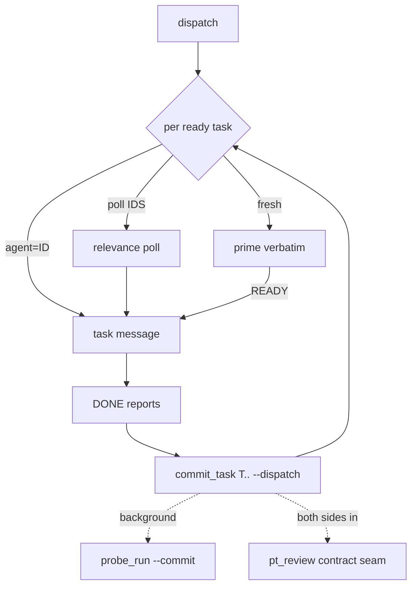
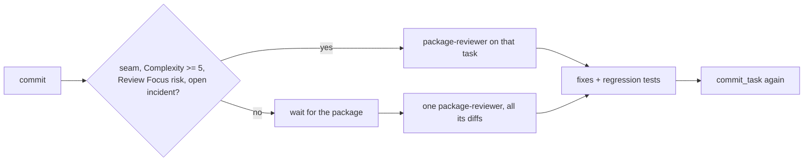
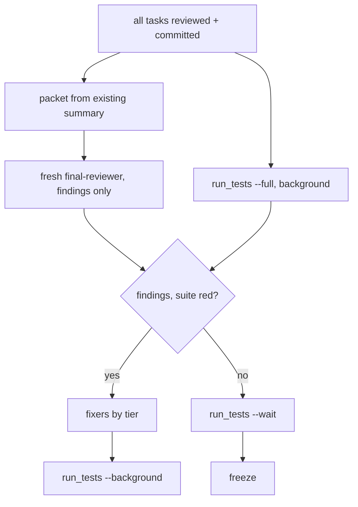

# Subagent-Driven Development

You are the coordinator: you decide, dispatch and rule; scripts do everything with a definite answer; agents design, write, review and fix. Read each script's one-line output. One narration line per call.

Shorthand (briefs state `SUPERLITE=<path>`): `SUPERLITE` = plugin root, two levels above this skill's "Base directory for this skill: ..." path: `SUPERLITE="$(cd "<base dir>/../.." && pwd)"`, pass the base dir through `cygpath -u` first when it exists. `SL="$SUPERLITE/skills/subagent-driven-development/scripts/sl"`; always run it as `bash "$SL" ...`. `PLAN` = the plan file; pass `--plan $PLAN` everywhere. Exit 3 means no Python: `bash "$SL" incident add` it, continue.

**You never edit code or run raw `pytest`; fixes go to fixer agents: tiers, escalation and contract in `fixing.md` (Fixing). Never pass `model`.**

**Rulings, not stalls.** Decide conflicts and plan defects (spec binds); append `Ruling: <decision> - <why> - <cost if wrong>` to `.superlite/progress.md`.

## Setup

- Branch `superlite/<topic>` if on the default branch (no worktree). Write the start SHA to `.superlite/progress.md` (`- start <sha>`). `commit_task` excludes `.superlite/` in `.git/info/exclude` itself.
- Wave 0 is never yours: `lint --stable` builds `.superlite/briefs/wave0.md` from the plan and prints `START FIRST:` with the Agent line for `superlite:implementer-haiku` (T0; `bash "$SL" wave0 --plan $PLAN` reprints it). Send it first with the stable set; commit with `commit_task T0`. `Ruling: skip T0` mutes it. You write no skeleton; tasks do not wait for T0. Then `bash "$SL" plan_tools adapter --plan $PLAN`.
- Prime: `bash "$SL" build_prime --plan $PLAN --spec SPEC --sections "1,3"` prints `hash size`, writes `.superlite/prime.md`. Start the first ready tasks. Never retype the prime.
- Incidents: `.superlite/incidents.jsonl` (agents use `bash "$SL" incident add`); you log BLOCKED and NEEDS_CONTEXT with `--agent coordinator`.
- Graphify: `bash "$SL" graphify_gate` prints JSON. `use` false: skip. Installed: `graphify update .`. `needs_install` and `allowed`: `uv tool install graphifyy`, `graphify extract . --code-only`. Only you run `graphify update .` after each package commits.

## Planning check

Order: write plan -> `bash "$SL" plan_tools prune --plan $PLAN` (drops edges `e.g.` examples make removable, then schedules) -> `bash "$SL" plan_tools lint --plan $PLAN --spec SPEC --stable` (lists STABLE and FIX tasks, writes `.superlite/stable.json`; prints `SEND BEFORE ANY PLAN EDIT:`, ends `DISPATCH NOW: T2 T4` or `none`) -> `dispatch` and start every task on that line in the same turn -> only then patch the FIX tasks (edits or rewrite, any rounds) -> re-lint -> dispatch the newly stable tasks -> repeat until lint passes. Never patch, rewrite or re-lint while a `DISPATCH NOW` task is unsent.

Each dispatch round, with the Agent calls, run the `THEN LOG` line lint prints (appends `unblocked: dispatched T2 T4 at HH:MM:SS; waiting on fixes: T1 T3` to `.superlite/progress.md`). `finish` checks it against `lint-log.jsonl`.

Dispatched tasks are frozen: a rewrite keeps their blocks byte-identical, else lint says `FROZEN:` (restore; a real change is a follow-up fix task). `**Status:** draft` is an optional manual hold. `MISSED TARGET: ... critical path T1 -> T5` warns: split or stub the named tasks, or `Ruling: accept predicted <N> min - <why sequential> - <cost>`. `NOTE:` is advice.

## The scheduling loop

Keep `.superlite/pool.json`: `{"agents":[{"id","tasks":[...],"files":[...],"context_k":N,"idle_min":N,"busy":false,"current":"Tn","tier":"haiku|sonnet"}]}` (`tier` = the line's; T0: `haiku`). Sending a task or spawning its agent sets `busy: true`, `current: Tn`; `commit_task` clears `current` on committing Tn. Ledger and `current` are the state; keep no lists. Never edit pool.json by hand: `bash "$SL" pool` (`add`, `busy`, `free`, `list`, `sync`) and `dispatch` (syncs first: real `context_k` and `idle_min` from transcripts, `busy` cleared by a newer stop record) keep it.

1. `bash "$SL" dispatch --plan $PLAN --cap 10` prints, per ready task, longest first: `Tn agent=ID tier=T`, `Tn poll ID,ID tier=T` or `Tn fresh tier=T agent=TYPE`; no agent is on two lines. Tiers come from `config/routing.json` via lint; never override one; a task goes only to an agent of its tier. Start all.
2. Per line: `agent=ID`: SendMessage the task to that agent. `poll ID,ID`: one SendMessage to each listed agent, "Relevance 0-10 for Tn (files, consumes)? Reply `score: N - reason`"; use the replies at your next turn, highest wins, tie to smallest `context_k`. `fresh tier=T agent=TYPE`: Agent TYPE with its tier's prime file pasted verbatim (`.superlite/prime.md`; haiku: `build_prime --tier haiku` writes `prime-haiku.md`), same bytes all run; send the task only after its reply `READY`, then register it: `bash "$SL" pool add ID --tier T --current Tn`. Sending a task to an idle agent: `bash "$SL" pool busy ID Tn`. `evict=ID` (stderr): drop it. `dispatch` never offers a busy agent, or one past 3 tasks, 80k context or 50 idle minutes; work never queues behind one.
3. Task message: heading (not the task text), Owns and files not to touch, Review Focus categories for its files, rulings and interface names (a fake returns the producer's `e.g.` examples), `SUPERLITE=<path>`, the verify command (`bash "$SL" run_tests --fast PATHS --background`, then the printed `wait:` line, `bash "$SL" run_tests --wait <path>`), and "reply in at most 200 words: status DONE / DONE_WITH_CONCERNS / NEEDS_CONTEXT / BLOCKED, files, test result, open questions".
4. Record all DONE tasks in one call (hidden checkpoints; `sl autocommit on` = real): `bash "$SL" commit_task T3 T5 --plan $PLAN --dispatch` commits each task's files, prints `Tn <sha>` or `Tn FAILED` (one task: just the SHA), then `next:` and dispatch lines. A FAILED task lists unowned files or syntax/import problems: send it back. DONE_WITH_CONCERNS: fix correctness ones first. NEEDS_CONTEXT: answer. BLOCKED: log it; a fixer one tier up takes it (Fixing). A haiku miss (NEEDS_CONTEXT, BLOCKED, red): `bash "$SL" routing miss --task Tn --plan $PLAN`; never retried on Haiku. Act on `next:` lines.
5. After a commit, `commit_task` has started `probe_run --commit` and, for each seam with both sides committed, `pt_review contract --seam` in the background. A pass logs `verified`; a mismatch is an incident. Route the fix per `fixing.md`.
6. Probe failures: `incident hotspots --files <task files>` before next work; open failures go to fixers (`fixing.md`). `commit_task` accepts generated `tests/regression/` files from any task.

## Reviews (D16)

- Matching tasks get `superlite:package-reviewer` on commit, in the same message as the next dispatches. Others: one review per package once committed. In the last package, review each task as it commits.
- Brief: `SUPERLITE=<path>`, commit or range, spec slice, `PLAN`, files in scope, `incident hotspots` output, adapter path. It reviews, fixes with regression tests, logs, never commits; its files are off limits meanwhile.

## Coordinator batching

- One message per turn: all dispatches, reviews, background starts.
- Every test run is `run_tests ... --background`; never wait, except the one `--wait` before the final commit.

## Final review

1. Gate: all tasks committed, all reviews reported and committed, all seams `verified`.
2. Build the packet: `bash "$SL" plan_tools packet --plan $PLAN --base <start-sha>` uses `.superlite/test-summary.json`, the probe results and the incidents, and writes `.superlite/review-packet.md`. Its header says `FAST PATH` or `REVIEW REQUIRED`. In the same message start `bash "$SL" run_tests --full --background`; don't wait.
3. Start `superlite:final-reviewer` then, fresh, brief = `SUPERLITE=<path>` and "read .superlite/review-packet.md", nothing more. The tree stays frozen. It answers in one turn, from the packet only: `Verdict: APPROVED` or `CHANGES_REQUESTED` plus `file:line - problem - fix - tier N` lines.
4. Red suite lines are findings too. Send all to fixers (`fixing.md`: tier by understanding, split by file), then `commit_task Tn` per owning task and one more `run_tests --background`. Leftovers become a `Ruling:`.
5. Before the final commit, `bash "$SL" run_tests --wait` once; green means freeze.

## Measure and budget

Hooks write `.superlite/metrics.jsonl` (`metrics.md`). `lint` and `dispatch` print `budget:` lines on change (`**Budget-usd:**` in the plan header is the cap). At `WARN` finish what is in flight; at `OVER CAP` no extra review rounds and no fix rounds beyond the first, then `commit_task` and finish. `LATE: critical path ...` names the task to unblock first.

## Freeze, rulings, finish

Green suite: freeze. Archive `.superlite/incidents.jsonl` and `progress.md` by the plan. Run `bash "$SL" finish --plan $PLAN`; print its rulings in your closing message under "Rulings I made", each with cost. Its last block is the report summary: print it before any merge or PR option; full: `<plan>.report.md` (on request). Then invoke `superlite:finishing-a-development-branch`.

## Stop conditions

Stop and ask only for: an irreversible or destructive operation; a security-sensitive action; an outward side effect (merge, push, publish); a plan so broken every path is a guess.

**AI orchestrator** (`sl orchestrator status`; also user away, "decide yourself"): never end your turn to wait. Take the safe path: defer outward or destructive actions, read a broken plan conservatively, record the ruling, list what you deferred. **Human orchestrator**: nothing is built, dispatched or written but the review plan before the human's approving reply; ask in plain text, end the turn, then `bash "$SL" orchestrator approve --review PATH` and the machine plan; `lint --stable`, `dispatch`, `wave0`, `build_prime` refuse before (`orchestrator.md`).

## Red flags

| Thought or act | Do instead |
|---|---|
| Typing the prime or a task before READY | `build_prime`, paste verbatim, wait for READY |
| Work to a busy agent, or "after T3" | `dispatch` |
| Editing code, raw `pytest`, or a foreground suite | Fixer agent; `run_tests --background` |
| Committing by hand | `commit_task T3 T5 --dispatch` |
| Killing by image name | By PID only |
