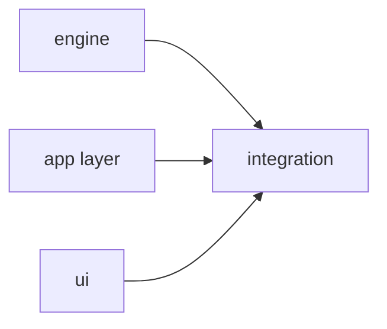

# Writing Plans

A plan is a set of contracts Sonnet implementers can execute without asking questions, and also the input to the 0.3 engine: a machine-readable task graph, interface stubs, per-task time predictions, a predicted schedule and probe plans. Write it so scripts can parse it. Code the implementer would write anyway burns Opus time and invites transcription errors.

Any build with 2+ tasks runs through `superlite:subagent-driven-development`: load it before writing the plan. Never use `general-purpose` agents for build or review work.

Save to `<plans>/YYYY-MM-DD-<topic>.md`; `<plans>` is `docs/superpowers/plans/` when that folder exists, else `docs/plans/`. When called from `superlite:brainstorming`, append to its doc instead. If the spec covers independent subsystems, write one plan per subsystem. The plan is the first file of the change: run `<skill-dir>/../subagent-driven-development/scripts/sl worktree ensure <topic>` first and write it in the folder the command prints, never into the shared main checkout (a plan header `**Worktree:** none` opts out).

## Lint, extract what's stable, fix the rest

`lint --stable` splits the plan into STABLE and FIX tasks (with reasons) and writes `.superlite/stable.json`. A task is stable when its own checks pass, every Consumes has a clean Produces line somewhere (even in an unstable task), it has no taskgraph edge to an unstable task, and it is not on a flagged `CHAIN:`. Plan-level issues (SPEC coverage, `COVERAGE:`, `CHAIN:`, the size cap, `MISSED TARGET`) never block stable tasks. `dispatch` offers only stable tasks. The order is fixed: lint, dispatch the whole stable set (`lint --stable` ends with `DISPATCH NOW: ...`), and only then patch the FIX tasks (edits or a full rewrite, as many rounds as needed), re-lint and dispatch the newly stable ones. No agent waits on plan polishing. Dispatched tasks are frozen: a rewrite keeps their blocks byte-identical, else lint reports `FROZEN:` and the change becomes a follow-up fix task, not a restart. `**Status:** draft` stays as an optional manual hold: `next_tasks` and `dispatch` skip draft tasks and their dependents, and draft tasks may keep placeholders.

## Write for the split

**Who orchestrates sets the mode** (`sl orchestrator status`).
- **Human orchestrator** (the human validates the plan before it runs), two phases:
  Read `review-plan.md` first: it holds the five steps (review plan, show it and end the turn, `orchestrator approve --review`, machine plan, fixes after the yes).
- **AI orchestrator** (plans, lints and dispatches itself; asks only major or uncertain decisions while planning, nothing when unattended): write a queue that starts building while the fixes are made. Lint splits what you write into stable tasks, which build now, and fix tasks, which wait. Follow all seven rules in `split.md`. Record minor and medium choices as `Ruling:` lines; a major or uncertain one that surfaces while writing the plan is asked once, before the first dispatch (brainstorming step 2), unless the run is unattended.

In both modes, write for the split:

Read `split.md` before you order the tasks: the seven rules (one Write, producers first, finished blocks, sizing, fewest edges, easy ones, contract examples).

## Plan shape, in this order

1. **Header** (an Xcode project: put `.superlite/test-cmd.json` `{"language":"swift","test":"xcodebuild test -scheme X {only_testing}"}` in the plan's setup; `{only_testing}` expands per test file): Goal, Architecture, Tech stack, Spec path, `**Detail:** contracts | tests | full` (default `tests`), `**Target-min:** N` (predicted-total target, default 11), `**Ticket:** KEY` (prefixes commit messages `KEY Tn: title`), `**Wave0:** none` (no Wave 0 skeleton; use it when the project already builds), `**Edges:** hard` (every taskgraph edge is hard: prune and `EDGE:` keep them all, `EXAMPLE:` skips their consumers, and a consumer waits for its producer's commit even with Wave 0 stubs; use it when a consumer cannot compile without its producer, such as a Swift package's whole-package compile), `**Coverage:** off` (skips the coverage check), global constraints (exact values copied from the spec: version floors, names, formats). `sl task` appends them, with the Tech stack and Architecture lines, to every task's text, so do not repeat constraints per task.
2. **Coverage:** the `## Coverage` table from brainstorming (`../brainstorming/coverage.md`); spike tasks (`S1`, ...) come first.
3. **Main diagram** (always): Mermaid of components and data flow.
4. **File structure:** every file and its one responsibility. Split by responsibility, not by layer, and follow the repo's patterns.
5. **Task graph** (always, machine-readable): see below.
6. **Predicted schedule:** generated, never hand-written.
7. **Sections, one per component or package:** its tasks, a mini diagram only if the section interacts, and a `**Probe entry:**` line.
8. **Review Focus:** the probe plan.
9. **Running-app checks:** a UI, widget, app extension or browser target (Review Focus rules).
10. **Self-review.**

## Diagram rules

- Main diagram and task graph: always.
- **Mini diagram only where something interacts:** a sequence across components, a state machine or a protocol, at most about 15 nodes. Skip it for self-contained modules (slug, feed, errors). Their Consumes, Produces, Owns and tests already say everything, and a diagram only repeats them and risks contradicting them.
- Every Mermaid block must parse. Quote labels that contain parentheses or punctuation.

### Task graph

One `Tn --> Tm` edge per line under a `%% taskgraph` comment. **Only execution dependencies are edges:** Tm's tests must run Tn's code. A names-only dependency (a route path, a CLI flag) or one a stub satisfies is not an edge, so it never makes a task wait. Declare nodes above the marker.



Here T1, T2 and T3 run in parallel; T2 and T3 build against T1's stubs, not its code. Waves are only a planning view: the scheduler dispatches a task the moment its dependencies are committed, with no wave barrier and no wave width cap.

## Split by interface

Read `split.md` before you order the tasks: interface stubs in Wave 0, when a task waits, the size band.

## Task template

Read `task-template.md` before you write the first task block.

## Review Focus: the probe plan

Read `probe-plan.md` before you write the Review Focus and Running-app checks sections: the app-type table, the probe entry and the running-app checks.

## Plan size: aim for 15k characters

The plan no longer rides in the sonnet prime (implementers read their task with `sl task Tn`: the block, the Produces lines it consumes, the plan sections it names and the Global constraints), but it is written on the critical path. Keep contracts, verbatim tests and the required diagrams. Move spec excerpts out and reference them by section. Over the cap is a lint `NOTE`, not an issue; a project with larger plans sets `**Max chars:** N` in the plan header.

## No placeholders

These are plan failures: "TBD", "TODO", "add error handling", "handle edge cases", "similar to Task N", a test without a name and an asserted value, or a type or function no task defines.

## After writing: schedule, then lint --stable (lint waits for approval with a human orchestrator)

Run both. Replace `PLAN` and `SPEC` with the paths. `<superlite-root>` is two levels above this skill's "Base directory for this skill: ..." path (run it through `cygpath -u` first if that exists).

```
"<superlite-root>/skills/subagent-driven-development/scripts/sl" plan_tools prune --plan PLAN
"<superlite-root>/skills/subagent-driven-development/scripts/sl" plan_tools lint --plan PLAN --spec SPEC --stable
```

`prune` drops the edges that examples make removable (consumer not yet dispatched), except hard edges: mark an edge whose consumer needs the producer built (a compiled package, e.g. Swift) as `T1 -->|hard| T2` or list it in a `%% hard: T1->T2` line inside the taskgraph (or set `**Edges:** hard` in the plan header to make every edge hard); prune and `EDGE:` skip it. Then it runs `schedule --insert`, which writes the Gantt, its summary line (critical path, peak width, predicted total) and a `shape:` line under a `%% schedule` marker. Never hand-edit that block. `CHAIN [chain-xxxx]` is silenced only by `Ruling: sequential [chain-xxxx] - <why>` with the id lint printed; a ruling written before lint never matches.

Read the lint output:
- **`MISSED TARGET`** is a warning, not a failure. Consider re-splitting or stubbing the tasks on the named critical path. If the chain is inherently sequential, accept the plan and record `Ruling: <why>`.
- **`NOTE:`** (under low_min) is advice only.
- **Every other error must be fixed**: placeholders, Consumes/Produces mismatches, diagram parse errors, `SIZE:` (over high_min), `CHAIN:`, `KIND:`, `OPUS-TASK:`, `COVERAGE:`, spec sections with no task. First dispatch every task on the `DISPATCH NOW:` line, then patch the FIX tasks listed under `--stable` (edit or rewrite; keep dispatched blocks unchanged), rerun `schedule --insert` then `lint --stable`, until only `MISSED TARGET` and `NOTE:` remain. Stable tasks need no rework: in delegated mode they dispatch now; with a human approver they wait for the yes (see "Who orchestrates sets the mode").

## Self-review checklist

Run it yourself, not as a subagent. Fix in place, with no re-review.

1. **Coverage:** every spec requirement maps to a task.
2. **Placeholders:** none.
3. **Type consistency:** each Consumes line matches the Produces line of its owner. `clearLayers` in T3 and `clearFullLayers` in T7 is a bug.
4. **Graph:** every edge is an execution dependency, with no cycles, and no two tasks that can run at once share a file.
5. **Measurable fields:** every task has `Components`, `LOC owned`, `Tests`, `Model`.
6. **Review Focus:** each package has an app type, categories and a `Probe entry` (unless it has no runnable entry, see `probe-plan.md`), and each task carries the cases for its files.
7. **Limits:** the plan is near its char cap (15k or `**Max chars:**`), no task is over the size band (`SIZE:`), and schedule and lint have run.

## Handoff

Do not ask about an execution method: it is `superlite:subagent-driven-development` (its inline mode covers small plans). If called from brainstorming, return to it for the single approval; the stable set dispatches as soon as it is approved. Otherwise give the path and wait for the go-ahead, unless the user pre-approved, in which case record any open choice as `Ruling: ...` and proceed.

## Red flags

| Thought | Reality |
|---|---|
| "I'll paste the full code so Sonnet can't go wrong" | `tests` is the default. `full` is for non-obvious algorithms. |
| "T5 can wait for T2, to be safe" | An edge is for code its tests execute. A stub or a name does not need one. |
| "Draw a diagram for every module" | Only for interactions. Self-contained modules get none. |
| "I'll write `Est. time` by gut feel" | Fill in the measurable fields. The predictor and the schedule depend on them. |
| "Lint says MISSED TARGET, so the plan is bad" | It is a warning. Re-split or write a `Ruling:`. |
| "Its README can go in the first wave" | Docs wait for the code they describe. |
| "Last task: integration and simulator check" | Not a task: `## Running-app checks` lines a checker runs before the final review. |
| "The checker will find a way into that state" | `reach:` names the launch argument, fixture, URL or preview, or a task adds one. |
