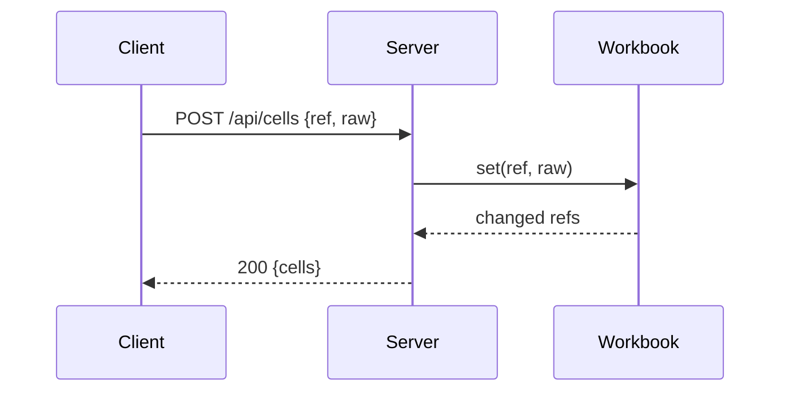

# Task template

Read this before you write the first task block.

## Task template

Size, not depth: a task is the smallest unit with its own test cycle that a reviewer could reject alone. Fold setup, config and docs into the task that needs them. Docs that describe other tasks' output depend on them.

````markdown
### T7 minisheet server · Complexity 5 (O-1) · Est. context 38k

**Owns:** src/minisheet/server.py, tests/minisheet/test_server.py
**Components:** 1
**LOC owned:** 120
**Tests:** slow
**Model:** sonnet
**Est. time:** 2.5 min (1 component, about 120 LOC, slow tests)
**Consumes:** Workbook.set(ref: str, raw: str) -> list[str] (T5) · Workbook.get(ref: str) -> Value (T5)
**Produces:** create_server(wb: Workbook, port: int = 0) -> HTTPServer
**Review Focus:** `test_unknown_method_404`: PUT /api/cells gives 404 {"error": "not found"}; `test_oversize_body_413`: 2 MB body gives 413
**Test code (verbatim):** ```python … ```
**Steps:** 1 failing test, 2 run: FAIL, 3 implement, 4 run: PASS
**Notes:** only non-obvious detail (a tie-break rule, an ordering).
````

Task ids are 1-3 capital letters and a number, optionally a lowercase suffix (`T1`, `S2`, `UI3a`), the same in headings, the taskgraph and `Consumes` refs. The title line shows `Complexity` and `Est. context`; drop the mini diagram if the task does not interact.

| Field | Rule |
|---|---|
| `Owns` | Exact paths, only this task's. Two tasks that can run at once never share a file. Lint warns (`OWNS:`) on an entry that is a symlink and names its target: own the target. |
| `Also-touches` | Optional: files this task edits that a later task owns, such as a compile-only change to the users of an enum it changes (`**Also-touches:** src/b.swift`). commit_task commits them with this task and run_tests --task syncs them. Lint warns (`ALSO-TOUCHES:`) on an entry the task owns already, one no task owns, and one whose owner does not depend on this task. |
| `Components` | Integer count of components the task builds. |
| `LOC owned` | Integer estimate of lines this task writes. |
| `Tests` | `fast`, `slow` or `build`. Browser and out-of-process server suites are slow; pure functions and in-process test servers are fast; `build` is a compile check for targets without tests (app shells). When the project's test command cannot run the task's tests (a shell script under pytest), name the command after the speed word: `**Tests:** fast cmd=bash tests/hooks/test.sh`; `run_tests --task Tn` then runs it instead of the runner (with no test count printed, its exit code is one test), and lint rejects (`TESTS:`) such a task without it. Swift code behind `#if os(...)`, `#if canImport(...)` or `#if targetEnvironment(...)` compiles only in that platform's build: lint prints `WARNING: PLATFORM: Tn has code behind ...` until the task is `Tests: slow` and its text names that build (`-destination`, `-sdk`, `--swift-sdk` or `--triple`). |
| `Kind` | `design` (the default) or `mechanical`. **Mechanical** means the what is fully decided and only the typing is left: LOC owned ≤ 150, Components ≤ 2, `Tests: fast`, no Review Focus case in deep, numeric, state or protocol, and test code or named tests with exact inputs and outputs. Typical: skeleton and config, thin CLI or route wrappers over a given interface, constant tables, small pure functions with a crisp spec (slug, date format), tests from an explicit list, docs from existing code. Never: parsers, evaluators, servers, UI, anything with state or an ambiguous spec. Lint rejects (`KIND:`) a mechanical task that breaks a rule. `predict` counts a task as prose when its `Kind` holds `prose` or every file it owns is a prose file (by default `.md`, `.mdx`, `.markdown`, `.rst`, `.txt`, `.adoc`), never a `mechanical` one; a prose task's forecast time is doubled and its calls tripled by default (`prose` in the coefficients). |
| `Model` | `haiku` for `Kind: mechanical` (lint rejects haiku on any other kind), otherwise always `sonnet`; lint rejects `opus` (Opus writes about half as fast). Split a task that seems to need Opus. If Sonnet can't get part of it right, a `fixer-opus` handles that part. Security-sensitive code still gets an Opus review. |
| `Est. time` | `predict.py` recomputes it from the four fields above, and the fields win on disagreement. Write them honestly. |
| `Est. context` | `18k + 3.3k + 21.6 per LOC owned + 0.45 per char of docs handed over + 36.9 per LOC read`, plus a 10-15% margin. Over 80k means split. |
| `Consumes`/`Produces` | Exact names, parameter types and return types. An implementer reads only its own task, so this is how it learns what neighbors named things. Lint warns (`WARNING: IMPORT:`) when a consumer's file may not import the producer's module: SwiftPM target dependencies, import-linter contracts (forbidden, layers, independence, protected) and workspace package.json dependencies (a package's tsconfig `references` and `paths` aliases count as allowed links); import-linter `acyclic_siblings` contracts report a sibling import cycle; other stacks are not checked. |
| `Covers` | Optional: the spec sections this task builds, `**Covers:** 3.1, 4` (a number or a title covers every heading below it, numbered or not, until the next heading of its level; quote a title holding a comma: `**Covers:** "Auth, sessions and tokens"`). Lint's SPEC coverage counts it; Intent, Decisions, Validation and Out of scope need no task. |
| `Review Focus` | Cases from the Review Focus section that touch this task's files, as named tests (see `probe-plan.md`). |
| `Test code` | At `contracts`, each test named with exact inputs and outputs. At `tests` and `full`, the code, runnable as written. Include the error and edge cases the spec implies. `**Detail:** full` on one task overrides the header, for tricky cores. |
